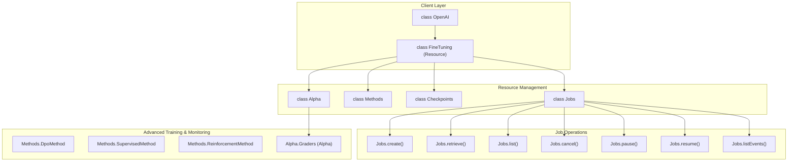
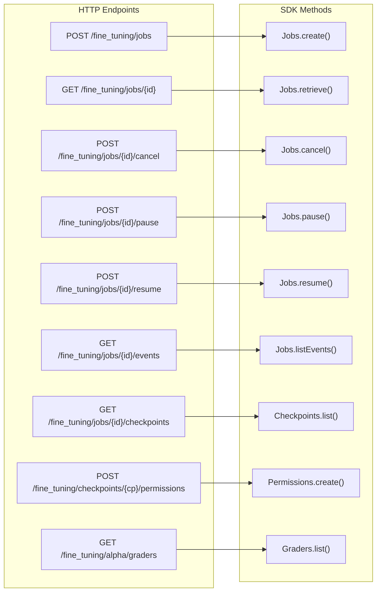

<!-- source: DeepWiki mcp.deepwiki.com · repo openai/openai-node · page 4.9 Fine-tuning · fetched 2026-10-26 -->

# Fine-tuning

Relevant source files

The following files were used as context for generating this wiki page:

- [src/resources/beta/assistants.ts](src/resources/beta/assistants.ts)
- [src/resources/beta/threads/messages.ts](src/resources/beta/threads/messages.ts)
- [src/resources/beta/threads/runs/runs.ts](src/resources/beta/threads/runs/runs.ts)
- [src/resources/beta/threads/runs/steps.ts](src/resources/beta/threads/runs/steps.ts)
- [src/resources/beta/threads/threads.ts](src/resources/beta/threads/threads.ts)
- [src/resources/evals/runs/output-items.ts](src/resources/evals/runs/output-items.ts)
- [src/resources/fine-tuning/alpha/graders.ts](src/resources/fine-tuning/alpha/graders.ts)
- [src/resources/fine-tuning/checkpoints/checkpoints.ts](src/resources/fine-tuning/checkpoints/checkpoints.ts)
- [src/resources/fine-tuning/checkpoints/index.ts](src/resources/fine-tuning/checkpoints/index.ts)
- [src/resources/fine-tuning/checkpoints/permissions.ts](src/resources/fine-tuning/checkpoints/permissions.ts)
- [src/resources/fine-tuning/fine-tuning.ts](src/resources/fine-tuning/fine-tuning.ts)
- [src/resources/fine-tuning/index.ts](src/resources/fine-tuning/index.ts)
- [src/resources/fine-tuning/jobs/index.ts](src/resources/fine-tuning/jobs/index.ts)
- [src/resources/fine-tuning/jobs/jobs.ts](src/resources/fine-tuning/jobs/jobs.ts)
- [tests/api-resources/evals/evals.test.ts](tests/api-resources/evals/evals.test.ts)
- [tests/api-resources/fine-tuning/alpha/graders.test.ts](tests/api-resources/fine-tuning/alpha/graders.test.ts)
- [tests/api-resources/fine-tuning/checkpoints/permissions.test.ts](tests/api-resources/fine-tuning/checkpoints/permissions.test.ts)

Fine-tuning allows you to train models on your own data to customize behavior for specific tasks. This documentation covers the fine-tuning job management system, lifecycle operations, monitoring capabilities, checkpoint management, and supported training methods (Supervised, DPO, and Reinforcement) within the OpenAI Node.js SDK.

## System Architecture

The fine-tuning system is organized around job management, with support for specialized training methods, checkpoint handling, and permission management for organization-wide model sharing.

### Fine-tuning System Overview

Sources: [src/resources/fine-tuning/fine-tuning.ts:33-38](), [src/resources/fine-tuning/jobs/jobs.ts:21-22](), [src/resources/fine-tuning/jobs/jobs.ts:41-161]()

### API Endpoint to Code Entity Mapping

Sources: [src/resources/fine-tuning/jobs/jobs.ts:42-159](), [src/resources/fine-tuning/checkpoints/permissions.ts:35-45](), [src/resources/fine-tuning/alpha/alpha.ts:10-10]()

## Job Management

The `Jobs` class provides comprehensive management of fine-tuning operations. It is accessed via `client.fineTuning.jobs`.

### Core Job Operations

| Method | Purpose | Implementation |
|--------|---------|----------------|
| `create()` | Enqueue a new fine-tuning job | `this._client.post('/fine_tuning/jobs', ...)` |
| `retrieve()` | Get info about a specific job | `this._client.get(path'/fine_tuning/jobs/${id}', ...)` |
| `list()` | List organization's jobs (paginated) | `this._client.getAPIList('/fine_tuning/jobs', ...)` |
| `cancel()` | Immediately stop a running job | `this._client.post(path'/fine_tuning/jobs/${id}/cancel', ...)` |
| `pause()` | Pause an active job | `this._client.post(path'/fine_tuning/jobs/${id}/pause', ...)` |
| `resume()` | Resume a paused job | `this._client.post(path'/fine_tuning/jobs/${id}/resume', ...)` |
| `listEvents()` | Get status updates/logs for a job | `this._client.getAPIList(path'/fine_tuning/jobs/${id}/events', ...)` |

Sources: [src/resources/fine-tuning/jobs/jobs.ts:41-161]()

## Fine-tuning Methods

OpenAI supports different training methodologies depending on the model and optimization goals. These are represented in the `Methods` resource.

### Supervised Fine-tuning (SFT)
The standard approach where the model is trained on prompt-completion pairs. It uses `SupervisedHyperparameters` such as `n_epochs`, `batch_size`, and `learning_rate_multiplier`.
Sources: [src/resources/fine-tuning/fine-tuning.ts:11-12](), [src/resources/fine-tuning/jobs/jobs.ts:204]()

### Direct Preference Optimization (DPO)
A method for aligning models with human preferences without requiring a separate reward model.
Sources: [src/resources/fine-tuning/fine-tuning.ts:6-7]()

### Reinforcement Learning
Support for reinforcement learning methods, utilizing `ReinforcementHyperparameters`.
Sources: [src/resources/fine-tuning/fine-tuning.ts:9-10]()

## Job Lifecycle

Fine-tuning jobs progress through several states. The `status` field in the `FineTuningJob` interface tracks this progression.

### Job Status States

The job `status` can be one of the following:
* `validating_files`: The system is checking the uploaded training/validation files.
* `queued`: The job is waiting for compute resources.
* `running`: The model is currently being trained.
* `succeeded`: Training completed successfully.
* `failed`: Training stopped due to an error.
* `cancelled`: The job was stopped by the user.

Sources: [src/resources/fine-tuning/jobs/jobs.ts:234-237]()

## Checkpoints and Permissions

Checkpoints represent intermediate states of the model during the fine-tuning process. The SDK allows managing these checkpoints and sharing them across projects.

### Checkpoint Permissions

Organization owners can share fine-tuned models with other projects using the `Permissions` resource. Note that these operations require an **Admin API Key**.

| Method | Purpose | Endpoint |
|--------|---------|----------|
| `create()` | Share checkpoint with specific project IDs | `POST /fine_tuning/checkpoints/{id}/permissions` |
| `list()` | View all permissions for a checkpoint | `GET /fine_tuning/checkpoints/{id}/permissions` |
| `delete()` | Revoke a specific permission | `DELETE /fine_tuning/checkpoints/{id}/permissions/{p_id}` |

Sources: [src/resources/fine-tuning/checkpoints/permissions.ts:17-124](), [tests/api-resources/fine-tuning/checkpoints/permissions.test.ts:7-7]()

## Graders (Alpha)

The `Alpha` namespace includes experimental features like `Graders`, which are used to evaluate fine-tuned model performance.

| Method | Purpose | Implementation |
|--------|---------|----------------|
| `list()` | List available graders | `this._client.getAPIList('/fine_tuning/alpha/graders', ...)` |

Sources: [src/resources/fine-tuning/alpha/alpha.ts:10-10](), [src/resources/fine-tuning/alpha/graders.ts:17-17]()

## Data Structures

### FineTuningJob
The primary object returned by job operations.
* `id`: Unique identifier for the job. [src/resources/fine-tuning/jobs/jobs.ts:175]()
* `fine_tuned_model`: The name of the resulting model (null until `succeeded`). [src/resources/fine-tuning/jobs/jobs.ts:192]()
* `hyperparameters`: Configuration used for training. Returned for `supervised` jobs. [src/resources/fine-tuning/jobs/jobs.ts:204]()
* `result_files`: Array of file IDs containing training results. [src/resources/fine-tuning/jobs/jobs.ts:226]()
* `error`: Details on why a job failed, if applicable. [src/resources/fine-tuning/jobs/jobs.ts:186]()

### FineTuningJobEvent
Status updates generated during training.
* `level`: Importance of the event (`info`, `warn`, `error`).
* `message`: Human-readable description of the progress or issue.
* `type`: Categorization of the event (e.g., `metrics` or `message`).

Sources: [src/resources/fine-tuning/jobs/jobs.ts:171-240]()

---

