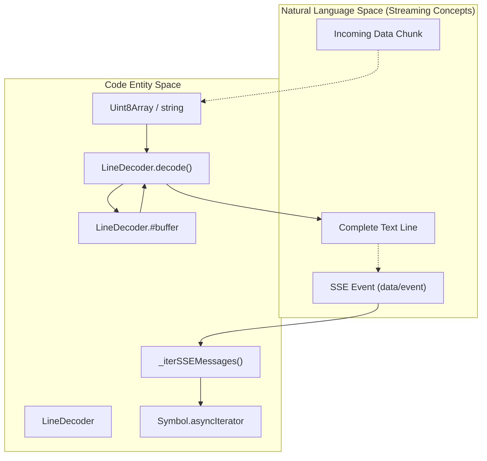
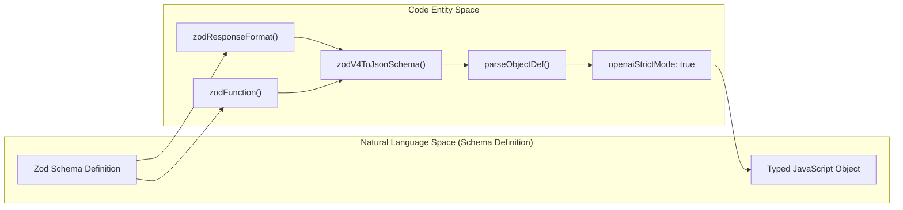

<!-- source: DeepWiki mcp.deepwiki.com · repo openai/openai-node · page 5 Advanced Features · fetched 2026-10-26 -->

# Advanced Features

Relevant source files

The following files were used as context for generating this wiki page:

- [src/_vendor/zod-to-json-schema/parsers/nullable.ts](src/_vendor/zod-to-json-schema/parsers/nullable.ts)
- [src/_vendor/zod-to-json-schema/parsers/object.ts](src/_vendor/zod-to-json-schema/parsers/object.ts)
- [src/_vendor/zod-to-json-schema/parsers/optional.ts](src/_vendor/zod-to-json-schema/parsers/optional.ts)
- [src/error.ts](src/error.ts)
- [src/helpers/zod.ts](src/helpers/zod.ts)
- [src/internal/decoders/line.ts](src/internal/decoders/line.ts)
- [src/internal/stream-utils.ts](src/internal/stream-utils.ts)
- [src/streaming.ts](src/streaming.ts)
- [tests/helpers/zod.test.ts](tests/helpers/zod.test.ts)
- [tests/internal/decoders/line.test.ts](tests/internal/decoders/line.test.ts)
- [tests/streaming.test.ts](tests/streaming.test.ts)

This document provides an overview of the OpenAI Node.js SDK's advanced capabilities that extend beyond basic API calls. These features enable sophisticated integration patterns including real-time streaming, automated function execution, type-safe response parsing, proxy configuration, and workload identity authentication.

For detailed implementation guides on specific advanced features, see [Streaming](#5.1), [Error Handling](#5.2), [Function Calling and Tools](#5.3), [Structured Outputs and Parsing](#5.4), [File Uploads and Utilities](#5.5), [Proxy Configuration](#5.6), [Workload Identity Authentication](#5.7), and [ChatKit (Beta)](#5.8).

## Overview

The OpenAI Node.js SDK provides comprehensive advanced features organized around helper functions, streaming infrastructure, and environment-specific authentication providers:

| Feature Category | Primary Use Cases | Key Classes/Methods |
|------------------|-------------------|-------------------|
| **Streaming & Decoders** | Real-time SSE responses, incremental processing | `LineDecoder`, `_iterSSEMessages`, `ChatCompletionStreamingRunner` |
| **Error & Retry Logic** | Robust API interactions, timeout handling | `OpenAIError`, `APIError`, `RequestOptions.maxRetries` |
| **Tool Integration** | Automated function calling, multi-turn loops | `chat.completions.runTools()`, `zodFunction()` |
| **Structured Outputs** | Type-safe JSON responses, Zod validation | `zodResponseFormat()`, `chat.completions.parse()` |
| **File & Upload Utils** | Multipart form handling, file conversions | `toFile()`, `Uploadable` |
| **Identity & Auth** | Enterprise security, Kubernetes/Cloud auth | `WorkloadIdentityAuthenticator` |

## Streaming and SSE Infrastructure

The SDK includes a low-level streaming infrastructure designed to handle Server-Sent Events (SSE) across different runtimes. At its core is the `LineDecoder`, which handles incremental text buffering and newline normalization for both `\n` and `\r\n` patterns.

### SSE Message Decoding Flow

The `LineDecoder` ensures that multi-byte UTF-8 characters are correctly handled even if they are split across network chunks [src/internal/decoders/line.ts:11-75](). The internal `_iterSSEMessages` utility consumes a `Response` body and yields parsed events [tests/streaming.test.ts:13-15](). For details, see [Streaming](#5.1).

Sources: [src/internal/decoders/line.ts:11-135](), [tests/streaming.test.ts:6-213](), [src/internal/stream-utils.ts:7-32]()

## Structured Outputs and Zod Integration

The SDK provides specialized helpers for defining and parsing structured outputs using Zod. This allows for strict JSON schema generation that the OpenAI API can use to guarantee response formats.

### Zod to JSON Schema Mapping

The `zodResponseFormat` helper automatically converts Zod objects into the `json_schema` format required by the API, enforcing `strict: true` by default [src/helpers/zod.ts:82-99](). It handles complex logic such as ensuring all fields are marked as required for strict mode [src/_vendor/zod-to-json-schema/parsers/object.ts:49-60](). For details, see [Structured Outputs and Parsing](#5.4).

Sources: [src/helpers/zod.ts:82-152](), [src/_vendor/zod-to-json-schema/parsers/object.ts:30-76](), [tests/helpers/zod.test.ts:11-50]()

## Error Handling

Advanced error handling is facilitated by a structured error hierarchy. The SDK exports core error classes from `openai/error` (internally `openai/core/error`) to allow developers to catch specific failure modes like rate limits or authentication failures.

For details on retry logic and timeout configuration, see [Error Handling](#5.2).

Sources: [src/error.ts:1-2]()

## Advanced Configuration

### Proxy and Network
The SDK supports advanced network configurations through `fetchOptions`, allowing users to pass environment-specific options for proxying in Node.js, Bun, or Deno. For details, see [Proxy Configuration](#5.6).

### Workload Identity
For enterprise environments, the SDK includes a Workload Identity system that automates token exchange for Kubernetes, Azure, and GCP. For details, see [Workload Identity Authentication](#5.7).

### ChatKit (Beta)
ChatKit is a high-level beta feature designed for workflow-driven chat sessions, providing specialized thread management and session lifecycle controls. For details, see [ChatKit (Beta)](#5.8).

---

