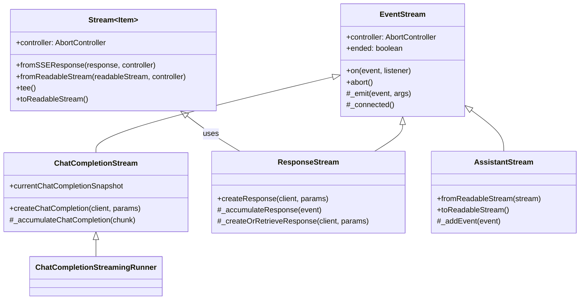
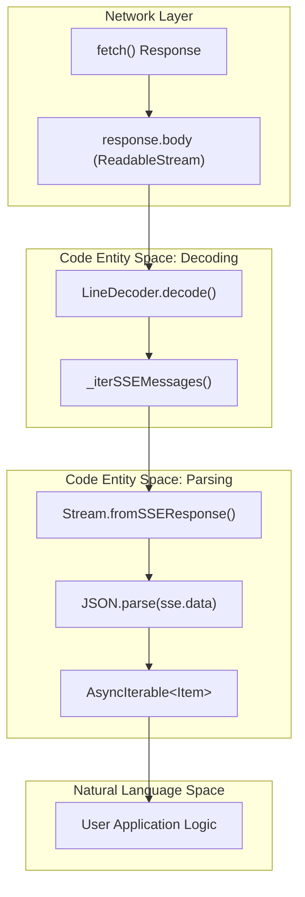
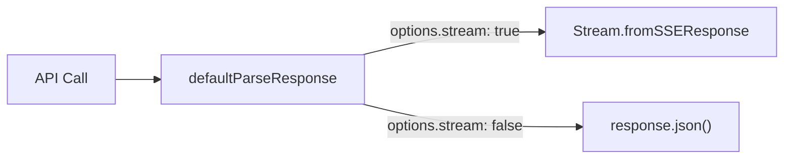

<!-- source: DeepWiki mcp.deepwiki.com · repo openai/openai-node · page 5.1 Streaming · fetched 2026-10-26 -->

# Streaming

<details>
<summary>Relevant source files</summary>

The following files were used as context for generating this wiki page:

- [examples/responses/stream_background.ts](examples/responses/stream_background.ts)
- [examples/tool-call-helpers-zod.ts](examples/tool-call-helpers-zod.ts)
- [examples/tool-call-helpers.ts](examples/tool-call-helpers.ts)
- [src/error.ts](src/error.ts)
- [src/internal/decoders/line.ts](src/internal/decoders/line.ts)
- [src/internal/stream-utils.ts](src/internal/stream-utils.ts)
- [src/lib/AbstractChatCompletionRunner.ts](src/lib/AbstractChatCompletionRunner.ts)
- [src/lib/AssistantStream.ts](src/lib/AssistantStream.ts)
- [src/lib/ChatCompletionRunner.ts](src/lib/ChatCompletionRunner.ts)
- [src/lib/ChatCompletionStream.ts](src/lib/ChatCompletionStream.ts)
- [src/lib/ChatCompletionStreamingRunner.ts](src/lib/ChatCompletionStreamingRunner.ts)
- [src/lib/EventStream.ts](src/lib/EventStream.ts)
- [src/lib/ResponsesParser.ts](src/lib/ResponsesParser.ts)
- [src/lib/RunnableFunction.ts](src/lib/RunnableFunction.ts)
- [src/lib/chatCompletionUtils.ts](src/lib/chatCompletionUtils.ts)
- [src/lib/responses/ResponseStream.ts](src/lib/responses/ResponseStream.ts)
- [src/resources/beta/threads/runs/index.ts](src/resources/beta/threads/runs/index.ts)
- [src/streaming.ts](src/streaming.ts)
- [tests/internal/decoders/line.test.ts](tests/internal/decoders/line.test.ts)
- [tests/lib/ResponseStream.test.ts](tests/lib/ResponseStream.test.ts)
- [tests/lib/__snapshots__/ResponseStream.test.ts.snap](tests/lib/__snapshots__/ResponseStream.test.ts.snap)
- [tests/streaming.test.ts](tests/streaming.test.ts)

</details>


This document covers the comprehensive streaming infrastructure in the OpenAI Node.js client library. The streaming system enables real-time processing of server-sent events (SSE) from various OpenAI APIs, including the newer Responses API, chat completions, and assistant runs.

For information about specific API endpoints that support streaming, see [Responses API](#4.1), [Chat Completions](#4.2), and [Assistants API](#4.10). For error handling in streaming contexts, see [Error Handling](#5.2).

## Core Streaming Architecture

The streaming infrastructure is built on a hierarchical event-driven architecture. The library uses a specialized `Stream` class for simple SSE iteration and more complex `EventStream` subclasses for stateful accumulation and helper methods.

### Streaming Class Hierarchy



Sources: [src/core/streaming.ts:21-32](), [src/lib/responses/ResponseStream.ts:64-76](), [src/lib/EventStream.ts:1-240](), [src/lib/ChatCompletionStream.ts:129-132](), [src/lib/AssistantStream.ts:73-76]()

### SSE Processing Pipeline

The data flow from raw network bytes to structured objects involves several decoding stages.



Sources: [src/internal/decoders/line.ts:11-22](), [src/core/streaming.ts:219-222](), [src/core/streaming.ts:34-43]()

## Line Decoding and SSE Parsing

The library uses a specialized `LineDecoder` to handle incremental SSE parsing across chunk boundaries, ensuring that multi-byte characters (like UTF-8 emojis or non-English scripts) are not corrupted when split between network packets.

### LineDecoder Implementation

The `LineDecoder` class handles various newline formats and maintains an internal buffer for incomplete lines.

| Feature | Implementation Detail |
|---------|-----------------------|
| **Multi-byte safety** | Buffers `Uint8Array` and only decodes to UTF-8 once full lines are found [src/internal/decoders/line.ts:34-59](). |
| **Newline formats** | Supports `\n`, `\r`, and `\r\n` [src/internal/decoders/line.ts:13-14](). |
| **Incremental parsing** | `decode(chunk)` returns an array of complete strings found in the current buffer [src/internal/decoders/line.ts:24-67](). |
| **Flushing** | `flush()` forces the remaining buffer to be treated as a line [src/internal/decoders/line.ts:69-74](). |

### SSE Message Iteration

The `_iterSSEMessages` function is the primary engine for parsing the SSE protocol. It looks for `event:` and `data:` prefixes and yields `ServerSentEvent` objects.

```typescript
export async function* _iterSSEMessages(
  response: Response,
  controller: AbortController,
): AsyncGenerator<ServerSentEvent, void, unknown> {
  // ... line decoding logic ...
  // Yields { event, data, raw }
}
```

Sources: [src/core/streaming.ts:219-222](), [tests/streaming.test.ts:5-23]()

## The Stream Class

The `Stream<Item>` class is a wrapper around an async iterator that provides utility methods for managing SSE responses.

### Key Methods

- **`fromSSEResponse`**: The standard entry point for API responses. It handles the `[DONE]` message and automatically parses JSON data [src/core/streaming.ts:34-62]().
- **`tee()`**: Splits the stream into two independent streams. This is useful if you need to process the same stream in two different places (e.g., logging and UI) [src/core/streaming.ts:163-185]().
- **`toReadableStream()`**: Converts the async iterator back into a standard web `ReadableStream`, stringifying objects back into a newline-separated format [src/core/streaming.ts:192-216]().
- **`controller.abort()`**: Every stream has an associated `AbortController` to cancel the underlying network request [src/core/streaming.ts:22-30]().

### Automatic JSON Parsing

The `Stream` class automatically attempts to parse `sse.data` as JSON. If the data contains an `error` field, it throws an `APIError` [src/core/streaming.ts:69-71]().

Sources: [src/core/streaming.ts:21-102](), [src/internal/parse.ts:39-44]()

## Specialized Streaming Runners

The SDK provides several specialized runners that extend `EventStream` to provide higher-level abstractions like snapshots and automatic tool execution.

### ChatCompletionStream

Used by the Chat Completions API, this runner accumulates chunks into a `ChatCompletionSnapshot`.

- **Events**: Emits `content`, `chunk`, `content.delta`, and `refusal.delta` [src/lib/ChatCompletionStream.ts:96-114]().
- **Snapshots**: Accessible via `currentChatCompletionSnapshot` [src/lib/ChatCompletionStream.ts:143-145]().
- **Tool Helpers**: `ChatCompletionStreamingRunner.runTools` allows for automatic execution of tools while streaming [src/lib/ChatCompletionStreamingRunner.ts:34-50]().

### ResponseStream

The `ResponseStream` (used by `openai.responses.stream`) provides a higher-level interface for the newer Responses API. It accumulates state over time and supports "backgrounding" and resuming streams using `response_id` and `starting_after`.

| Event | Purpose |
|-------|---------|
| `response.created` | Emitted when the response object is first initialized [src/lib/responses/ResponseStream.ts:206-208](). |
| `response.output_text.delta` | Emitted for text chunks, including a snapshot of the full text so far [src/lib/responses/ResponseStream.ts:110-129](). |
| `response.function_call_arguments.delta` | Emitted for tool argument chunks [src/lib/responses/ResponseStream.ts:131-143](). |

Sources: [src/lib/responses/ResponseStream.ts:17-46](), [src/lib/responses/ResponseStream.ts:179-191](), [src/lib/ChatCompletionStream.ts:199-230]()

### AssistantStream

Handles the complex event lifecycle of the Assistants API, including runs, steps, and message deltas.

- **Event Mapping**: Maps raw `AssistantStreamEvent` to high-level events like `textDelta`, `toolCallDone`, and `messageDone` [src/lib/AssistantStream.ts:35-59]().
- **Iterator**: Implements `[Symbol.asyncIterator]` to allow `for await` loops over `AssistantStreamEvent` [src/lib/AssistantStream.ts:96-156]().

Sources: [src/lib/AssistantStream.ts:73-156]()

## Integration with Request Lifecycle

Streaming is triggered in the SDK when the `stream: true` option is passed in `RequestOptions`.



The `defaultParseResponse` function checks for the `stream` flag and returns a `Stream` instance instead of a static object if enabled [src/internal/parse.ts:24-45]().

Sources: [src/internal/parse.ts:18-45](), [src/internal/request-options.ts:48-83]()

---

