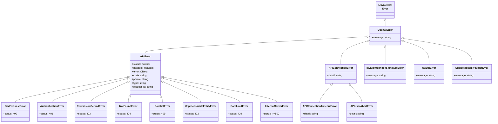
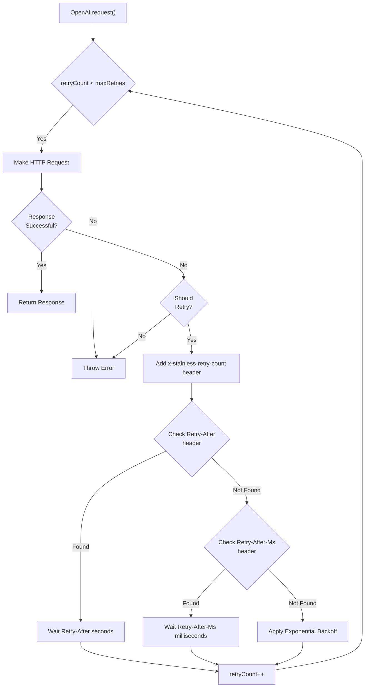

<!-- source: DeepWiki mcp.deepwiki.com · repo openai/openai-node · page 5.2 Error Handling · fetched 2026-10-26 -->

# Error Handling

<details>
<summary>Relevant source files</summary>

The following files were used as context for generating this wiki page:

- [src/azure.ts](src/azure.ts)
- [src/client.ts](src/client.ts)
- [src/error.ts](src/error.ts)
- [src/internal/decoders/line.ts](src/internal/decoders/line.ts)
- [src/internal/stream-utils.ts](src/internal/stream-utils.ts)
- [src/streaming.ts](src/streaming.ts)
- [tests/index.test.ts](tests/index.test.ts)
- [tests/internal/decoders/line.test.ts](tests/internal/decoders/line.test.ts)
- [tests/lib/azure.test.ts](tests/lib/azure.test.ts)
- [tests/log.test.ts](tests/log.test.ts)
- [tests/responses.test.ts](tests/responses.test.ts)
- [tests/streaming.test.ts](tests/streaming.test.ts)
- [tests/utils/typing.ts](tests/utils/typing.ts)

</details>


This page documents the error handling system in the OpenAI Node.js SDK. It covers the error class hierarchy, error types, how to handle errors in your applications, retry mechanism, and best practices for debugging. For information about streaming-related errors, see [Streaming](#5.1).

## Error Class Hierarchy

The OpenAI SDK implements a comprehensive error handling system with a hierarchy of specialized error classes. All errors extend from the base `OpenAIError` class.

### Core Error Classes



Sources: [src/client.ts:16-20](), [src/error.ts:1-2]()

## API Error Types

The SDK maps HTTP status codes to specific error classes, making it easier to handle different types of errors programmatically.

| Status Code | Error Class | Description |
|-------------|-------------|-------------|
| 400 | `BadRequestError` | The request was malformed or invalid |
| 401 | `AuthenticationError` | Authentication credentials were missing or incorrect |
| 403 | `PermissionDeniedError` | The authenticated user doesn't have permission |
| 404 | `NotFoundError` | The requested resource was not found |
| 409 | `ConflictError` | The request conflicts with the current state |
| 422 | `UnprocessableEntityError` | The request was well-formed but couldn't be processed |
| 429 | `RateLimitError` | Too many requests have been made in a given time period |
| ≥500 | `InternalServerError` | An error occurred on the OpenAI server |
| N/A | `APIConnectionError` | Failed to connect to the API (network issues) |
| N/A | `InvalidWebhookSignatureError` | Webhook signature verification failed |
| N/A | `OAuthError` | OAuth-related error during authentication |
| N/A | `SubjectTokenProviderError` | Error from the subject token provider during workload identity authentication |

Sources: [src/client.ts:16-20](), [src/error.ts:1-2]()

## Error Properties

All API errors include the following properties that can be useful for debugging:

```javascript
{
  status: 400,                  // HTTP status code
  headers: { ... },             // Response headers
  error: { ... },               // Full error object from the API
  code: "invalid_request_error", // Error code
  param: "model",               // Parameter that caused the error (if applicable)
  type: "invalid_request_error", // Error type
  request_id: "req_abc123",     // Request ID for tracking and debugging
  message: "400 Invalid model..." // Error message
}
```

Sources: [src/client.ts:16]()

## Connection Errors

In addition to API errors, the SDK defines error types for network and connection issues:

1. `APIConnectionError`: Base class for connection-related errors.
2. `APIConnectionTimeoutError`: Request timed out.
3. `APIUserAbortError`: Request was aborted by the user (e.g., via `AbortController`).

These errors are thrown when the SDK is unable to connect to the API, rather than receiving an error response from the API itself. The `isAbortError` utility is used internally to detect these states.

Sources: [src/client.ts:9](), [tests/index.test.ts:7](), [tests/lib/azure.test.ts:2](), [tests/lib/azure.test.ts:157]()

## Handling Errors

### Basic Error Handling

You can catch and handle errors using standard try/catch blocks:

```javascript
try {
  const completion = await client.chat.completions.create({
    model: 'gpt-4o',
    messages: [{ role: 'user', content: 'Hello!' }],
  });
} catch (error) {
  console.error('API call failed:', error);
}
```

### Type-Specific Error Handling

For more granular error handling, check the type of error:

```javascript
import { APIUserAbortError } from 'openai';

async function main() {
  try {
    await client.chat.completions.create({ model: 'gpt-4o', messages: [] });
  } catch (err) {
    if (err instanceof OpenAI.APIError) {
      console.log(err.request_id);
      console.log(err.status);  // e.g. 400
      console.log(err.name);    // e.g. BadRequestError
    } else if (err instanceof APIUserAbortError) {
      console.log('Request was aborted by user');
    } else {
      throw err;
    }
  }
}
```

Sources: [src/client.ts:16](), [tests/index.test.ts:7]()

## Automatic Retries

### Which Errors Are Retried

The SDK automatically retries certain types of errors with exponential backoff. By default, it will retry failed requests up to 2 times.

### Retry Flow and Logic



The following errors trigger automatic retries:
1. Connection errors (network issues, timeouts).
2. HTTP status 408 (Request Timeout).
3. HTTP status 409 (Conflict).
4. HTTP status 429 (Rate Limit).
5. HTTP status ≥500 (Server errors).

The SDK respects the `Retry-After` and `Retry-After-Ms` headers if they are present in the error response. During retries, the `x-stainless-retry-count` header is incremented.

Sources: [tests/lib/azure.test.ts:65-75](), [src/client.ts:127]()

### Configuring Retries

You can customize the retry behavior using the `maxRetries` option:

```javascript
const client = new OpenAI({
  maxRetries: 5, // default is 2
});

// Per-request override:
await client.chat.completions.create({ ... }, {
  maxRetries: 0, // Disable retries
});
```

Sources: [src/client.ts:233](), [tests/lib/azure.test.ts:214-221]()

## Timeout Handling

Requests time out after 10 minutes by default. This can be configured globally or per request.

```javascript
const client = new OpenAI({
  timeout: 20 * 1000, // 20 seconds
});

// Manual abort:
const controller = new AbortController();
setTimeout(() => controller.abort(), 200);

try {
  await client.get('/foo', { signal: controller.signal });
} catch (error) {
  if (error instanceof APIUserAbortError) {
    console.log('Request was manually aborted');
  }
}
```

Sources: [src/azure.ts:54](), [tests/lib/azure.test.ts:157]()

## Request IDs for Debugging

All object responses in the SDK provide a `_request_id` property, extracted from the `x-request-id` header.

```javascript
const response = await client.chat.completions.create({ ... });
console.log(response._request_id); // e.g. req_id_xxx

// Using withResponse() to get metadata explicitly
const { data, response: raw, request_id } = await client.chat.completions
  .create({ ... })
  .withResponse();
```

The SDK uses `APIPromise` to wrap the underlying fetch request, allowing it to attach metadata like `request_id` to the final parsed JSON object.

Sources: [tests/responses.test.ts:30-40](), [tests/responses.test.ts:50-54](), [src/client.ts:33]()

## Debug Logging

The SDK supports various log levels: `off`, `error`, `warn`, `info`, and `debug`. The default is `warn`.

```javascript
const client = new OpenAI({
  logLevel: 'debug',
  logger: {
    debug: (msg, props) => console.debug(msg, props),
    // ... other methods
  }
});
```

When `debug` logging is enabled, the SDK logs request details, including a `log_` prefixed ID. Sensitive headers like `Authorization` are automatically redacted with `***`.

Sources: [src/client.ts:8](), [tests/index.test.ts:110-134](), [tests/log.test.ts:30-43]()

## Best Practices

1. **Catch specific errors**: Differentiate between `RateLimitError` (where you might want to wait) and `AuthenticationError` (where you need to fix your config).
2. **Use Request IDs**: Always log the `_request_id` or `error.request_id` when an operation fails to aid in support requests.
3. **Monitor Retries**: Be aware that the `x-stainless-retry-count` header is sent to the server, allowing OpenAI to track client-side retry attempts.
4. **Redact Logs**: If implementing a custom `Logger`, ensure you do not log sensitive data; the SDK's internal logging already redacts the `Authorization` header.

Sources: [tests/log.test.ts:35-42](), [tests/lib/azure.test.ts:74]()

---

