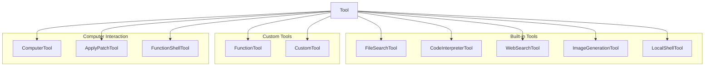
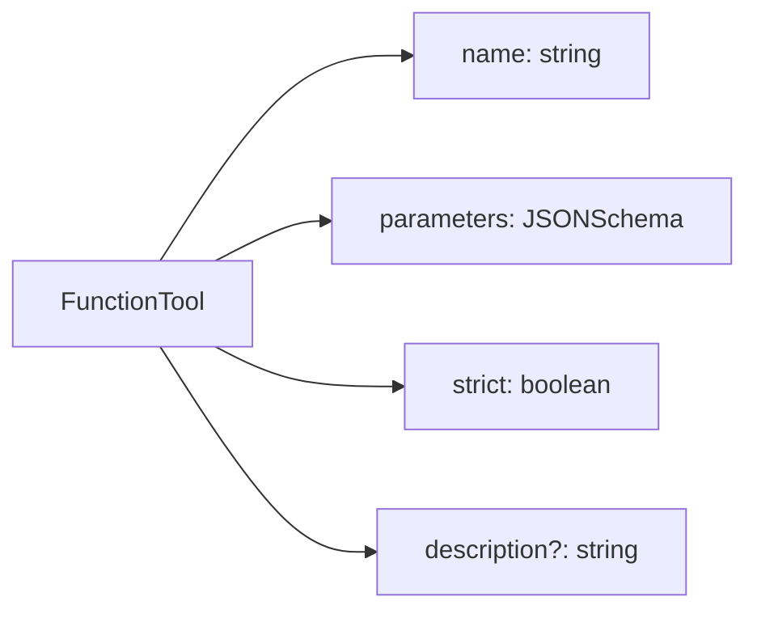
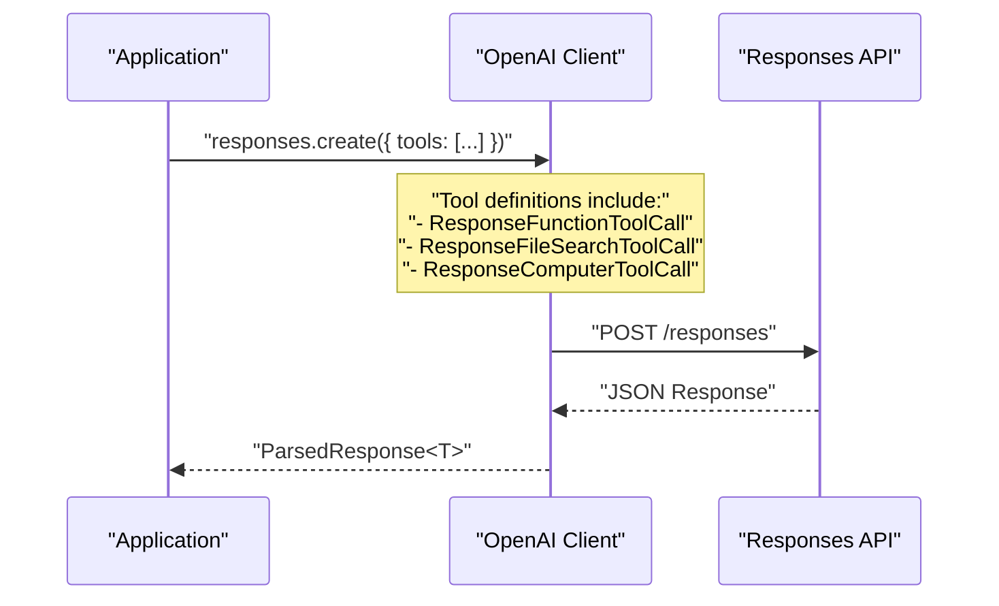
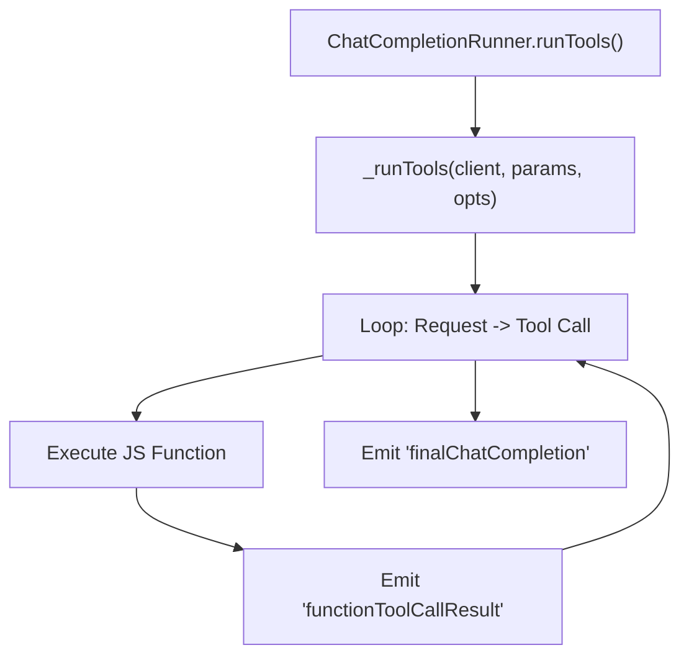

<!-- source: DeepWiki mcp.deepwiki.com · repo openai/openai-node · page 5.3 Function Calling and Tools · fetched 2026-10-26 -->

# Function Calling and Tools

Relevant source files

The following files were used as context for generating this wiki page:

- [.stats.yml](.stats.yml)
- [examples/tool-call-helpers-zod.ts](examples/tool-call-helpers-zod.ts)
- [examples/tool-call-helpers.ts](examples/tool-call-helpers.ts)
- [src/lib/AbstractChatCompletionRunner.ts](src/lib/AbstractChatCompletionRunner.ts)
- [src/lib/AssistantStream.ts](src/lib/AssistantStream.ts)
- [src/lib/ChatCompletionRunner.ts](src/lib/ChatCompletionRunner.ts)
- [src/lib/ChatCompletionStream.ts](src/lib/ChatCompletionStream.ts)
- [src/lib/ChatCompletionStreamingRunner.ts](src/lib/ChatCompletionStreamingRunner.ts)
- [src/lib/EventStream.ts](src/lib/EventStream.ts)
- [src/lib/RunnableFunction.ts](src/lib/RunnableFunction.ts)
- [src/lib/chatCompletionUtils.ts](src/lib/chatCompletionUtils.ts)
- [src/lib/parser.ts](src/lib/parser.ts)
- [src/resources/beta/threads/runs/index.ts](src/resources/beta/threads/runs/index.ts)
- [src/resources/chat/completions/completions.ts](src/resources/chat/completions/completions.ts)
- [src/resources/responses/responses.ts](src/resources/responses/responses.ts)
- [src/resources/shared.ts](src/resources/shared.ts)
- [tests/api-resources/chat/completions/completions.test.ts](tests/api-resources/chat/completions/completions.test.ts)
- [tests/api-resources/responses/responses.test.ts](tests/api-resources/responses/responses.test.ts)
- [tests/lib/ChatCompletionRunFunctions.test.ts](tests/lib/ChatCompletionRunFunctions.test.ts)
- [tests/lib/ChatCompletionStream.test.ts](tests/lib/ChatCompletionStream.test.ts)
- [tests/lib/__snapshots__/ChatCompletionStream.test.ts.snap](tests/lib/__snapshots__/ChatCompletionStream.test.ts.snap)

This document describes how to define and use tools with the OpenAI TypeScript/JavaScript SDK. Tools enable models to call external functions, search files, execute code, and interact with computer interfaces. The SDK provides utilities for automated tool execution, parsing tool call arguments, and managing multi-turn conversations.

For information about structured outputs and response parsing, see [Structured Outputs and Parsing](#5.4). For streaming tool call events, see [Streaming](#5.1).

---

## Purpose and Scope

Function calling and tools allow models to:
- Call functions in your application code with strongly-typed arguments.
- Search uploaded files using vector stores.
- Execute Python code in sandboxed environments.
- Define custom tool input formats with grammars.

This document covers tool definitions, tool choice options, execution patterns, and API-specific tool capabilities across the Responses API, Chat Completions API, and Assistants API.

---

## Tool Types

The SDK supports multiple tool categories across different APIs. Tools are organized into built-in tools provided by OpenAI, custom functions defined by you, and specialized tools for computer interaction.

### Tool Type Hierarchy

**Sources:** [src/resources/responses/responses.ts:38-64]()

### FunctionTool

The `FunctionTool` defines a function that the model can call with JSON arguments. Functions require a name, optional description, and JSON Schema for parameters.

**Key properties:**
- `name`: Function identifier (a-z, A-Z, 0-9, underscores, dashes, max 64 chars).
- `parameters`: JSON Schema object describing function arguments.
- `strict`: Whether to enable strict schema adherence (Structured Outputs).
- `description`: Used by model to determine when/how to call the function.

**Sources:** [src/resources/shared.ts:196-228](), [src/resources/chat/completions/completions.test.ts:70-80]()

### CustomTool

The `CustomTool` allows defining tools with custom input formats, including text grammars. This enables specialized input validation beyond JSON.

**Supported formats:**
- `text`: Unconstrained free-form text.
- `grammar`: Custom grammar definitions (Lark or regex syntax).

**Sources:** [src/resources/shared.ts:152-184]()

---

## Defining Tools

Tools are defined differently depending on the API being used. The Responses API and Chat Completions API both accept tools in the request, while the Assistants API attaches tools to assistant objects.

### Responses API Tool Definition

The `Responses` resource [src/resources/responses/responses.ts:74]() handles tool calls via the `create` and `parse` methods.

**Sources:** [src/resources/responses/responses.ts:38-64](), [src/resources/responses/responses.ts:189-196]()

### Chat Completions API Tool Definition

The Chat Completions API uses the `tools` array in `ChatCompletionCreateParams`.

**Tool structure:**
- `type`: Must be `'function'`.
- `function`: A `FunctionDefinition` containing `name`, `description`, `parameters`, and `strict`.

**Sources:** [src/resources/chat/completions/completions.test.ts:70-80](), [src/resources/shared.ts:196-228]()

---

## Tool Choice Control

Tool choice parameters control which tools the model can call and when.

**Options:**
- `'auto'`: Model decides.
- `'none'`: No tool calls allowed.
- `'required'`: Model must call at least one tool.
- Specific tool: Force the model to call a specific function.

**Sources:** [src/resources/chat/completions/completions.test.ts:69-70]()

---

## Automated Tool Execution

The SDK provides helper methods to automatically execute tool calls without manual intervention, looping until the model produces a final response.

### Chat Completions: runTools()

The `ChatCompletionRunner` and `ChatCompletionStreamingRunner` provide `runTools()` to handle the execution loop.

**Sources:** [src/lib/ChatCompletionRunner.ts:30-42](), [src/lib/ChatCompletionStreamingRunner.ts:34-49](), [src/lib/AbstractChatCompletionRunner.ts:61-70]()

### Assistants API Streaming

The `AssistantStream` helper manages tool call events during assistant runs, emitting specific events for tool lifecycle management.

**Key Events:**
- `toolCallCreated`: When a tool call is first detected in the stream.
- `toolCallDelta`: As arguments for a tool call are streamed.
- `toolCallDone`: When the tool call definition is complete.

**Sources:** [src/lib/AssistantStream.ts:47-49](), [src/lib/AssistantStream.ts:189-203]()

---

## Parsing Tool Arguments

The SDK provides utilities to parse tool call arguments with type safety.

### Automatic Parsing with runTools

When using `runTools`, arguments are automatically parsed before being passed to the tool implementation. The `ChatCompletionStream` also tracks `parsed_arguments` for function tool calls.

**Sources:** [src/lib/ChatCompletionStream.ts:56-76](), [src/resources/responses/responses.ts:34-36]()

### Chat Completions Parsing

The `parseChatCompletion` utility [src/lib/parser.ts:21]() is used internally by the `parse` method to extract and validate content based on the provided tools.

**Sources:** [src/resources/chat/completions/completions.ts:164-179]()

---

## Tool Output Formats

Different tools produce different output items in the `Responses` API.

| Output Item Type | Description |
| :--- | :--- |
| `ParsedResponseFunctionToolCall` | A function call with `parsed_arguments`. |
| `ResponseFileSearchToolCall` | Results from a file search tool. |
| `ResponseComputerToolCall` | Interaction with a computer interface. |
| `ResponseCodeInterpreterToolCall` | Python code execution. |

**Sources:** [src/resources/responses/responses.ts:34-64]()

---

## Summary

The SDK provides robust infrastructure for function calling and tool execution:

- **Manual Handling**: Standard API calls returning tool call objects for manual execution [src/resources/chat/completions/completions.ts:61-80]().
- **Automated Execution**: `runTools` helpers in Chat Completions for zero-boilerplate agentic loops [src/lib/ChatCompletionRunner.ts:30-42]().
- **Streaming Support**: Specialized runners like `ChatCompletionStream` and `AssistantStream` for real-time tool call feedback [src/lib/ChatCompletionStream.ts:129-132](), [src/lib/AssistantStream.ts:73-76]().
- **Type Safety**: Integration with parsers for validated tool arguments [src/lib/parser.ts:21]().

**Sources:** [src/lib/AbstractChatCompletionRunner.ts](), [src/lib/ChatCompletionRunner.ts](), [src/lib/ChatCompletionStreamingRunner.ts](), [src/lib/AssistantStream.ts](), [src/lib/parser.ts]()

---

