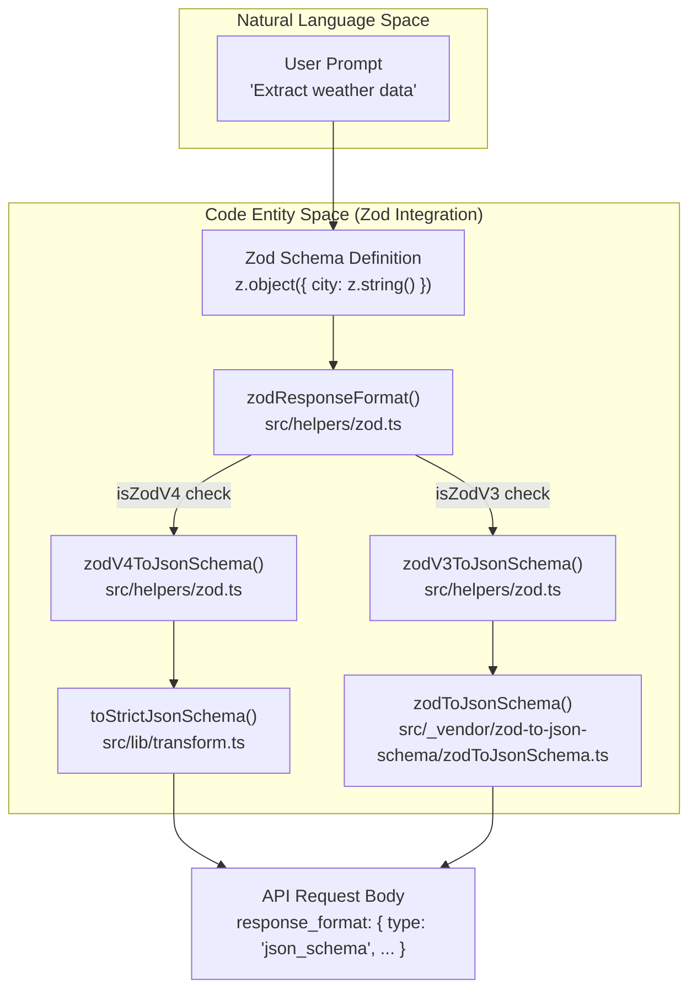
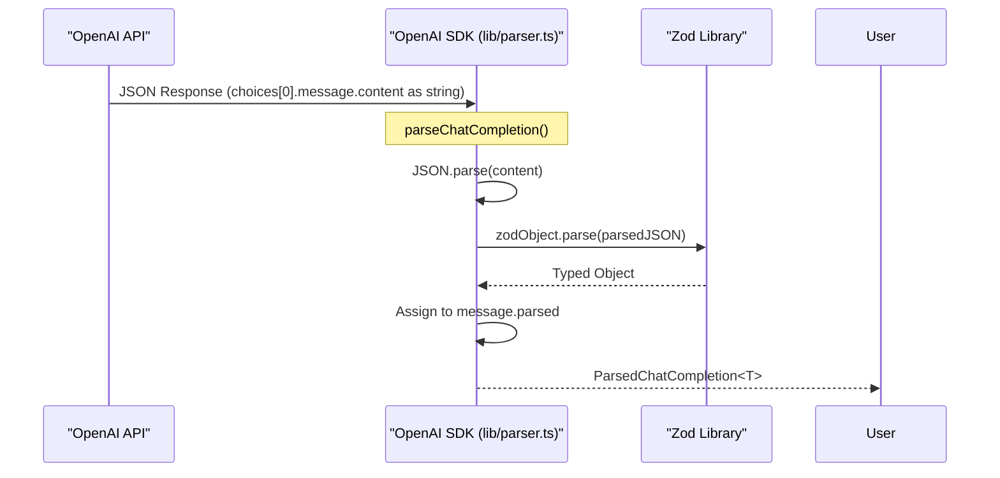

<!-- source: DeepWiki mcp.deepwiki.com · repo openai/openai-node · page 5.4 Structured Outputs and Parsing · fetched 2026-10-26 -->

# Structured Outputs and Parsing

<details>
<summary>Relevant source files</summary>

The following files were used as context for generating this wiki page:

- [src/_vendor/partial-json-parser/README.md](src/_vendor/partial-json-parser/README.md)
- [src/_vendor/partial-json-parser/parser.ts](src/_vendor/partial-json-parser/parser.ts)
- [src/_vendor/zod-to-json-schema/Options.ts](src/_vendor/zod-to-json-schema/Options.ts)
- [src/_vendor/zod-to-json-schema/Refs.ts](src/_vendor/zod-to-json-schema/Refs.ts)
- [src/_vendor/zod-to-json-schema/parseDef.ts](src/_vendor/zod-to-json-schema/parseDef.ts)
- [src/_vendor/zod-to-json-schema/parsers/effects.ts](src/_vendor/zod-to-json-schema/parsers/effects.ts)
- [src/_vendor/zod-to-json-schema/parsers/nullable.ts](src/_vendor/zod-to-json-schema/parsers/nullable.ts)
- [src/_vendor/zod-to-json-schema/parsers/object.ts](src/_vendor/zod-to-json-schema/parsers/object.ts)
- [src/_vendor/zod-to-json-schema/parsers/optional.ts](src/_vendor/zod-to-json-schema/parsers/optional.ts)
- [src/_vendor/zod-to-json-schema/util.ts](src/_vendor/zod-to-json-schema/util.ts)
- [src/_vendor/zod-to-json-schema/zodToJsonSchema.ts](src/_vendor/zod-to-json-schema/zodToJsonSchema.ts)
- [src/helpers/zod.ts](src/helpers/zod.ts)
- [tests/_vendor/partial-json-parser/partial-json-parsing.test.ts](tests/_vendor/partial-json-parser/partial-json-parsing.test.ts)
- [tests/helpers/zod.test.ts](tests/helpers/zod.test.ts)
- [tests/lib/__snapshots__/parser.test.ts.snap](tests/lib/__snapshots__/parser.test.ts.snap)
- [tests/lib/parser.test.ts](tests/lib/parser.test.ts)

</details>


## Purpose and Scope

This document covers the SDK's support for generating and parsing structured outputs from OpenAI models. The SDK provides type-safe parsing of JSON responses using Zod schemas, automatic validation, and type extraction for both the Responses API and Chat Completions API. It specifically details the implementation of the `zodResponseFormat` helper and the underlying parsing logic that bridges Natural Language Space to Code Entity Space.

Sources: [src/helpers/zod.ts:1-116](), [src/lib/parser.ts:1-212]()

## Overview

The SDK provides two complementary mechanisms for working with structured data:

1.  **Response Format Configuration**: Specify JSON schemas to constrain model outputs.
2.  **Parsing Methods**: Type-safe extraction and validation of structured data using Zod.

The `zodResponseFormat` helper allows developers to use familiar Zod schemas to define the structure, which the SDK then converts to strict JSON Schema for the API.

Sources: [src/helpers/zod.ts:82-99](), [src/lib/parser.ts:178-212]()

## Zod Integration and Schema Conversion

The SDK supports both Zod v3 and v4 [src/helpers/zod.ts:18-21](). It includes an internal vendor copy of `zod-to-json-schema` to handle the conversion of Zod objects into the specific "Strict Mode" JSON Schema required by OpenAI [src/helpers/zod.ts:12]().

### Schema Conversion Flow



Sources: [src/helpers/zod.ts:23-43](), [src/helpers/zod.ts:82-99](), [src/_vendor/zod-to-json-schema/zodToJsonSchema.ts:7-118]()

### Key Helper Functions

| Function | File | Purpose |
| :--- | :--- | :--- |
| `zodResponseFormat` | [src/helpers/zod.ts:82]() | Main entry point for creating `json_schema` response formats from Zod. |
| `zodTextFormat` | [src/helpers/zod.ts:101]() | Creates a parseable text format for the Responses API. |
| `zodFunction` | [src/helpers/zod.ts:123]() | Creates a chat completion tool with automatic Zod parsing. |
| `zodResponsesFunction` | [src/helpers/zod.ts:154]() | Creates a tool compatible with the Responses API parser. |
| `makeParseableResponseFormat` | [src/lib/parser.ts:43]() | Attaches a `$parseRaw` method and `$brand` to the response format object. |

Sources: [src/helpers/zod.ts:82-180](), [src/lib/parser.ts:43-61]()

## Parsing Implementation

When using methods like `chat.completions.parse()`, the SDK wraps the standard API response and applies the Zod parser to the raw string content.

### Data Flow: From Raw String to Typed Object



Sources: [src/lib/parser.ts:178-212](), [src/helpers/zod.ts:97]()

### Handling Strict Mode Requirements

OpenAI's Structured Outputs require specific JSON Schema features. The SDK's internal `zod-to-json-schema` implementation enforces these:
- **All fields must be required**: The SDK enforces that all fields are present in the `required` array [src/_vendor/zod-to-json-schema/parsers/object.ts:67](). It throws an error if a Zod field is `.optional()` without being `.nullable()` in strict mode [src/_vendor/zod-to-json-schema/parsers/object.ts:50-60]().
- **No Additional Properties**: `additionalProperties: false` is enforced via `decideAdditionalProperties` [src/_vendor/zod-to-json-schema/parsers/object.ts:72]().
- **Recursive Schemas**: Supported via `z.lazy()` and converted to JSON Schema `$ref` definitions using the `extract-to-root` strategy [src/helpers/zod.ts:28](), [src/_vendor/zod-to-json-schema/parseDef.ts:133-142]().

Sources: [src/_vendor/zod-to-json-schema/parsers/object.ts:5-75](), [tests/lib/parser.test.ts:51-78]()

## Auto-Parseable Interfaces

The SDK uses "branded" types to identify objects that contain internal parsing logic.

| Interface | Branding Property | Purpose |
| :--- | :--- | :--- |
| `AutoParseableResponseFormat` | `$brand: 'auto-parseable-response-format'` | Stores the Zod parser for message content. |
| `AutoParseableTool` | `$brand: 'auto-parseable-tool'` | Stores the Zod parser and optional callback for tool calls. |
| `AutoParseableResponseTool` | `$brand: 'auto-parseable-response-tool'` | Stores parsing logic specifically for the Responses API. |

These objects are created using factory functions like `makeParseableResponseFormat` [src/lib/parser.ts:43](). They contain a non-enumerable `$parseRaw` method that the SDK calls during the response lifecycle [src/helpers/zod.ts:97]().

Sources: [src/lib/parser.ts:36-61](), [src/lib/ResponsesParser.ts:13](), [src/helpers/zod.ts:82-180]()

## Advanced Usage: Recursive Schemas

The SDK handles complex recursive structures (like UI trees or linked lists) by extracting definitions to the root of the JSON Schema.

**Example: UI Generation Schema**
```typescript
const UI: any = z.lazy(() =>
  z.object({
    type: z.enum(['div', 'button', 'header', 'section', 'field', 'form']),
    label: z.string(),
    children: z.array(UI),
    attributes: z.array(z.object({ name: z.string(), value: z.string() })),
  }),
);
```
The SDK converts this into a JSON Schema where `children` uses a `$ref` pointing to `#/definitions/ui` [tests/lib/parser.test.ts:195](). This ensures the model understands the recursive nature while maintaining strict adherence to the schema.

Sources: [tests/lib/parser.test.ts:51-64](), [src/_vendor/zod-to-json-schema/parseDef.ts:133-142]()

## Error Handling during Parsing

The parsing logic is wrapped to handle specific failure modes:
1.  **Length Errors**: If the model stops because of token limits (`finish_reason: 'length'`), the SDK throws a `LengthFinishReasonError` [src/lib/parser.ts:183-185]().
2.  **Content Filter**: If output is blocked, it throws a `ContentFilterFinishReasonError` [src/lib/parser.ts:187-189]().
3.  **Refusals**: If the model refuses to answer, the `parsed` property will be `null`, and the `refusal` property will contain the explanation [src/lib/parser.ts:204-206]().

Sources: [src/lib/parser.ts:178-212](), [tests/lib/parser.test.ts:33-48]()

---

