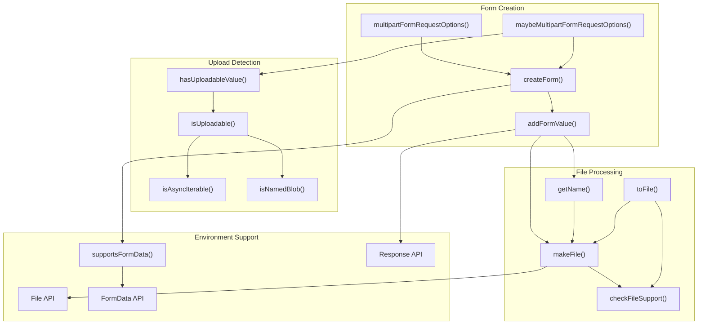
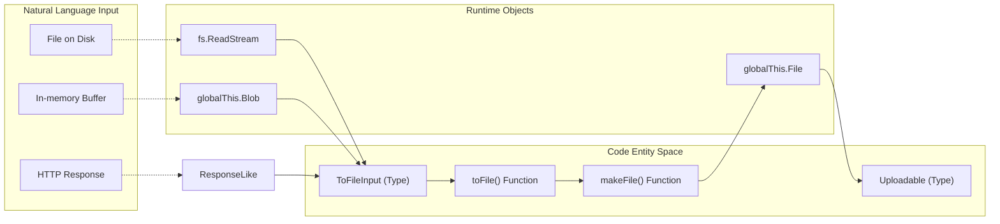
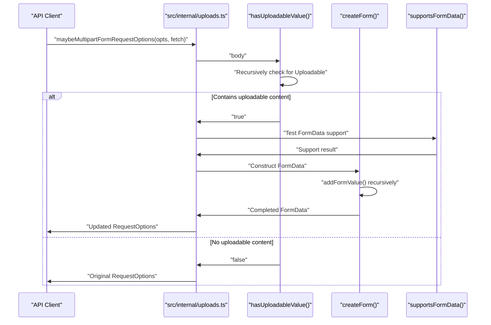
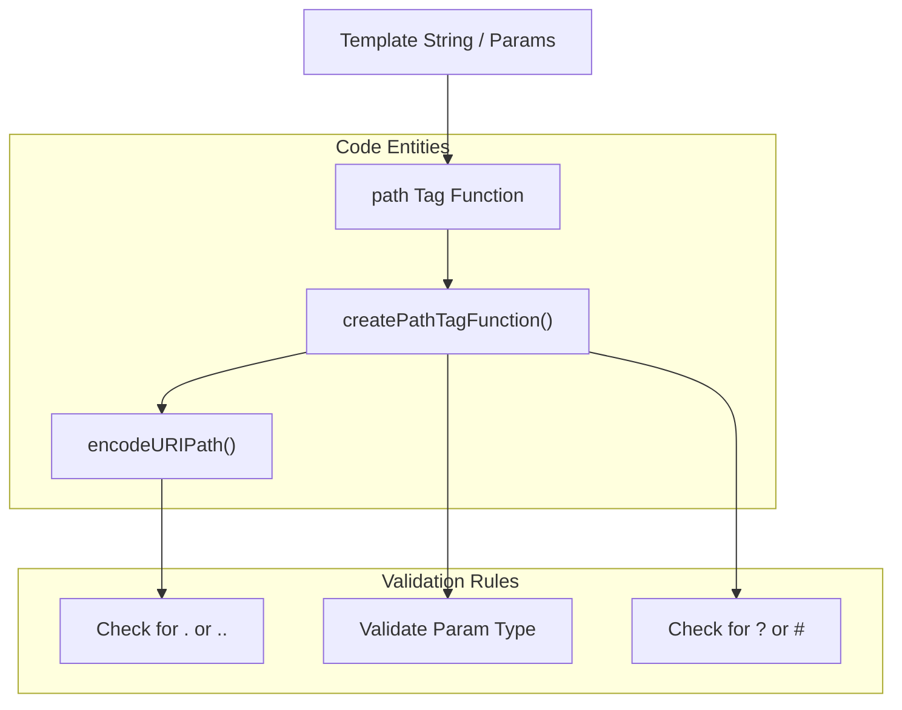

<!-- source: DeepWiki mcp.deepwiki.com · repo openai/openai-node · page 5.5 File Uploads and Utilities · fetched 2026-10-26 -->

# File Uploads and Utilities

Relevant source files

The following files were used as context for generating this wiki page:

- [scripts/build](scripts/build)
- [src/internal/to-file.ts](src/internal/to-file.ts)
- [src/internal/uploads.ts](src/internal/uploads.ts)
- [src/internal/utils/path.ts](src/internal/utils/path.ts)
- [src/internal/utils/uuid.ts](src/internal/utils/uuid.ts)
- [src/resources/uploads/uploads.ts](src/resources/uploads/uploads.ts)
- [src/uploads.ts](src/uploads.ts)
- [tests/path.test.ts](tests/path.test.ts)
- [tests/uploads.test.ts](tests/uploads.test.ts)

This page documents the file upload handling system and internal utilities that support data transmission in the OpenAI Node.js client library. These utilities handle multipart form encoding, file type detection, cross-environment compatibility, and various data processing tasks that enable robust API communication.

For information about the Files API endpoints themselves, see [Files](#4.7). For streaming capabilities, see [Streaming](#5.1).

## Purpose and Scope

The file upload and utilities system provides:

- **File Upload Processing**: Converts various file-like objects into uploadable formats using the `toFile` helper [src/internal/to-file.ts:83-120]().
- **Multipart Form Handling**: Automatically detects when multipart encoding is needed and constructs `FormData` [src/internal/uploads.ts:75-82]().
- **Cross-Environment Support**: Works across Node.js, Deno, Bun, and browser environments by checking for global `File` support [src/internal/uploads.ts:14-26]().
- **Path Management**: Safe URI path encoding and template tag functions for dynamic route construction [src/internal/utils/path.ts:11-88]().
- **Type Safety**: Defines `Uploadable` and `ToFileInput` types for runtime validation [src/internal/uploads.ts:37-38](), [src/internal/to-file.ts:68-72]().

## File Upload System Overview

The upload system centers around the `Uploadable` type and automatic multipart form detection.

Title: Upload System Architecture

Sources: [src/internal/uploads.ts:1-188](), [src/internal/to-file.ts:83-120]()

## Uploadable Types and Detection

The system supports multiple file-like objects through the `Uploadable` type. It is designed to bridge natural language file references to concrete code entities like `Blob` and `File`.

| Type | Description | Environment |
|------|-------------|-------------|
| `File` | Native File API objects | All environments |
| `Response` | Fetch Response objects | All environments |
| `FsReadStream` | Node.js file streams (AsyncIterable with path) | Node.js only |
| `BunFile` | Bun-specific file objects (Blob with name) | Bun only |

Title: Code Entity Space - Uploadable Mapping

The `getName()` function extracts filenames from properties like `name`, `url`, `filename`, or `path` [src/internal/uploads.ts:52-66]().

Sources: [src/internal/uploads.ts:6-12](), [src/internal/uploads.ts:37-38](), [src/internal/uploads.ts:52-66](), [src/internal/uploads.ts:143-147](), [src/internal/to-file.ts:68-72]()

## Multipart Form Handling

The system automatically detects when multipart encoding is needed and handles form creation.

Title: Multipart Request Lifecycle

The `addFormValue()` function handles nested data structures recursively:

- **Primitives**: Converted to strings via `String(value)` [src/internal/uploads.ts:168-169]().
- **Arrays**: Processed with `[]` suffix notation (e.g., `key[]`) [src/internal/uploads.ts:176-177]().
- **Objects**: Flattened using bracket notation (e.g., `key[name]`) [src/internal/uploads.ts:178-181]().
- **Files/Blobs**: Added with appropriate filenames using `makeFile` [src/internal/uploads.ts:170-175]().
- **Async Iterables**: Converted to blobs via `ReadableStreamFrom` [src/internal/uploads.ts:172-173]().

Sources: [src/internal/uploads.ts:75-82](), [src/internal/uploads.ts:86-91](), [src/internal/uploads.ts:125-137](), [src/internal/uploads.ts:159-187]()

## Environment Compatibility

The upload system handles cross-environment differences, particularly for Node.js versions and the global `File` object:

- **Node.js Compatibility**: Checks if `globalThis.File` is defined. For Node < 20, it suggests updating or setting `globalThis.File` to `import('node:buffer').File` [src/internal/uploads.ts:14-26]().
- **FormData Detection**: `supportsFormData()` detects if the fetch function properly handles the global `FormData` object to avoid "[object FormData]" stringification errors [src/internal/uploads.ts:101-123]().
- **Bun Support**: Explicitly handles `BunFile` which may not inherit from `File` but inherits from `Blob` [src/internal/uploads.ts:10-12](), [src/internal/uploads.ts:141]().

Sources: [src/internal/uploads.ts:14-26](), [src/internal/uploads.ts:43-50](), [src/internal/uploads.ts:101-123](), [src/internal/uploads.ts:172-173]()

## Path and URI Utilities

The SDK provides a specialized `path` template tag for constructing API URLs safely.

Title: Path Encoding Logic

- **Safety**: `encodeURIPath` percent-encodes characters not defined as unreserved, sub-delims, or safe pchars in RFC 3986 [src/internal/utils/path.ts:11-13]().
- **Validation**: The `path` function throws `OpenAIError` if path parameters result in invalid segments like `/../` or if null/undefined values are passed [src/internal/utils/path.ts:52-80]().
- **Context Awareness**: It distinguishes between path segments and query/fragment parts, switching to `encodeURIComponent` after a `?` or `#` is detected [src/internal/utils/path.ts:25-29]().

Sources: [src/internal/utils/path.ts:1-88](), [tests/path.test.ts:51-93]()

## Multipart Uploads (Large Files)

For files up to 8GB, the SDK supports the `Uploads` resource, which allows for multi-part uploads [src/resources/uploads/uploads.ts:14-42]().

1.  **Create Upload**: Initialize an upload session with `bytes`, `filename`, and `mime_type` [src/resources/uploads/uploads.ts:134-166]().
2.  **Add Parts**: Upload chunks using the `parts` resource attached to the `Uploads` instance [src/resources/uploads/uploads.ts:15]().
3.  **Complete**: Finalize the upload by providing the ordered `part_ids` [src/resources/uploads/uploads.ts:73-79]().

Sources: [src/resources/uploads/uploads.ts:14-80](), [src/resources/uploads/uploads.ts:201-211]()

---

