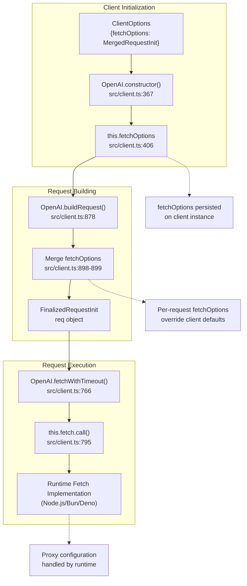

<!-- source: DeepWiki mcp.deepwiki.com · repo openai/openai-node · page 5.6 Proxy Configuration · fetched 2026-10-26 -->

# Proxy Configuration

<details>
<summary>Relevant source files</summary>

The following files were used as context for generating this wiki page:

- [.release-please-manifest.json](.release-please-manifest.json)
- [CHANGELOG.md](CHANGELOG.md)
- [README.md](README.md)
- [jsr.json](jsr.json)
- [package.json](package.json)
- [scripts/build-deno](scripts/build-deno)
- [scripts/utils/convert-jsr-readme.cjs](scripts/utils/convert-jsr-readme.cjs)
- [src/azure.ts](src/azure.ts)
- [src/client.ts](src/client.ts)
- [src/version.ts](src/version.ts)
- [tests/index.test.ts](tests/index.test.ts)
- [tests/lib/azure.test.ts](tests/lib/azure.test.ts)
- [tests/log.test.ts](tests/log.test.ts)
- [tests/responses.test.ts](tests/responses.test.ts)
- [tests/utils/typing.ts](tests/utils/typing.ts)

</details>


This page documents how to configure HTTP proxies for OpenAI SDK requests. Proxy configuration enables routing API requests through an intermediary server, which is useful for corporate networks, debugging, or adding custom request processing.

For general client configuration options, see `ClientOptions` in `src/client.ts` [src/client.ts:255-364]().

---

## Overview

The OpenAI SDK supports HTTP proxy configuration through the `fetchOptions` parameter in the client constructor. This parameter accepts runtime-specific options that are passed directly to the underlying fetch implementation. Because the SDK uses the Web Fetch API with zero runtime dependencies, proxy support varies by runtime environment.

**Sources:** [src/client.ts:273-276](), [src/client.ts:367-417]()

---

## Architecture: fetchOptions Flow

The following diagram illustrates how `fetchOptions` provided during instantiation flow through the internal request building process to the final `fetch` call.



**Diagram: fetchOptions Flow Through Request Lifecycle**

The `fetchOptions` parameter follows this path:

1.  **Initialization**: Passed to `OpenAI` constructor as part of `ClientOptions` [src/client.ts:367-417]().
2.  **Storage**: Stored on the client instance at `this.fetchOptions` [src/client.ts:406]().
3.  **Request Building**: Merged into the final request in `buildRequest()` [src/client.ts:898-899]().
4.  **Execution**: Passed to the runtime's `fetch` implementation via `fetchWithTimeout()` [src/client.ts:795]().

**Sources:** [src/client.ts:367-417](), [src/client.ts:406](), [src/client.ts:878-903](), [src/client.ts:766-799]()

---

## Configuration by Runtime

### Node.js Proxy Configuration

Node.js does not have native proxy support in its built-in `fetch` implementation. Proxy configuration requires runtime-specific options that are processed by the underlying HTTP client (typically `undici`).

#### Using Undici Dispatcher
If you are using a Node.js version that uses `undici` for fetch, you can pass a `ProxyAgent` via `fetchOptions`. The SDK explicitly acknowledges `undici` dispatcher mismatches in recent updates [CHANGELOG.md:38-38]().

```typescript
import OpenAI from 'openai';
import { ProxyAgent } from 'undici';

const client = new OpenAI({
  apiKey: 'your-api-key',
  fetchOptions: {
    dispatcher: new ProxyAgent('http://proxy.example.com:8080')
  }
});
```

#### Environment Variables
Standard Node.js environments often respect proxy settings through environment variables, though this depends on the specific fetch shim or global implementation in use.

**Sources:** [src/client.ts:273-276](), [CHANGELOG.md:38-38]()

---

### Bun Proxy Configuration

Bun's `fetch` implementation provides native proxy support through the `proxy` option in `fetchOptions`.

```typescript
import OpenAI from 'openai';

const client = new OpenAI({
  apiKey: 'your-api-key',
  fetchOptions: {
    proxy: 'http://proxy.example.com:8080'
  }
});
```

**Sources:** [src/client.ts:273-276]()

---

### Deno Proxy Configuration

Deno's `fetch` does not currently support proxy configuration through `fetchOptions`. For proxy support in Deno, consider:
1.  Using environment variables (Deno respects `HTTP_PROXY` and `HTTPS_PROXY`).
2.  Implementing a custom fetch function with proxy logic and passing it to the `fetch` option in the client constructor [src/client.ts:279-283]().

**Sources:** [src/client.ts:273-276](), [src/client.ts:279-283]()

---

## Implementation Details

### Type Definitions

The `fetchOptions` parameter is typed as `MergedRequestInit`, which extends the standard `RequestInit` interface to allow runtime-specific extensions [src/client.ts:4]().

```mermaid
graph LR
    "MergedRequestInit"["MergedRequestInit<br/>(src/internal/types.ts)"]
    "RequestInit"["RequestInit<br/>(src/internal/builtin-types.ts)"]
    "RuntimeSpecific"["Runtime-Specific Options<br/>• proxy (Bun)<br/>• dispatcher (Node.js)"]
    
    "MergedRequestInit" -.-> "RequestInit"
    "MergedRequestInit" -.-> "RuntimeSpecific"
```

**Diagram: fetchOptions Type Hierarchy**

**Sources:** [src/client.ts:3-4](), [src/client.ts:276]()

---

### Request Merging Behavior

When building a request, the SDK merges `fetchOptions` in the following order (later values override earlier ones):

```mermaid
graph TB
    "Client"["Client-level fetchOptions<br/>this.fetchOptions"]
    "Request"["Per-request fetchOptions<br/>options.fetchOptions"]
    "Final"["Final Request<br/>FinalizedRequestInit"]
    
    "Client" --> "Merge"["Merge Strategy<br/>src/client.ts:898-899"]
    "Request" --> "Merge"
    "Merge" --> "Final"
    
    "note"["Later values override<br/>earlier values"]
    "Merge" -.-> "note"
```

**Diagram: fetchOptions Merge Strategy**

In `buildRequest()`, the client-level `fetchOptions` are spread first, followed by any `fetchOptions` provided in the specific call's `RequestOptions` [src/client.ts:891-900]():

```typescript
const req: FinalizedRequestInit = {
  method,
  headers: reqHeaders,
  ...((this.fetchOptions as any) ?? {}),      // Client-level defaults
  ...((options.fetchOptions as any) ?? {}),   // Per-request overrides
};
```

**Sources:** [src/client.ts:891-900]()

---

## Configuration Matrix

| Runtime | Proxy Support | Configuration Method |
| :--- | :--- | :--- |
| **Node.js** | Via undici dispatcher | `fetchOptions.dispatcher` |
| **Bun** | Native | `fetchOptions.proxy` |
| **Deno** | Environment Variables | `HTTP_PROXY` / `HTTPS_PROXY` |
| **Edge Runtimes** | Varies | Typically via custom `fetch` |
| **Browser** | System-level | Handled by browser settings |

**Sources:** [src/client.ts:273-276](), [src/internal/detect-platform.ts:11-36]()

---

## Debugging Proxy Issues

To debug proxy-related connection issues:

1.  **Enable debug logging**: Set `logLevel: 'debug'` in the client options to see detailed request information [src/client.ts:316-327]().
2.  **Inspect platform headers**: The SDK sends platform information via `getPlatformHeaders` that can help identify the runtime [src/internal/detect-platform.ts:11-13]().
3.  **Custom Fetch**: If proxies are failing, provide a custom `fetch` implementation to log the exact `RequestInit` being passed to the runtime [src/client.ts:279-283]().

**Sources:** [src/client.ts:316-327](), [src/internal/detect-platform.ts:11-13](), [src/client.ts:279-283]()

---

## Related Configuration

-   **Custom fetch function**: For complete control over request behavior, use the `fetch` option [src/client.ts:279-283]().
-   **Timeout configuration**: Proxy connections respect the client's `timeout` setting, which defaults to 10 minutes [src/client.ts:271]().
-   **Retry behavior**: Failed proxy connections trigger the SDK's retry logic [src/client.ts:519-577]().

**Sources:** [src/client.ts:271](), [src/client.ts:279-283](), [src/client.ts:519-577]()

---

