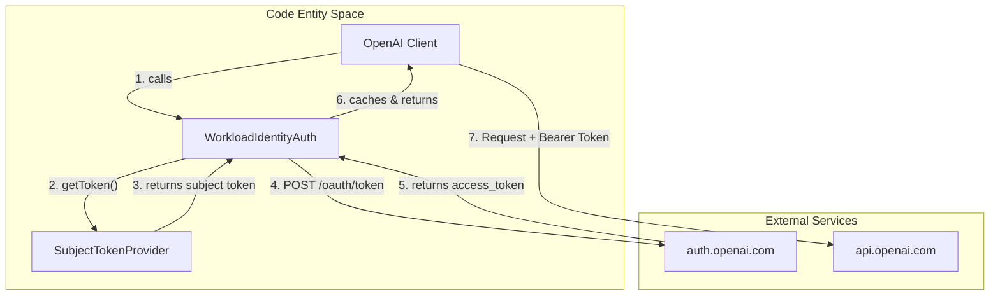
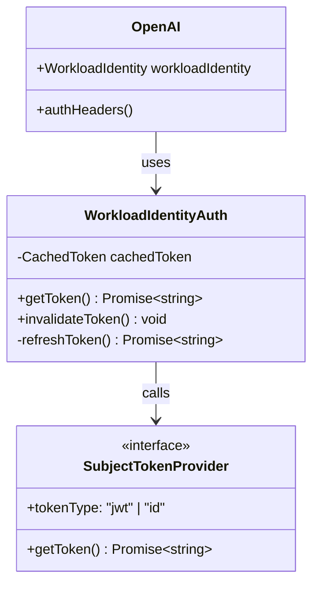

<!-- source: DeepWiki mcp.deepwiki.com · repo openai/openai-node · page 5.7 Workload Identity Authentication · fetched 2026-10-26 -->

# Workload Identity Authentication

<details>
<summary>Relevant source files</summary>

The following files were used as context for generating this wiki page:

- [src/auth/index.ts](src/auth/index.ts)
- [src/auth/subject-token-providers.ts](src/auth/subject-token-providers.ts)
- [src/auth/types.ts](src/auth/types.ts)
- [src/auth/workload-identity-auth.ts](src/auth/workload-identity-auth.ts)
- [src/azure.ts](src/azure.ts)
- [src/client.ts](src/client.ts)
- [tests/auth/workload-identity-auth.test.ts](tests/auth/workload-identity-auth.test.ts)
- [tests/index.test.ts](tests/index.test.ts)
- [tests/lib/azure.test.ts](tests/lib/azure.test.ts)
- [tests/lib/workload-identity.test.ts](tests/lib/workload-identity.test.ts)
- [tests/log.test.ts](tests/log.test.ts)
- [tests/responses.test.ts](tests/responses.test.ts)
- [tests/utils/typing.ts](tests/utils/typing.ts)

</details>


This page documents the workload identity authentication system implemented in the OpenAI TypeScript/JavaScript SDK. It covers how to configure and use workload identity for Kubernetes, Azure Managed Identity, and Google Cloud Platform (GCP) environments, detailing the token exchange flow and provider configurations. This method provides a secure alternative to long-lived API keys by leveraging short-lived tokens from cloud identity providers.

## Purpose and Scope

Workload Identity Authentication is designed for secure, automated environments such as Kubernetes clusters, Azure, and GCP. Instead of relying on static API keys, which can pose security risks if compromised, this system uses short-lived tokens issued by the cloud provider's identity management service. This approach enhances security by reducing the exposure window for credentials and integrating directly with the cloud's native identity mechanisms. The SDK facilitates this by allowing the configuration of specific token providers for different cloud environments.

The `workloadIdentity` parameter is mutually exclusive with the `apiKey` parameter when initializing the `OpenAI` client [src/client.ts:5754-5757]().

## Workload Identity Configuration

The `workloadIdentity` option in the `OpenAI` client constructor allows you to specify the details for obtaining and exchanging workload identity tokens. This object requires `identityProviderId`, `serviceAccountId`, and a `provider` configuration [src/auth/types.ts:6-21]().

```typescript
import OpenAI from 'openai';
import { k8sServiceAccountTokenProvider } from 'openai/auth';

const client = new OpenAI({
  workloadIdentity: {
    identityProviderId: 'idp-123',
    serviceAccountId: 'sa-456',
    provider: {
      tokenType: 'id',
      getToken: async () => '...subject-token...',
    },
    refreshBufferSeconds: 120, // Optional: customize token refresh buffer
  },
});
```

Sources:
- [src/auth/types.ts:6-21]()
- [src/client.ts:5754-5757]()

### Token Exchange Flow

The core of workload identity authentication involves exchanging a subject token (obtained from the cloud provider) for an access token from the OpenAI API. This process is managed internally by the `WorkloadIdentityAuth` class [src/auth/workload-identity-auth.ts:18]().

1.  **Subject Token Acquisition**: The configured `provider.getToken()` function is invoked to obtain a subject token (e.g., JWT or ID token) [src/auth/workload-identity-auth.ts:56]().
2.  **Token Exchange Request**: The SDK sends a `POST` request to `https://auth.openai.com/oauth/token` [src/auth/workload-identity-auth.ts:22](). The request body uses the `urn:ietf:params:oauth:grant-type:token-exchange` grant type [src/auth/workload-identity-auth.ts:16]().
3.  **Access Token Reception**: The OpenAI API validates the subject token and returns a `TokenExchangeResponse` containing the `access_token` and `expires_in` fields [src/auth/types.ts:23-28]().
4.  **Authorization**: This access token is cached and attached to subsequent API requests as a Bearer token in the `Authorization` header.
5.  **Token Refresh**: The SDK automatically handles refreshing the token. It proactively initiates a refresh if the current time is within the `refreshBufferSeconds` window (default 20 minutes) [src/auth/workload-identity-auth.ts:112-116]().


**Diagram: Workload Identity Token Exchange Flow**

Sources:
- [src/auth/workload-identity-auth.ts:18-122]()
- [src/auth/types.ts:23-28]()

### Provider Implementation and Types

The SDK supports two primary subject token types: `jwt` and `id` [src/auth/types.ts:2](). These map to standard OAuth2 token type URIs during the exchange [src/auth/workload-identity-auth.ts:11-14]().

| Code Entity | Role | File Reference |
| :--- | :--- | :--- |
| `WorkloadIdentity` | Interface defining the configuration for the auth system. | [src/auth/types.ts:6-21]() |
| `SubjectTokenProvider` | Interface for the component that fetches the initial cloud token. | [src/auth/types.ts:1-4]() |
| `WorkloadIdentityAuth` | Class managing the cache, refresh logic, and exchange calls. | [src/auth/workload-identity-auth.ts:18]() |
| `OAuthError` | Error thrown when the token exchange endpoint returns 400, 401, or 403. | [src/auth/workload-identity-auth.ts:85-87]() |

### Automatic Token Invalidation

The SDK implements a retry mechanism for `401 Unauthorized` errors when workload identity is active. If a request fails with a 401, the `WorkloadIdentityAuth` instance's `invalidateToken()` method is called to clear the cache, and the request is retried exactly once with a fresh token [tests/lib/workload-identity.test.ts:150-188]().


**Diagram: Class Relationships for Workload Identity**

Sources:
- [src/auth/workload-identity-auth.ts:118-122]()
- [tests/lib/workload-identity.test.ts:150-188]()
- [src/auth/types.ts:1-4]()

### Supported Environments

While the core logic resides in `WorkloadIdentityAuth`, the SDK provides specialized providers for common cloud environments:

*   **Kubernetes**: Uses service account tokens usually mounted at `/var/run/secrets/kubernetes.io/serviceaccount/token`.
*   **Azure Managed Identity**: Interacts with the Azure Instance Metadata Service (IMDS).
*   **GCP**: Retrieves ID tokens from the Google metadata server.

These providers are exported via `src/auth/index.ts` and implemented in `src/auth/subject-token-providers.ts` [src/auth/index.ts:3-7]().

Sources:
- [src/auth/index.ts:3-7]()
- [src/auth/workload-identity-auth.ts:22]()

---

