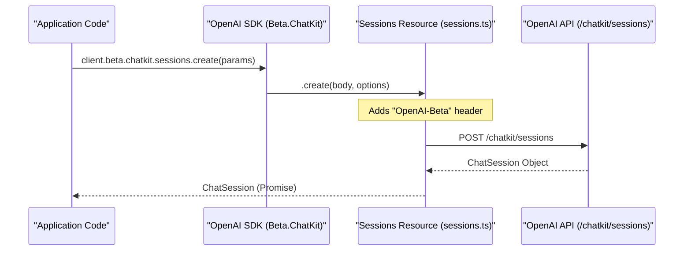
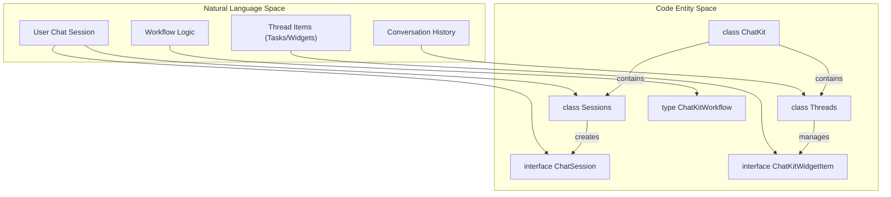

<!-- source: DeepWiki mcp.deepwiki.com · repo openai/openai-node · page 5.8 ChatKit (Beta) · fetched 2026-10-26 -->

# ChatKit (Beta)

Relevant source files

The following files were used as context for generating this wiki page:

- [src/resources/beta/beta.ts](src/resources/beta/beta.ts)
- [src/resources/beta/chatkit/sessions.ts](src/resources/beta/chatkit/sessions.ts)
- [src/resources/beta/chatkit/threads.ts](src/resources/beta/chatkit/threads.ts)
- [src/resources/beta/index.ts](src/resources/beta/index.ts)
- [src/resources/beta/threads/index.ts](src/resources/beta/threads/index.ts)
- [src/resources/vector-stores/index.ts](src/resources/vector-stores/index.ts)
- [src/resources/vector-stores/vector-stores.ts](src/resources/vector-stores/vector-stores.ts)

ChatKit is a beta feature designed for workflow-driven chat sessions. It provides a structured way to manage short-lived chat interactions powered by specific workflows, offering session-based authentication and managed thread history.

## Overview

The ChatKit API is located under the `beta` namespace and is divided into sub-resources: `sessions` and `threads`. ChatKit sessions are designed to be temporary (defaulting to a 10-minute expiration) and are scoped to specific end-users via a `user` identifier.

### Key Components
- **Sessions**: Manage the lifecycle of a ChatKit interaction, including creation and cancellation.
- **Workflows**: The underlying logic or configuration that powers the session.
- **Threads**: Managed conversation histories associated with a session, including support for specialized items like widgets and tasks.

---

## Session Management

Sessions are the entry point for ChatKit. When a session is created, it generates an ephemeral `client_secret` and configuration specific to a user and a workflow.

### Creating a Session
Sessions are created via `client.beta.chatkit.sessions.create()`. This requires a `user` identifier and a `workflow` configuration.

[src/resources/beta/chatkit/sessions.ts:23-30]()

### Cancelling a Session
Cancellation prevents any new requests from using the session's client secret and returns the final metadata for that session.

[src/resources/beta/chatkit/sessions.ts:43-49]()

### Implementation Detail: Headers
All ChatKit requests automatically include the `OpenAI-Beta: chatkit_beta=v1` header to signal usage of the beta environment.

[src/resources/beta/chatkit/sessions.ts:27-27]()
[src/resources/beta/chatkit/sessions.ts:46-46]()

### Data Flow: Session Lifecycle
The following diagram illustrates the transition from a client-side request to the internal SDK resource management.

**ChatKit Session Flow**

Sources: [src/resources/beta/beta.ts:96-101](), [src/resources/beta/chatkit/sessions.ts:10-50]()

---

## Thread Management

Threads in ChatKit provide the context for the conversation. Unlike standard Chat Completions, ChatKit threads are managed resources that can be retrieved, listed, and deleted.

### Thread Operations
The `Threads` class provides methods to manage the lifecycle of conversation history.

- **Retrieve**: Fetch a specific thread by ID. [src/resources/beta/chatkit/threads.ts:25-31]()
- **List**: List threads with optional pagination and user filters. [src/resources/beta/chatkit/threads.ts:44-54]()
- **Delete**: Remove a thread and its associated attachments. [src/resources/beta/chatkit/threads.ts:66-72]()

### Thread Items
ChatKit threads support complex item types beyond standard messages, including:
- **Assistant/User Messages**: Standard chat components.
- **Widgets**: UI-driven items for specialized interactions.
- **Tasks/Task Groups**: Workflow-driven execution steps.
- **Client Tool Calls**: Requests for the client to execute specific functions.

Items are retrieved via `listItems(threadID)`. [src/resources/beta/chatkit/threads.ts:87-117]()

---

## Entity Mapping

This diagram maps the natural language concepts of ChatKit to the specific TypeScript classes and interfaces defined in the codebase.

**Code Entity Mapping**

Sources: [src/resources/beta/beta.ts:76-77](), [src/resources/beta/chatkit/sessions.ts:10-84](), [src/resources/beta/chatkit/threads.ts:15-130]()

---

## Classes and Interfaces Reference

### Sessions Class
Located at `src/resources/beta/chatkit/sessions.ts`.

| Method | Parameters | Return Type | Description |
| :--- | :--- | :--- | :--- |
| `create` | `SessionCreateParams`, `RequestOptions` | `APIPromise<ChatSession>` | Initiates a new ChatKit session for a user. |
| `cancel` | `sessionID`, `RequestOptions` | `APIPromise<ChatSession>` | Terminates an active session and returns metadata. |

[src/resources/beta/chatkit/sessions.ts:10-50]()

### Threads Class
Located at `src/resources/beta/chatkit/threads.ts`.

| Method | Parameters | Return Type | Description |
| :--- | :--- | :--- | :--- |
| `retrieve` | `threadID`, `RequestOptions` | `APIPromise<ChatKitThread>` | Gets a single thread. |
| `list` | `ThreadListParams`, `RequestOptions` | `PagePromise<ChatKitThreadsPage>` | Lists threads for the authenticated user. |
| `delete` | `threadID`, `RequestOptions` | `APIPromise<ThreadDeleteResponse>` | Deletes a thread. |
| `listItems` | `threadID`, `ThreadListItemsParams` | `PagePromise<ChatKitThreadItemListDataPage>` | Retrieves all items (messages, tasks, widgets) in a thread. |

[src/resources/beta/chatkit/threads.ts:15-118]()

### Session Configuration
The `ChatSession` object contains the resolved configuration for the session, including `client_secret` for frontend usage.

| Property | Type | Description |
| :--- | :--- | :--- |
| `client_secret` | `string` | Ephemeral key for client-side authentication. |
| `expires_at` | `number` | Unix timestamp for session expiration. |
| `workflow` | `ChatKitWorkflow` | The workflow metadata powering the session. |

[src/resources/beta/chatkit/threads.ts:134-184]()

Sources: [src/resources/beta/beta.ts:1-101](), [src/resources/beta/chatkit/sessions.ts:1-84](), [src/resources/beta/chatkit/threads.ts:1-184]()

---

