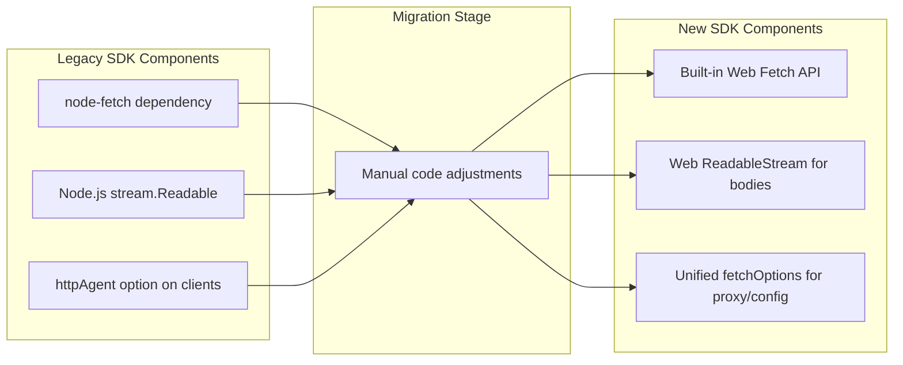

<!-- source: DeepWiki mcp.deepwiki.com · repo openai/openai-node · page 6 Migration Guide · fetched 2026-10-26 -->

# Migration Guide

<details>
<summary>Relevant source files</summary>

The following files were used as context for generating this wiki page:

- [.release-please-manifest.json](.release-please-manifest.json)
- [CHANGELOG.md](CHANGELOG.md)
- [MIGRATION.md](MIGRATION.md)
- [README.md](README.md)
- [jsr.json](jsr.json)
- [package.json](package.json)
- [scripts/build-deno](scripts/build-deno)
- [scripts/detect-breaking-changes](scripts/detect-breaking-changes)
- [scripts/utils/convert-jsr-readme.cjs](scripts/utils/convert-jsr-readme.cjs)
- [src/resources/admin/organization/index.ts](src/resources/admin/organization/index.ts)
- [src/resources/admin/organization/organization.ts](src/resources/admin/organization/organization.ts)
- [src/resources/admin/organization/projects/hosted-tool-permissions.ts](src/resources/admin/organization/projects/hosted-tool-permissions.ts)
- [src/resources/admin/organization/projects/index.ts](src/resources/admin/organization/projects/index.ts)
- [src/resources/admin/organization/projects/model-permissions.ts](src/resources/admin/organization/projects/model-permissions.ts)
- [src/resources/admin/organization/projects/projects.ts](src/resources/admin/organization/projects/projects.ts)
- [src/resources/admin/organization/usage.ts](src/resources/admin/organization/usage.ts)
- [src/version.ts](src/version.ts)
- [tests/api-resources/admin/organization/projects/hosted-tool-permissions.test.ts](tests/api-resources/admin/organization/projects/hosted-tool-permissions.test.ts)
- [tests/api-resources/admin/organization/usage.test.ts](tests/api-resources/admin/organization/usage.test.ts)

</details>


This document provides comprehensive technical guidance for migrating your codebase from older versions of the OpenAI TypeScript/JavaScript SDK to the latest SDK release. The migration ensures compatibility with the architectural refactor, improved runtime support, and API consistency.

The major architectural change is the replacement of the `node-fetch` dependency with the builtin Web Fetch API. This yields zero runtime dependencies and broad runtime support across Node.js, Bun, Deno, browsers, and edge environments. [MIGRATION.md:1-6]()

---

## Migration Overview

The latest SDK version emphasizes:

- **Zero runtime dependencies**: Removal of all external modules like `node-fetch`. [MIGRATION.md:1-6]()
- **Web standard compliance**: Full use of Web Fetch API and Web Streams across platforms. [MIGRATION.md:17-21]()
- **Modern runtime and tooling requirements**: Node.js 20+, TypeScript 4.9+, Jest 28+. [MIGRATION.md:9-14]()
- **API clarity and consistency**: Standardized method names, parameter ordering, and namespaces. [MIGRATION.md:35-40]()

### Architectural Transition Diagram



Sources: [MIGRATION.md:1-55](), [package.json:29-30]()

---

## Migration Tooling

While previous versions included a CLI migration tool, recent maintenance has shifted toward manual updates for precision. The SDK development process uses internal scripts to detect breaking changes by validating older test suites against the current SDK structure. [scripts/detect-breaking-changes:1-9]()

### Breaking Change Detection

The development team uses `scripts/detect-breaking-changes` to ensure migration paths are documented. This script checks out test files from previous versions and runs the linter to identify incompatible API calls. [scripts/detect-breaking-changes:99-108]()

Affected test paths include:
- Chat and Completions: `tests/api-resources/chat/completions/completions.test.ts` [scripts/detect-breaking-changes:12]()
- Fine-tuning: `tests/api-resources/fine-tuning/jobs/jobs.test.ts` [scripts/detect-breaking-changes:24]()
- Assistants: `tests/api-resources/beta/assistants.test.ts` [scripts/detect-breaking-changes:40]()
- Admin APIs: `tests/api-resources/admin/organization/usage.test.ts` [scripts/detect-breaking-changes:52]()

Sources: [scripts/detect-breaking-changes:1-108](), [CHANGELOG.md:30]()

---

## Environment Requirements

### Supported Runtime Versions & Tooling

| Runtime/Tool | Required Minimum Version | Notes                               |
|--------------|-------------------------|-----------------------------------|
| Node.js      | 20 LTS                  | Has native Web Fetch API support  |
| TypeScript   | 4.9                     | Required for updated type defs    |
| Jest         | 28                      | For test compatibility            |

Sources: [MIGRATION.md:9-14]()

### Supported Runtimes

The SDK uses Web Fetch API which enables usage across runtimes:

```mermaid
graph TB
    SDK["OpenAI SDK (Web Fetch API)"]

    subgraph Servers
        NODE["Node.js 20+"]
        BUN["Bun 1.2+"]
        DENO["Deno"]
    end

    subgraph Edge
        CF["Cloudflare Workers"]
        VERCEL["Vercel Edge"]
    end

    subgraph Browser
        BROWSER["Modern Browsers" / "dangerouslyAllowBrowser config"]
    end

    SDK --> NODE
    SDK --> BUN
    SDK --> DENO
    SDK --> CF
    SDK --> VERCEL
    SDK --> BROWSER
```

Sources: [MIGRATION.md:1-15](), [package.json:36,56]()

---

## Breaking Changes: Response Handling

### Web Types for `withResponse`, `asResponse`, and APIError Headers

The SDK now returns Web standard types such as the Web `ReadableStream` for response bodies instead of Node.js streams. [MIGRATION.md:17-21]()

**Example difference in response body handling:**

```typescript
// Before (Node streams)
const res = await client.example.retrieve('id').asResponse();
res.body.pipe(process.stdout); 

// After (Web streams)
import { Readable } from 'node:stream';
const res = await client.example.retrieve('id').asResponse();
// res.body is a Web ReadableStream
Readable.fromWeb(res.body).pipe(process.stdout);
```

### `APIError.headers` Now a Web `Headers` Object

The `headers` property on `APIError` objects is now an instance of the Web [Headers](https://developer.mozilla.org/en-US/docs/Web/API/Headers) class. It was previously defined as `Record<string, string | null | undefined>`. [MIGRATION.md:33-34]()

```mermaid
graph LR
    Old["headers: Record<string, string | null | undefined>"]
    New["headers: Web Headers"]

    Old --> New
    New --> "get(name)"
    New --> "has(name)"
    New --> "forEach()"
```

Sources: [MIGRATION.md:17-34]()

---

## Breaking Changes: Path Parameters

### Named Path Parameters Instead of Positional

Methods with multiple path parameters now use the last parameter as positional and the others as named parameters passed in an options object. [MIGRATION.md:35-40]()

**Example migration:**

```typescript
// Before
client.parents.children.retrieve('p_123', 'c_456');

// After
client.parents.children.retrieve('c_456', { parent_id: 'p_123' });
```

#### Affected Methods (selected examples):

| Resource                      | Method               | Path Mapping |
|-------------------------------|----------------------|--------------|
| `beta.threads.runs`            | `retrieve()`         | `(run_id, { thread_id })` [MIGRATION.md:61]() |
| `beta.threads.messages`        | `delete()`           | `(message_id, { thread_id })` [MIGRATION.md:69]() |
| `vectorStores.files`           | `retrieve()`         | `(file_id, { vector_store_id })` [MIGRATION.md:54]() |
| `evals.runs.outputItems`       | `retrieve()`         | `(output_item_id, { eval_id, run_id })` [MIGRATION.md:105]() |
| `admin.organization.users.roles`| `retrieve()`        | `(role_id, { user_id })` [MIGRATION.md:70]() |

Sources: [MIGRATION.md:35-113]()

### Automatic URI Encoding of Path Parameters

The SDK now automatically encodes path parameters. Users must stop manual encoding to avoid double-encoding. [MIGRATION.md:116-121]()

```diff
- client.example.retrieve(encodeURIComponent('string/with/slash'))
+ client.example.retrieve('string/with/slash') // retrieves /example/string%2Fwith%2Fslash
```

Sources: [MIGRATION.md:116-129]()

---

## Breaking Changes: Request Options Overload Removal

Methods that accept optional parameters without a required body now require explicit `null`, `undefined`, or an empty object `{}` as the parameter before passing request options. [MIGRATION.md:131-133]()

```typescript
// Before (implicit overload)
client.example.list({ headers: { ... } });

// After (explicit params)
client.example.list({}, { headers: { ... } });
client.example.list(null, { headers: { ... } });
client.example.list(undefined, { headers: { ... } });
```

### Affected Methods Include:

- `client.chat.completions.list()` [MIGRATION.md:147]()
- `client.files.list()` [MIGRATION.md:149]()
- `client.fineTuning.jobs.list()` [MIGRATION.md:150]()
- `client.admin.organization.auditLogs.list()` [MIGRATION.md:164]()

Sources: [MIGRATION.md:131-165]()

---

## Breaking Changes: Method Naming Conventions

### `del` Methods Renamed to `delete`

Consistent with HTTP method naming, all `del` method names are renamed to `delete`.

| API Resource             | Old Method Name | New Method Name |
|-------------------------|-----------------|-----------------|
| `files`                 | `del()`         | `delete()`      |
| `models`                | `del()`         | `delete()`      |
| `beta.assistants`       | `del()`         | `delete()`      |
| `admin.organization.roles`| `del()`        | `delete()`      |

Sources: [MIGRATION.md:150-185]()

---

## Breaking Changes: Proxy Configuration Update

### Removal of `httpAgent` Option

The `httpAgent` option for proxy configuration has been removed because the SDK uses Web Fetch API by default. Instead, runtime-specific proxy configuration should use `fetchOptions`. [MIGRATION.md:187-195]()

**Node.js example change:**

```typescript
// After (Node.js with undici ProxyAgent)
import OpenAI from 'openai';
import * as undici from 'undici';

const proxyAgent = new undici.ProxyAgent(process.env.PROXY_URL);
const client = new OpenAI({
  fetchOptions: {
    dispatcher: proxyAgent,
  },
});
```

Sources: [MIGRATION.md:187-219]()

---

## Summary

Migration to the latest OpenAI SDK primarily involves:

- Switching to Web Fetch API and Web Streams. [MIGRATION.md:1-6]()
- Updating method names from `del` to `delete`. [MIGRATION.md:150-185]()
- Changing positional path parameters to named parameters for complex routes. [MIGRATION.md:35-48]()
- Using explicit `null`/`{}` for methods with optional params when passing `RequestOptions`. [MIGRATION.md:131-142]()
- Upgrading environment to Node.js 20+ and TypeScript 4.9+. [MIGRATION.md:9-14]()

Sources: [MIGRATION.md:1-219](), [package.json:1-100]()

---

