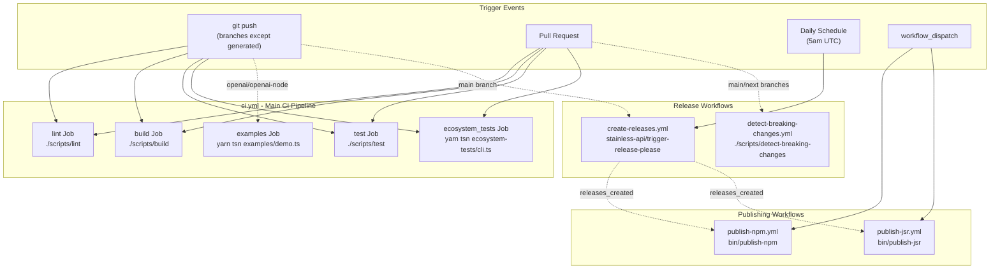
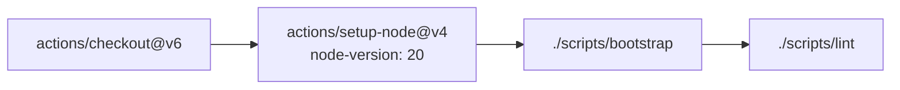
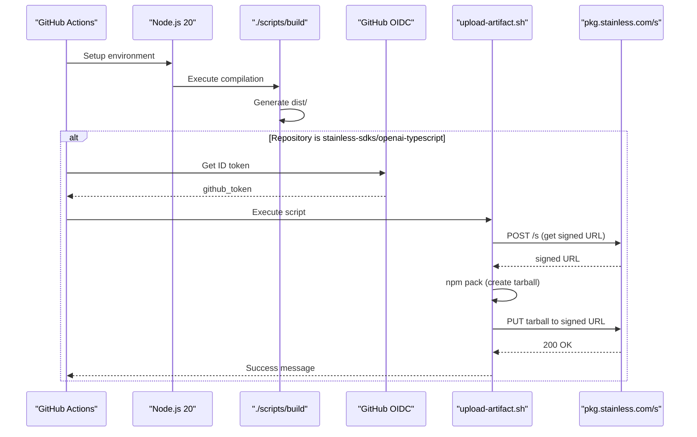
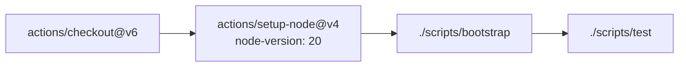
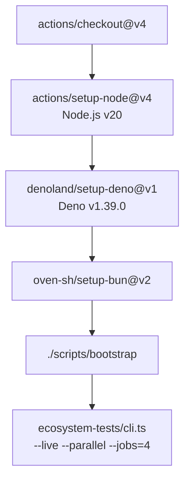

<!-- source: DeepWiki mcp.deepwiki.com · repo openai/openai-node · page 7.2 CI/CD Pipeline · fetched 2026-10-26 -->

# CI/CD Pipeline

Relevant source files

The following files were used as context for generating this wiki page:

- [.github/workflows/ci.yml](.github/workflows/ci.yml)
- [.github/workflows/create-releases.yml](.github/workflows/create-releases.yml)
- [.github/workflows/detect-breaking-changes.yml](.github/workflows/detect-breaking-changes.yml)
- [.github/workflows/publish-jsr.yml](.github/workflows/publish-jsr.yml)
- [.github/workflows/publish-npm.yml](.github/workflows/publish-npm.yml)
- [bin/publish-jsr](bin/publish-jsr)
- [bin/publish-npm](bin/publish-npm)
- [release-please-config.json](release-please-config.json)
- [scripts/utils/upload-artifact.sh](scripts/utils/upload-artifact.sh)

## Purpose and Scope

This document describes the GitHub Actions workflows that comprise the CI/CD pipeline for the OpenAI SDK. The pipeline validates code quality, executes tests across multiple runtimes, and generates build artifacts for pre-release testing. For information about the build process itself, see [Build System](#7.1). For release automation and publishing, see [Release Process](#7.4). For ecosystem testing details, see [Ecosystem Tests](#7.3).

## Pipeline Overview

The CI/CD pipeline is implemented through several GitHub Actions workflows that run on every push and pull request. The primary workflow is `ci.yml`, which executes parallel jobs to validate code quality, compilation, and functionality. Additional workflows handle release automation, breaking change detection, and publishing.

**Workflow Architecture**

Sources: [.github/workflows/ci.yml:1-150](), [.github/workflows/create-releases.yml:1-48](), [.github/workflows/detect-breaking-changes.yml:1-97]()

## CI Workflow Jobs

The `ci.yml` workflow defines the primary quality gates that must pass for code changes. Each job runs independently with specific timeouts.

### Job Execution Matrix

| Job | Runs On | Trigger Condition | Script | Purpose |
|-----|---------|-------------------|-----------------|-----------------------------------|
| `lint` | ubuntu-latest / depot-ubuntu-24.04 | push or fork PR | `./scripts/lint` | TypeScript type checking and ESLint validation |
| `build` | ubuntu-latest / depot-ubuntu-24.04 | push or fork PR | `./scripts/build` | Compilation and artifact generation |
| `test` | ubuntu-latest / depot-ubuntu-24.04 | push or fork PR | `./scripts/test` | Jest test suite execution |
| `examples` | ubuntu-latest / depot-ubuntu-24.04 | push in openai/openai-node | `yarn tsn examples/demo.ts` | Demo validation with live API |
| `ecosystem_tests` | ubuntu-latest | push or fork PR | ecosystem-tests CLI | Cross-runtime validation (Node, Deno, Bun) |

Sources: [.github/workflows/ci.yml:17-150]()

### Lint Job

The lint job validates TypeScript types and code style. It uses Node.js 20 and runs the bootstrap script before executing linting.

**Runner Selection**: The workflow uses `depot-ubuntu-24.04` runners when running in the `stainless-sdks/openai-typescript` repository, otherwise falls back to `ubuntu-latest` [.github/workflows/ci.yml:21]().
Sources: [.github/workflows/ci.yml:18-36]()

### Build Job

The build job compiles TypeScript source to JavaScript and uploads the resulting tarball to Stainless storage for pre-release testing.

The artifact upload process requires specific permissions and uses GitHub OIDC for authentication:

**Permissions Required**:
- `contents: read` - Access repository contents [.github/workflows/ci.yml:43]()
- `id-token: write` - Generate GitHub OIDC token [.github/workflows/ci.yml:44]()

**Environment Variables**:
- `URL`: `https://pkg.stainless.com/s` [.github/workflows/ci.yml:73]()
- `AUTH`: OIDC token from `steps.github-oidc.outputs.github_token` [.github/workflows/ci.yml:74]()
- `SHA`: Current commit SHA from `github.sha` [.github/workflows/ci.yml:75]()

Sources: [.github/workflows/ci.yml:37-76](), [scripts/utils/upload-artifact.sh:1-28]()

### Test Job

The test job executes the Jest test suite. It follows the same bootstrap pattern as other jobs.

Sources: [.github/workflows/ci.yml:77-95]()

### Examples Job

The examples job validates that SDK demo code executes successfully against the live OpenAI API. This job only runs for the `openai/openai-node` repository [.github/workflows/ci.yml:100]().

**API Key Injection**: The job requires the `OPENAI_API_KEY` secret to be configured in repository settings. The key is injected as an environment variable during execution of `examples/demo.ts` [.github/workflows/ci.yml:114-116]().

Sources: [.github/workflows/ci.yml:96-117]()

### Ecosystem Tests Job

The ecosystem tests validate SDK compatibility across multiple JavaScript runtimes.

**Runtime Setup**:

**Test Configuration**:
- **Parallelism**: 4 parallel jobs (`--jobs=4`) [.github/workflows/ci.yml:146]()
- **Retry Logic**: 3 retries per test (`--retry=3`) [.github/workflows/ci.yml:146]()
- **Execution Mode**: Live API tests (`--live`) [.github/workflows/ci.yml:146]()

Sources: [.github/workflows/ci.yml:118-150]()

## Artifact Upload System

The build job uploads compiled tarballs to Stainless storage when running in the `stainless-sdks/openai-typescript` repository.

**Upload Process Implementation**:
The logic in `scripts/utils/upload-artifact.sh` performs the following:
1. Obtains a signed upload URL via POST request to `$URL` [scripts/utils/upload-artifact.sh:4-6]().
2. Extracts the `url` from the JSON response using `jq` [scripts/utils/upload-artifact.sh:8]().
3. Generates a package tarball using `npm pack --silent` inside the `dist/` directory [scripts/utils/upload-artifact.sh:15]().
4. Performs a PUT request to the signed URL with the binary data of the tarball [scripts/utils/upload-artifact.sh:17-19]().

Sources: [scripts/utils/upload-artifact.sh:1-28]()

## Release and Publishing Workflows

### Create Releases Workflow

The `create-releases.yml` workflow triggers Release Please automation.

**Trigger Conditions**:
- Daily schedule at 5am UTC (`cron: '0 5 * * *'`) [.github/workflows/create-releases.yml:4]().
- Push to `main` branch [.github/workflows/create-releases.yml:7]().

**Release Please Integration**:
The workflow uses `stainless-api/trigger-release-please@v1.4.0` [.github/workflows/create-releases.yml:22](). If a release is created, it automatically triggers `bin/publish-npm` and `bin/publish-jsr` [.github/workflows/create-releases.yml:39-47]().

The `release-please-config.json` file controls the behavior, including versioning (`prerelease: true`) and which files to update, such as `src/version.ts` and `jsr.json` [release-please-config.json:8-71]().

Sources: [.github/workflows/create-releases.yml:1-48](), [release-please-config.json:1-72]()

### Detect Breaking Changes Workflow

The `detect-breaking-changes.yml` workflow performs two critical validation jobs on pull requests targeting `main` or `next` [.github/workflows/detect-breaking-changes.yml:3-6]().

1.  **`detect_breaking_changes`**: Executes `./scripts/detect-breaking-changes` against the base SHA of the pull request to identify API regressions [.github/workflows/detect-breaking-changes.yml:31-36]().
2.  **`agents_sdk`**: Ensures changes do not break the `openai-agents-js` ecosystem. It clones `openai/openai-agents-js`, links the local SDK build from `openai-node/dist` using `pnpm add file:...`, and runs the agents' build and lint suites [.github/workflows/detect-breaking-changes.yml:67-97]().

Sources: [.github/workflows/detect-breaking-changes.yml:1-97]()

### Manual Publishing Workflows

Workflows `publish-npm.yml` and `publish-jsr.yml` allow manual execution via `workflow_dispatch`.

- **NPM**: Executes `bash ./bin/publish-npm` [.github/workflows/publish-npm.yml:30]().
- **JSR**: Executes `bash ./bin/publish-jsr` [.github/workflows/publish-jsr.yml:30]().

Sources: [.github/workflows/publish-npm.yml:1-31](), [.github/workflows/publish-jsr.yml:1-31]()

## Publishing Logic Implementation

### NPM Publishing (`bin/publish-npm`)

The `bin/publish-npm` script manages authentication and semantic tagging.

- **Authentication**: Uses `NPM_TOKEN` if provided, otherwise relies on GitHub Action OIDC permissions [bin/publish-npm:5-10]().
- **Tagging Strategy**: 
    - It compares the current version in `package.json` with the latest version on NPM via `npm view` [bin/publish-npm:16-29]().
    - If the current version is a prerelease (e.g., contains `-alpha`) and the last version was stable, it publishes with that specific tag (e.g., `--tag alpha`) [bin/publish-npm:59-63]().
    - Otherwise, it defaults to the `latest` tag.
- **OIDC Support**: It explicitly installs `npm@11.6.2` in a local directory to ensure OIDC compatibility during the publish step [bin/publish-npm:65-70]().

Sources: [bin/publish-npm:1-71]()

### JSR Publishing (`bin/publish-jsr`)

The `bin/publish-jsr` script:
1. Runs `yarn build` to generate the project output [bin/publish-jsr:6]().
2. Navigates to the `dist-deno` directory [bin/publish-jsr:9]().
3. Executes `npx jsr publish`, passing the `JSR_TOKEN` if available [bin/publish-jsr:11]().

Sources: [bin/publish-jsr:1-12]()

---

