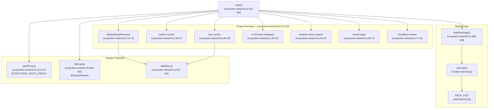
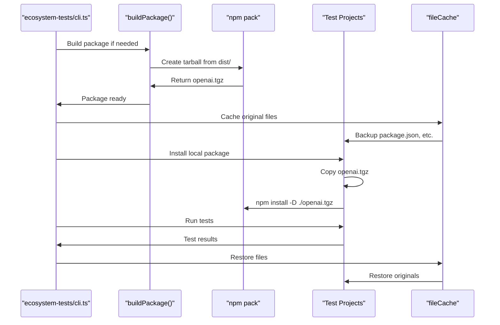
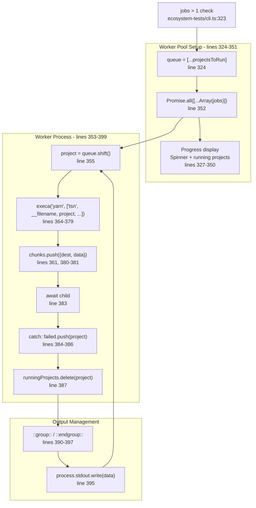
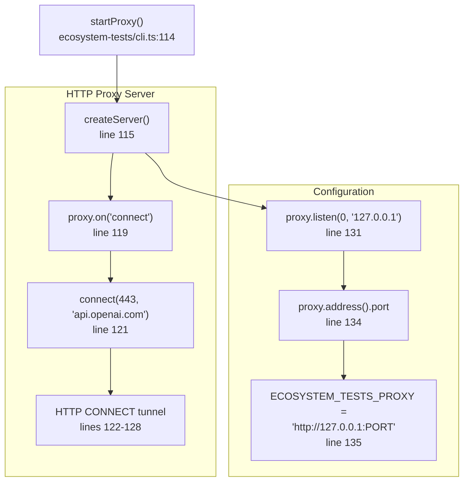

<!-- source: DeepWiki mcp.deepwiki.com · repo openai/openai-node · page 7.3 Ecosystem Tests · fetched 2026-10-26 -->

# Ecosystem Tests

<details>
<summary>Relevant source files</summary>

The following files were used as context for generating this wiki page:

- [.gitignore](.gitignore)
- [.prettierignore](.prettierignore)
- [ecosystem-tests/bun/.gitignore](ecosystem-tests/bun/.gitignore)
- [ecosystem-tests/bun/README.md](ecosystem-tests/bun/README.md)
- [ecosystem-tests/bun/openai.test.ts](ecosystem-tests/bun/openai.test.ts)
- [ecosystem-tests/bun/package.json](ecosystem-tests/bun/package.json)
- [ecosystem-tests/bun/tsconfig.json](ecosystem-tests/bun/tsconfig.json)
- [ecosystem-tests/cli.ts](ecosystem-tests/cli.ts)
- [ecosystem-tests/cloudflare-worker/src/uploadWebApiTestCases.ts](ecosystem-tests/cloudflare-worker/src/uploadWebApiTestCases.ts)
- [ecosystem-tests/cloudflare-worker/tsconfig.check.json](ecosystem-tests/cloudflare-worker/tsconfig.check.json)
- [ecosystem-tests/deno/deno.jsonc](ecosystem-tests/deno/deno.jsonc)
- [ecosystem-tests/deno/deno.lock](ecosystem-tests/deno/deno.lock)
- [ecosystem-tests/deno/main_test.ts](ecosystem-tests/deno/main_test.ts)
- [ecosystem-tests/node-ts-cjs-auto/tests/test.ts](ecosystem-tests/node-ts-cjs-auto/tests/test.ts)
- [ecosystem-tests/node-ts-cjs-web/tests/test-jsdom.ts](ecosystem-tests/node-ts-cjs-web/tests/test-jsdom.ts)
- [ecosystem-tests/node-ts-cjs-web/tests/test-node.ts](ecosystem-tests/node-ts-cjs-web/tests/test-node.ts)
- [ecosystem-tests/node-ts-cjs/tests/test-jsdom.ts](ecosystem-tests/node-ts-cjs/tests/test-jsdom.ts)
- [ecosystem-tests/node-ts-cjs/tests/test-node.ts](ecosystem-tests/node-ts-cjs/tests/test-node.ts)
- [ecosystem-tests/node-ts-esm-auto/tests/test.ts](ecosystem-tests/node-ts-esm-auto/tests/test.ts)
- [ecosystem-tests/node-ts-esm-web/tests/test.ts](ecosystem-tests/node-ts-esm-web/tests/test.ts)
- [ecosystem-tests/node-ts-esm/tests/test.ts](ecosystem-tests/node-ts-esm/tests/test.ts)
- [ecosystem-tests/proxy.ts](ecosystem-tests/proxy.ts)
- [ecosystem-tests/ts-browser-webpack/src/index.ts](ecosystem-tests/ts-browser-webpack/src/index.ts)
- [ecosystem-tests/vercel-edge/src/uploadWebApiTestCases.ts](ecosystem-tests/vercel-edge/src/uploadWebApiTestCases.ts)
- [eslint.config.mjs](eslint.config.mjs)
- [tsc-multi.json](tsc-multi.json)
- [yarn.lock](yarn.lock)

</details>


## Purpose and Scope

The ecosystem tests validate the OpenAI SDK's compatibility across multiple JavaScript runtimes, module systems, and deployment platforms. The testing framework is orchestrated by [ecosystem-tests/cli.ts:1-669]() and validates:

- **Runtime compatibility**: Node.js, Bun, browser environments, and serverless platforms.
- **Module system support**: CommonJS, ES Modules, and direct browser imports.
- **Build tooling**: Webpack bundling and TypeScript compilation.
- **Network configuration**: HTTP proxy support via [ecosystem-tests/proxy.ts:1-28]().
- **Platform deployment**: Vercel Edge and Cloudflare Workers.

These tests complement unit tests by focusing on real-world integration scenarios and platform-specific compatibility issues. For the CI/CD pipeline that runs these tests, see page 7.2.

## System Architecture

The ecosystem testing framework consists of a central CLI orchestrator that manages multiple test environments, each configured for specific runtime and module system combinations.

### Core Components and Data Flow



Sources: [ecosystem-tests/cli.ts:1-669](), [ecosystem-tests/proxy.ts:1-28]()

## Supported Environments

The ecosystem tests validate compatibility across multiple runtime environments and configuration combinations:

| Environment | Runtime | Module System | Test Directory | Runner Function |
|-------------|---------|---------------|----------------|-----------------|
| `node-ts-cjs` | Node.js | CommonJS | `ecosystem-tests/node-ts-cjs/` | `defaultNodeRunner()` |
| `node-ts-esm` | Node.js | ES Modules | `ecosystem-tests/node-ts-esm/` | `defaultNodeRunner()` |
| `node-ts-cjs-web` | Node.js | CommonJS | `ecosystem-tests/node-ts-cjs-web/` | `defaultNodeRunner()` |
| `node-ts-esm-web` | Node.js | ES Modules | `ecosystem-tests/node-ts-esm-web/` | `defaultNodeRunner()` |
| `node-ts-cjs-auto` | Node.js | CommonJS | `ecosystem-tests/node-ts-cjs-auto/` | `defaultNodeRunner()` |
| `node-ts-esm-auto` | Node.js | ES Modules | `ecosystem-tests/node-ts-esm-auto/` | `defaultNodeRunner()` |
| `node-ts4.5-jest28` | Node.js | CommonJS + Jest 28 | `ecosystem-tests/node-ts4.5-jest28/` | `defaultNodeRunner()` |
| `node-js` | Node.js | Plain JavaScript | `ecosystem-tests/node-js/` | Custom runner |
| `bun` | Bun | Native | `ecosystem-tests/bun/` | `projectRunners['bun']` |
| `ts-browser-webpack` | Browser | Webpack bundle | `ecosystem-tests/ts-browser-webpack/` | Custom runner |
| `browser-direct-import` | Browser | ES Modules | `ecosystem-tests/browser-direct-import/` | Custom runner |
| `vercel-edge` | Vercel Edge | Edge Runtime | `ecosystem-tests/vercel-edge/` | Custom runner |
| `cloudflare-worker` | Cloudflare | Workers Runtime | `ecosystem-tests/cloudflare-worker/` | Custom runner |

**Note**: The Deno environment is currently defined but commented out in the CLI runner [ecosystem-tests/cli.ts:100-108]().

Sources: [ecosystem-tests/cli.ts:22-109]()

### Runner Implementation Details

```mermaid
graph TB
    subgraph "defaultNodeRunner - ecosystem-tests/cli.ts:14-20"
        DNR_Install["installPackage()<br/>ecosystem-tests/cli.ts:510-524"]
        DNR_TSC["npm run tsc<br/>TypeScript compile"]
        DNR_Test["npm test<br/>if --live flag"]
    end
    
    subgraph "bun runner - ecosystem-tests/cli.ts:84-99"
        Bun_Check{"fromNpm?<br/>ecosystem-tests/cli.ts:85-88"}
        Bun_NPM["bun install -D $fromNpm"]
        Bun_Local["Copy PACK_FILE<br/>bun install -D ./openai.tgz"]
        Bun_TSC["npm run tsc"]
        Bun_Test["bun test<br/>if --live flag"]
    end
    
    subgraph "vercel-edge runner - ecosystem-tests/cli.ts:56-70"
        Vercel_Install["installPackage()"]
        Vercel_DevTest["npm run test:ci:dev<br/>if --live"]
        Vercel_Build["npm run build"]
        Vercel_ProdTest["npm run test:ci<br/>if --live"]
        Vercel_Deploy["vercel deploy --prod<br/>if --deploy"]
    end
    
    subgraph "cloudflare-worker - ecosystem-tests/cli.ts:71-83"
        CF_Install["installPackage()"]
        CF_Vars["Write .dev.vars<br/>OPENAI_API_KEY"]
        CF_TSC["npm run tsc"]
        CF_Test["npm run test:ci<br/>if --live"]
        CF_Deploy["npm run deploy<br/>if --deploy"]
    end
    
    DNR_Install --> DNR_TSC
    DNR_TSC --> DNR_Test
    
    Bun_Check -->|Yes| Bun_NPM
    Bun_Check -->|No| Bun_Local
    Bun_NPM --> Bun_TSC
    Bun_Local --> Bun_TSC
    Bun_TSC --> Bun_Test
    
    Vercel_Install --> Vercel_DevTest
    Vercel_DevTest --> Vercel_Build
    Vercel_Build --> Vercel_ProdTest
    Vercel_ProdTest --> Vercel_Deploy
    
    CF_Install --> CF_Vars
    CF_Vars --> CF_TSC
    CF_TSC --> CF_Test
    CF_Test --> CF_Deploy
```



Sources: [ecosystem-tests/cli.ts:14-109]()

## CLI Tool Functionality

The CLI orchestrator [ecosystem-tests/cli.ts:1-669]() manages test execution across all runtime environments. It is invoked via `yarn tsn ecosystem-tests/cli.ts` with specific project names and options.

### Command Line Options

Options defined in `parseArgs()` [ecosystem-tests/cli.ts:143-208]():

| Option | Type | Default | Purpose |
|--------|------|---------|---------|
| `--verbose` | boolean | false | Enable detailed command output. |
| `--skip` | array | [] | Skip specific projects (e.g., `--skip bun vercel-edge`). |
| `--skipPack` | boolean | false | Skip `buildPackage()` - use existing tarball. |
| `--fromNpm` | string | - | Test against published NPM version instead of local. |
| `--live` | boolean | false | Execute tests against live OpenAI API. |
| `--deploy` | boolean | false | Push to live servers (Vercel/Cloudflare). |
| `--jobs` | number | 1 | Number of parallel worker processes. |
| `--retry` | number | 0 | Retry attempts for failed tests. |
| `--retryDelay` | number | 1000 | Delay between retries (milliseconds). |
| `--parallel` | boolean | false | Run all projects in parallel (sets jobs = # projects). |
| `--noCleanup` | boolean | false | Skip cleanup phase (for debugging). |

### Environment Variables

| Variable | Set By | Purpose |
|----------|--------|---------|
| `OPENAI_API_KEY` | User (required) | Authentication for live API tests. |
| `ECOSYSTEM_TESTS_PROXY` | `startProxy()` [ecosystem-tests/cli.ts:135]() | Proxy server URL for tests. |
| `CI` | CI environment | Enables special output formatting. |

Sources: [ecosystem-tests/cli.ts:143-208](), [ecosystem-tests/cli.ts:12](), [ecosystem-tests/cli.ts:135]()

### Package Management Workflow



Sources: [ecosystem-tests/cli.ts:480-524](), [ecosystem-tests/cli.ts:594-640]()

## Test Structure and Patterns

Ecosystem tests follow consistent patterns across different runtime environments, focusing on core client functionality validation.

### Common Test Scenarios

Each environment tests the following core functionality:

1. **Basic API Requests**: Chat completions with response validation [ecosystem-tests/bun/openai.test.ts:38-44]().
2. **Streaming Support**: Server-sent events and response streaming [ecosystem-tests/bun/openai.test.ts:93-104]().
3. **File Upload Handling**: Various file input types like `fs.ReadStream`, `File`, and `Response` [ecosystem-tests/bun/openai.test.ts:107-140]().
4. **Raw Response Access**: Direct HTTP response manipulation via `.asResponse()` [ecosystem-tests/bun/openai.test.ts:60-91]().
5. **Proxy Configuration**: Network proxy compatibility using `fetchOptions` [ecosystem-tests/bun/openai.test.ts:46-58]().
6. **Type Safety**: Validation of `Uploadable` types and TypeScript error checking [ecosystem-tests/bun/openai.test.ts:16-23]().

### Test Implementation Example: Bun Runtime

The Bun test suite [ecosystem-tests/bun/openai.test.ts:1-191]() validates core functionality and Bun-specific features like `Bun.file()` [ecosystem-tests/bun/openai.test.ts:134-140]().

```mermaid
graph TB
    TestFile["ecosystem-tests/bun/<br/>openai.test.ts"]
    
    subgraph "API Request Tests"
        BasicTest["test: 'basic request works'<br/>line 38-44<br/>chat.completions.create()"]
        ProxyTest["test: 'proxied request works'<br/>line 46-58<br/>fetchOptions.proxy"]
        RawTest["test: 'raw response'<br/>line 60-91<br/>.asResponse() + ReadableStream"]
        StreamTest["test: 'streaming works'<br/>line 93-104<br/>stream: true + async iteration"]
    end
    
    subgraph "File Upload Tests"
        BuiltinFile["test: 'handles builtinFile'<br/>line 108-116<br/>new File()"]
        FetchResp["test: 'handles Response'<br/>line 119-124<br/>fetch() result"]
        FSReadStream["test: 'handles fs.ReadStream'<br/>line 126-132<br/>fs.createReadStream()"]
        BunFile["test: 'handles Bun.File'<br/>line 134-140<br/>Bun.file()"]
    end
    
    subgraph "toFile() Helper Tests"
        BlobTest["test: 'toFile handles builtin Blob'<br/>line 146-156"]
        Uint8Test["test: 'toFile handles Uint8Array'<br/>line 158-168"]
        ArrayBufferTest["test: 'toFile handles ArrayBuffer'<br/>line 169-179"]
        DataViewTest["test: 'toFile handles DataView'<br/>line 180-190"]
    end
    
    subgraph "Utilities"
        ExpectSimilar["expectSimilar()<br/>line 25-36<br/>Levenshtein distance"]
        TypeTests["typeTests()<br/>line 16-23<br/>@ts-expect-error validation"]
    end
    
    TestFile --> BasicTest
    TestFile --> ProxyTest
    TestFile --> RawTest
    TestFile --> StreamTest
    TestFile --> BuiltinFile
    TestFile --> FetchResp
    TestFile --> FSReadStream
    TestFile --> BunFile
    TestFile --> BlobTest
    TestFile --> Uint8Test
    TestFile --> ArrayBufferTest
    TestFile --> DataViewTest
    
    BasicTest --> ExpectSimilar
    ProxyTest --> ExpectSimilar
    StreamTest --> ExpectSimilar
```



Sources: [ecosystem-tests/bun/openai.test.ts:1-191]()

### Response Validation Strategy

Tests use Levenshtein distance (via the `fastest-levenshtein` package) to validate AI responses, allowing for minor variations in model output.

**Implementation** [ecosystem-tests/bun/openai.test.ts:25-36]():
```typescript
function expectSimilar(received: any, comparedTo: string, expectedDistance: number) {
  const actualDistance = distance(received, comparedTo);
  expect(actualDistance).toBeLessThan(expectedDistance);
}
```

**Usage Example** [ecosystem-tests/bun/openai.test.ts:43]():
```typescript
  expectSimilar(completion.choices[0]?.message?.content, 'This is a test', 10);
```

Sources: [ecosystem-tests/bun/openai.test.ts:25-36](), [ecosystem-tests/bun/openai.test.ts:38-44]()

## Execution Workflow

The ecosystem test execution follows a structured workflow with resource management and error handling.

### Parallel Execution Architecture

When `--jobs > 1` or `--parallel` is set, tests run concurrently using a worker pool pattern [ecosystem-tests/cli.ts:323-404]():



**Key Implementation Details**:
- Each worker recursively invokes the CLI with `--skip-pack` and `--noCleanup` flags [ecosystem-tests/cli.ts:370-371]().
- Output buffering preserves interleaved stdout/stderr ordering [ecosystem-tests/cli.ts:361]().
- CI environments get collapsible output groups using `::group::` syntax [ecosystem-tests/cli.ts:390-397]().

Sources: [ecosystem-tests/cli.ts:323-404]()

## Proxy Server Integration

The test suite includes an HTTP proxy server to validate proxy configuration support across runtimes.

### Proxy Implementation

**Server Setup** [ecosystem-tests/cli.ts:114-141]():



The proxy server logs each connection with `'got proxied connection'` [ecosystem-tests/cli.ts:120]() and establishes an HTTP CONNECT tunnel to `api.openai.com:443` [ecosystem-tests/cli.ts:121]().

Sources: [ecosystem-tests/cli.ts:114-141](), [ecosystem-tests/bun/openai.test.ts:46-58]()

---

