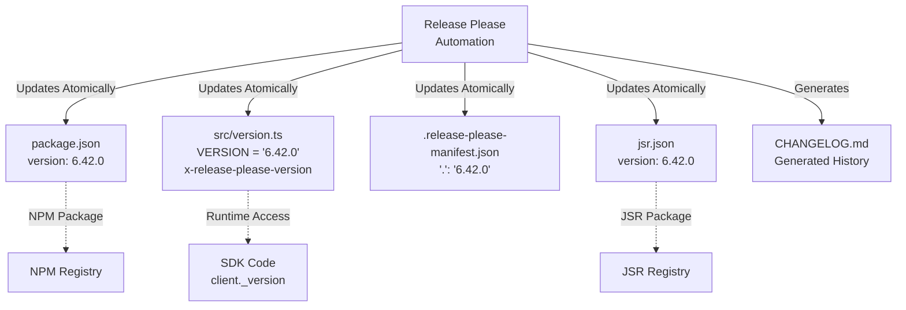
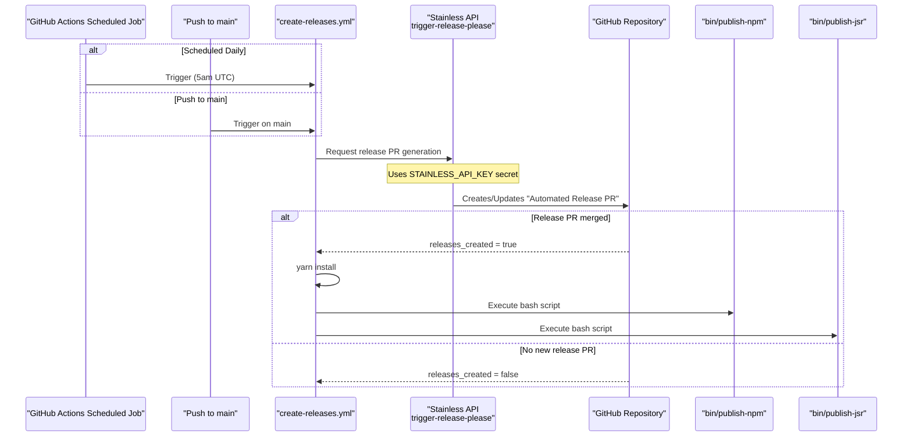
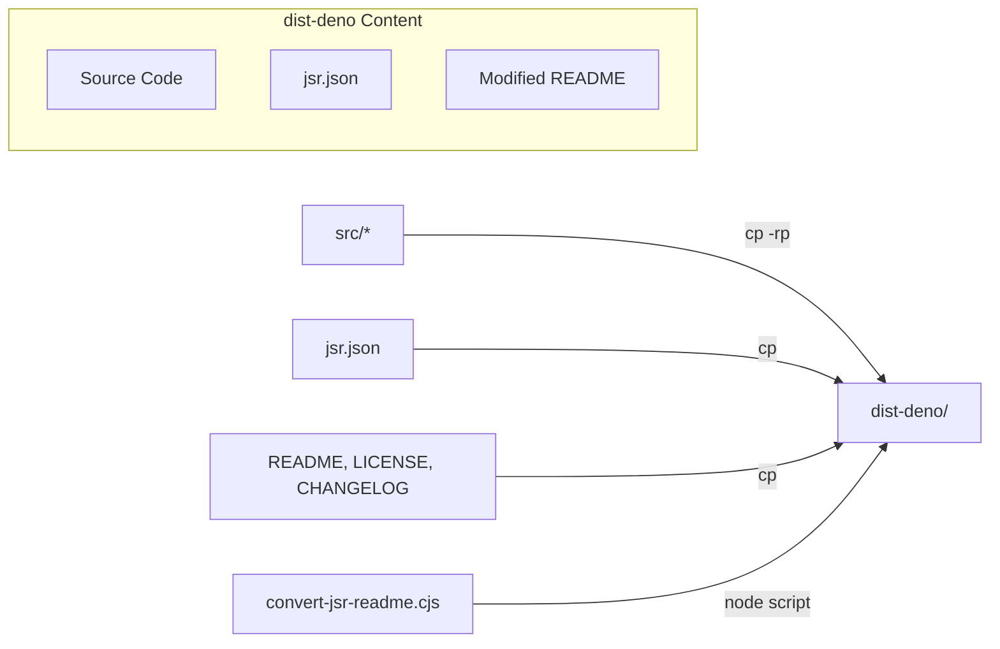

<!-- source: DeepWiki mcp.deepwiki.com · repo openai/openai-node · page 7.4 Release Process · fetched 2026-10-26 -->

# Release Process

Relevant source files

The following files were used as context for generating this wiki page:

- [.github/workflows/ci.yml](.github/workflows/ci.yml)
- [.github/workflows/create-releases.yml](.github/workflows/create-releases.yml)
- [.github/workflows/detect-breaking-changes.yml](.github/workflows/detect-breaking-changes.yml)
- [.github/workflows/publish-jsr.yml](.github/workflows/publish-jsr.yml)
- [.github/workflows/publish-npm.yml](.github/workflows/publish-npm.yml)
- [.release-please-manifest.json](.release-please-manifest.json)
- [CHANGELOG.md](CHANGELOG.md)
- [README.md](README.md)
- [bin/publish-jsr](bin/publish-jsr)
- [bin/publish-npm](bin/publish-npm)
- [jsr.json](jsr.json)
- [package.json](package.json)
- [release-please-config.json](release-please-config.json)
- [scripts/build-deno](scripts/build-deno)
- [scripts/utils/convert-jsr-readme.cjs](scripts/utils/convert-jsr-readme.cjs)
- [scripts/utils/upload-artifact.sh](scripts/utils/upload-artifact.sh)
- [src/version.ts](src/version.ts)

This document describes the automated and manual release processes for the OpenAI TypeScript/JavaScript SDK, including version management, changelog generation, and publishing to NPM and JSR registries.

## Overview

The OpenAI SDK uses **Release Please** for automated version management and changelog generation based on conventional commits. Releases are published to two registries:

- **NPM** (for Node.js and browser environments)
- **JSR** (JavaScript Registry, targeting Deno environments)  

Version numbers are synchronized across multiple files atomically during the release process to ensure consistency.

### Key Components

- Automated release PRs via Release Please.
- Atomic version synchronization across multiple files.
- Dual-registry publishing pipelines (NPM and JSR).
- Pre-release tag management (alpha, beta, rc).
- Build artifact upload for pre-release testing.

---

## Version Synchronization System

To maintain consistency, the SDK synchronizes version numbers across four primary files in atomic commits generated by Release Please. This ensures all artifacts and metadata share the same version.

### Data Flow for Versioning

### Version Storage Locations and Roles

| File | Line(s) | Format Example | Purpose |
| :--- | :--- | :--- | :--- |
| `package.json` | [package.json:3-3]() | `"version": "6.42.0"` | NPM package version metadata |
| `src/version.ts` | [src/version.ts:1-1]() | `export const VERSION = '6.42.0';` | Runtime version string for SDK |
| `.release-please-manifest.json` | [.release-please-manifest.json:2-2]() | `".": "6.42.0"` | Release Please status tracking |
| `jsr.json` | [jsr.json:3-3]() | `"version": "6.42.0"` | JSR package version metadata |

The special comment `// x-release-please-version` in [src/version.ts:1-1]() signals to Release Please that this line should be updated when bumping versions.

Sources: [package.json:1-101](), [src/version.ts:1-2](), [.release-please-manifest.json:1-4](), [jsr.json:1-18]()

---

## Release Please Automation

Release Please identifies version bumps based on commit messages following the Conventional Commits specification. It is configured via `release-please-config.json`.

### Commit Type Mapping

The configuration defines how different commit types appear in the changelog and impact versioning:

| Type | Section in Changelog | Version Impact |
| :--- | :--- | :--- |
| `feat` | Features | Minor |
| `fix` | Bug Fixes | Patch |
| `perf` | Performance Improvements | Patch |
| `chore` | Chores | None |
| `docs` | Documentation | None |
| `build` | Build System | Patch |

The automation also updates "extra-files" defined in the configuration, specifically [src/version.ts:1-1](), [README.md:1-200](), and the JSON path `$.version` in [jsr.json:3-3]().

Sources: [release-please-config.json:14-72](), [CHANGELOG.md:1-137]()

---

## Automated Release Workflow

The release workflow is managed by GitHub Actions and coordinates with the Stainless API to trigger Release Please and execute publishing scripts.

### Workflow Orchestration

The workflow [create-releases.yml:1-48]() runs on a daily schedule [create-releases.yml:4-4]() and on every push to the `main` branch [create-releases.yml:5-7]().

Sources: [.github/workflows/create-releases.yml:1-48](), [release-please-config.json:12-13]()

---

## Publishing Workflows

The SDK is published to two registries using dedicated bash scripts and manual-dispatch GitHub workflows.

### NPM Publishing

The script `bin/publish-npm` is responsible for building the package and pushing it to the NPM registry. It is invoked by both the automated release workflow [create-releases.yml:42-42]() and a manual workflow [publish-npm.yml:30-30]().

The script performs the following:
1. Executes `yarn build` to generate distribution artifacts in `dist/`.
2. Determines the appropriate NPM tag (`latest` or a prerelease tag like `alpha`/`beta`) based on the version string.
3. Publishes the content of the `dist/` directory.

### JSR Publishing

JSR publishing requires a specific build step for Deno compatibility. The script `bin/publish-jsr` (invoked at [create-releases.yml:47-47]()) relies on `scripts/build-deno`.

### JSR Build Logic (`scripts/build-deno`)

The build script [scripts/build-deno:7-14]() prepares a `dist-deno` directory by copying source files and running a conversion utility `scripts/utils/convert-jsr-readme.cjs` to ensure the README is compatible with JSR's environment.

Sources: [.github/workflows/create-releases.yml:39-48](), [.github/workflows/publish-npm.yml:1-31](), [.github/workflows/publish-jsr.yml:1-31](), [scripts/build-deno:1-15](), [bin/publish-npm:1-31](), [bin/publish-jsr:1-31]()

---

## Artifact Generation and Pre-release Testing

During standard CI runs, the system generates artifacts that can be used for testing before an official release is cut.

1. **Build Verification**: The `build` job in [ci.yml:37-76]() runs `scripts/build` to ensure the package compiles.
2. **Artifact Upload**: If the repository is the official `stainless-sdks/openai-typescript`, it uses `scripts/utils/upload-artifact.sh` to upload a tarball of the build to a storage service [ci.yml:76-76]().
3. **OIDC Authentication**: The workflow uses GitHub's OIDC provider to get a token for secure artifact upload [ci.yml:59-67]().

Sources: [.github/workflows/ci.yml:37-76](), [scripts/utils/upload-artifact.sh:1-28]()

---

## Manual Release and Emergency Procedures

While automation is preferred, developers can manually trigger releases or publishing tasks:

- **Manual NPM Publish**: Navigate to the "Publish NPM" workflow in GitHub Actions and use `workflow_dispatch` [.github/workflows/publish-npm.yml:5-5]().
- **Manual JSR Publish**: Navigate to the "Publish JSR" workflow and use `workflow_dispatch` [.github/workflows/publish-jsr.yml:5-5]().
- **Local Build**: Developers can run `yarn build` locally to generate the `dist/` folder [package.json:21-21](). However, the `prepublishOnly` script [package.json:22-22]() prevents direct `yarn publish` from the root to enforce the standard build-and-publish-from-dist workflow.

Sources: [.github/workflows/publish-npm.yml:1-31](), [.github/workflows/publish-jsr.yml:1-31](), [package.json:19-28]()

---

