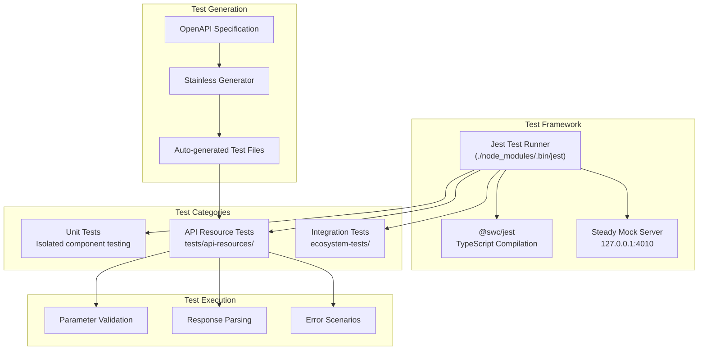
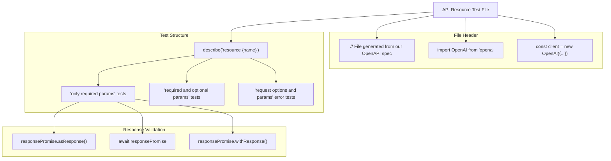
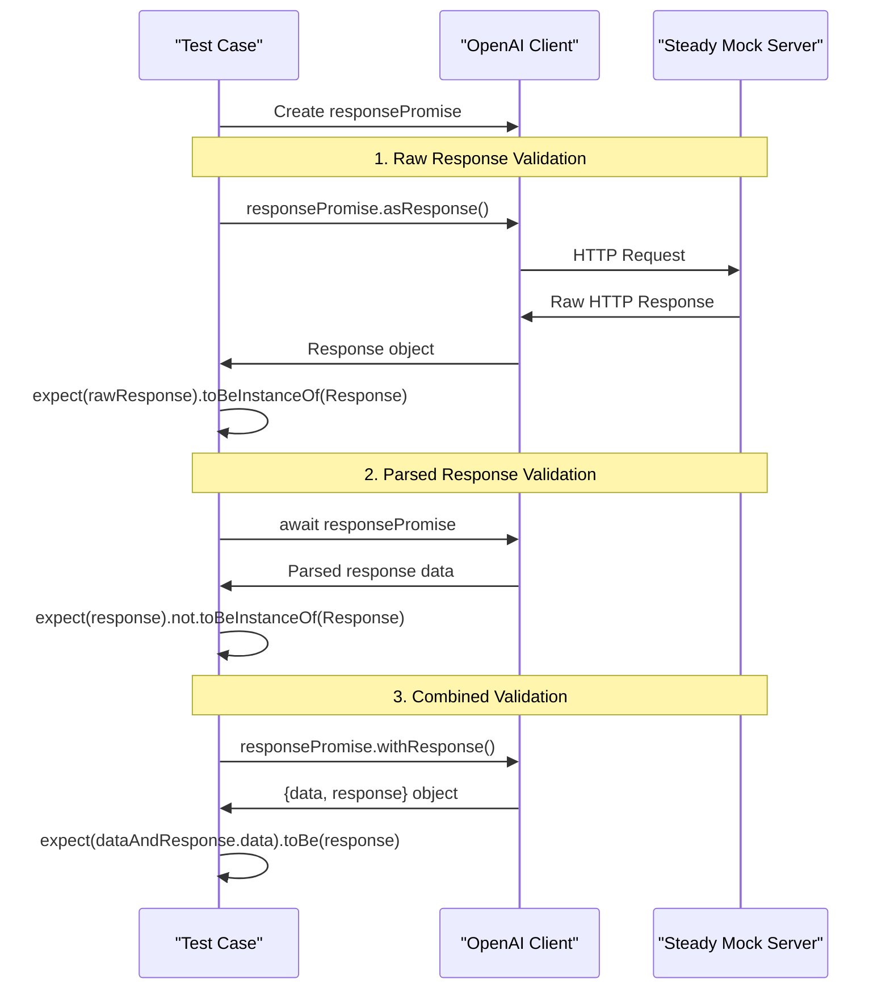
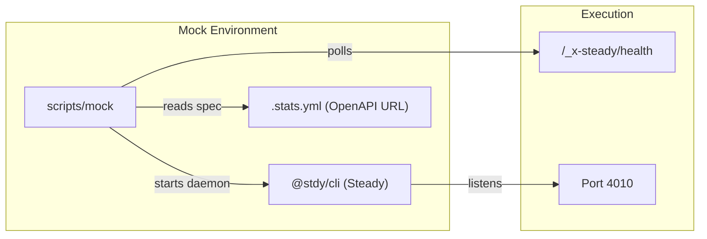

<!-- source: DeepWiki mcp.deepwiki.com · repo openai/openai-node · page 7.5 Testing Practices · fetched 2026-10-26 -->

# Testing Practices

<details>
<summary>Relevant source files</summary>

The following files were used as context for generating this wiki page:

- [Brewfile](Brewfile)
- [CONTRIBUTING.md](CONTRIBUTING.md)
- [examples/logprobs.ts](examples/logprobs.ts)
- [jest.config.ts](jest.config.ts)
- [scripts/bootstrap](scripts/bootstrap)
- [scripts/mock](scripts/mock)
- [scripts/test](scripts/test)
- [tests/api-resources/beta/assistants.test.ts](tests/api-resources/beta/assistants.test.ts)
- [tests/api-resources/beta/threads/messages.test.ts](tests/api-resources/beta/threads/messages.test.ts)
- [tests/api-resources/beta/threads/runs/runs.test.ts](tests/api-resources/beta/threads/runs/runs.test.ts)
- [tests/api-resources/beta/threads/threads.test.ts](tests/api-resources/beta/threads/threads.test.ts)
- [tests/api-resources/completions.test.ts](tests/api-resources/completions.test.ts)
- [tests/api-resources/fine-tuning/jobs/jobs.test.ts](tests/api-resources/fine-tuning/jobs/jobs.test.ts)
- [tests/api-resources/images.test.ts](tests/api-resources/images.test.ts)
- [tests/api-resources/moderations.test.ts](tests/api-resources/moderations.test.ts)
- [tests/utils/mock-fetch.ts](tests/utils/mock-fetch.ts)
- [tests/utils/mock-snapshots.ts](tests/utils/mock-snapshots.ts)

</details>


## Purpose and Scope

This document covers the comprehensive testing strategy for the OpenAI TypeScript/JavaScript SDK, including unit testing, integration testing, API resource validation, and mocking approaches. The SDK employs a multi-layered testing strategy that validates functionality across different runtime environments while ensuring API compatibility and code quality.

For information about cross-platform compatibility testing, see [7.3 Ecosystem Tests](). For details about the CI/CD pipeline that executes these tests, see [7.2 CI/CD Pipeline]().

## Test Infrastructure Overview

The SDK uses a comprehensive testing infrastructure built on Jest with SWC for fast TypeScript compilation. The test suite is organized into multiple categories, each serving a specific validation purpose.

**Test Infrastructure Components**



Sources: [jest.config.ts:1-25](), [tests/api-resources/beta/threads/runs/runs.test.ts:1-8](), [scripts/test:56](), [CONTRIBUTING.md:1-13]()

### Testing Configuration

The SDK's testing environment is configured via `jest.config.ts`, which sets up the Node.js environment and mapping for the `openai` module.

| Configuration Property | Value | Purpose |
|----------------------|-------|---------|
| `testEnvironment` | `'node'` | Execution environment for tests |
| `moduleNameMapper` | `^openai$ -> <rootDir>/src/index.ts` | Maps imports to source files |
| `transform` | `@swc/jest` | Fast compilation of TypeScript files |

Sources: [jest.config.ts:3-12]()

## Test File Structure and Patterns

### Standard Test File Organization

Each API resource test file follows a consistent structure with standardized client initialization and test categorization. Most of these files are generated from the OpenAPI spec by Stainless [tests/api-resources/images.test.ts:1]().



Sources: [tests/api-resources/images.test.ts:1-10](), [tests/api-resources/beta/threads/runs/runs.test.ts:1-10](), [tests/api-resources/completions.test.ts:1-9]()

### Client Initialization Pattern

All test files use a standardized client configuration that enables testing against a mock server by overriding the `baseURL`.

| Configuration Property | Value | Purpose |
|----------------------|-------|---------|
| `apiKey` | `'My API Key'` | Test API key for authentication |
| `baseURL` | `process.env['TEST_API_BASE_URL'] ?? 'http://127.0.0.1:4010'` | Configurable mock server endpoint |

Sources: [tests/api-resources/images.test.ts:5-8](), [tests/api-resources/moderations.test.ts:5-8](), [tests/api-resources/completions.test.ts:5-8]()

## Parameter Validation Testing

### Required vs Optional Parameter Testing

Each API endpoint is tested with scenarios to ensure comprehensive parameter validation and correct serialization.

**Example: Chat Completions**
- **Required Only**: Validates minimal request with `model` and `prompt`. [tests/api-resources/completions.test.ts:12-24]()
- **Required and Optional**: Validates full schema including `logit_bias`, `presence_penalty`, `seed`, and `stream_options`. [tests/api-resources/completions.test.ts:26-47]()

### Complex Parameter Structures

For APIs with nested or complex parameter structures, such as Fine-tuning or Assistants, tests validate the full parameter hierarchy.

**Fine-tuning Jobs (`client.fineTuning.jobs.create`)**
- Validates `hyperparameters` object. [tests/api-resources/fine-tuning/jobs/jobs.test.ts:30-34]()
- Validates `integrations` array (e.g., `wandb`). [tests/api-resources/fine-tuning/jobs/jobs.test.ts:35-45]()
- Validates `method` variations (DPO, Reinforcement, Supervised). [tests/api-resources/fine-tuning/jobs/jobs.test.ts:47-82]()

Sources: [tests/api-resources/fine-tuning/jobs/jobs.test.ts:26-87]()

## Response Validation Patterns

### Triple Response Validation

The testing framework validates responses in three different formats to ensure proper handling across different use cases:



Sources: [tests/api-resources/images.test.ts:12-23](), [tests/api-resources/beta/threads/runs/runs.test.ts:12-21](), [tests/api-resources/moderations.test.ts:12-21]()

## File Upload Testing Patterns

API endpoints that handle file uploads use the `toFile` utility to convert Buffers or Streams into uploadable formats compatible with the SDK.

**Example: Image Variations**
```typescript
const response = await client.images.createVariation({
  image: await toFile(Buffer.from('Example data'), 'README.md'),
});
```

Sources: [tests/api-resources/images.test.ts:13-15](), [tests/api-resources/images.test.ts:51-53]()

## Error Handling and Request Options Testing

### Request Options Propagation

Tests verify that `requestOptions` (like custom paths or headers) are correctly passed to the underlying HTTP layer by intentionally providing invalid paths and catching the resulting error.

**Pattern: Invalid Path Testing**
- Call a method with `{ path: '/_stainless_unknown_path' }` in the options argument. [tests/api-resources/beta/threads/threads.test.ts:51]()
- Use `expect(...).rejects.toThrow(OpenAI.NotFoundError)`. [tests/api-resources/beta/threads/threads.test.ts:53]()

Sources: [tests/api-resources/beta/threads/threads.test.ts:23-54](), [tests/api-resources/beta/threads/runs/runs.test.ts:97-111]()

## Mocking Strategies

The SDK relies on a mock server for API resource tests to ensure speed and reliability.

### Steady Mock Server

The `scripts/mock` script manages a mock server using `@stdy/cli` (Steady). This server generates responses based on the OpenAPI specification.



- **Startup**: The script fetches the spec URL from `.stats.yml` [scripts/mock:11]() and starts Steady on port 4010 [scripts/mock:27]().
- **Health Check**: It waits up to 30 seconds for the health endpoint to respond before proceeding. [scripts/mock:32-47]()
- **Test Orchestration**: The `scripts/test` script automatically starts this server if it isn't running and kills it on exit using a `trap`. [scripts/test:28-34]()

Sources: [scripts/mock:1-52](), [scripts/test:12-34](), [CONTRIBUTING.md:67-72]()

### Integration with Jest

The `jest.config.ts` file ensures that the `openai` module identifier points to the local source code rather than the installed package, allowing tests to run against the current codebase changes. [jest.config.ts:9-12]()

Sources: [jest.config.ts:1-25]()

## Resource-Specific Testing Patterns

### Beta API Testing

Beta features like Assistants and Threads often involve complex state and nested resources.

- **Thread Runs**: Validates submission of tool outputs and retrieval of run steps. [tests/api-resources/beta/threads/runs/runs.test.ts:128-148]()
- **Assistant Configuration**: Tests comprehensive tool resource setup, including `code_interpreter` file IDs and `file_search` vector store IDs. [tests/api-resources/beta/assistants.test.ts:33-45]()

Sources: [tests/api-resources/beta/assistants.test.ts:11-109](), [tests/api-resources/beta/threads/runs/runs.test.ts:11-149]()

---

