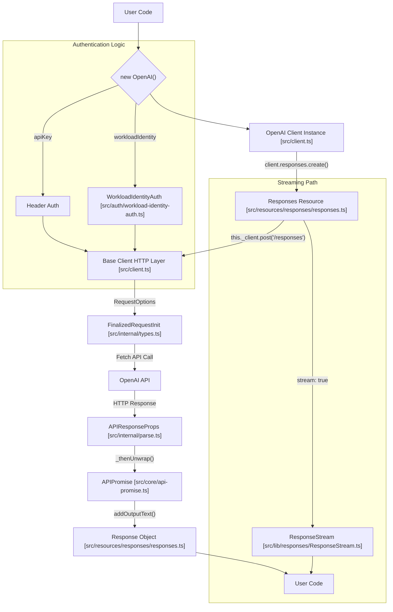
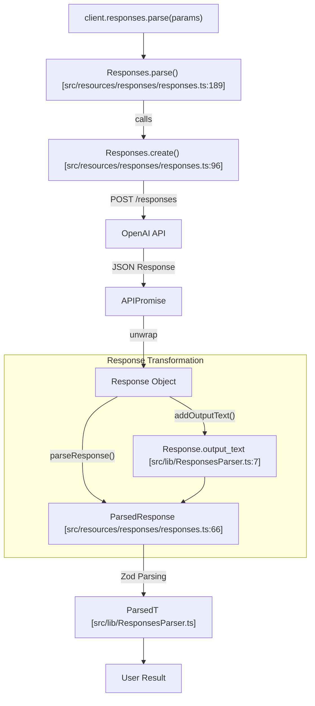
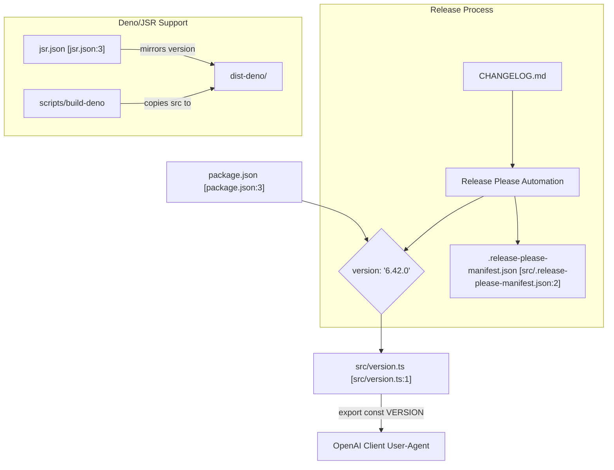

<!-- source: DeepWiki mcp.deepwiki.com · repo openai/openai-node · page 8 Glossary · fetched 2026-10-26 -->

# Glossary

Relevant source files

The following files were used as context for generating this wiki page:

- [.release-please-manifest.json](.release-please-manifest.json)
- [.stats.yml](.stats.yml)
- [CHANGELOG.md](CHANGELOG.md)
- [README.md](README.md)
- [api.md](api.md)
- [jsr.json](jsr.json)
- [package.json](package.json)
- [scripts/build-deno](scripts/build-deno)
- [scripts/utils/convert-jsr-readme.cjs](scripts/utils/convert-jsr-readme.cjs)
- [src/azure.ts](src/azure.ts)
- [src/client.ts](src/client.ts)
- [src/error.ts](src/error.ts)
- [src/index.ts](src/index.ts)
- [src/internal/decoders/line.ts](src/internal/decoders/line.ts)
- [src/internal/stream-utils.ts](src/internal/stream-utils.ts)
- [src/resources/beta/assistants.ts](src/resources/beta/assistants.ts)
- [src/resources/beta/threads/messages.ts](src/resources/beta/threads/messages.ts)
- [src/resources/beta/threads/runs/runs.ts](src/resources/beta/threads/runs/runs.ts)
- [src/resources/beta/threads/runs/steps.ts](src/resources/beta/threads/runs/steps.ts)
- [src/resources/beta/threads/threads.ts](src/resources/beta/threads/threads.ts)
- [src/resources/chat/completions/completions.ts](src/resources/chat/completions/completions.ts)
- [src/resources/fine-tuning/jobs/jobs.ts](src/resources/fine-tuning/jobs/jobs.ts)
- [src/resources/index.ts](src/resources/index.ts)
- [src/resources/responses/responses.ts](src/resources/responses/responses.ts)
- [src/resources/shared.ts](src/resources/shared.ts)
- [src/streaming.ts](src/streaming.ts)
- [src/version.ts](src/version.ts)
- [tests/api-resources/chat/completions/completions.test.ts](tests/api-resources/chat/completions/completions.test.ts)
- [tests/api-resources/responses/responses.test.ts](tests/api-resources/responses/responses.test.ts)
- [tests/index.test.ts](tests/index.test.ts)
- [tests/internal/decoders/line.test.ts](tests/internal/decoders/line.test.ts)
- [tests/lib/azure.test.ts](tests/lib/azure.test.ts)
- [tests/log.test.ts](tests/log.test.ts)
- [tests/responses.test.ts](tests/responses.test.ts)
- [tests/streaming.test.ts](tests/streaming.test.ts)
- [tests/utils/typing.ts](tests/utils/typing.ts)

This page defines key terms, jargon, abbreviations, and domain concepts specific to the `openai-node` codebase. Understanding these terms is crucial for new engineers onboarding to the project. Each definition includes references to relevant code files and line numbers to provide context and facilitate deeper exploration.

## Core Concepts

### APIPromise
The `APIPromise` is a custom Promise-like object used throughout the SDK for handling API responses. It extends the standard `Promise` and provides additional methods for chaining operations and error handling specific to API interactions.
- **Definition:** [src/core/api-promise.ts:1-10]()
- **Usage Example:** [src/client.ts:33]()

### Client
The `Client` refers to the main entry point for interacting with the OpenAI API. The primary client is `OpenAI` [src/client.ts:7](), but there's also `AzureOpenAI` [src/azure.ts:28]() and `BedrockOpenAI` [src/index.ts:29](). These classes encapsulate authentication, request handling, and expose various API resources.
- **Definition:** [src/client.ts:234-240]()
- **Usage Example:** [README.md:39-41]()

### API Resource
An API Resource represents a specific category of operations within the OpenAI API, such as `chat`, `completions`, `embeddings`, `files`, etc. Each resource typically has its own class within the SDK, containing methods for interacting with that part of the API.
- **Definition:** [src/core/resource.ts:4-10]()
- **Usage Example:** [src/client.ts:32]()

### Streaming
Streaming refers to the process of receiving API responses incrementally, typically for long-running operations like chat completions or audio processing. The SDK supports Server-Sent Events (SSE) for streaming via the `Stream` class.
- **Definition:** [src/streaming.ts:1-10]()
- **Usage Example:** [README.md:177-185]()

### Workload Identity Authentication
A method of authentication that allows applications running in secure, automated environments (like Kubernetes, Azure, GCP) to obtain short-lived tokens from cloud identity providers instead of using long-lived API keys.
- **Definition:** [src/auth/workload-identity-auth.ts:1-20]()
- **Usage Example:** [README.md:73-166]()

## API-Specific Terms

### Responses API
The recommended and primary interface for generating text, images, and using tools with OpenAI models. It offers a unified approach for various generative tasks and includes automatic parsing capabilities.
- **Definition:** [src/resources/responses/responses.ts:74-89]()
- **Usage Example:** [README.md:43-47]()

### Chat Completions API
A legacy (but still supported) interface for generating text, primarily designed for conversational interactions. It uses a message-based input format.
- **Definition:** [src/resources/chat/completions/completions.ts:1-10]()
- **Usage Example:** [README.md:61-66]()

### Tools
Mechanisms that allow the model to interact with external systems or perform specific actions. This includes custom code (function calling), web search, and file search.
- **Definition:** [src/resources/shared.ts:11-12]() (FunctionDefinition)
- **Usage Example:** [src/resources/responses/responses.ts:79-88]()

### Structured Outputs
The ability to instruct the model to generate responses in a specific, machine-readable format, often JSON, using tools like Zod for schema validation.
- **Definition:** [src/resources/shared.ts:17-18]() (ResponseFormatJSONObject, ResponseFormatJSONSchema)
- **Usage Example:** [src/resources/responses/responses.ts:81-83]()

### Embeddings
Vector representations of text or other data, used for tasks like semantic search, clustering, and recommendations.
- **Definition:** [src/resources/embeddings.ts:53-59]()
- **Usage Example:** [api.md:98-105]()

### Assistants API
A higher-level API for building stateful AI agents that can manage conversations, use tools, and persist data.
- **Definition:** [src/resources/beta/assistants.ts:1-10]()
- **Usage Example:** [api.md:110-120]()

### Vector Stores
Databases designed to store and retrieve vector embeddings, often used in Retrieval Augmented Generation (RAG) applications.
- **Definition:** [src/resources/vector-stores/vector-stores.ts:176-186]()
- **Usage Example:** [api.md:1110-1117]()

## Internal Terms

### `_thenUnwrap`
A method on `APIPromise` used internally to process the raw API response before returning it to the user. It often involves adding computed properties or performing initial parsing.
- **Definition:** [src/core/api-promise.ts:1-10]()
- **Usage Example:** [src/resources/responses/responses.ts:116-122]()

### `addOutputText`
A utility function that processes a `Response` object to add an `output_text` property, making it easier to access the main text content of a response.
- **Definition:** [src/lib/ResponsesParser.ts:7]()
- **Usage Example:** [src/resources/responses/responses.ts:118]()

### `path`
A utility function used for constructing API endpoint paths, often with template literals for dynamic segments to ensure proper encoding.
- **Definition:** [src/internal/utils/path.ts:1-5]()
- **Usage Example:** [src/resources/responses/responses.ts:156]()

### `VERSION`
A constant storing the current version of the SDK, updated during the release process.
- **Definition:** [src/version.ts:1]()
- **Usage Example:** [src/client.ts:15]()

## Diagrams

### Diagram: Client Initialization and Request Flow

This diagram maps the natural language concept of "making a request" to the specific code entities involved in the lifecycle of an SDK call.

Sources: [src/client.ts:3-33](), [src/resources/responses/responses.ts:107-123](), [src/core/api-promise.ts:1-10](), [src/lib/ResponsesParser.ts:7](), [README.md:39-47]()

### Diagram: Responses API Data Flow and Parsing

This diagram bridges the gap between the high-level "Responses API" feature and the internal parsing logic used to provide structured data.

Sources: [src/resources/responses/responses.ts:66-70](), [src/resources/responses/responses.ts:189-196](), [src/lib/ResponsesParser.ts:1-8]()

### Diagram: SDK Build and Versioning System

This diagram explains how versioning is managed across different metadata files and runtimes (Node.js vs Deno).

Sources: [package.json:3](), [src/version.ts:1](), [CHANGELOG.md:3](), [.release-please-manifest.json:2](), [jsr.json:3](), [scripts/build-deno:1-10]()