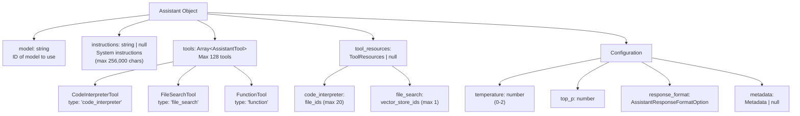
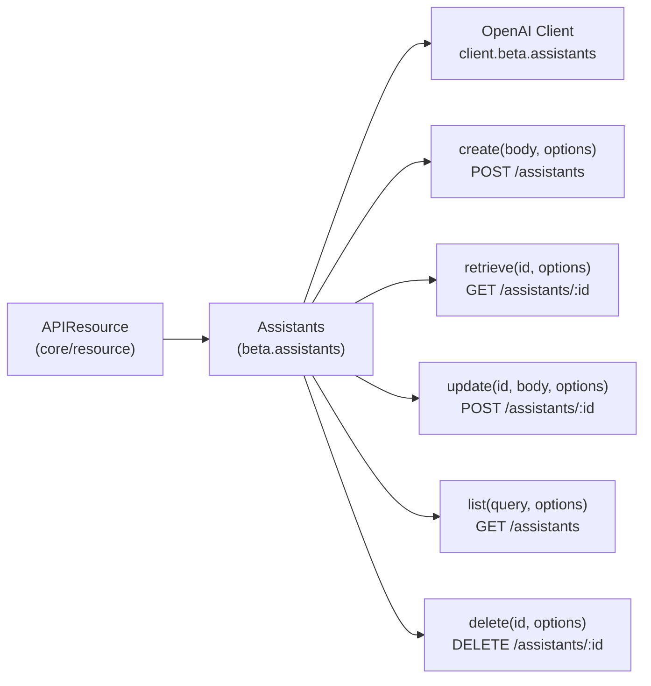
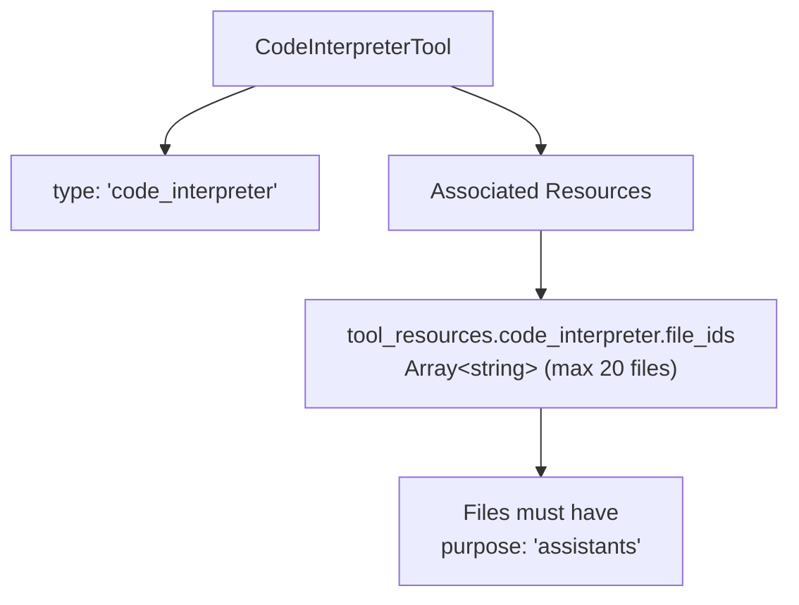
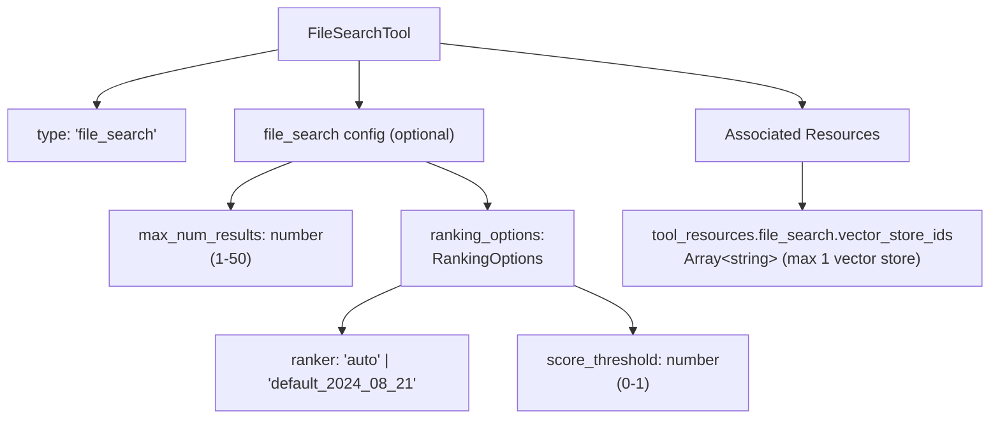
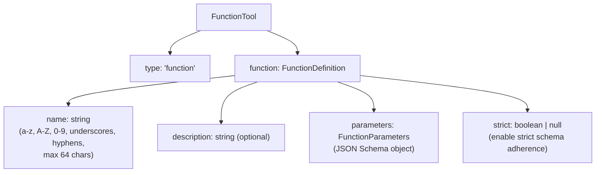

<!-- source: DeepWiki mcp.deepwiki.com · repo openai/openai-node · extra page Assistants · fetched 2026-10-26 -->

# Assistants

<details>
<summary>Relevant source files</summary>

The following files were used as context for generating this wiki page:

- [src/resources/beta/assistants.ts](src/resources/beta/assistants.ts)
- [src/resources/beta/threads/messages.ts](src/resources/beta/threads/messages.ts)
- [src/resources/beta/threads/runs/runs.ts](src/resources/beta/threads/runs/runs.ts)
- [src/resources/beta/threads/runs/steps.ts](src/resources/beta/threads/runs/steps.ts)
- [src/resources/beta/threads/threads.ts](src/resources/beta/threads/threads.ts)
- [src/resources/fine-tuning/jobs/jobs.ts](src/resources/fine-tuning/jobs/jobs.ts)

</details>


This document covers the `Assistants` resource, which manages the creation, configuration, and lifecycle of AI assistant entities. Assistants are stateful configurations that define how a model behaves, what tools it can use, and what resources are available to it. For information about executing assistants within conversations, see [Runs](#4.10.4). For managing conversation state, see [Threads](#4.10.2) and [Messages](#4.10.3).

**Deprecation Notice**: The Assistants API is deprecated in favor of the Responses API. All methods in [src/resources/beta/assistants.ts]() are marked with `@deprecated` annotations.

## Core Concepts

An `Assistant` is a configured AI agent that persists across multiple conversation threads. Unlike stateless API calls, assistants maintain their configuration including:

- **Model selection**: Which OpenAI model to use (e.g., `gpt-4o`) [src/resources/beta/assistants.ts:136-136]().
- **Instructions**: System-level instructions that define the assistant's behavior (max 256,000 characters) [src/resources/beta/assistants.ts:114-117]().
- **Tools**: Enabled capabilities like code execution, file search, or custom functions [src/resources/beta/assistants.ts:149-153]().
- **Tool Resources**: Associated files and vector stores that tools can access [src/resources/beta/assistants.ts:187-192]().
- **Sampling parameters**: Temperature, top_p, and response formatting options [src/resources/beta/assistants.ts:180-201]().
- **Metadata**: Key-value pairs for custom organization (16 pairs max, 64-char keys, 512-char values) [src/resources/beta/assistants.ts:120-127]().

### Assistant Object Structure



**Diagram: Assistant Object Structure and Components**

Sources: [src/resources/beta/assistants.ts:97-202](), [src/resources/beta/assistants.ts:206-253]()

## Assistants Class API

The `Assistants` class in [src/resources/beta/assistants.ts:19-90]() provides CRUD operations for assistant management. All methods require the `OpenAI-Beta: assistants=v2` header.

### Class Hierarchy



**Diagram: Assistants Class Structure and Methods**

Sources: [src/resources/beta/assistants.ts:19-90]()

## Creating Assistants

The `create` method accepts an `AssistantCreateParams` object with parameters including the required `model`.

| Parameter | Type | Required | Description |
|-----------|------|----------|-------------|
| `model` | `string` | Yes | Model ID (e.g., `gpt-4o`, `gpt-4o-mini`) [src/resources/beta/assistants.ts:136-136]() |
| `description` | `string \| null` | No | Description (max 512 chars) [src/resources/beta/assistants.ts:109-111]() |
| `instructions` | `string \| null` | No | System instructions (max 256,000 chars) [src/resources/beta/assistants.ts:114-117]() |
| `name` | `string \| null` | No | Name (max 256 chars) [src/resources/beta/assistants.ts:139-141]() |
| `tools` | `Array<AssistantTool>` | No | Enabled tools (max 128) [src/resources/beta/assistants.ts:149-153]() |
| `tool_resources` | `ToolResources \| null` | No | File and vector store associations [src/resources/beta/assistants.ts:187-192]() |
| `metadata` | `Metadata \| null` | No | Custom key-value pairs [src/resources/beta/assistants.ts:120-127]() |
| `temperature` | `number \| null` | No | Sampling temperature (0-2) [src/resources/beta/assistants.ts:180-184]() |
| `top_p` | `number \| null` | No | Nucleus sampling parameter [src/resources/beta/assistants.ts:195-201]() |
| `response_format` | `AssistantResponseFormatOption \| null` | No | Output format constraint [src/resources/beta/assistants.ts:156-177]() |

Sources: [src/resources/beta/assistants.ts:25-32](), [src/resources/beta/assistants.ts:97-202]()

## Tool Configuration

Assistants support three types of tools, defined as a union type `AssistantTool` in [src/resources/beta/assistants.ts:153-153]():

### Code Interpreter Tool

Enables Python code execution in a sandboxed environment. It can read and write files.



**Diagram: Code Interpreter Tool Configuration**

Sources: [src/resources/beta/assistants.ts:151-151](), [src/resources/beta/assistants.ts:187-192]()

### File Search Tool

Enables semantic search over attached files using vector embeddings.



**Diagram: File Search Tool Configuration**

Sources: [src/resources/beta/assistants.ts:151-151](), [src/resources/beta/assistants.ts:187-192](), [src/resources/beta/threads/runs/steps.ts:216-232]()

### Function Tool

Enables custom function calling with JSON schema definitions.



**Diagram: Function Tool Configuration**

Sources: [src/resources/beta/assistants.ts:151-151](), [src/resources/shared.ts]()

## Response Format Options

The `response_format` parameter controls output structure, defined as `AssistantResponseFormatOption` in [src/resources/beta/threads/threads.ts:187-205]():

| Format | Type | Description |
|--------|------|-------------|
| `'auto'` | String literal | Default - model chooses format |
| `ResponseFormatText` | Object | Plain text output: `{ type: 'text' }` |
| `ResponseFormatJSONObject` | Object | Valid JSON object: `{ type: 'json_object' }` |
| `ResponseFormatJSONSchema` | Object | Structured outputs with schema validation: `{ type: 'json_schema', json_schema: {...} }` |

**Important**: When using `json_object` mode, you must instruct the model to produce JSON in your system message. Without this, the model may generate whitespace until token limits are reached. [src/resources/beta/threads/threads.ts:198-203]()

Sources: [src/resources/beta/threads/threads.ts:187-205](), [src/resources/beta/assistants.ts:156-177]()

## Management Operations

### Retrieving an Assistant

```typescript
retrieve(assistantID: string, options?: RequestOptions): APIPromise<Assistant>
```

Fetches a single assistant by ID. Returns the full `Assistant` object. [src/resources/beta/assistants.ts:39-45]()

### Updating an Assistant

```typescript
update(assistantID: string, body: AssistantUpdateParams, options?: RequestOptions): APIPromise<Assistant>
```

Modifies an existing assistant. Fields not provided remain unchanged. [src/resources/beta/assistants.ts:52-59]()

### Listing Assistants

```typescript
list(query?: AssistantListParams, options?: RequestOptions): PagePromise<AssistantsPage, Assistant>
```

Returns a paginated list of assistants. Parameters include `after`, `before`, `limit`, and `order`. [src/resources/beta/assistants.ts:66-76](). Returns a `CursorPage<Assistant>` for iteration [src/resources/beta/assistants.ts:92-92]().

### Deleting an Assistant

```typescript
delete(assistantID: string, options?: RequestOptions): APIPromise<AssistantDeleted>
```

Permanently removes an assistant. Returns an `AssistantDeleted` object containing the `id` and `deleted` status. [src/resources/beta/assistants.ts:83-89]()

## Assistant Lifecycle Flow

```mermaid
sequenceDiagram
    participant Client as Client Code
    participant AssistantsAPI as Assistants Resource<br/>(beta.assistants)
    participant HTTP as HTTP Layer
    participant OpenAI as OpenAI API
    
    Note over Client,OpenAI: Create Assistant
    Client->>AssistantsAPI: create({model, instructions, tools})
    AssistantsAPI->>HTTP: POST /assistants<br/>Header: OpenAI-Beta=assistants=v2
    HTTP->>OpenAI: Request
    OpenAI-->>HTTP: Assistant object
    HTTP-->>AssistantsAPI: Assistant
    AssistantsAPI-->>Client: Assistant {id, model, ...}
    
    Note over Client,OpenAI: Update Configuration
    Client->>AssistantsAPI: update(assistant_id, {instructions})
    AssistantsAPI->>HTTP: POST /assistants/:id
    HTTP->>OpenAI: Request
    OpenAI-->>HTTP: Updated Assistant
    HTTP-->>AssistantsAPI: Assistant
    AssistantsAPI-->>Client: Assistant
    
    Note over Client,OpenAI: List Assistants
    Client->>AssistantsAPI: list({limit: 20, order: 'desc'})
    AssistantsAPI->>HTTP: GET /assistants?limit=20&order=desc
    HTTP->>OpenAI: Request
    OpenAI-->>HTTP: CursorPage response
    HTTP-->>AssistantsAPI: AssistantsPage
    AssistantsAPI-->>Client: CursorPage&lt;Assistant&gt;
```

**Diagram: Complete Assistant Management Flow**

Sources: [src/resources/beta/assistants.ts:19-90]()

## Pagination

The `list` method returns a `CursorPage<Assistant>` which supports automatic iteration using the `PagePromise` wrapper [src/resources/beta/assistants.ts:66-76]().

Sources: [src/resources/beta/assistants.ts:66-76](), [src/core/pagination.ts]()

## Headers and Versioning

All assistant operations require the `OpenAI-Beta: assistants=v2` header, added via the `buildHeaders` utility [src/resources/beta/assistants.ts:29-29](). This header is automatically included by all methods in the `Assistants` class.

Sources: [src/resources/beta/assistants.ts:25-89](), [src/internal/headers.ts]()

---

