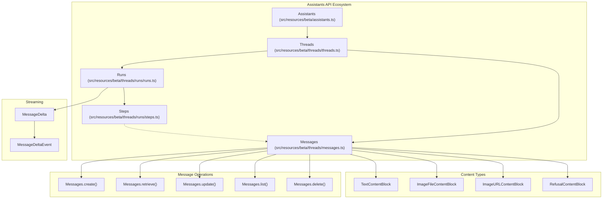
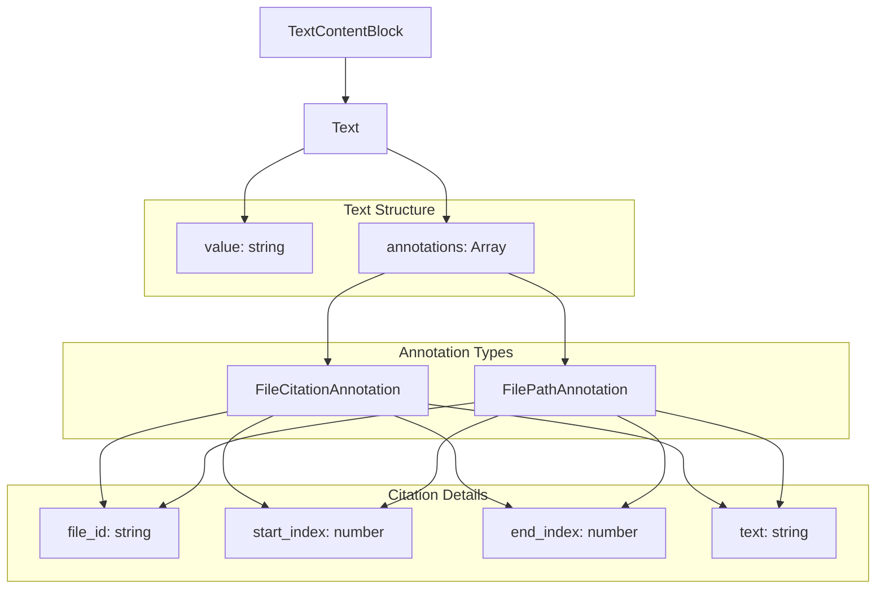
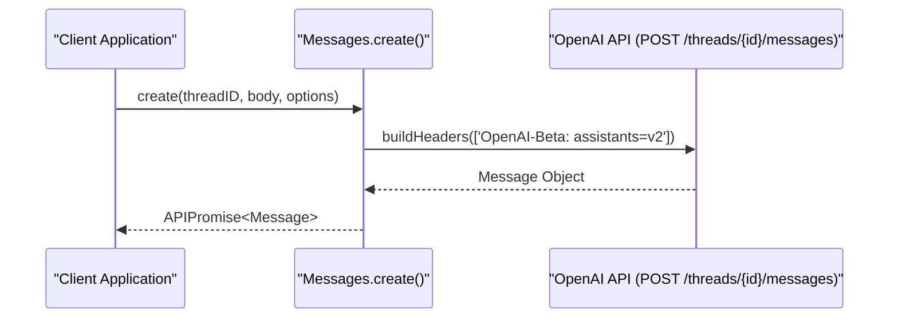
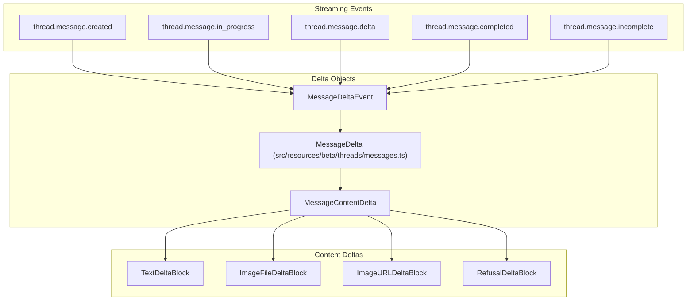

<!-- source: DeepWiki mcp.deepwiki.com · repo openai/openai-node · extra page Messages · fetched 2026-10-26 -->

# Messages

<details>
<summary>Relevant source files</summary>

The following files were used as context for generating this wiki page:

- [src/resources/beta/assistants.ts](src/resources/beta/assistants.ts)
- [src/resources/beta/threads/messages.ts](src/resources/beta/threads/messages.ts)
- [src/resources/beta/threads/runs/runs.ts](src/resources/beta/threads/runs/runs.ts)
- [src/resources/beta/threads/runs/steps.ts](src/resources/beta/threads/runs/steps.ts)
- [src/resources/beta/threads/threads.ts](src/resources/beta/threads/threads.ts)
- [src/resources/fine-tuning/jobs/jobs.ts](src/resources/fine-tuning/jobs/jobs.ts)

</details>


The Messages system provides creation and management of conversational messages within threads in the Assistants API. Messages represent individual communications from users or assistants, supporting text, images, and file attachments.

**Note**: The Assistants API, including Messages, is deprecated in favor of the Responses API [src/resources/beta/threads/messages.ts:15-16]().

## System Architecture

Messages operate within the context of threads and are processed by runs in the Assistants API ecosystem. The `Messages` class provides CRUD operations while supporting rich content types and streaming capabilities.

Title: Assistants API Resource Relationship


Sources: [src/resources/beta/threads/messages.ts:17-96](), [src/resources/beta/threads/threads.ts:80-82](), [src/resources/beta/threads/runs/runs.ts:49-50](), [src/resources/beta/assistants.ts:19-20]()

## Message Structure

The `Message` interface defines the core structure of conversational messages, supporting rich metadata and content types.

| Property | Type | Description |
|----------|------|-------------|
| `id` | string | Unique identifier for the message [src/resources/beta/threads/messages.ts:374](). |
| `role` | 'user' \| 'assistant' | Entity that created the message [src/resources/beta/threads/messages.ts:411](). |
| `content` | Array<MessageContent> | Message content blocks [src/resources/beta/threads/messages.ts:382](). |
| `thread_id` | string | Parent thread identifier [src/resources/beta/threads/messages.ts:416](). |
| `assistant_id` | string \| null | Assistant that authored the message [src/resources/beta/threads/messages.ts:380](). |
| `run_id` | string \| null | Associated run identifier [src/resources/beta/threads/messages.ts:406](). |
| `status` | 'in_progress' \| 'incomplete' \| 'completed' | Message processing status [src/resources/beta/threads/messages.ts:413](). |
| `attachments` | Array<Attachment> \| null | File attachments with tools [src/resources/beta/threads/messages.ts:377](). |
| `metadata` | Metadata \| null | Custom key-value pairs [src/resources/beta/threads/messages.ts:394](). |

Title: Message Entity Composition
```mermaid
graph TD
    Message["Message (src/resources/beta/threads/messages.ts)"]
    
    subgraph "Core Properties"
        ID["id: string"]
        Role["role: 'user' | 'assistant'"]
        Status["status: 'in_progress' | 'incomplete' | 'completed'"]
        ThreadID["thread_id: string"]
        AssistantID["assistant_id: string | null"]
        RunID["run_id: string | null"]
    end
    
    subgraph "Content System"
        Content["content: Array<MessageContent>"]
        TextBlock["TextContentBlock"]
        ImageFileBlock["ImageFileContentBlock"]
        ImageURLBlock["ImageURLContentBlock"]
        RefusalBlock["RefusalContentBlock"]
    end
    
    subgraph "Attachments"
        Attachments["attachments: Array<Attachment>"]
        FileID["file_id: string"]
        Tools["tools: Array<Tool>"]
        CodeInterpreter["CodeInterpreterTool"]
        FileSearch["FileSearchTool"]
    end
    
    Message --> ID
    Message --> Role
    Message --> Status
    Message --> ThreadID
    Message --> AssistantID
    Message --> RunID
    
    Message --> Content
    Content --> TextBlock
    Content --> ImageFileBlock
    Content --> ImageURLBlock
    Content --> RefusalBlock
    
    Message --> Attachments
    Attachments --> FileID
    Attachments --> Tools
    Tools --> CodeInterpreter
    Tools --> FileSearch
```

Sources: [src/resources/beta/threads/messages.ts:370-451](), [src/resources/beta/threads/messages.ts:453-484]()

## Content Types and Structure

Messages support multiple content types through the `MessageContent` union type, enabling rich multimedia conversations.

### Text Content

Text content includes annotations for file citations and generated file paths:

Title: Text Content and Annotation Hierarchy


Sources: [src/resources/beta/threads/messages.ts:594-604](), [src/resources/beta/threads/messages.ts:585-592](), [src/resources/beta/threads/messages.ts:105-217]()

### Image Content

Images can be referenced via file IDs or external URLs:

| Content Type | Properties | Use Case |
|--------------|------------|----------|
| `ImageFileContentBlock` | `image_file.file_id`, `image_file.detail` | Uploaded files with vision analysis [src/resources/beta/threads/messages.ts:267-274](). |
| `ImageURLContentBlock` | `image_url.url`, `image_url.detail` | External image references [src/resources/beta/threads/messages.ts:326-333](). |

Sources: [src/resources/beta/threads/messages.ts:267-274](), [src/resources/beta/threads/messages.ts:326-333]()

## CRUD Operations

The `Messages` class in `src/resources/beta/threads/messages.ts` provides comprehensive message management through standard CRUD operations.

### Message Creation

The `create` method accepts `MessageCreateParams` with content, role, optional attachments, and metadata. It enforces the `OpenAI-Beta: assistants=v2` header [src/resources/beta/threads/messages.ts:27-28]().

Title: Message Creation Data Flow


Sources: [src/resources/beta/threads/messages.ts:23-30](), [src/resources/beta/threads/messages.ts:647-700]()

### Message Retrieval and Listing

| Operation | Method | Parameters | Return Type |
|-----------|--------|------------|-------------|
| Get single | `retrieve(messageID, params)` | `MessageRetrieveParams` | `APIPromise<Message>` [src/resources/beta/threads/messages.ts:37-44](). |
| List messages | `list(threadID, query)` | `MessageListParams` | `PagePromise<MessagesPage, Message>` [src/resources/beta/threads/messages.ts:66-77](). |

The `list` method returns a `PagePromise` for cursor-based pagination, utilizing the `CursorPage<Message>` class [src/resources/beta/threads/messages.ts:71]().

Sources: [src/resources/beta/threads/messages.ts:37-44](), [src/resources/beta/threads/messages.ts:66-77]()

### Message Updates and Deletion

- **Update**: Modifies message metadata via `update(messageID, params)` [src/resources/beta/threads/messages.ts:51-59]().
- **Delete**: Removes message from thread via `delete(messageID, params)` [src/resources/beta/threads/messages.ts:84-95](). Returns a `MessageDeleted` object [src/resources/beta/threads/messages.ts:88]().

## File Attachments and Annotations

Messages support file attachments that integrate with assistant tools for enhanced functionality.

### Attachment Structure

Attachments link specific files to tools like `code_interpreter` or `file_search` for the duration of the message's processing [src/resources/beta/threads/messages.ts:454-473]().

Sources: [src/resources/beta/threads/messages.ts:454-473](), [src/resources/beta/threads/messages.ts:680-699]()

### Annotation System

Text content includes automatic annotations for file citations and paths:

- **File Citations**: References to specific quotes from files used in `file_search` [src/resources/beta/threads/messages.ts:119-144]().
- **File Paths**: References to files generated by `code_interpreter` [src/resources/beta/threads/messages.ts:192-217]().

## Streaming Support

Messages participate in the Assistants API streaming system through delta objects that represent incremental changes during message generation.

Title: Message Streaming Event Model


Sources: [src/resources/beta/threads/messages.ts:539-554](), [src/resources/beta/threads/messages.ts:500-504](), [src/resources/beta/threads/messages.ts:510-537]()

## Integration with Threads and Runs

Messages are managed as a sub-resource of Threads [src/resources/beta/threads/threads.ts:82]().

- **Thread Context**: Messages maintain references to their parent thread via `thread_id` [src/resources/beta/threads/messages.ts:416]().
- **Run Association**: Messages created by assistants during a run include a `run_id` [src/resources/beta/threads/messages.ts:406]().
- **Assistant Relationship**: Assistant-authored messages include an `assistant_id` [src/resources/beta/threads/messages.ts:380]().

Sources: [src/resources/beta/threads/threads.ts:80-82](), [src/resources/beta/threads/messages.ts:370-420]()

---

