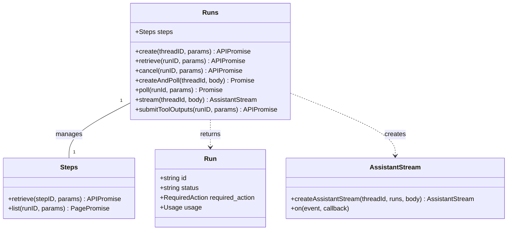
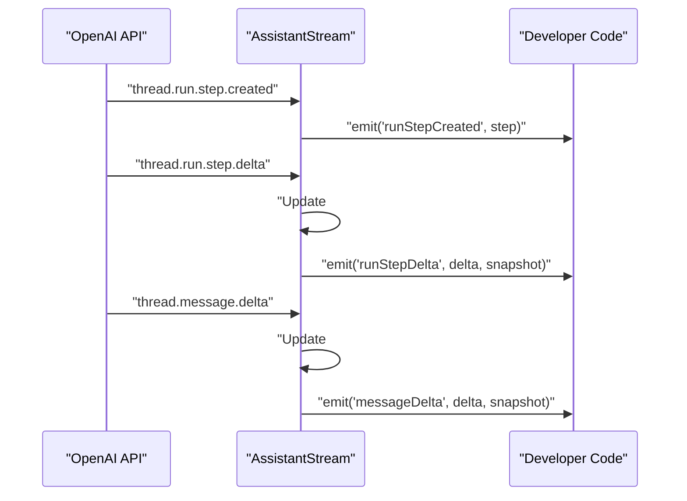

<!-- source: DeepWiki mcp.deepwiki.com · repo openai/openai-node · extra page Runs · fetched 2026-10-26 -->

# Runs

<details>
<summary>Relevant source files</summary>

The following files were used as context for generating this wiki page:

- [examples/tool-call-helpers-zod.ts](examples/tool-call-helpers-zod.ts)
- [examples/tool-call-helpers.ts](examples/tool-call-helpers.ts)
- [src/lib/AbstractChatCompletionRunner.ts](src/lib/AbstractChatCompletionRunner.ts)
- [src/lib/AssistantStream.ts](src/lib/AssistantStream.ts)
- [src/lib/ChatCompletionRunner.ts](src/lib/ChatCompletionRunner.ts)
- [src/lib/ChatCompletionStream.ts](src/lib/ChatCompletionStream.ts)
- [src/lib/ChatCompletionStreamingRunner.ts](src/lib/ChatCompletionStreamingRunner.ts)
- [src/lib/EventStream.ts](src/lib/EventStream.ts)
- [src/lib/RunnableFunction.ts](src/lib/RunnableFunction.ts)
- [src/lib/chatCompletionUtils.ts](src/lib/chatCompletionUtils.ts)
- [src/resources/beta/assistants.ts](src/resources/beta/assistants.ts)
- [src/resources/beta/threads/messages.ts](src/resources/beta/threads/messages.ts)
- [src/resources/beta/threads/runs/index.ts](src/resources/beta/threads/runs/index.ts)
- [src/resources/beta/threads/runs/runs.ts](src/resources/beta/threads/runs/runs.ts)
- [src/resources/beta/threads/runs/steps.ts](src/resources/beta/threads/runs/steps.ts)
- [src/resources/beta/threads/threads.ts](src/resources/beta/threads/threads.ts)
- [src/resources/fine-tuning/jobs/jobs.ts](src/resources/fine-tuning/jobs/jobs.ts)

</details>


> **⚠️ Deprecation Notice**: The Assistants API is deprecated in favor of the Responses API. While this functionality remains available, new implementations should consider using the newer Responses API. [src/resources/beta/threads/runs/runs.ts:47-48](), [src/resources/beta/threads/threads.ts:77-79]()

This document provides a technical overview of the Runs API in the OpenAI Node.js SDK. Runs represent the execution of an Assistant on a Thread, involving a complex lifecycle of state transitions, tool executions, and message generation.

## Run Lifecycle

A run progresses through several states. The SDK provides helper methods like `createAndPoll` and `stream` to manage these transitions automatically.

### Run Status Transitions
```mermaid
stateDiagram-v2
    [*] --> "queued": Run created
    "queued" --> "in_progress": Processing started
    "in_progress" --> "requires_action": Tool outputs needed
    "requires_action" --> "in_progress": submitToolOutputs() called
    "in_progress" --> "completed": Run finished successfully
    "in_progress" --> "failed": Error encountered
    "in_progress" --> "cancelling": cancel() called
    "cancelling" --> "cancelled": Termination confirmed
    "in_progress" --> "expired": Time limit reached
    "in_progress" --> "incomplete": Context window limit
```

Sources: [src/resources/beta/threads/runs/runs.ts:197-219](), [src/resources/beta/threads/runs/runs.ts:629-638]()

## Code Architecture

The `Runs` resource is nested under `Threads` and manages the lifecycle of assistant executions. It interfaces with the `Steps` resource to provide detailed execution logs.

### Code Entity Space: Runs and Steps


Sources: 
- [src/resources/beta/threads/runs/runs.ts:49-50]()
- [src/resources/beta/threads/runs/runs.ts:340-524]()
- [src/lib/AssistantStream.ts:73-76]()
- [src/resources/beta/threads/runs/steps.ts:17-18]()

## Execution Patterns

### Polling Pattern
The SDK implements a robust polling mechanism in `poll()`. It handles intermediate states and respects the `openai-poll-after-ms` header provided by the API to optimize request frequency.

```typescript
// Internal polling logic
while (true) {
  const { data: run, response } = await this.retrieve(runId, params, options).withResponse();
  if (['queued', 'in_progress', 'cancelling'].includes(run.status)) {
    const sleepInterval = options?.pollIntervalMs ?? 
                         parseInt(response.headers.get('openai-poll-after-ms')) ?? 5000;
    await sleep(sleepInterval);
  } else {
    return run;
  }
}
```

Sources: [src/resources/beta/threads/runs/runs.ts:178-219](), [src/resources/beta/threads/runs/runs.ts:151-158]()

### Streaming Pattern
The `AssistantStream` class (extending `EventStream`) handles Server-Sent Events (SSE). It accumulates `RunStepDelta` and `MessageDelta` events into local snapshots.



Sources: [src/lib/AssistantStream.ts:35-59](), [src/lib/AssistantStream.ts:73-95](), [src/lib/AssistantStream.ts:174-177]()

## Tool Output Submission

When a Run status is `requires_action`, the assistant is waiting for tool execution results. The `submitToolOutputs` method is used to provide these results. This can also be streamed using `submitToolOutputsStream`.

```typescript
await client.beta.threads.runs.submitToolOutputs(threadId, runId, {
  tool_outputs: [
    {
      tool_call_id: "call_123",
      output: "The weather is 72 degrees."
    }
  ]
});
```

Sources: [src/resources/beta/threads/runs/runs.ts:236-262](), [src/lib/AssistantStream.ts:189-203]()

## Run Steps

Run steps provide a granular view of the Assistant's internal operations.

| Step Type | Data Object | Description |
| :--- | :--- | :--- |
| `message_creation` | `MessageCreationStepDetails` | The assistant created a new message. [src/resources/beta/threads/runs/steps.ts:443-455]() |
| `tool_calls` | `ToolCallsStepDetails` | The assistant called one or more tools. [src/resources/beta/threads/runs/steps.ts:517-536]() |

### Tool Call Types in Steps
1.  **Code Interpreter**: Includes `input` (code) and `outputs` (logs or images). [src/resources/beta/threads/runs/steps.ts:98-114]()
2.  **File Search**: Contains ranking options and search results. [src/resources/beta/threads/runs/steps.ts:216-232]()
3.  **Function**: Standard tool calls with `name` and `arguments`. [src/resources/beta/threads/runs/steps.ts:323-339]()

Sources: [src/resources/beta/threads/runs/steps.ts:17-47]()

## Advanced Configuration

The `RunCreateParams` allow overriding Assistant behavior per-run:
- **Truncation Strategy**: `truncation_strategy` defines how to handle thread history when context limits are reached. [src/resources/beta/threads/runs/runs.ts:792-806]()
- **Tool Choice**: Use `tool_choice` to force the use of a specific tool or disable them. [src/resources/beta/threads/runs/runs.ts:782-790]()
- **Response Format**: Constrain the output to `json_object` or a specific `json_schema`. [src/resources/beta/threads/runs/runs.ts:742-770]()

Sources: [src/resources/beta/threads/runs/runs.ts:642-806]()

---

