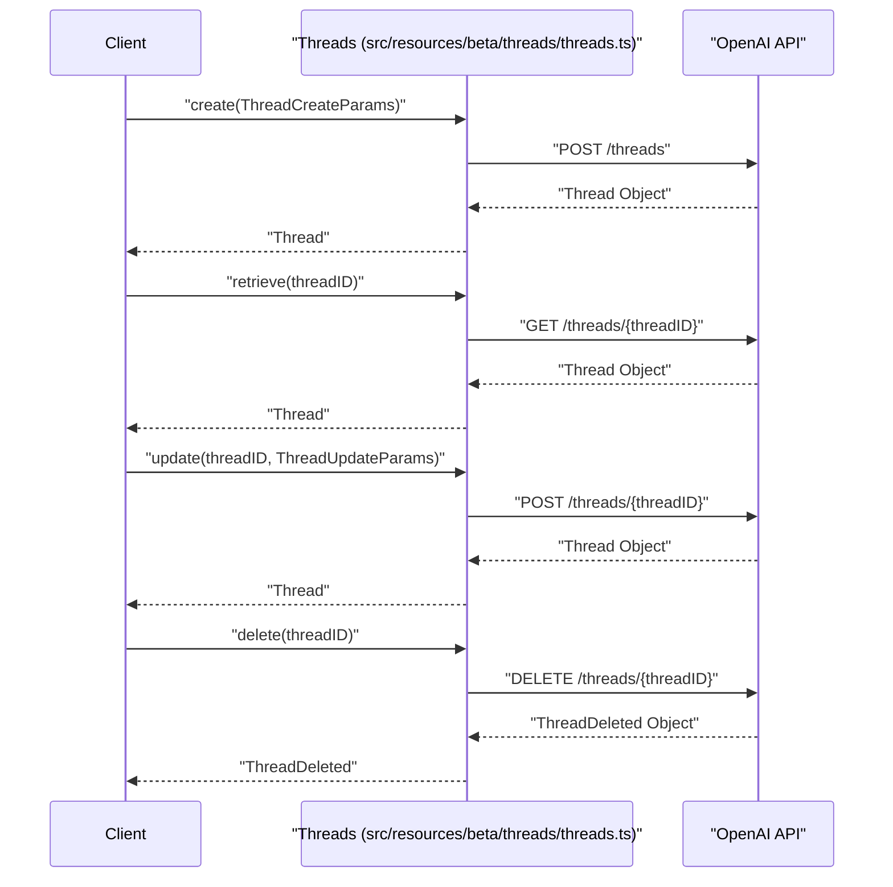
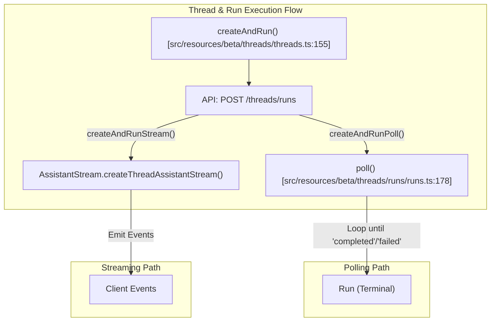
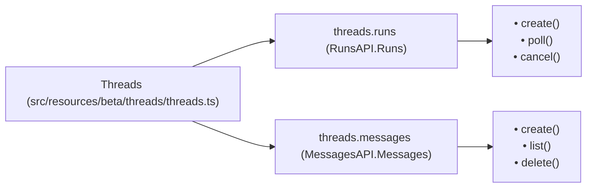

<!-- source: DeepWiki mcp.deepwiki.com · repo openai/openai-node · extra page Threads · fetched 2026-10-26 -->

# Threads

Relevant source files

The following files were used as context for generating this wiki page:

- [src/resources/beta/assistants.ts](src/resources/beta/assistants.ts)
- [src/resources/beta/threads/messages.ts](src/resources/beta/threads/messages.ts)
- [src/resources/beta/threads/runs/runs.ts](src/resources/beta/threads/runs/runs.ts)
- [src/resources/beta/threads/runs/steps.ts](src/resources/beta/threads/runs/steps.ts)
- [src/resources/beta/threads/threads.ts](src/resources/beta/threads/threads.ts)
- [src/resources/fine-tuning/jobs/jobs.ts](src/resources/fine-tuning/jobs/jobs.ts)
- [tests/api-resources/beta/assistants.test.ts](tests/api-resources/beta/assistants.test.ts)
- [tests/api-resources/beta/threads/messages.test.ts](tests/api-resources/beta/threads/messages.test.ts)
- [tests/api-resources/beta/threads/runs/runs.test.ts](tests/api-resources/beta/threads/runs/runs.test.ts)
- [tests/api-resources/beta/threads/threads.test.ts](tests/api-resources/beta/threads/threads.test.ts)
- [tests/api-resources/completions.test.ts](tests/api-resources/completions.test.ts)
- [tests/api-resources/fine-tuning/jobs/jobs.test.ts](tests/api-resources/fine-tuning/jobs/jobs.test.ts)
- [tests/api-resources/images.test.ts](tests/api-resources/images.test.ts)
- [tests/api-resources/moderations.test.ts](tests/api-resources/moderations.test.ts)

This document covers thread management within the Assistants API, including thread creation, modification, and lifecycle operations. Threads serve as conversation containers that hold messages and can be executed by assistants through runs. For information about executing threads, see [Runs](#4.10.4). For information about managing messages within threads, see [Messages](#4.10.3).

**Note**: The Assistants API is currently marked as deprecated in favor of the Responses API [src/resources/beta/threads/threads.ts:78-78]().

## Thread Architecture Overview

The `Threads` class acts as the primary entry point for managing conversational state. It orchestrates the creation of thread entities and provides access to nested resources for `Runs` and `Messages`.

```mermaid
graph TB
    subgraph "Thread Management [src/resources/beta/threads/threads.ts]"
        ThreadsClass["Threads"]
        ThreadEntity["Thread"]
        ThreadCreateParams["ThreadCreateParams"]
        ThreadUpdateParams["ThreadUpdateParams"]
    end
    
    subgraph "Nested Resources"
        RunsResource["threads.runs (RunsAPI.Runs)"]
        MessagesResource["threads.messages (MessagesAPI.Messages)"]
    end
    
    subgraph "Tool Resources"
        CodeInterpreter["code_interpreter"]
        FileSearch["file_search"]
        VectorStores["vector_stores"]
    end
    
    subgraph "Operations"
        Create["create()"]
        Retrieve["retrieve()"]
        Update["update()"]
        Delete["delete()"]
        CreateAndRun["createAndRun()"]
        CreateAndRunPoll["createAndRunPoll()"]
        CreateAndRunStream["createAndRunStream()"]
    end
    
    ThreadsClass --> RunsResource
    ThreadsClass --> MessagesResource
    ThreadsClass --> Create
    ThreadsClass --> Retrieve
    ThreadsClass --> Update
    ThreadsClass --> Delete
    ThreadsClass --> CreateAndRun
    ThreadsClass --> CreateAndRunPoll
    ThreadsClass --> CreateAndRunStream
    
    ThreadEntity --> CodeInterpreter
    ThreadEntity --> FileSearch
    ThreadEntity --> VectorStores
    
    Create --> ThreadCreateParams
    Update --> ThreadUpdateParams
```

Sources: [src/resources/beta/threads/threads.ts:80-185]()

## Core Thread Operations

The `Threads` class provides fundamental CRUD operations. All requests to the threads endpoints include the `OpenAI-Beta: assistants=v2` header [src/resources/beta/threads/threads.ts:93-93]().

| Operation | Method | Purpose |
|-----------|--------|---------|
| **Create** | `create()` | Creates a new thread with optional initial messages and tool resources [src/resources/beta/threads/threads.ts:89-96](). |
| **Retrieve** | `retrieve()` | Fetches an existing thread by its ID [src/resources/beta/threads/threads.ts:103-108](). |
| **Update** | `update()` | Modifies thread metadata and tool resources [src/resources/beta/threads/threads.ts:116-122](). |
| **Delete** | `delete()` | Permanently removes a thread and its associated messages [src/resources/beta/threads/threads.ts:130-135](). |

### Basic Thread Lifecycle

Sources: [src/resources/beta/threads/threads.ts:87-136]()

## Thread Structure and Properties

The `Thread` interface defines the schema for the conversational container. It includes identifiers, timestamps, and resource configurations.

### Thread Properties

- **`id`**: Unique thread identifier [src/resources/beta/threads/threads.ts:246-246]().
- **`created_at`**: Unix timestamp (seconds) of creation [src/resources/beta/threads/threads.ts:251-251]().
- **`metadata`**: Up to 16 key-value pairs for custom data [src/resources/beta/threads/threads.ts:260-260]().
- **`object`**: Always `"thread"` [src/resources/beta/threads/threads.ts:265-265]().
- **`tool_resources`**: Configuration for tools like `code_interpreter` and `file_search` [src/resources/beta/threads/threads.ts:270-270]().

### Tool Resources Configuration

Threads can be configured with resources that tools use during a run:

1.  **Code Interpreter**: Holds an array of `file_ids` (max 20) used for data analysis or code execution [src/resources/beta/threads/threads.ts:285-285]().
2.  **File Search**: Supports `vector_store_ids` for retrieval-augmented generation [src/resources/beta/threads/threads.ts:300-300](). During thread creation, vector stores can be created inline via `vector_stores` parameters [src/resources/beta/threads/threads.ts:461-488]().

Sources: [src/resources/beta/threads/threads.ts:242-507]()

## Advanced Thread Operations

The SDK provides high-level helpers to combine thread creation with run execution and polling.

### Create and Run Helpers

| Method | Return Type | Description |
|--------|-------------|-------------|
| `createAndRun()` | `APIPromise<Run \| Stream>` | Atomic request to create a thread and start a run [src/resources/beta/threads/threads.ts:143-164](). |
| `createAndRunPoll()` | `Promise<Run>` | Creates a thread, starts a run, and uses the `runs.poll()` helper to wait for a terminal state [src/resources/beta/threads/threads.ts:171-177](). |
| `createAndRunStream()` | `AssistantStream` | Creates a thread and returns an `AssistantStream` for handling real-time events [src/resources/beta/threads/threads.ts:182-184](). |

### Thread and Run Integration Flow

The following diagram illustrates how the "Create and Run" helpers bridge the gap between static thread creation and active model execution.

Sources: [src/resources/beta/threads/threads.ts:139-185](), [src/resources/beta/threads/runs/runs.ts:151-182]()

## Relationship to Nested Resources

The `Threads` class maintains instances of `Runs` and `Messages` to allow for chained access (e.g., `client.beta.threads.runs.create(...)`).

- **`this.runs`**: An instance of `RunsAPI.Runs` [src/resources/beta/threads/threads.ts:81-81]().
- **`this.messages`**: An instance of `MessagesAPI.Messages` [src/resources/beta/threads/threads.ts:82-82]().

Sources: [src/resources/beta/threads/threads.ts:81-82](), [src/resources/beta/threads/runs/runs.ts:49-50](), [src/resources/beta/threads/messages.ts:17-17]()

---

