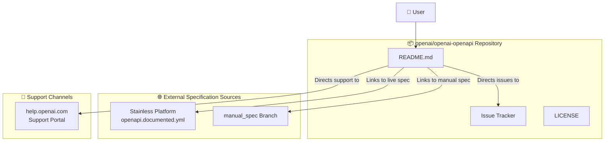
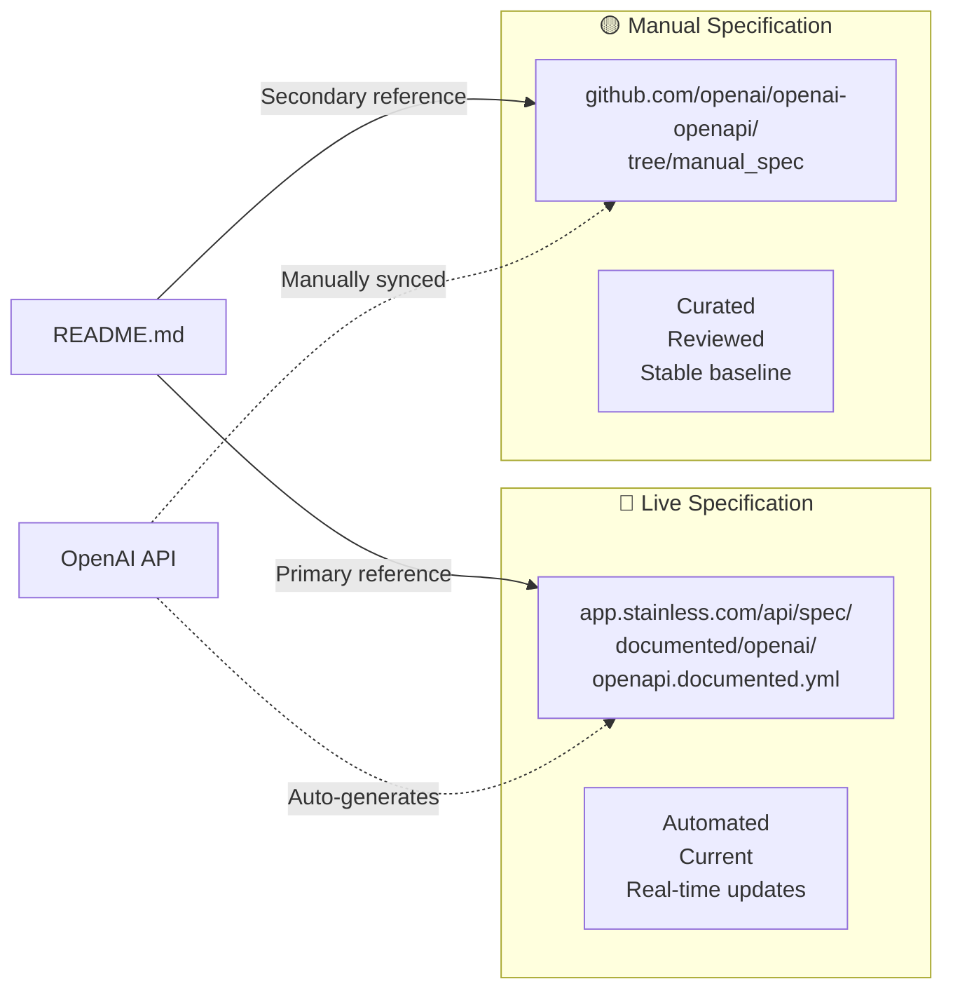
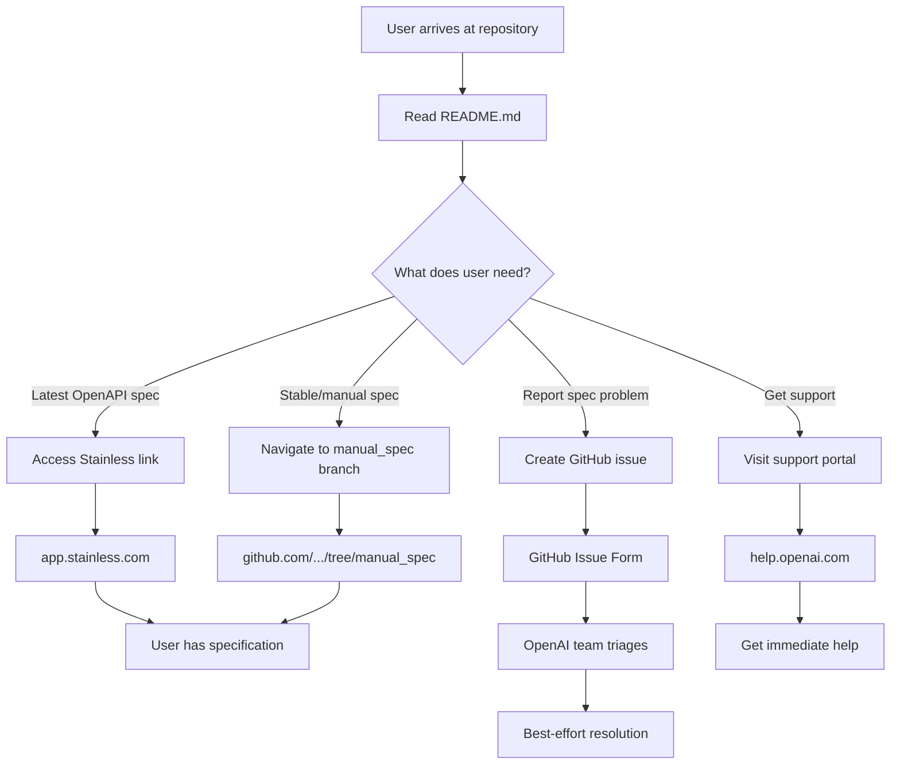

<!-- source: DeepWiki mcp.deepwiki.com · repo openai/openai-openapi · page 1 Repository Overview · fetched 2026-10-26 -->

# Repository Overview

Relevant source files

The following files were used as context for generating this wiki page:

- [README.md](README.md)

## Purpose and Philosophy

The `openai/openai-openapi` repository serves as a **navigation hub and pointer** to OpenAPI specifications for the OpenAI API, rather than a specification storage repository. This repository implements a minimalist design philosophy where the primary content is routing information to external authoritative sources.

**Key Characteristics:**
- **Navigation Hub**: Central documentation point that directs users to specification sources
- **Lightweight Architecture**: Minimal content storage, maximum routing capability
- **Dual Specification Strategy**: References both automated (live) and curated (manual) specification versions
- **Separation of Concerns**: Distinct pathways for specification access, issue reporting, and support

The repository does **not** contain the OpenAPI specification file itself. Instead, it provides clear pathways to access specifications hosted elsewhere, ensuring users always access the most current and appropriate version for their needs.

Sources: [README.md:1-17]()

## Repository Architecture

### Hub-and-Spoke Model

The repository implements a hub-and-spoke architecture where `README.md` acts as the central routing hub to external specification sources and support channels.

**Hub-and-Spoke Navigation Architecture**

Sources: [README.md:1-17]()

### What This Repository Contains

The repository has minimal content by design:

| Component | Description | Location |
|-----------|-------------|----------|
| `README.md` | Primary navigation document with links to specifications and support | [README.md:1-17]() |
| Issue Tracker | GitHub issues for reporting specification problems | Repository feature |
| `LICENSE` | MIT License terms | Root directory |

**Content stored in this repository is intentionally minimal** to ensure users always access authoritative, up-to-date sources rather than potentially stale copies.

Sources: [README.md:1-17]()

### What This Repository References

The `README.md` file provides navigation to external resources:

| Resource | Type | URL Pattern | Purpose |
|----------|------|-------------|---------|
| Live Specification | Automated | `app.stainless.com/api/spec/documented/openai/openapi.documented.yml` | Most recent, auto-generated spec |
| Manual Specification | Curated | `github.com/openai/openai-openapi/tree/manual_spec` | Human-reviewed, stable spec |
| Support Portal | Documentation | `help.openai.com` | General support and assistance |

Sources: [README.md:3-16]()

## Dual Specification Strategy

The repository documentation references two distinct specification sources, each serving different use cases:

**Dual-Track Specification Architecture**

Sources: [README.md:3-10]()

### Specification Comparison

| Aspect | Live Specification | Manual Specification |
|--------|-------------------|---------------------|
| **Source** | Stainless Platform | `manual_spec` Git branch |
| **Update Method** | Automated | Manual curation |
| **Currency** | Most recent | Stable baseline |
| **Best For** | SDK generation, real-time tooling | Documentation, validation |
| **Access** | External URL | Git branch |

This dual-track approach balances **agility** (rapid API changes reflected in live spec) with **stability** (reviewed specification for critical integrations).

Sources: [README.md:3-10]()

## User Journey Flow

The `README.md` serves as a decision router, directing users to appropriate resources based on their needs:

**User Navigation Flow**

Sources: [README.md:1-17]()

### Navigation Pathways

The `README.md` content provides four distinct navigation pathways:

1. **Specification Access (Live)**: Direct link to Stainless platform for most recent spec [README.md:3-5]()
2. **Specification Access (Manual)**: Link to `manual_spec` branch for curated version [README.md:7-10]()
3. **Issue Reporting**: Direction to GitHub issue tracker for spec problems [README.md:12-14]()
4. **General Support**: Link to OpenAI support portal for immediate assistance [README.md:14-16]()

This separation ensures users reach the appropriate resource for their specific need without confusion.

Sources: [README.md:1-17]()

## License and Contribution Guidelines

### License

The repository is licensed under the MIT License, which allows for free use, modification, and distribution, subject to including the original copyright notice.

Sources: [LICENSE:1-22]()

### Contribution Guidelines

As noted in the README, this repository is a public mirror of OpenAI's internal API specification. Currently, pull requests to this repository are not accepted. This policy may change in the future to allow for contributions and corrections.

Sources: [README.md:5-7]()

---

