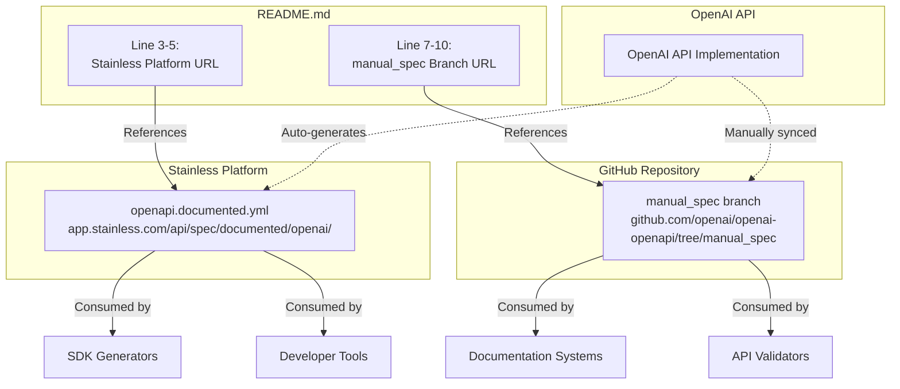
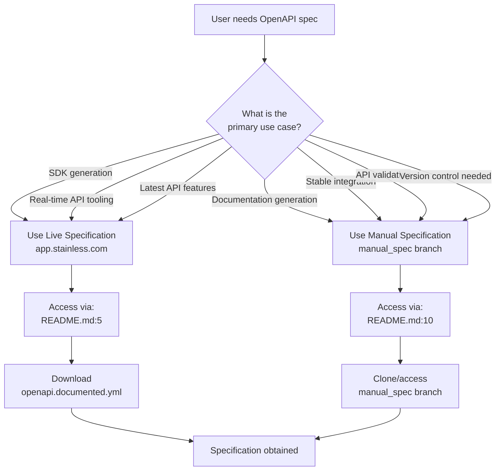
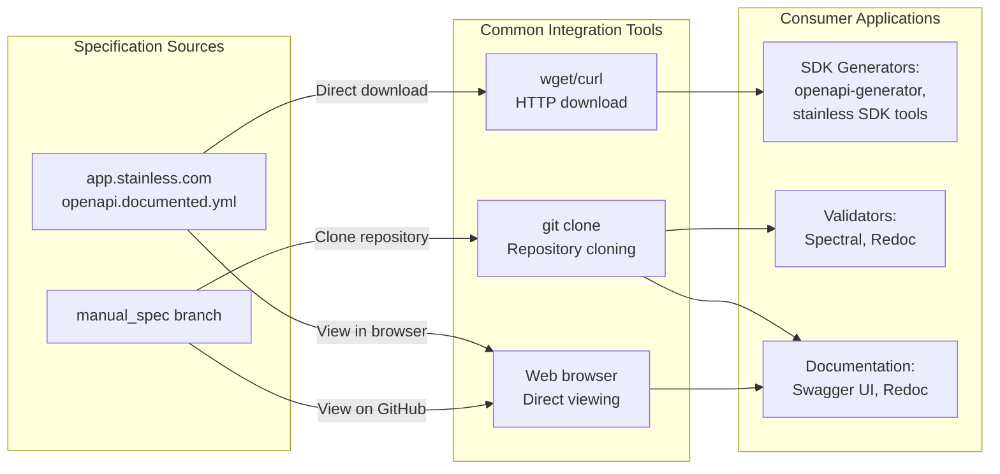

<!-- source: DeepWiki mcp.deepwiki.com · repo openai/openai-openapi · page 2 OpenAPI Specification Access · fetched 2026-10-26 -->

# OpenAPI Specification Access

<details>
<summary>Relevant source files</summary>

The following files were used as context for generating this wiki page:

- [README.md](README.md)

</details>


## Purpose and Scope

This document explains how to access the OpenAPI specification for the OpenAI API. The repository implements a dual-track specification strategy that provides both automatically-updated and manually-curated versions of the OpenAPI specification. This page covers the access methods, use cases, and decision criteria for choosing between specification versions.

For detailed information about the live specification hosted on Stainless, see [Live Specification (Stainless Platform)](#2.1). For information about the manually-curated specification in Git, see [Manual Specification (Git Branch)](#2.2). For reporting issues with the specification, see [Reporting Specification Issues](#3.1).

Sources: [README.md:1-17]()

## Dual-Track Specification Strategy

The OpenAI API provides two distinct versions of its OpenAPI specification:

| Specification Type | Hosting Location | Update Method | Primary Use Cases |
|-------------------|------------------|---------------|-------------------|
| **Live Specification** | Stainless Platform | Automated | SDK generation, real-time tooling, latest API features |
| **Manual Specification** | `manual_spec` Git branch | Manual curation | Documentation, validation, stable integrations |

The live specification reflects the current state of the OpenAI API with automatic updates, while the manual specification undergoes human review before publication. This architecture balances agility in API development with stability for critical integrations.

Sources: [README.md:3-10]()

## Specification Access Architecture



**Diagram: Specification Access Flow from README.md**

This diagram shows how the `README.md` file serves as the routing mechanism to both specification sources, and how each specification type serves different downstream consumers.

Sources: [README.md:3-10]()

## Access Method Overview

### Live Specification Access

The most recent OpenAPI specification is available at:

```
https://app.stainless.com/api/spec/documented/openai/openapi.documented.yml
```

This URL is documented in [README.md:5](). The specification file is named `openapi.documented.yml` and is hosted on the Stainless platform at `app.stainless.com`.

**Key Characteristics:**
- **Update Frequency:** Automatic updates as API changes
- **File Format:** YAML (`.yml` extension)
- **Hosting Platform:** `app.stainless.com`
- **Access Method:** Direct HTTP download via browser or command-line tools

For detailed usage instructions and integration patterns, see [Live Specification (Stainless Platform)](#2.1).

Sources: [README.md:3-5]()

### Manual Specification Access

The manually-curated OpenAPI specification is available on the `manual_spec` Git branch:

```
https://github.com/openai/openai-openapi/tree/manual_spec
```

This branch reference is documented in [README.md:10](). The branch name `manual_spec` indicates its manually-curated nature.

**Key Characteristics:**
- **Update Frequency:** Manual updates after human review
- **Storage Location:** Git branch in the repository
- **Access Method:** Git clone, GitHub web interface, or branch-specific URLs
- **Version Control:** Full Git history available

For detailed usage instructions and cloning procedures, see [Manual Specification (Git Branch)](#2.2).

Sources: [README.md:7-10]()

## Specification Selection Decision Flow



**Diagram: Specification Selection Decision Tree**

This flowchart maps user requirements to the appropriate specification source, showing the decision criteria and access paths documented in the `README.md` file.

Sources: [README.md:3-10]()

## Specification Access Comparison

The following table provides a detailed comparison to assist in selecting the appropriate specification version:

| Criteria | Live Specification | Manual Specification |
|----------|-------------------|---------------------|
| **URL Format** | Single-file download URL | Git branch URL |
| **Access Pattern** | HTTP GET request | Git clone or web browse |
| **Update Lag** | Near real-time | Hours to days |
| **Review Status** | Automated generation | Human-reviewed |
| **Stability** | May change frequently | Stable between updates |
| **Version History** | Not available via platform | Full Git history |
| **Offline Access** | Requires download | Available after clone |
| **Integration Complexity** | Simple (direct URL) | Moderate (Git operations) |

Sources: [README.md:3-10]()

## File References in README.md

The `README.md` file contains the following key references for specification access:

| Line Numbers | Content Type | Target Resource |
|--------------|-------------|-----------------|
| [README.md:5]() | Live spec URL | `https://app.stainless.com/api/spec/documented/openai/openapi.documented.yml` |
| [README.md:10]() | Manual spec URL | `https://github.com/openai/openai-openapi/tree/manual_spec` |
| [README.md:12-13]() | Issue reporting | GitHub issue tracker directive |
| [README.md:16]() | Support URL | `https://help.openai.com/en/articles/6614161-how-can-i-contact-support` |

These references in the `README.md` serve as the authoritative navigation layer for the entire specification access system.

Sources: [README.md:1-17]()

## Integration Patterns



**Diagram: Specification Integration Tool Chain**

This diagram illustrates common tools used to retrieve specifications from each source and their downstream applications. The live specification (`openapi.documented.yml` on `app.stainless.com`) is typically accessed via HTTP tools, while the `manual_spec` branch uses Git-based workflows.

Sources: [README.md:3-10]()

## Specification Update Workflow

The dual-track system operates with different update workflows:

**Live Specification Workflow:**
1. OpenAI API implementation changes
2. Stainless platform automatically generates updated `openapi.documented.yml`
3. File becomes immediately available at the URL in [README.md:5]()
4. No manual intervention required

**Manual Specification Workflow:**
1. OpenAI API implementation changes
2. OpenAI team reviews changes
3. Team manually updates files in `manual_spec` branch
4. Changes committed to the branch referenced in [README.md:10]()
5. Specification available after branch update

Sources: [README.md:3-10]()

## Related Documentation

For specific implementation details:
- **Live specification access details:** See [Live Specification (Stainless Platform)](#2.1)
- **Manual specification access details:** See [Manual Specification (Git Branch)](#2.2)
- **Reporting specification problems:** See [Reporting Specification Issues](#3.1)
- **General support needs:** See [Contacting OpenAI Support](#3.2)
- **Repository architecture overview:** See [Repository Architecture](#4)

Sources: [README.md:1-17]()

---

