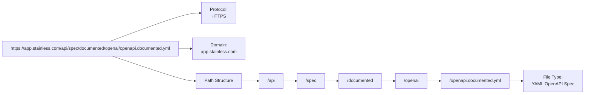
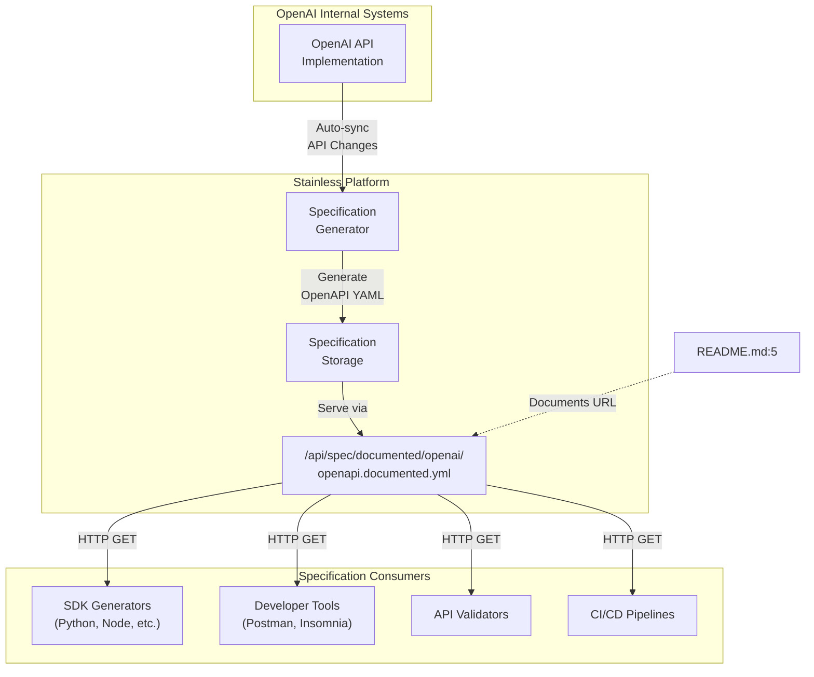
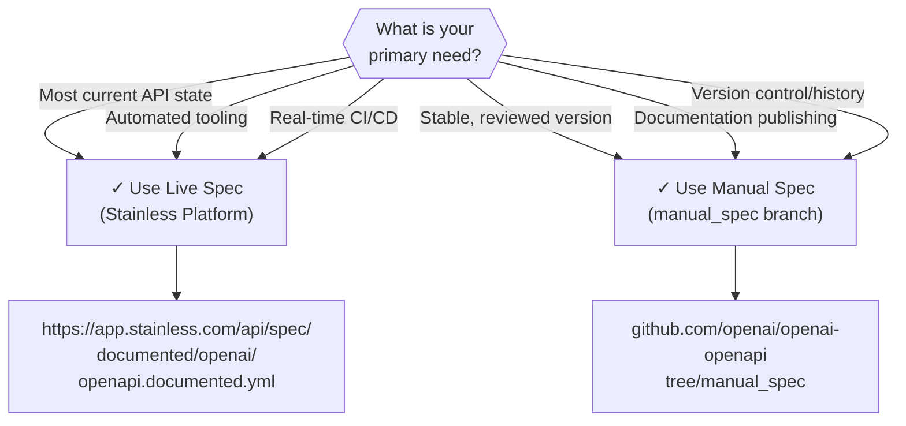
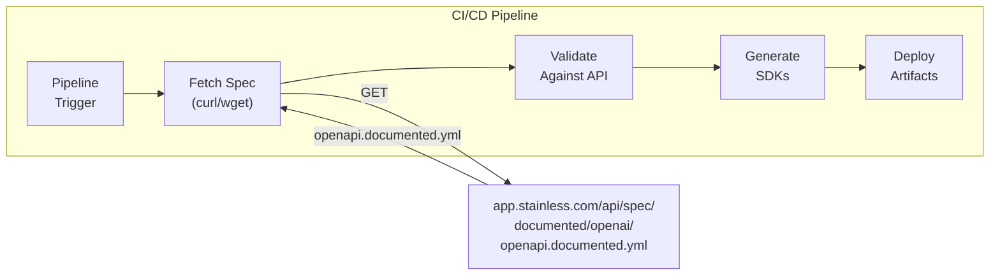
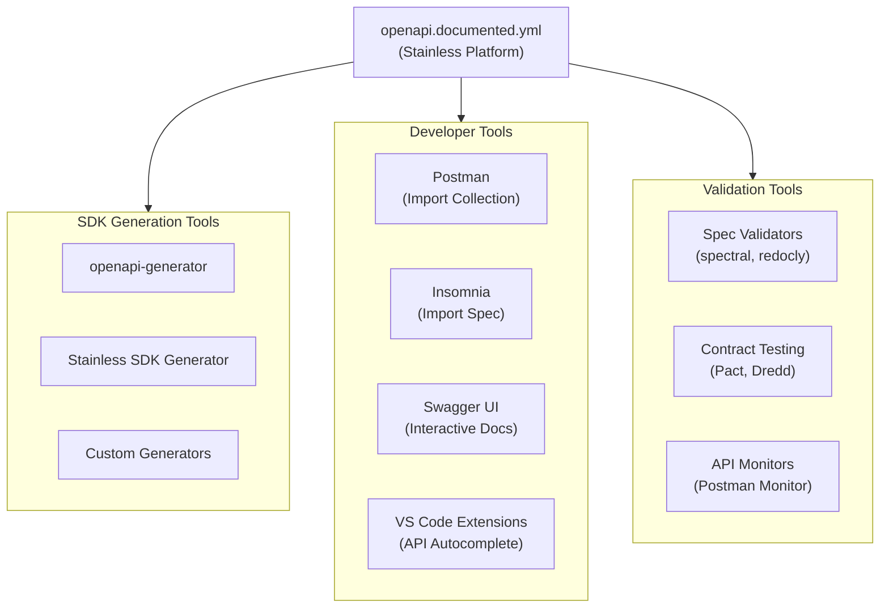
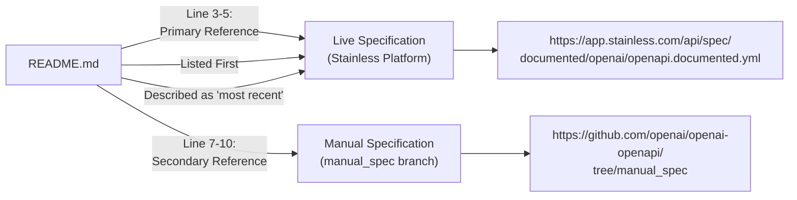

<!-- source: DeepWiki mcp.deepwiki.com · repo openai/openai-openapi · page 2.1 Live Specification (Stainless Platform) · fetched 2026-10-26 -->

# Live Specification (Stainless Platform)

<details>
<summary>Relevant source files</summary>

The following files were used as context for generating this wiki page:

- [README.md](README.md)

</details>


This page documents the **live OpenAPI specification** for the OpenAI API, which is automatically updated and hosted on the Stainless platform. This specification represents the most current state of the OpenAI API implementation.

For information about the manually-curated specification alternative, see [Manual Specification (Git Branch)](#2.2). For general information about OpenAPI specification access strategies, see [OpenAPI Specification Access](#2).

**Sources:** [README.md:1-17]()

---

## Overview

The live OpenAPI specification is an **automatically-updated** YAML file that reflects the current state of the OpenAI API. Unlike the manual specification which requires human review and Git commits, the live specification is generated dynamically from the API implementation.

### Key Characteristics

| Characteristic | Value |
|----------------|-------|
| **Update Frequency** | Automatic (reflects API changes immediately) |
| **Hosting Platform** | Stainless (`app.stainless.com`) |
| **File Format** | YAML (OpenAPI specification) |
| **Filename** | `openapi.documented.yml` |
| **Maintenance** | Automated generation from API source |
| **Version Control** | Not Git-versioned (use manual spec for versioning) |

**Sources:** [README.md:3-5]()

---

## Access URL

The live specification is accessible via a direct HTTPS URL:

```
https://app.stainless.com/api/spec/documented/openai/openapi.documented.yml
```

This URL provides immediate access to the current specification without requiring authentication or repository access.

### URL Structure



**Sources:** [README.md:5]()

### Accessing the Specification

The specification can be retrieved using standard HTTP clients:

**Command Line (curl):**
```bash
curl https://app.stainless.com/api/spec/documented/openai/openapi.documented.yml
```

**Programmatic Access:**
Any HTTP client can fetch the specification for processing, validation, or code generation.

**Sources:** [README.md:5]()

---

## Live Specification Architecture

The following diagram illustrates how the live specification is generated and accessed by various consumers:



**Sources:** [README.md:3-5]()

---

## File Format and Structure

The `openapi.documented.yml` file follows the OpenAPI Specification standard, providing a machine-readable description of the OpenAI API.

### Expected Contents

The specification file includes:

- **OpenAPI version** declaration (e.g., `openapi: 3.0.x` or `3.1.x`)
- **API metadata** (title, description, version)
- **Server URLs** for API endpoints
- **Authentication schemes** (API key authentication)
- **Paths** defining all API endpoints
- **Request/response schemas** for each endpoint
- **Data models** and component definitions
- **Error response formats**

### Format Specification

```mermaid
graph LR
    File["openapi.documented.yml"]
    
    File --> Format["Format: YAML"]
    File --> Standard["Standard: OpenAPI 3.x"]
    File --> Encoding["Encoding: UTF-8"]
    
    Standard --> Components["Components"]
    Standard --> Paths["Paths"]
    Standard --> Servers["Servers"]
    
    Components --> Schemas["schemas"]
    Components --> Security["securitySchemes"]
    Components --> Responses["responses"]
    
    Paths --> Endpoints["API Endpoints"]
    Endpoints --> Methods["HTTP Methods"]
    Methods --> Parameters["Parameters"]
    Methods --> RequestBodies["Request Bodies"]
    Methods --> ResponseDefs["Response Definitions"]
```



**Sources:** [README.md:5]()

---

## Use Cases

The live specification serves specific use cases where **currency** and **automation** are priorities:

### Primary Use Cases

| Use Case | Description | Why Live Spec? |
|----------|-------------|----------------|
| **SDK Generation** | Automated generation of client SDKs | Requires most recent API surface |
| **Real-time Validation** | CI/CD pipeline validation against current API | Must match production API |
| **Development Tools** | IDEs, API explorers, testing tools | Need current endpoint definitions |
| **Monitoring** | Detecting API changes and breaking changes | Requires immediate update detection |
| **Prototyping** | Rapid experimentation with latest features | Access to newest endpoints |

### When to Use Live Spec vs Manual Spec



**Sources:** [README.md:3-10]()

---

## Integration Patterns

### Pattern 1: Direct HTTP Fetch

Fetch the specification on-demand for processing:

**Implementation:**
- Direct HTTP GET request to the Stainless URL
- Parse YAML content
- Process specification (validate, generate code, etc.)

**Use Case:** One-time SDK generation, manual inspection

### Pattern 2: Cached Retrieval

Fetch and cache the specification with periodic refresh:

**Implementation:**
- Periodic HTTP GET with caching logic
- Cache invalidation based on time or API version changes
- Local storage for offline access

**Use Case:** Developer tools, IDEs with offline support

### Pattern 3: CI/CD Integration

Integrate specification retrieval into automated pipelines:

**Implementation:**
- Pipeline step fetches specification from Stainless URL
- Run validation against implementation
- Generate SDK artifacts
- Deploy or publish results

**Use Case:** Continuous integration, automated SDK publishing



**Sources:** [README.md:5]()

---

## Specification Consumers

The following diagram maps specific tooling categories to their interaction with the live specification:



**Sources:** [README.md:3-5]()

---

## Differences from Manual Specification

The live specification differs from the manual specification in key operational aspects:

### Comparison Table

| Aspect | Live Specification | Manual Specification |
|--------|-------------------|---------------------|
| **Update Method** | Automated generation | Manual Git commits |
| **Update Frequency** | Real-time with API changes | Periodic human review cycles |
| **Location** | `app.stainless.com` | `manual_spec` Git branch |
| **Version Control** | Not Git-tracked | Git-versioned with history |
| **Review Process** | Automated only | Human-curated and reviewed |
| **Stability** | May change frequently | Stable between updates |
| **Access Method** | Direct HTTP URL | Git clone/checkout |
| **Best For** | Automation, tooling, CI/CD | Documentation, stable integrations |

**Sources:** [README.md:3-10]()

---

## Relationship to README Documentation

The README.md file serves as the primary pointer to the live specification:



The README positions the live specification as the **primary reference** by listing it first and describing it as "the most recent OpenAPI specification."

**Sources:** [README.md:3-10]()

---

## Operational Considerations

### Availability

- **Uptime:** Dependent on Stainless platform availability
- **No SLA:** No service-level agreement documented
- **Fallback:** Use manual specification if live spec is unavailable

### Caching Recommendations

For production systems consuming the live specification:

1. **Implement local caching** to reduce dependency on external service
2. **Set reasonable TTL** (e.g., 1 hour) for cache invalidation
3. **Monitor for changes** to detect breaking changes early
4. **Maintain fallback** to last-known-good specification

### Rate Limiting

No documented rate limits exist for accessing the Stainless URL, but consumers should:

- Avoid excessive polling (use reasonable intervals)
- Implement exponential backoff on failures
- Cache responses appropriately

**Sources:** [README.md:5]()

---

## Summary

The live OpenAPI specification on the Stainless platform provides:

- **Real-time accuracy:** Automatically reflects current API state
- **Easy access:** Simple HTTPS URL without authentication
- **Tool-friendly:** Designed for automated consumption
- **Continuous integration:** Ideal for CI/CD pipelines

For stable, version-controlled specifications suitable for documentation, use the manual specification documented in [Manual Specification (Git Branch)](#2.2). For reporting issues with the specification, see [Reporting Specification Issues](#3.1).

**Sources:** [README.md:1-17]()

---

