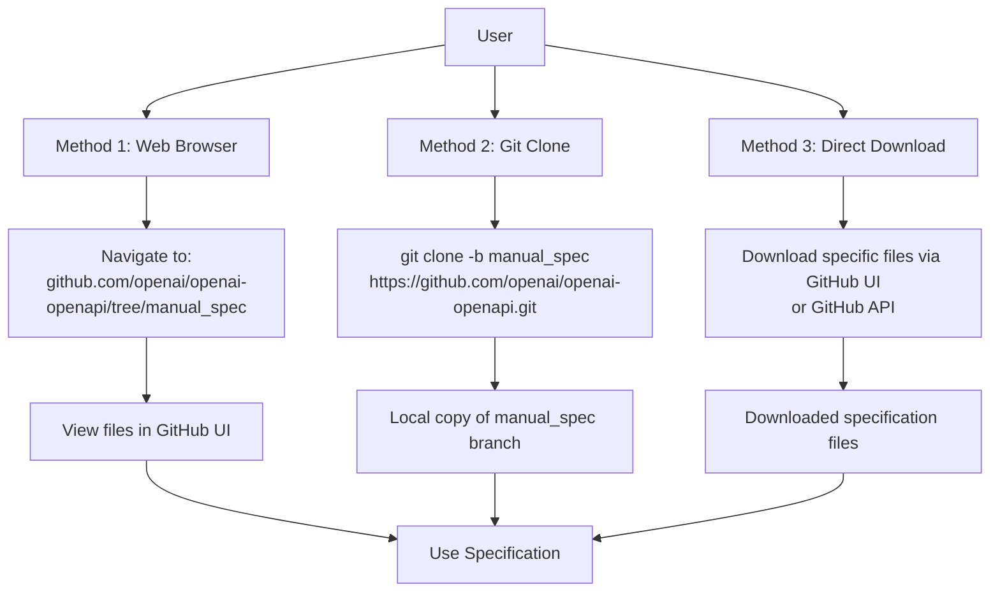
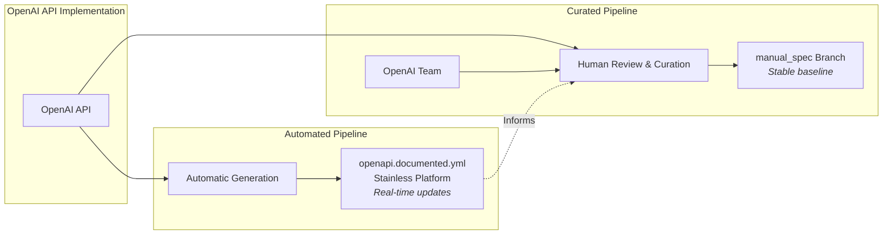
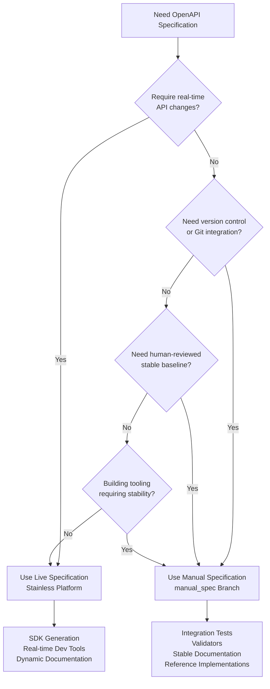
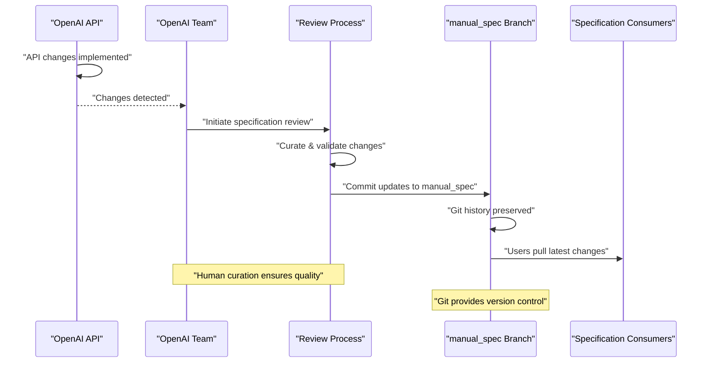
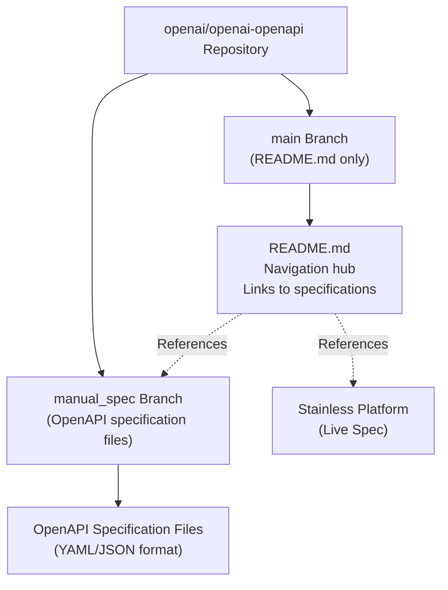

<!-- source: DeepWiki mcp.deepwiki.com · repo openai/openai-openapi · page 2.2 Manual Specification (Git Branch) · fetched 2026-10-26 -->

# Manual Specification (Git Branch)

<details>
<summary>Relevant source files</summary>

The following files were used as context for generating this wiki page:

- [README.md](README.md)

</details>


## Purpose and Scope

This document describes the manually-curated OpenAPI specification for the OpenAI API, which is maintained on the `manual_spec` Git branch of this repository. This specification represents a human-reviewed, stable baseline version of the API specification, as opposed to the automatically-generated live specification documented in [Live Specification (Stainless Platform)](#2.1).

The manual specification is designed for use cases requiring stability, versioning, and human curation, such as documentation generation, validation tooling, and integration testing where a stable reference is preferred over real-time updates.

## Accessing the Manual Specification

### Branch Location

The manual specification is hosted as a Git branch within the `openai/openai-openapi` repository:

```
https://github.com/openai/openai-openapi/tree/manual_spec
```

**Sources:** [README.md:7-10]()

### Access Methods



**Sources:** [README.md:7-10]()

| Access Method | Use Case | Advantages |
|--------------|----------|------------|
| **Web Browser** | Quick reference, one-time viewing | No tools required, immediate access |
| **Git Clone** | Development integration, version tracking | Full Git history, easy updates via `git pull` |
| **Direct Download** | Automation, CI/CD pipelines | Scriptable, specific file retrieval |

## Specification Characteristics

### Manual vs Live Specification Comparison



**Sources:** [README.md:3-10]()

| Attribute | Manual Specification | Live Specification |
|-----------|---------------------|-------------------|
| **Update Mechanism** | Manual curation by OpenAI team | Automatic generation from API |
| **Update Frequency** | As needed, human-driven | Real-time, continuous |
| **Stability** | High - changes are deliberate | Lower - reflects immediate API changes |
| **Review Status** | Human-reviewed and curated | Automated, may contain edge cases |
| **Version Control** | Git-tracked on `manual_spec` branch | Hosted on Stainless platform |
| **Primary Use Cases** | Documentation, validation, stable integrations | SDK generation, real-time tooling |
| **Access Location** | `github.com/openai/openai-openapi/tree/manual_spec` | `app.stainless.com/api/spec/...` |

**Sources:** [README.md:3-10]()

### Key Properties

The `manual_spec` branch provides:

1. **Git Version History**: Full commit history showing specification evolution
2. **Stable References**: Immutable commits can be referenced for reproducible builds
3. **Human Curation**: Reviewed for clarity, completeness, and accuracy
4. **Deterministic Access**: Branch content changes only through explicit commits

## When to Use Manual vs Live Specification

### Decision Flow



**Sources:** [README.md:3-10]()

### Use Case Recommendations

#### Prefer Manual Specification When:

- **Integration Testing**: Requires a stable, versioned specification that doesn't change unexpectedly
- **Documentation Generation**: Needs a curated, reviewed specification for accuracy
- **API Validation Tools**: Validates API responses against a stable baseline
- **Reference Implementations**: Builds example code that should remain valid over time
- **Regulatory Compliance**: Requires auditable, version-controlled specification
- **Educational Materials**: Creates tutorials or examples requiring stability

#### Prefer Live Specification When:

- **SDK Generation**: Needs latest API features immediately (see [Live Specification](#2.1))
- **Real-time Development**: Working with bleeding-edge API capabilities
- **Automated Tooling**: Tools that benefit from always-current specification
- **Rapid Prototyping**: Quick access to newest API endpoints

**Sources:** [README.md:3-10]()

## Maintenance and Update Process

### Specification Lifecycle



**Sources:** [README.md:7-10]()

### Update Characteristics

| Aspect | Description |
|--------|-------------|
| **Trigger** | Manual decision by OpenAI team |
| **Process** | Human review and curation of API changes |
| **Frequency** | As needed, not on fixed schedule |
| **Versioning** | Implicit through Git commits on `manual_spec` branch |
| **Rollback** | Possible via Git checkout of previous commits |
| **Transparency** | Commit history shows what changed and when |

**Sources:** [README.md:7-10]()

## Branch Structure and Contents

### Repository Structure Reference



**Sources:** [README.md:1-17]()

The repository uses a branch-based architecture where:

- **`main` branch**: Contains only [README.md:1-17]() as a navigation hub
- **`manual_spec` branch**: Contains the actual OpenAPI specification files

This separation ensures the main branch remains lightweight while the specification content is maintained separately with its own commit history.

## Integration Examples

### CI/CD Pipeline Integration

For automated testing or documentation generation, the manual specification can be integrated into CI/CD workflows:

**Git Clone Approach:**
```bash
# Clone only the manual_spec branch
git clone --single-branch --branch manual_spec \
  https://github.com/openai/openai-openapi.git spec

# Use the specification files
cd spec
# Run validation, documentation generation, etc.
```

**Direct Download Approach:**
```bash
# Download specific spec file via GitHub API
curl -L -o openapi.yaml \
  https://raw.githubusercontent.com/openai/openai-openapi/manual_spec/[spec-file-name]
```

### Version Pinning

For reproducible builds, reference a specific commit:

```bash
# Clone at a specific commit
git clone https://github.com/openai/openai-openapi.git
cd openai-openapi
git checkout manual_spec
git checkout [commit-hash]
```

**Sources:** [README.md:7-10]()

## Relationship to Repository Support Model

Issues with the manual specification should be reported via the GitHub issue tracker as described in [Reporting Specification Issues](#3.1). The OpenAI team performs best-effort triage and resolution of specification problems.

For immediate assistance with API usage (not specification issues), refer to the OpenAI support portal documented in [Contacting OpenAI Support](#3.2).

**Sources:** [README.md:12-16]()

## Summary

The `manual_spec` branch provides a **stable, human-curated, version-controlled** OpenAPI specification suitable for:

- Documentation generation
- API validation and testing
- Reference implementations
- Any use case requiring specification stability

Access it at: `https://github.com/openai/openai-openapi/tree/manual_spec`

For real-time, automatically-updated specifications, use the [Live Specification (Stainless Platform)](#2.1) instead.

**Sources:** [README.md:3-10]()

---

