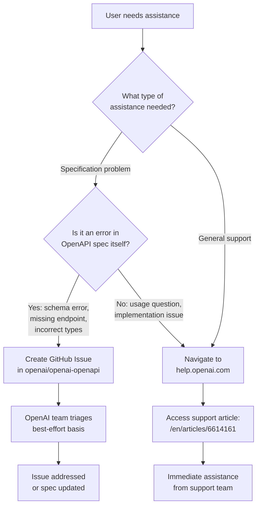
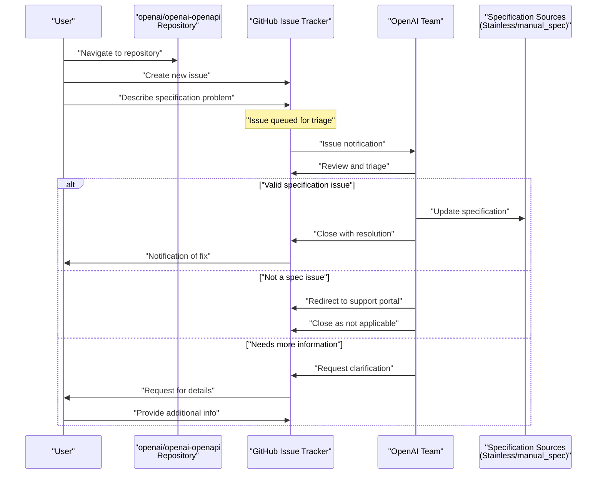
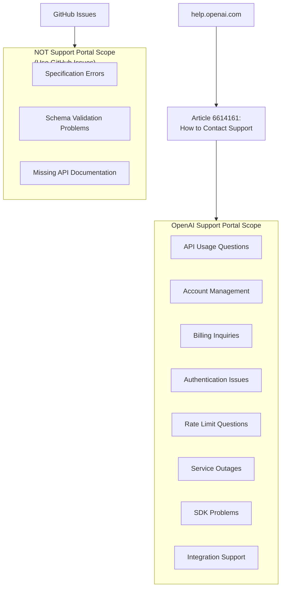
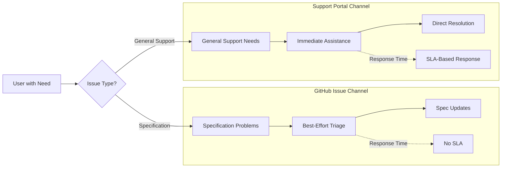
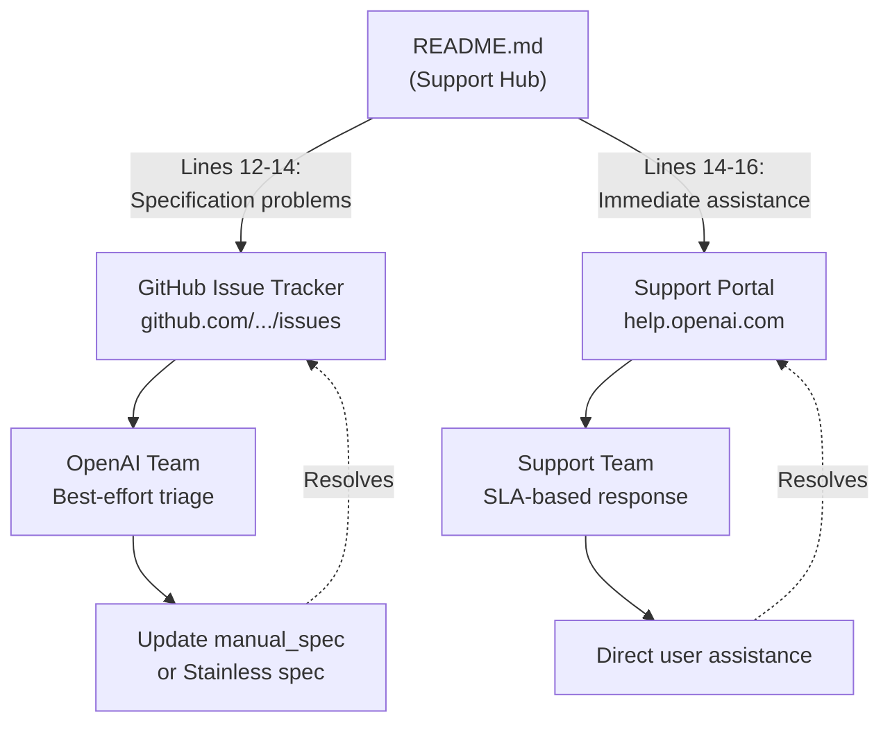

<!-- source: DeepWiki mcp.deepwiki.com · repo openai/openai-openapi · page 3 Support and Issue Reporting · fetched 2026-10-26 -->

# Support and Issue Reporting

<details>
<summary>Relevant source files</summary>

The following files were used as context for generating this wiki page:

- [README.md](README.md)

</details>


## Purpose and Scope

This document describes the dual-channel support model implemented by the openai-openapi repository. It covers how to get assistance when working with OpenAPI specifications, distinguishing between specification-specific issues (reported via GitHub issues) and general support needs (handled through OpenAI's support portal).

For information about accessing the OpenAPI specifications themselves, see [OpenAPI Specification Access](#2).

Sources: [README.md:1-17]()

## Support Model Overview

The repository implements a **dual-channel support model** that separates concerns between specification-related problems and general API or account support. This separation ensures efficient routing of user needs to the appropriate support mechanism.

### Support Channel Decision Matrix

| Need Type | Channel | Response Model | URL/Location |
|-----------|---------|----------------|--------------|
| Specification errors or inconsistencies | GitHub Issues | Best-effort triage | `github.com/openai/openai-openapi/issues` |
| Schema validation problems | GitHub Issues | Best-effort triage | `github.com/openai/openai-openapi/issues` |
| Missing or incorrect API documentation | GitHub Issues | Best-effort triage | `github.com/openai/openai-openapi/issues` |
| API usage questions | Support Portal | Immediate assistance | `help.openai.com` |
| Account or billing issues | Support Portal | Immediate assistance | `help.openai.com` |
| Service outages or incidents | Support Portal | Immediate assistance | `help.openai.com` |
| SDK integration problems | Support Portal | Immediate assistance | `help.openai.com` |

Sources: [README.md:12-16]()

### Support Channel Selection Flow



**Support Channel Selection Flow**

This diagram illustrates the decision process users should follow when determining which support channel to use. The key distinction is whether the problem relates specifically to the OpenAPI specification document itself.

Sources: [README.md:12-16]()

## Reporting Specification Issues

### When to Use GitHub Issues

GitHub issues in this repository should be used exclusively for problems with the **OpenAPI specification documents** themselves, not for general API usage or support questions.

Valid issue types include:

- **Schema Errors**: Incorrect type definitions, validation constraints, or property specifications
- **Missing Endpoints**: API endpoints that exist in the OpenAI API but are absent from the specification
- **Incorrect Documentation**: Descriptions or examples that don't match actual API behavior
- **Breaking Schema Changes**: Specification updates that break previously valid tooling
- **Structural Problems**: Malformed OpenAPI YAML/JSON, invalid references, or schema violations

Sources: [README.md:12-14]()

### Issue Reporting Process



**GitHub Issue Lifecycle**

This sequence diagram shows the complete lifecycle of a specification issue from creation through resolution, including the OpenAI team's triage process.

Sources: [README.md:12-14]()

### Best-Effort Support Model

The repository operates on a **best-effort support model** for GitHub issues. This means:

- **No SLA Guarantees**: Issues are triaged and addressed as team resources permit
- **Prioritization**: Critical specification errors affecting multiple users may receive faster attention
- **Community Visibility**: All issues are public, allowing community members to see known problems
- **No Guaranteed Response Time**: The OpenAI team addresses issues when available

This model differs from the immediate assistance available through the support portal (see [Contacting OpenAI Support](#contacting-openai-support) below).

Sources: [README.md:12-14]()

### Issue Submission Guidelines

When creating a GitHub issue for a specification problem:

1. **Verify the Specification Version**: Check both the live specification ([Live Specification](#2.1)) and manual specification ([Manual Specification](#2.2)) to confirm the problem exists
2. **Provide Specific Details**: Include the exact endpoint, schema path, or specification location
3. **Include Examples**: Show the discrepancy between specification and actual API behavior
4. **Check for Duplicates**: Search existing issues to avoid duplicate reports

Example issue structure:

```markdown
**Specification Version:** [Live/Manual]
**Affected Endpoint:** POST /v1/chat/completions
**Schema Location:** components/schemas/ChatCompletionRequest

**Problem Description:**
The `temperature` parameter is defined as type `number` with range 0-2,
but API returns error when value exceeds 1.0.

**Expected Behavior:**
Schema should restrict range to 0-1 or API should accept values up to 2.

**Actual Behavior:**
API rejects requests with temperature > 1.0 despite schema allowing it.
```

Sources: [README.md:12-14]()

## Contacting OpenAI Support

### When to Use the Support Portal

The OpenAI support portal at `help.openai.com` should be used for all non-specification issues requiring immediate assistance.



**Support Channel Scope Boundaries**

This diagram clarifies which issues belong to the support portal versus GitHub issues, preventing misdirected support requests.

Sources: [README.md:14-16]()

### Accessing Support

The primary support access point is documented in the README:

[README.md:14-16]()

```
For immediate assistance, visit:
https://help.openai.com/en/articles/6614161-how-can-i-contact-support
```

This article provides:

- **Direct Contact Methods**: How to reach OpenAI support directly
- **Response Time Expectations**: Information about support response SLAs
- **Escalation Procedures**: How to escalate urgent issues
- **Self-Service Resources**: Links to documentation and troubleshooting guides

Sources: [README.md:14-16]()

### Support vs. Issue Reporting Comparison



**Comparison of Support Channels**

This diagram contrasts the two support channels, highlighting their different input types, processing models, and response time commitments.

Sources: [README.md:12-16]()

## Integration with Repository Architecture

The support model integrates with the repository's navigation hub architecture. The [README.md:1-17]() serves as the central routing point, directing users to appropriate support channels based on their needs.

### Support Routing in README.md

The README implements a clear three-tier information structure:

1. **Specification Access** ([README.md:3-10]()): Links to live and manual specifications
2. **Issue Reporting** ([README.md:12-14]()): GitHub issues for specification problems
3. **General Support** ([README.md:14-16]()): Support portal for immediate assistance

This separation ensures users can quickly identify and access the appropriate support mechanism without confusion.

Sources: [README.md:1-17]()

### Repository as Support Hub



**README.md Support Routing Architecture**

This diagram shows how README.md acts as a hub that routes users to different support mechanisms, with specific line references showing where each routing instruction appears in the file.

Sources: [README.md:1-17]()

## Summary

The openai-openapi repository implements a dual-channel support model:

- **GitHub Issues**: For specification-specific problems, operated on a best-effort basis without SLA guarantees
- **Support Portal**: For immediate assistance with general API, account, or usage questions

Users should consult [README.md:12-16]() to determine the appropriate channel. Specification problems belong in GitHub issues, while all other support needs should use the `help.openai.com` portal for faster, SLA-based assistance.

Sources: [README.md:1-17]()

---

