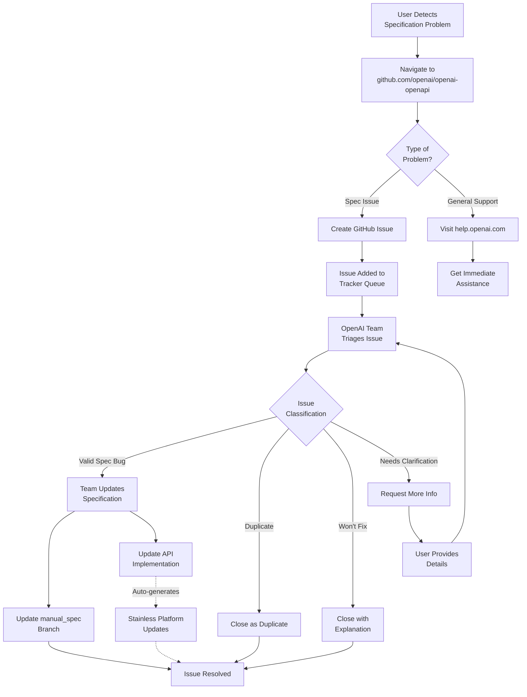
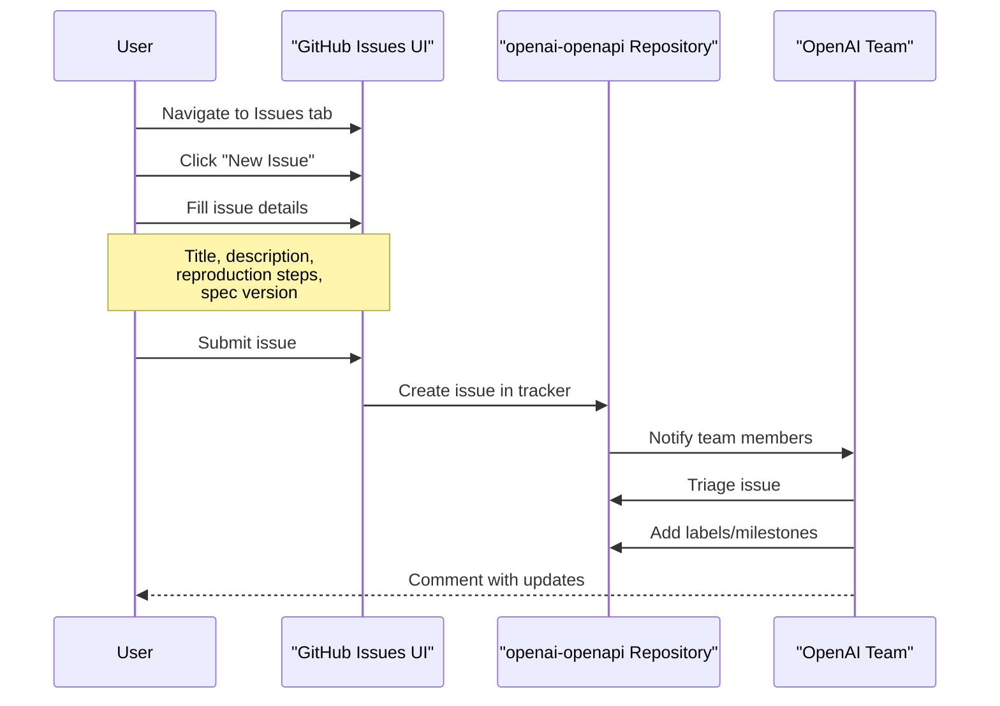
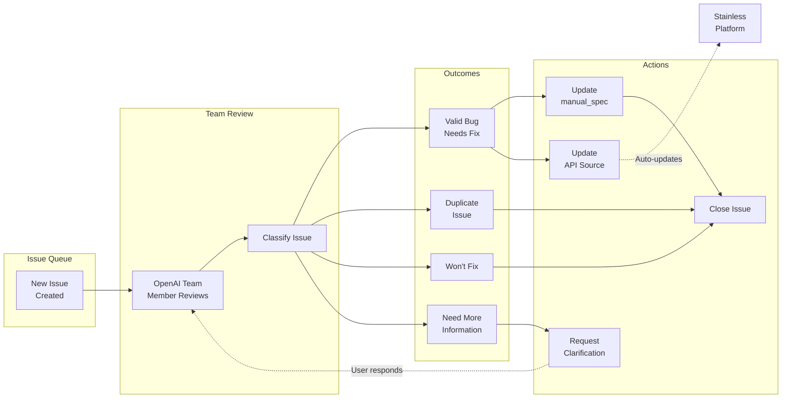
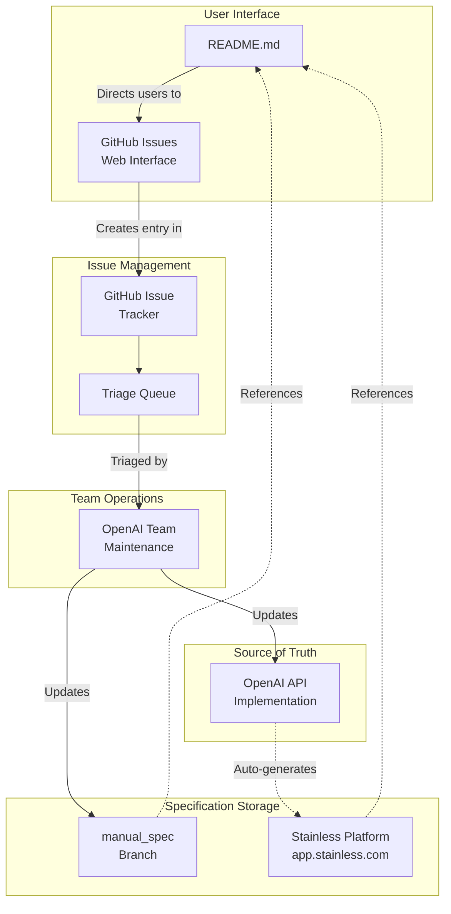
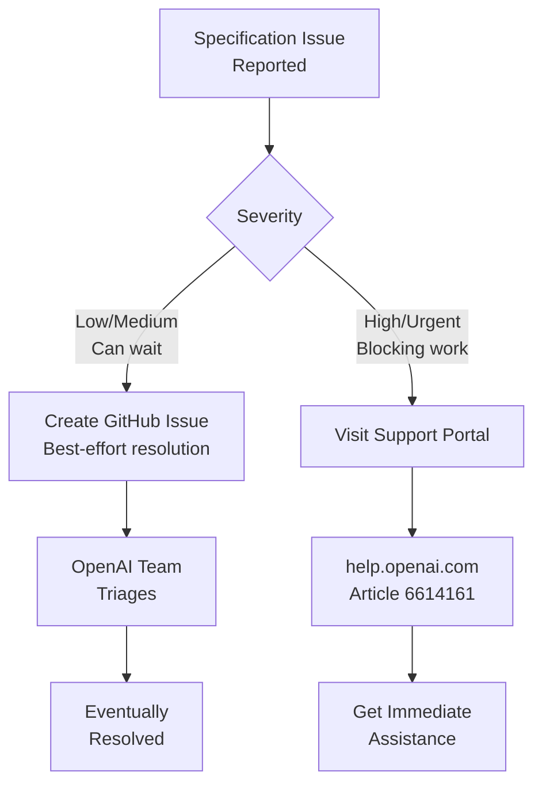

<!-- source: DeepWiki mcp.deepwiki.com · repo openai/openai-openapi · page 3.1 Reporting Specification Issues · fetched 2026-10-26 -->

# Reporting Specification Issues

<details>
<summary>Relevant source files</summary>

The following files were used as context for generating this wiki page:

- [README.md](README.md)

</details>


## Purpose and Scope

This document describes the process for reporting problems with the OpenAI API OpenAPI specification via the GitHub issue tracker. It covers what types of issues should be reported through this channel, how to create an issue, and what to expect from the OpenAI team's triage and resolution process.

For general support needs or immediate assistance with the OpenAI API (not specification-specific), see [Contacting OpenAI Support](#3.2).

**Sources:** [README.md:1-17]()

---

## Overview

The openai-openapi repository provides a GitHub issue tracker as the primary channel for reporting problems with the OpenAPI specification. This includes issues with both the live specification (hosted on Stainless) and the manual specification (on the `manual_spec` branch).

The OpenAI team monitors this issue tracker and makes a **best-effort attempt** to triage and resolve reported issues. This is not an SLA-backed support channel but rather a community feedback mechanism.

**Sources:** [README.md:12-14]()

---

## Issue Reporting Flow

The following diagram illustrates the complete lifecycle of a specification issue from detection through resolution:

### Issue Lifecycle



**Sources:** [README.md:12-16]()

---

## When to Use GitHub Issues

GitHub issues in this repository should be used specifically for problems with the OpenAPI specification itself. The following table clarifies when to use this channel versus other support options:

| Problem Type | Use GitHub Issues | Use Support Portal |
|--------------|-------------------|-------------------|
| Incorrect schema definition in OpenAPI spec | ✓ | |
| Missing endpoint in specification | ✓ | |
| Wrong parameter types in spec | ✓ | |
| Documentation inconsistency in spec | ✓ | |
| Validation errors when using the spec | ✓ | |
| API authentication problems | | ✓ |
| Billing questions | | ✓ |
| API quota or rate limiting issues | | ✓ |
| General API usage questions | | ✓ |
| Service outages | | ✓ |

**Sources:** [README.md:12-16]()

---

## Creating a Specification Issue

### Access the Issue Tracker

To create an issue, navigate to the repository's issue tracker:

```
https://github.com/openai/openai-openapi/issues
```

This is accessible from the main repository page at `https://github.com/openai/openai-openapi` by clicking the "Issues" tab.

### Issue Creation Process



**Sources:** [README.md:12-14]()

---

## Recommended Issue Content

While there is no formal issue template, providing the following information helps the OpenAI team triage and resolve issues more efficiently:

### Essential Information

| Field | Description | Example |
|-------|-------------|---------|
| **Specification Version** | Which spec version shows the problem | Live spec from Stainless, or manual_spec branch |
| **Endpoint/Schema** | Specific API endpoint or schema affected | `/v1/chat/completions` endpoint |
| **Problem Description** | Clear description of the issue | Response schema missing `finish_reason` field |
| **Expected Behavior** | What the spec should contain | Schema should include optional `finish_reason` string |
| **Actual Behavior** | What the spec currently shows | Field is not documented in response schema |

### Optional but Helpful

- **Impact**: How this affects your use case
- **Workaround**: Any temporary solution you've found
- **Related Issues**: Links to similar or related issues
- **Spec Snippet**: Copy of the problematic section from the OpenAPI YAML

**Sources:** [README.md:12-14]()

---

## Triage and Resolution Process

### Best-Effort Support Model

The repository operates under a **best-effort support model**, as documented in [README.md:13-14]():

```
the OpenAI team will make a best-effort attempt to
triage and resolve them
```

This means:
- No guaranteed response time (SLA)
- No guaranteed resolution
- Prioritization based on team capacity and impact
- Community-driven feedback mechanism

### Triage Workflow



**Sources:** [README.md:12-14]()

---

## System Integration

The issue tracking system integrates with the broader specification management architecture:

### GitHub Issues in Context



**Sources:** [README.md:1-17]()

---

## Issue Resolution Paths

### Path 1: Manual Specification Update

When an issue affects the manually-curated specification:

1. OpenAI team member identifies the problem
2. Updates the OpenAPI YAML file(s) in the `manual_spec` branch
3. Commits the fix with reference to the issue number
4. Closes the issue with resolution details

### Path 2: API Implementation Update

When an issue reveals an actual API implementation problem:

1. OpenAI team identifies the root cause in the API implementation
2. Updates the API source code
3. Changes automatically propagate to the Stainless platform
4. Live specification regenerates with the fix
5. Team may also update `manual_spec` branch manually
6. Issue is closed with resolution details

### Path 3: Clarification or Won't Fix

When an issue is not a specification bug:

1. Team member adds a comment explaining the current behavior
2. May mark as "wontfix" or "working as intended"
3. Issue is closed with detailed explanation
4. User can respond if they believe the assessment is incorrect

**Sources:** [README.md:7-10](), [README.md:3-5]()

---

## Escalation Path

For issues requiring immediate attention or not suitable for the issue tracker:



The support portal link referenced in [README.md:16]() provides:

```
https://help.openai.com/en/articles/6614161-how-can-i-contact-support
```

This is the appropriate channel for urgent or blocking issues that cannot wait for the best-effort GitHub issue resolution process.

**Sources:** [README.md:14-16]()

---

## Communication Expectations

### Response Times

- **No guaranteed SLA**: Issue tracker operates on best-effort basis
- **Triage timing**: Varies based on team capacity and issue volume
- **Resolution timing**: Depends on issue complexity and priority

### Status Updates

Users can expect:
- Issue acknowledgment when triaged
- Status updates for significant progress
- Resolution explanation when closed
- Requests for additional information if needed

### Community Participation

The issue tracker is public, allowing:
- Other users to comment on similar issues
- Community members to provide workarounds
- Discussion of specification design decisions
- Transparency in the triage process

**Sources:** [README.md:12-14]()

---

## Summary

The GitHub issue tracker at `github.com/openai/openai-openapi/issues` provides a structured channel for reporting OpenAPI specification problems. Key characteristics:

| Aspect | Details |
|--------|---------|
| **Purpose** | Report specification bugs and inconsistencies |
| **Support Model** | Best-effort, no SLA guarantees |
| **Triage** | Performed by OpenAI team |
| **Resolution Paths** | Update `manual_spec` branch, update API implementation, or close with explanation |
| **Escalation** | Use support portal for urgent issues |
| **Documentation** | [README.md:12-16]() |

For general support or immediate assistance, see [Contacting OpenAI Support](#3.2).

**Sources:** [README.md:1-17]()

---

