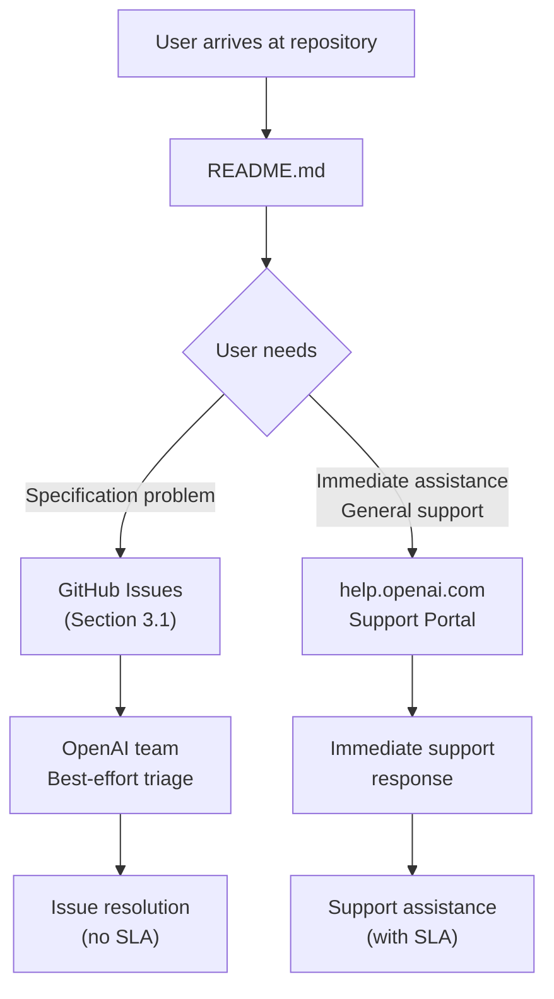
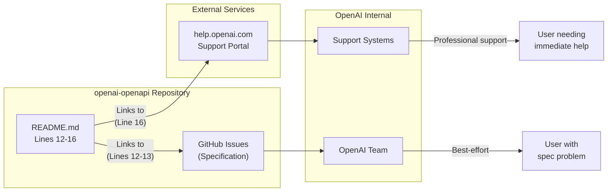
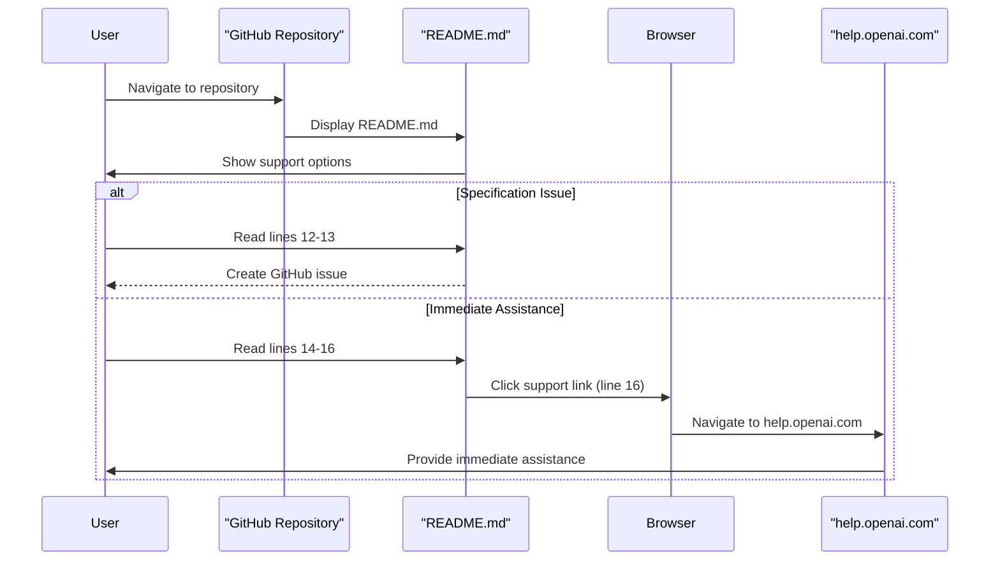
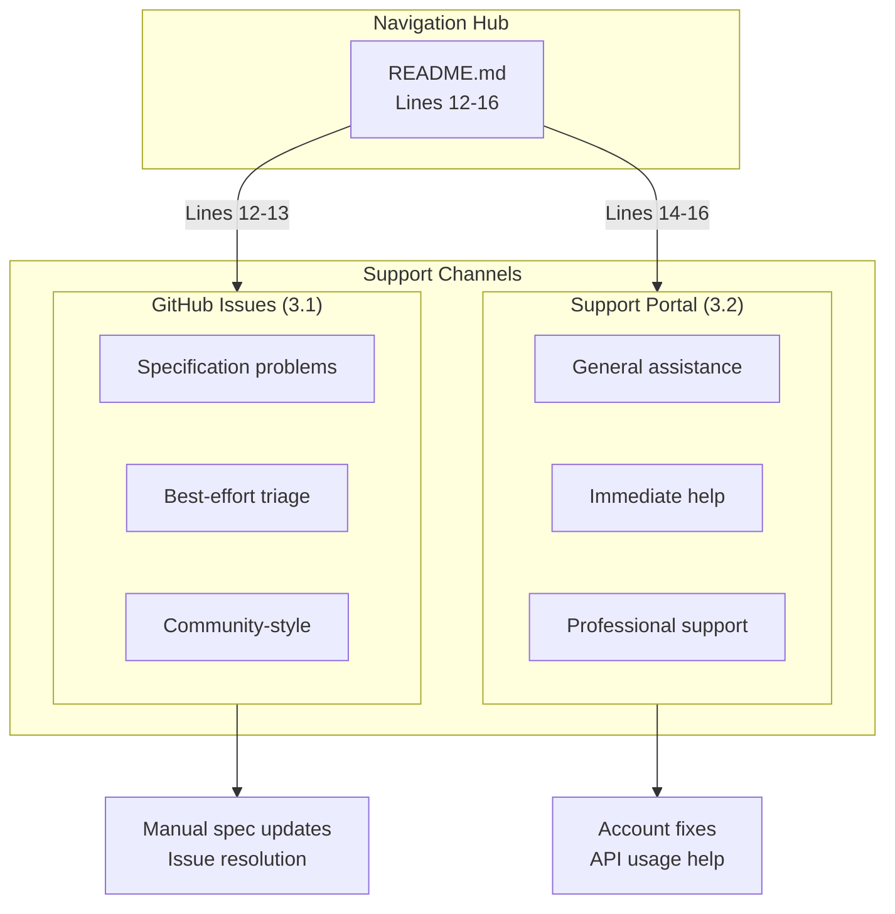
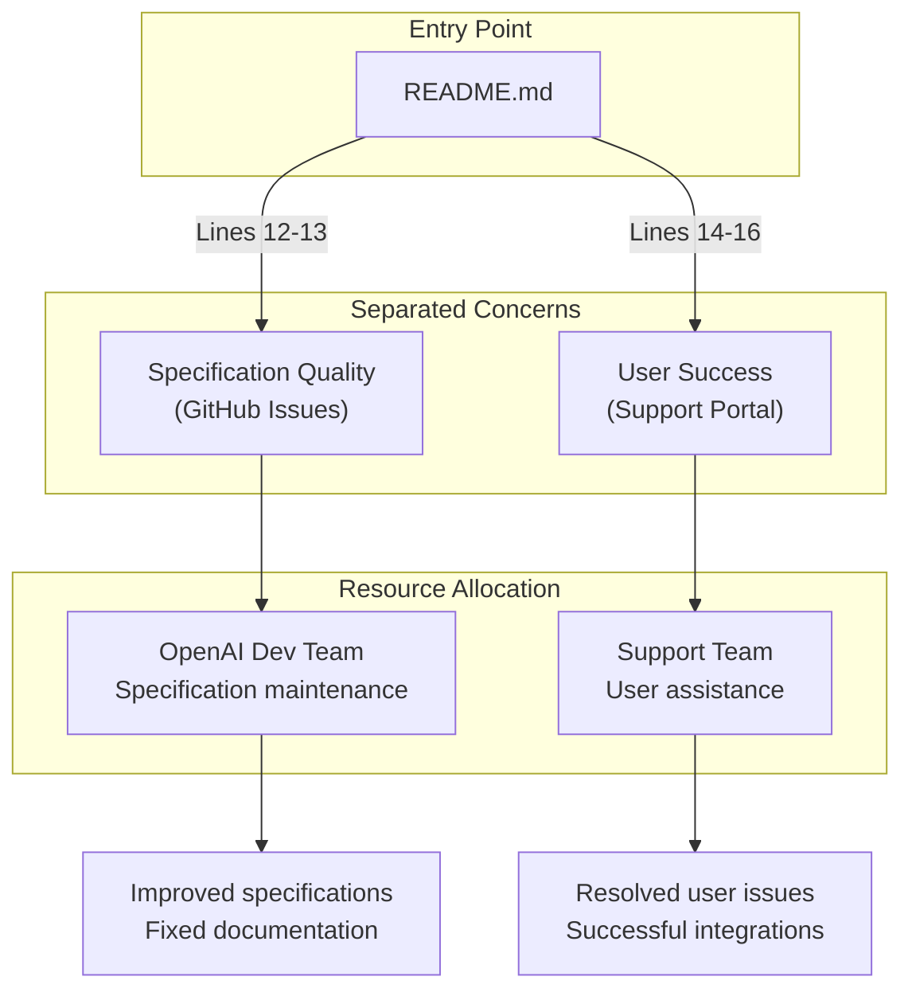

<!-- source: DeepWiki mcp.deepwiki.com · repo openai/openai-openapi · page 3.2 Contacting OpenAI Support · fetched 2026-10-26 -->

# Contacting OpenAI Support

<details>
<summary>Relevant source files</summary>

The following files were used as context for generating this wiki page:

- [README.md](README.md)

</details>


## Purpose and Scope

This document explains how to access the OpenAI support portal for immediate assistance with general support needs, questions, or issues that fall outside the scope of OpenAPI specification problems. For reporting problems specifically with the OpenAPI specification itself, see [Reporting Specification Issues](#3.1).

The repository implements a **dual-channel support model** that routes users to different support resources based on their needs. This page covers the external support channel pathway.

**Sources:** [README.md:12-16]()

---

## When to Use OpenAI Support

The OpenAI support portal is the appropriate channel for:

| Use Case | Description | Example |
|----------|-------------|---------|
| **API Usage Questions** | Questions about how to use the OpenAI API | "How do I implement streaming responses?" |
| **Account Issues** | Problems with billing, authentication, rate limits | "My API key isn't working" |
| **Product Features** | Questions about API capabilities and features | "What models support function calling?" |
| **General Assistance** | Any support needs requiring immediate help | "I need urgent help with my integration" |
| **Non-Specification Issues** | Problems not related to the OpenAPI spec itself | "API endpoint returning unexpected data" |

The GitHub issue tracker (covered in [Reporting Specification Issues](#3.1)) should be used **only** for problems with the OpenAPI specification documentation itself, not general API support.

**Sources:** [README.md:12-16]()

---

## Support Portal Access

### URL and Location

The OpenAI support portal is accessed via the following URL, as documented in the repository README:

```
https://help.openai.com/en/articles/6614161-how-can-i-contact-support
```

This link is referenced in [README.md:16]() and serves as the primary entry point for immediate assistance.

### Integration with Repository Navigation

The README.md file serves as the navigation hub that routes users to this external support resource:



**Diagram: Support Channel Routing from README.md**

The README acts as a decision router, directing users to the appropriate support channel based on their needs. The support portal provides SLA-backed immediate assistance, while GitHub issues operate on a best-effort basis.

**Sources:** [README.md:12-16]()

---

## Support Flow Architecture

### External vs Internal Support Channels

The repository's architecture separates support concerns into external (immediate) and internal (specification-focused) channels:



**Diagram: Dual-Channel Support Architecture**

The architecture maintains clear separation between:
- **External support portal**: Professional, SLA-backed support for general needs
- **GitHub issues**: Community-style, best-effort support for specification problems

**Sources:** [README.md:12-16]()

---

## Code References and Navigation Path

### README.md Implementation

The support portal link is embedded in the README at a specific location:

| File | Line Range | Content | Purpose |
|------|------------|---------|---------|
| `README.md` | 12-13 | GitHub issue instructions | Directs to specification issues |
| `README.md` | 14 | "For immediate assistance, visit:" | Transition to support portal |
| `README.md` | 16 | Support portal URL | Direct link to external support |

The implementation uses a clear textual transition ("For immediate assistance") to signal the shift from specification-focused issues to general support needs.

### User Journey from Repository to Support



**Diagram: User Support Journey Sequence**

This sequence shows how users navigate from the repository to the appropriate support channel. The README.md serves as the decision point, with line 16 providing the direct link to external support.

**Sources:** [README.md:12-16]()

---

## Relationship to Other Support Mechanisms

### Comparison with Specification Issue Reporting

The repository provides two distinct support pathways that serve different purposes:



**Diagram: Support Channel Comparison**

**Key Differences:**

| Aspect | GitHub Issues (3.1) | Support Portal (3.2) |
|--------|---------------------|----------------------|
| **Scope** | OpenAPI specification problems only | General API and account support |
| **Response Model** | Best-effort, no SLA | Immediate assistance |
| **Outcome** | Specification corrections | Direct problem resolution |
| **Documentation** | README.md:12-13 | README.md:14-16 |
| **Support Type** | Community/triage-based | Professional support team |

**Sources:** [README.md:12-16]()

---

## Design Philosophy

### Separation of Concerns

The repository's support architecture implements a clean separation between specification maintenance and general user support:



**Diagram: Separation of Support Concerns**

This architecture ensures:
- **Specification issues** route to the development team for documentation improvements
- **User support needs** route to dedicated support systems for immediate resolution
- **No overlap** between specification maintenance and user assistance workflows

The README.md file enforces this separation through clear textual guidance at lines 12-16.

**Sources:** [README.md:12-16]()

---

## Summary

The OpenAI support portal provides immediate, professional assistance for general API usage questions, account issues, and support needs outside the scope of OpenAPI specification problems. Access is provided through a direct link in [README.md:16](), which routes users from the repository to the external support system at `help.openai.com`.

**Key Points:**

- Use the support portal for **immediate assistance** with general needs
- Use GitHub issues (see [Reporting Specification Issues](#3.1)) for **specification problems only**
- The repository implements a **dual-channel support model** with clear separation of concerns
- The README.md serves as the **navigation hub** routing users to appropriate support resources

**Sources:** [README.md:12-16]()

---

