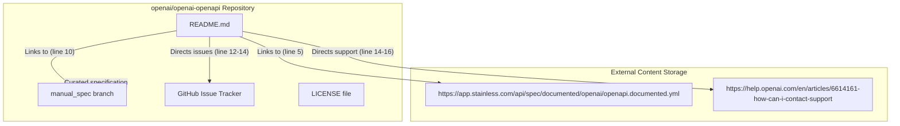
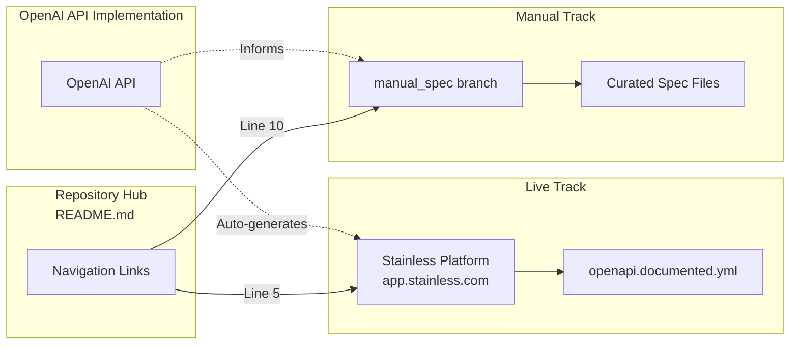
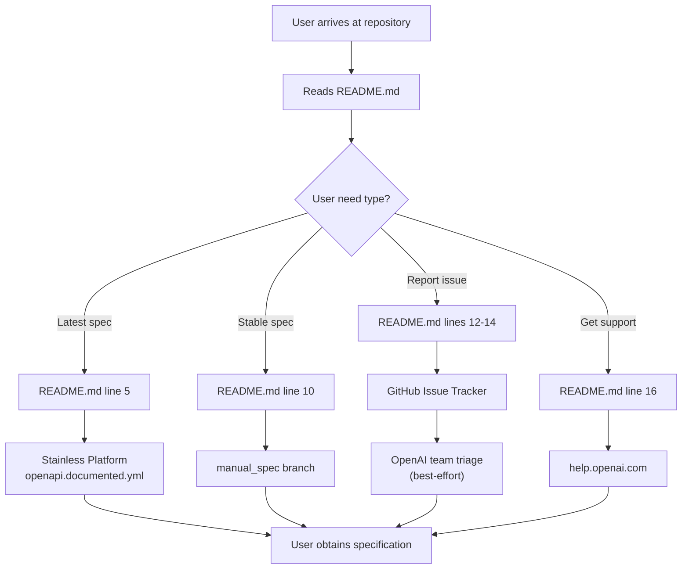
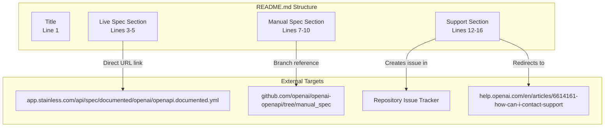
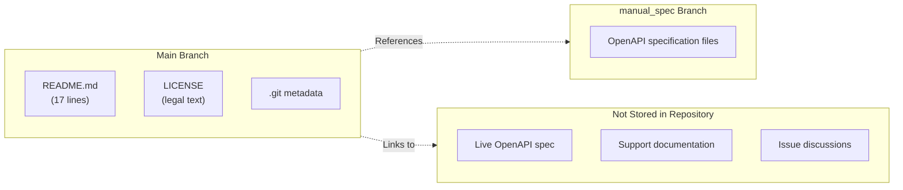
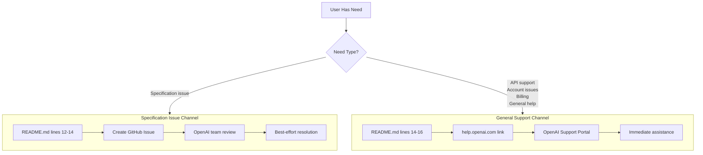

<!-- source: DeepWiki mcp.deepwiki.com · repo openai/openai-openapi · page 4 Repository Architecture · fetched 2026-10-26 -->

# Repository Architecture

Relevant source files

The following files were used as context for generating this wiki page:

- [README.md](README.md)

## Purpose and Scope

This document explains the architectural design and philosophy of the openai-openapi repository. The repository implements a **lightweight navigation hub pattern** rather than functioning as a traditional specification storage repository. It employs a distributed architecture where content is hosted externally and the repository serves as a stable reference point.

For information about accessing the specifications themselves, see [OpenAPI Specification Access](#2). For details on support mechanisms, see [Support and Issue Reporting](#3).

Sources: [README.md:1-17]()

## Core Architectural Principles

The openai-openapi repository is built on three fundamental architectural principles:

### 1. Navigation Hub Pattern

The repository functions as a **pointer and routing mechanism** rather than a content store. The primary asset is [README.md:1-17](), which contains structured links to external resources rather than embedding the OpenAPI specification directly.

**Key characteristics:**
- Single entry point documentation ([README.md:1-17]())
- External resource references ([README.md:5](), [README.md:10](), [README.md:16]())
- Minimal local content storage
- Stable URL structure for external linking

### 2. Distributed Specification Management

The OpenAPI specification is maintained across two distinct locations, each serving different use cases:

| Specification Type | Location | Update Mechanism | Primary Use Case |
|-------------------|----------|------------------|------------------|
| Live Spec | Stainless Platform ([README.md:5]()) | Automated | Real-time tooling, SDK generation |
| Manual Spec | Git branch ([README.md:10]()) | Manual curation | Documentation, stable integrations |

### 3. Separation of Concerns

The architecture clearly separates different user needs into distinct channels:
- **Specification Access**: External hosting platforms
- **Issue Reporting**: GitHub issue tracker
- **General Support**: OpenAI help portal ([README.md:16]())

Sources: [README.md:1-17]()

## Repository Component Architecture

**Component Breakdown:**

| Component | File Path | Purpose | Content Type |
|-----------|-----------|---------|--------------|
| Navigation Hub | `README.md` | Primary documentation and routing | Link directory |
| Manual Specification | `manual_spec` branch | Stable, curated OpenAPI spec | YAML specification |
| Issue Tracker | GitHub Issues (repository feature) | Problem reporting queue | User-generated issues |
| License | `LICENSE` | Legal terms | MIT license text |

The [README.md:1-17]() serves as the **central routing document**, containing no specification content itself but instead providing structured navigation to:
- Live specification URL at line 5
- Manual specification branch reference at line 10
- Issue reporting instructions at lines 12-14
- Support portal URL at line 16

Sources: [README.md:1-17]()

## Specification Distribution Model

The repository implements a **dual-track specification architecture** where specifications are stored and served from separate systems:

**Distribution Characteristics:**

The **Live Track** ([README.md:5]()):
- Hosted externally on Stainless platform
- Automatically updated from API implementation
- Accessed via stable URL: `https://app.stainless.com/api/spec/documented/openai/openapi.documented.yml`
- No local storage in main branch

The **Manual Track** ([README.md:10]()):
- Hosted as Git branch: `manual_spec`
- Manually curated and reviewed
- Version-controlled through Git
- Accessible via GitHub branch URL: `https://github.com/openai/openai-openapi/tree/manual_spec`

This separation enables:
1. **Currency**: Live spec reflects latest API state
2. **Stability**: Manual spec provides reviewed baseline
3. **Flexibility**: Users choose appropriate version for their use case

Sources: [README.md:3-10]()

## Information Flow Architecture

The repository's information flow follows a clear pattern where users enter through README.md and are routed to appropriate resources:

**Flow Characteristics:**

1. **Single Entry Point**: All documentation begins at [README.md:1]()
2. **Decision Routing**: Lines 3-16 provide structured routing based on user needs
3. **External Handoff**: Most paths exit repository to external systems
4. **Best-Effort Support**: Issue path ([README.md:12-14]()) operates on best-effort basis, not SLA-backed

Sources: [README.md:1-17]()

## Navigation Hub Implementation

The [README.md:1-17]() file implements the navigation hub pattern through a structured document with four distinct sections:

**Document Structure Analysis:**

| Lines | Section Purpose | Target Resource | Link Type |
|-------|----------------|-----------------|-----------|
| 1 | Title/Header | N/A | Informational |
| 3-5 | Live specification access | Stainless platform | Direct URL |
| 7-10 | Manual specification access | `manual_spec` branch | GitHub branch URL |
| 12-14 | Issue reporting instructions | GitHub Issues | Repository feature |
| 14-16 | Support portal access | OpenAI help center | External URL |

The navigation hub contains **zero specification content**. The entire file is 17 lines of routing information, making it:
- Fast to load
- Easy to maintain
- Stable reference point
- Single source of truth for resource locations

Sources: [README.md:1-17]()

## Minimal Content Storage Design

The repository deliberately minimizes local content storage to maintain agility and avoid duplication:

**Repository Footprint:**

**Design Rationale:**

1. **Avoid Duplication**: Live spec is generated from API implementation; storing locally would create synchronization burden
2. **Reduce Maintenance**: Single README.md file requires minimal updates
3. **External Delegation**: Leverage existing platforms (Stainless, GitHub Features, Help Portal) rather than rebuilding functionality
4. **Version Control Separation**: Manual spec on separate branch prevents main branch pollution

**What the Repository Contains:**
- Navigation document: [README.md:1-17]()
- Legal terms: `LICENSE` file
- Version control metadata: `.git` directory
- Manual specification: `manual_spec` branch (separate from main)

**What the Repository Does Not Contain:**
- Live OpenAPI specification (hosted externally at line 5)
- Support documentation (hosted at line 16)
- SDK generation tools (external consumers)
- Specification validation tools (external consumers)

This minimal design ensures the repository remains a **stable reference point** without becoming a content management burden.

Sources: [README.md:1-17]()

## Multi-Channel Support Architecture

The repository implements a **dual-channel support model** where different types of user needs are routed to appropriate systems:

**Channel Separation Logic:**

The [README.md:12-16]() establishes clear routing:

**Specification Channel** (lines 12-14):
- Purpose: OpenAPI specification problems
- Mechanism: GitHub issue tracker
- SLA: Best-effort (no guaranteed response time)
- Audience: Developers, integration engineers

**General Support Channel** (lines 14-16):
- Purpose: Immediate assistance, non-specification issues
- Mechanism: External help portal
- SLA: Per OpenAI support policies
- Audience: All users

This separation prevents:
- Issue tracker overflow with non-specification questions
- Delayed responses for urgent support needs
- Confusion about appropriate escalation paths

Sources: [README.md:12-16]()

## Architectural Benefits and Trade-offs

**Benefits of the Navigation Hub Architecture:**

| Benefit | Implementation | Evidence |
|---------|---------------|----------|
| **Maintainability** | Single 17-line README requires minimal updates | [README.md:1-17]() |
| **Scalability** | External hosting handles specification serving load | [README.md:5]() |
| **Flexibility** | Can change specification hosting without repository changes | External URL references |
| **Clarity** | Clear separation between live and manual specs | [README.md:5]() vs [README.md:10]() |
| **Stability** | Repository provides stable reference point | Minimal content changes |

**Trade-offs:**

| Trade-off | Impact | Mitigation |
|-----------|--------|------------|
| **External Dependencies** | Stainless platform availability affects spec access | Manual spec branch provides backup |
| **URL Stability** | Broken external links would impact users | Repository provides stable GitHub URL |
| **No Offline Access** | Live spec requires internet connection | Manual spec branch accessible via Git clone |
| **Support Complexity** | Dual-channel model requires user understanding | Clear routing in README |

The architecture prioritizes **agility and minimal maintenance burden** over self-contained storage, making it suitable for rapidly evolving API specifications where the implementation is the source of truth.

Sources: [README.md:1-17]()

---

