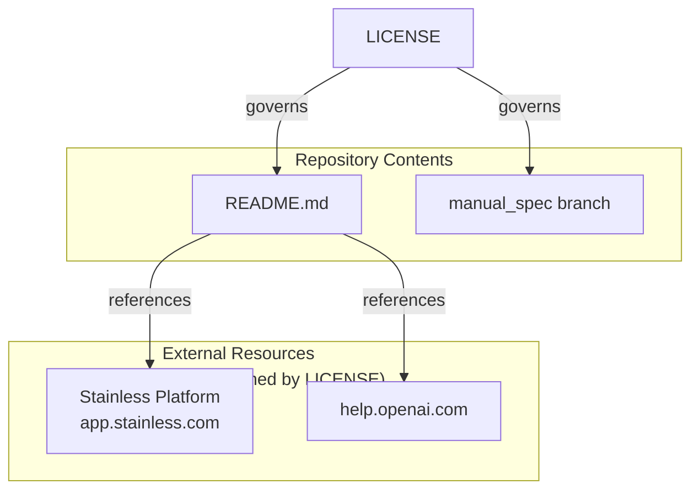
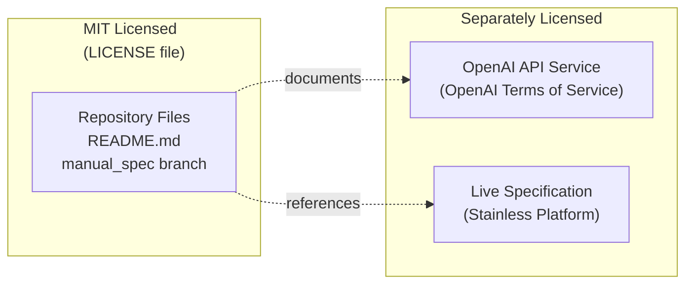

<!-- source: DeepWiki mcp.deepwiki.com · repo openai/openai-openapi · page 5 License · fetched 2026-10-26 -->

# License

<details>
<summary>Relevant source files</summary>

The following files were used as context for generating this wiki page:

- [LICENSE](LICENSE)

</details>


## Purpose and Scope

This document details the MIT License terms under which the openai-openapi repository is distributed. It covers the permissions granted to users, conditions required for use, warranty disclaimers, and liability limitations as defined in the [LICENSE]() file.

## License Overview

The repository is licensed under the MIT License, a permissive open-source license.

### Basic Information

| Attribute | Value |
|-----------|-------|
| License Type | The MIT License |
| Copyright Holder | OpenAI (https://openai.com) |
| License File | [LICENSE:1-21]() |

Sources: [LICENSE:1-3]()

## Permissions Granted

The MIT License grants permission to any person obtaining a copy of the software and associated documentation files to deal in the Software without restriction, including the following rights:

| Permission | Description |
|------------|-------------|
| Use | Use the software for any purpose |
| Copy | Make copies of the software |
| Modify | Modify the software |
| Merge | Merge the software with other works |
| Publish | Publish the software |
| Distribute | Distribute copies of the software |
| Sublicense | Grant sublicenses of the software |
| Sell | Sell copies of the software |

Sources: [LICENSE:5-10]()

## License Conditions

The license imposes one condition for use:

**Copyright Notice Inclusion**: The copyright notice and permission notice must be included in all copies or substantial portions of the Software.

```
The above copyright notice and this permission notice shall be included in
all copies or substantial portions of the Software.
```

Sources: [LICENSE:12-13]()

## Warranty Disclaimer

The Software is provided "AS IS", without warranty of any kind, express or implied, including but not limited to:

- Warranties of merchantability
- Fitness for a particular purpose  
- Non-infringement

```
THE SOFTWARE IS PROVIDED "AS IS", WITHOUT WARRANTY OF ANY KIND, EXPRESS OR
IMPLIED, INCLUDING BUT NOT LIMITED TO THE WARRANTIES OF MERCHANTABILITY,
FITNESS FOR A PARTICULAR PURPOSE AND NONINFRINGEMENT.
```

Sources: [LICENSE:15-18]()

## Liability Limitations

The authors or copyright holders shall not be liable for:

- Any claim, damages, or other liability
- Whether arising in an action of contract, tort, or otherwise
- Arising from, out of, or in connection with the software or the use or other dealings in the software

```
IN NO EVENT SHALL THE AUTHORS OR COPYRIGHT HOLDERS BE LIABLE FOR ANY CLAIM,
DAMAGES OR OTHER LIABILITY, WHETHER IN AN ACTION OF CONTRACT, TORT OR
OTHERWISE, ARISING FROM, OUT OF OR IN CONNECTION WITH THE SOFTWARE OR THE
USE OR OTHER DEALINGS IN THE SOFTWARE.
```

Sources: [LICENSE:17-21]()

## License Application to Repository Components

### Repository File Coverage

The MIT License in [LICENSE]() applies to the repository contents:



Sources: [LICENSE:1-21]()

### License Scope Diagram



Sources: [LICENSE:1-21]()

## Repository Usage Rights

Under the MIT License, users have the following rights:

| Right | Application |
|-------|-------------|
| Use | Use repository contents for any purpose, including commercial applications |
| Copy | Make copies of repository contents |
| Modify | Create derivative works based on repository contents |
| Distribute | Share original or modified versions |
| Sublicense | Grant licenses to others under different terms |
| Sell | Include in commercial products |

**Condition**: All distributions must include the copyright notice and permission notice from [LICENSE:12-13]().

Sources: [LICENSE:5-13]()

## Important Distinctions

It's crucial to understand the difference between:

1. **The OpenAPI specification document** - Licensed under MIT, allowing for free use, modification, and distribution
2. **The OpenAI API service itself** - Usage governed by OpenAI's Terms of Service, not by the MIT License

Using, modifying, or distributing the OpenAPI specification does not grant any additional rights to use the OpenAI API beyond what is provided in OpenAI's Terms of Service.

## Summary

The OpenAI OpenAPI repository is licensed under the MIT License, providing users with broad rights to use, modify, and distribute the specification. However, as a public mirror of an internal specification, the repository does not currently accept external contributions through pull requests. OpenAI has indicated that contribution capabilities may be enabled in the future.

Sources: [README.md:1-7](), [LICENSE:1-21]()