# Page: Repository Overview

# Repository Overview

<details>
<summary>Relevant source files</summary>

The following files were used as context for generating this wiki page:

- [README.md](README.md)

</details>


## Purpose and Philosophy

The `openai/openai-openapi` repository serves as a **navigation hub and pointer** to OpenAPI specifications for the OpenAI API, rather than a specification storage repository. This repository implements a minimalist design philosophy where the primary content is routing information to external authoritative sources.

**Key Characteristics:**
- **Navigation Hub**: Central documentation point that directs users to specification sources
- **Lightweight Architecture**: Minimal content storage, maximum routing capability
- **Dual Specification Strategy**: References both automated (live) and curated (manual) specification versions
- **Separation of Concerns**: Distinct pathways for specification access, issue reporting, and support

The repository does **not** contain the OpenAPI specification file itself. Instead, it provides clear pathways to access specifications hosted elsewhere, ensuring users always access the most current and appropriate version for their needs.

Sources: [README.md:1-17]()

## Repository Architecture

### Hub-and-Spoke Model

The repository implements a hub-and-spoke architecture where `README.md` acts as the central routing hub to external specification sources and support channels.

**Hub-and-Spoke Navigation Architecture**

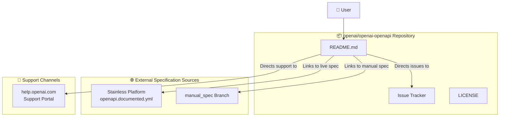

Sources: [README.md:1-17]()

### What This Repository Contains

The repository has minimal content by design:

| Component | Description | Location |
|-----------|-------------|----------|
| `README.md` | Primary navigation document with links to specifications and support | [README.md:1-17]() |
| Issue Tracker | GitHub issues for reporting specification problems | Repository feature |
| `LICENSE` | MIT License terms | Root directory |

**Content stored in this repository is intentionally minimal** to ensure users always access authoritative, up-to-date sources rather than potentially stale copies.

Sources: [README.md:1-17]()

### What This Repository References

The `README.md` file provides navigation to external resources:

| Resource | Type | URL Pattern | Purpose |
|----------|------|-------------|---------|
| Live Specification | Automated | `app.stainless.com/api/spec/documented/openai/openapi.documented.yml` | Most recent, auto-generated spec |
| Manual Specification | Curated | `github.com/openai/openai-openapi/tree/manual_spec` | Human-reviewed, stable spec |
| Support Portal | Documentation | `help.openai.com` | General support and assistance |

Sources: [README.md:3-16]()

## Dual Specification Strategy

The repository documentation references two distinct specification sources, each serving different use cases:

**Dual-Track Specification Architecture**

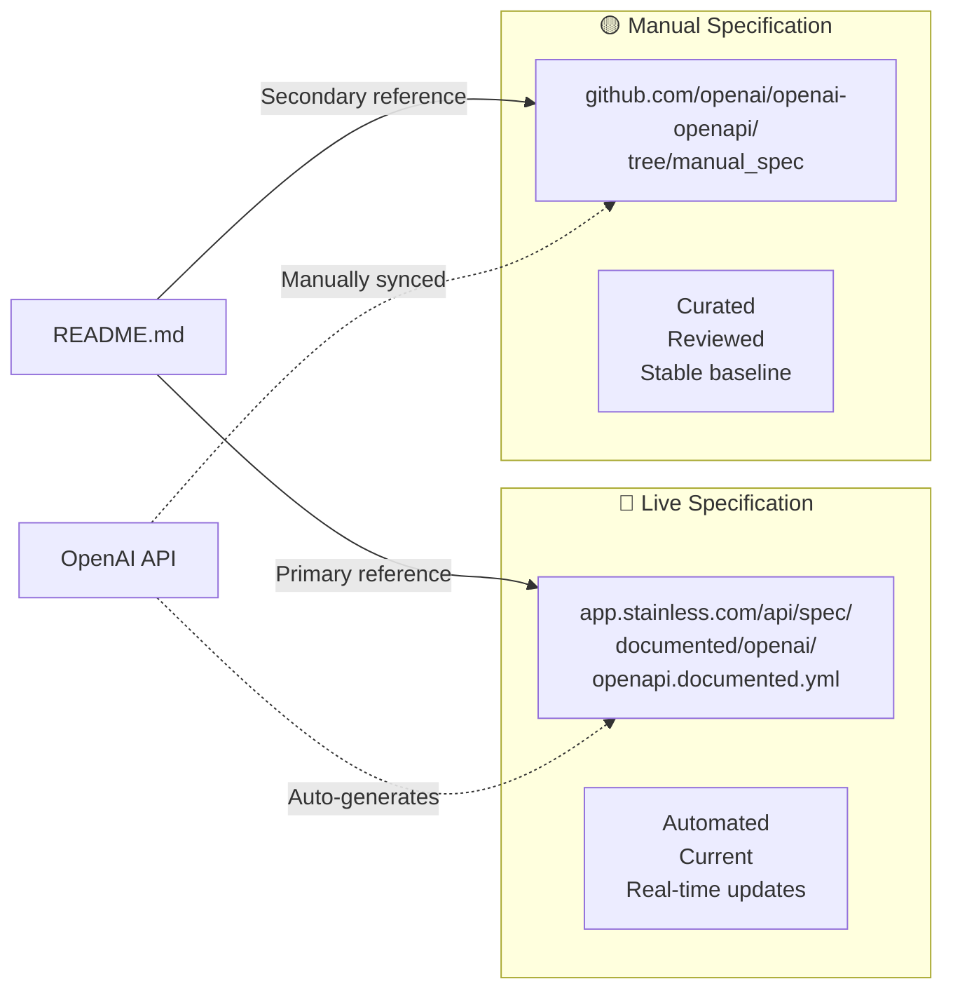

Sources: [README.md:3-10]()

### Specification Comparison

| Aspect | Live Specification | Manual Specification |
|--------|-------------------|---------------------|
| **Source** | Stainless Platform | `manual_spec` Git branch |
| **Update Method** | Automated | Manual curation |
| **Currency** | Most recent | Stable baseline |
| **Best For** | SDK generation, real-time tooling | Documentation, validation |
| **Access** | External URL | Git branch |

This dual-track approach balances **agility** (rapid API changes reflected in live spec) with **stability** (reviewed specification for critical integrations).

Sources: [README.md:3-10]()

## User Journey Flow

The `README.md` serves as a decision router, directing users to appropriate resources based on their needs:

**User Navigation Flow**

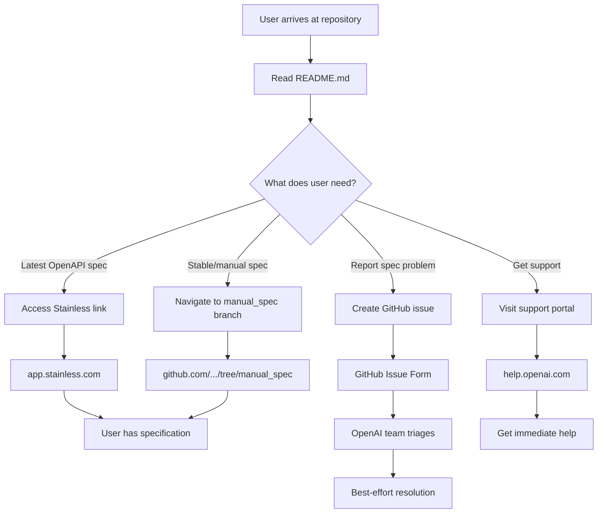

Sources: [README.md:1-17]()

### Navigation Pathways

The `README.md` content provides four distinct navigation pathways:

1. **Specification Access (Live)**: Direct link to Stainless platform for most recent spec [README.md:3-5]()
2. **Specification Access (Manual)**: Link to `manual_spec` branch for curated version [README.md:7-10]()
3. **Issue Reporting**: Direction to GitHub issue tracker for spec problems [README.md:12-14]()
4. **General Support**: Link to OpenAI support portal for immediate assistance [README.md:14-16]()

This separation ensures users reach the appropriate resource for their specific need without confusion.

Sources: [README.md:1-17]()

## License and Contribution Guidelines

### License

The repository is licensed under the MIT License, which allows for free use, modification, and distribution, subject to including the original copyright notice.

Sources: [LICENSE:1-22]()

### Contribution Guidelines

As noted in the README, this repository is a public mirror of OpenAI's internal API specification. Currently, pull requests to this repository are not accepted. This policy may change in the future to allow for contributions and corrections.

Sources: [README.md:5-7]()

---

# Page: OpenAPI Specification Access

# OpenAPI Specification Access

<details>
<summary>Relevant source files</summary>

The following files were used as context for generating this wiki page:

- [README.md](README.md)

</details>


## Purpose and Scope

This document explains how to access the OpenAPI specification for the OpenAI API. The repository implements a dual-track specification strategy that provides both automatically-updated and manually-curated versions of the OpenAPI specification. This page covers the access methods, use cases, and decision criteria for choosing between specification versions.

For detailed information about the live specification hosted on Stainless, see [Live Specification (Stainless Platform)](#2.1). For information about the manually-curated specification in Git, see [Manual Specification (Git Branch)](#2.2). For reporting issues with the specification, see [Reporting Specification Issues](#3.1).

Sources: [README.md:1-17]()

## Dual-Track Specification Strategy

The OpenAI API provides two distinct versions of its OpenAPI specification:

| Specification Type | Hosting Location | Update Method | Primary Use Cases |
|-------------------|------------------|---------------|-------------------|
| **Live Specification** | Stainless Platform | Automated | SDK generation, real-time tooling, latest API features |
| **Manual Specification** | `manual_spec` Git branch | Manual curation | Documentation, validation, stable integrations |

The live specification reflects the current state of the OpenAI API with automatic updates, while the manual specification undergoes human review before publication. This architecture balances agility in API development with stability for critical integrations.

Sources: [README.md:3-10]()

## Specification Access Architecture

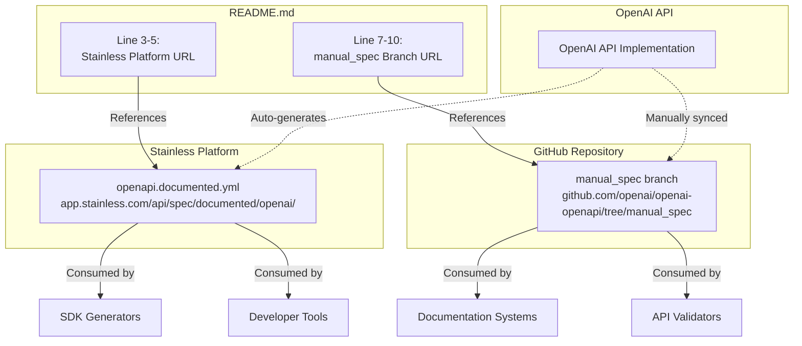

**Diagram: Specification Access Flow from README.md**

This diagram shows how the `README.md` file serves as the routing mechanism to both specification sources, and how each specification type serves different downstream consumers.

Sources: [README.md:3-10]()

## Access Method Overview

### Live Specification Access

The most recent OpenAPI specification is available at:

```
https://app.stainless.com/api/spec/documented/openai/openapi.documented.yml
```

This URL is documented in [README.md:5](). The specification file is named `openapi.documented.yml` and is hosted on the Stainless platform at `app.stainless.com`.

**Key Characteristics:**
- **Update Frequency:** Automatic updates as API changes
- **File Format:** YAML (`.yml` extension)
- **Hosting Platform:** `app.stainless.com`
- **Access Method:** Direct HTTP download via browser or command-line tools

For detailed usage instructions and integration patterns, see [Live Specification (Stainless Platform)](#2.1).

Sources: [README.md:3-5]()

### Manual Specification Access

The manually-curated OpenAPI specification is available on the `manual_spec` Git branch:

```
https://github.com/openai/openai-openapi/tree/manual_spec
```

This branch reference is documented in [README.md:10](). The branch name `manual_spec` indicates its manually-curated nature.

**Key Characteristics:**
- **Update Frequency:** Manual updates after human review
- **Storage Location:** Git branch in the repository
- **Access Method:** Git clone, GitHub web interface, or branch-specific URLs
- **Version Control:** Full Git history available

For detailed usage instructions and cloning procedures, see [Manual Specification (Git Branch)](#2.2).

Sources: [README.md:7-10]()

## Specification Selection Decision Flow

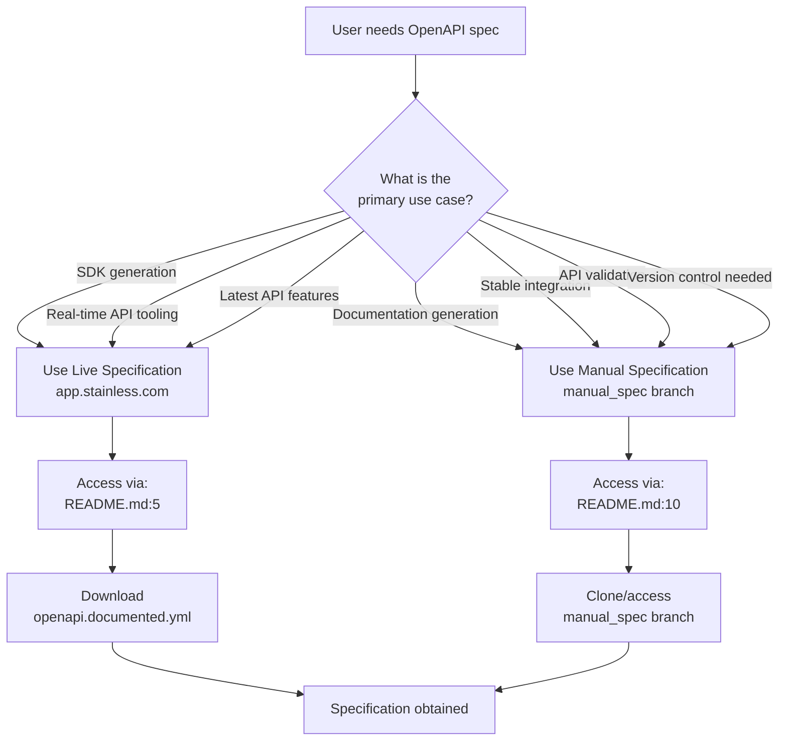

**Diagram: Specification Selection Decision Tree**

This flowchart maps user requirements to the appropriate specification source, showing the decision criteria and access paths documented in the `README.md` file.

Sources: [README.md:3-10]()

## Specification Access Comparison

The following table provides a detailed comparison to assist in selecting the appropriate specification version:

| Criteria | Live Specification | Manual Specification |
|----------|-------------------|---------------------|
| **URL Format** | Single-file download URL | Git branch URL |
| **Access Pattern** | HTTP GET request | Git clone or web browse |
| **Update Lag** | Near real-time | Hours to days |
| **Review Status** | Automated generation | Human-reviewed |
| **Stability** | May change frequently | Stable between updates |
| **Version History** | Not available via platform | Full Git history |
| **Offline Access** | Requires download | Available after clone |
| **Integration Complexity** | Simple (direct URL) | Moderate (Git operations) |

Sources: [README.md:3-10]()

## File References in README.md

The `README.md` file contains the following key references for specification access:

| Line Numbers | Content Type | Target Resource |
|--------------|-------------|-----------------|
| [README.md:5]() | Live spec URL | `https://app.stainless.com/api/spec/documented/openai/openapi.documented.yml` |
| [README.md:10]() | Manual spec URL | `https://github.com/openai/openai-openapi/tree/manual_spec` |
| [README.md:12-13]() | Issue reporting | GitHub issue tracker directive |
| [README.md:16]() | Support URL | `https://help.openai.com/en/articles/6614161-how-can-i-contact-support` |

These references in the `README.md` serve as the authoritative navigation layer for the entire specification access system.

Sources: [README.md:1-17]()

## Integration Patterns

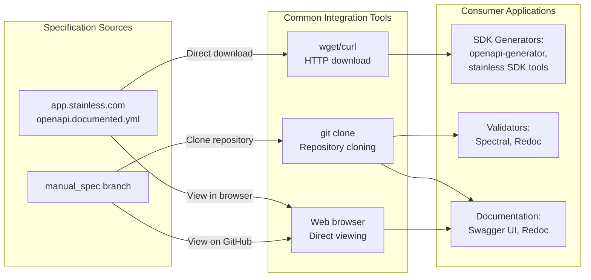

**Diagram: Specification Integration Tool Chain**

This diagram illustrates common tools used to retrieve specifications from each source and their downstream applications. The live specification (`openapi.documented.yml` on `app.stainless.com`) is typically accessed via HTTP tools, while the `manual_spec` branch uses Git-based workflows.

Sources: [README.md:3-10]()

## Specification Update Workflow

The dual-track system operates with different update workflows:

**Live Specification Workflow:**
1. OpenAI API implementation changes
2. Stainless platform automatically generates updated `openapi.documented.yml`
3. File becomes immediately available at the URL in [README.md:5]()
4. No manual intervention required

**Manual Specification Workflow:**
1. OpenAI API implementation changes
2. OpenAI team reviews changes
3. Team manually updates files in `manual_spec` branch
4. Changes committed to the branch referenced in [README.md:10]()
5. Specification available after branch update

Sources: [README.md:3-10]()

## Related Documentation

For specific implementation details:
- **Live specification access details:** See [Live Specification (Stainless Platform)](#2.1)
- **Manual specification access details:** See [Manual Specification (Git Branch)](#2.2)
- **Reporting specification problems:** See [Reporting Specification Issues](#3.1)
- **General support needs:** See [Contacting OpenAI Support](#3.2)
- **Repository architecture overview:** See [Repository Architecture](#4)

Sources: [README.md:1-17]()

---

# Page: Live Specification (Stainless Platform)

# Live Specification (Stainless Platform)

<details>
<summary>Relevant source files</summary>

The following files were used as context for generating this wiki page:

- [README.md](README.md)

</details>


This page documents the **live OpenAPI specification** for the OpenAI API, which is automatically updated and hosted on the Stainless platform. This specification represents the most current state of the OpenAI API implementation.

For information about the manually-curated specification alternative, see [Manual Specification (Git Branch)](#2.2). For general information about OpenAPI specification access strategies, see [OpenAPI Specification Access](#2).

**Sources:** [README.md:1-17]()

---

## Overview

The live OpenAPI specification is an **automatically-updated** YAML file that reflects the current state of the OpenAI API. Unlike the manual specification which requires human review and Git commits, the live specification is generated dynamically from the API implementation.

### Key Characteristics

| Characteristic | Value |
|----------------|-------|
| **Update Frequency** | Automatic (reflects API changes immediately) |
| **Hosting Platform** | Stainless (`app.stainless.com`) |
| **File Format** | YAML (OpenAPI specification) |
| **Filename** | `openapi.documented.yml` |
| **Maintenance** | Automated generation from API source |
| **Version Control** | Not Git-versioned (use manual spec for versioning) |

**Sources:** [README.md:3-5]()

---

## Access URL

The live specification is accessible via a direct HTTPS URL:

```
https://app.stainless.com/api/spec/documented/openai/openapi.documented.yml
```

This URL provides immediate access to the current specification without requiring authentication or repository access.

### URL Structure

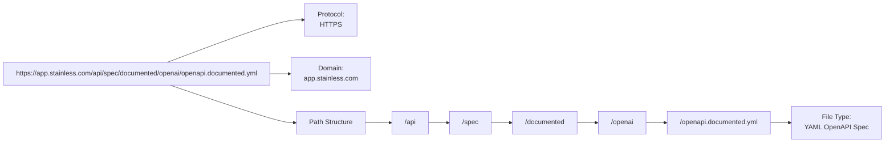

**Sources:** [README.md:5]()

### Accessing the Specification

The specification can be retrieved using standard HTTP clients:

**Command Line (curl):**
```bash
curl https://app.stainless.com/api/spec/documented/openai/openapi.documented.yml
```

**Programmatic Access:**
Any HTTP client can fetch the specification for processing, validation, or code generation.

**Sources:** [README.md:5]()

---

## Live Specification Architecture

The following diagram illustrates how the live specification is generated and accessed by various consumers:

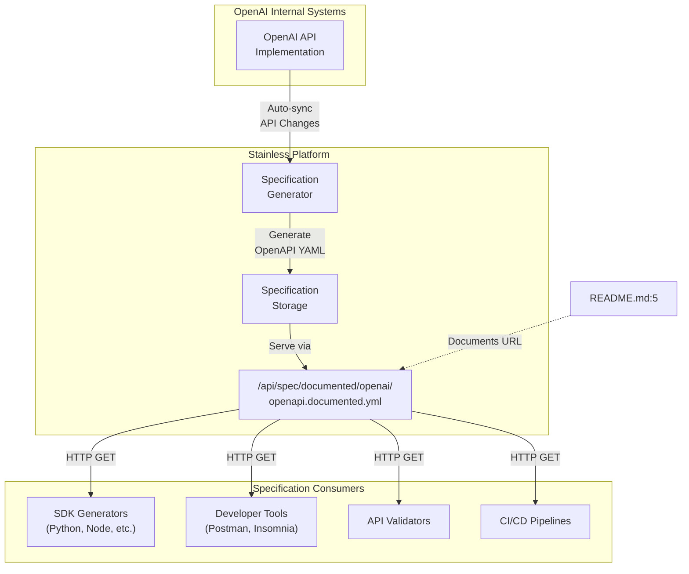

**Sources:** [README.md:3-5]()

---

## File Format and Structure

The `openapi.documented.yml` file follows the OpenAPI Specification standard, providing a machine-readable description of the OpenAI API.

### Expected Contents

The specification file includes:

- **OpenAPI version** declaration (e.g., `openapi: 3.0.x` or `3.1.x`)
- **API metadata** (title, description, version)
- **Server URLs** for API endpoints
- **Authentication schemes** (API key authentication)
- **Paths** defining all API endpoints
- **Request/response schemas** for each endpoint
- **Data models** and component definitions
- **Error response formats**

### Format Specification

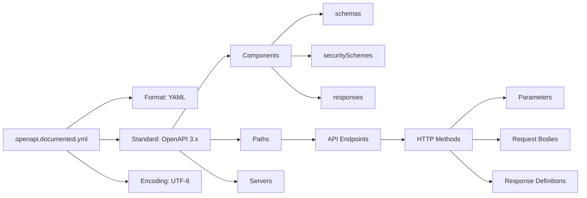

**Sources:** [README.md:5]()

---

## Use Cases

The live specification serves specific use cases where **currency** and **automation** are priorities:

### Primary Use Cases

| Use Case | Description | Why Live Spec? |
|----------|-------------|----------------|
| **SDK Generation** | Automated generation of client SDKs | Requires most recent API surface |
| **Real-time Validation** | CI/CD pipeline validation against current API | Must match production API |
| **Development Tools** | IDEs, API explorers, testing tools | Need current endpoint definitions |
| **Monitoring** | Detecting API changes and breaking changes | Requires immediate update detection |
| **Prototyping** | Rapid experimentation with latest features | Access to newest endpoints |

### When to Use Live Spec vs Manual Spec

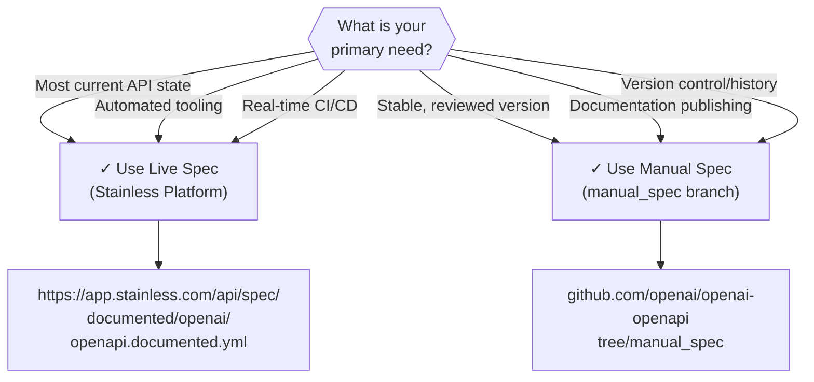

**Sources:** [README.md:3-10]()

---

## Integration Patterns

### Pattern 1: Direct HTTP Fetch

Fetch the specification on-demand for processing:

**Implementation:**
- Direct HTTP GET request to the Stainless URL
- Parse YAML content
- Process specification (validate, generate code, etc.)

**Use Case:** One-time SDK generation, manual inspection

### Pattern 2: Cached Retrieval

Fetch and cache the specification with periodic refresh:

**Implementation:**
- Periodic HTTP GET with caching logic
- Cache invalidation based on time or API version changes
- Local storage for offline access

**Use Case:** Developer tools, IDEs with offline support

### Pattern 3: CI/CD Integration

Integrate specification retrieval into automated pipelines:

**Implementation:**
- Pipeline step fetches specification from Stainless URL
- Run validation against implementation
- Generate SDK artifacts
- Deploy or publish results

**Use Case:** Continuous integration, automated SDK publishing

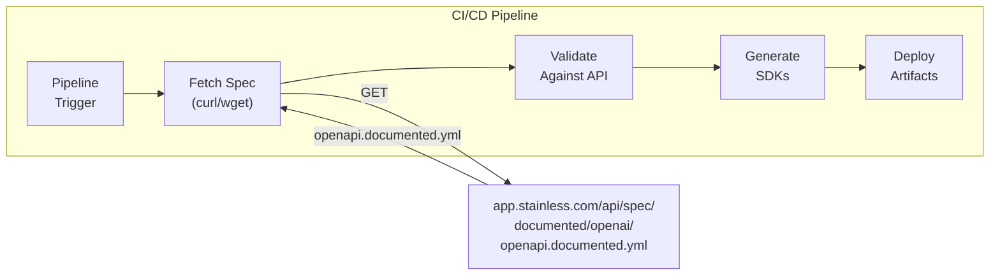

**Sources:** [README.md:5]()

---

## Specification Consumers

The following diagram maps specific tooling categories to their interaction with the live specification:

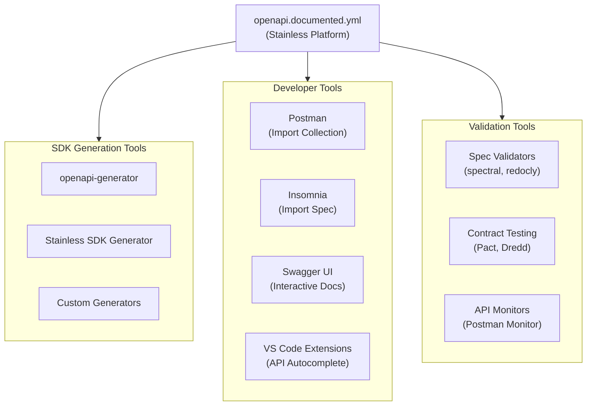

**Sources:** [README.md:3-5]()

---

## Differences from Manual Specification

The live specification differs from the manual specification in key operational aspects:

### Comparison Table

| Aspect | Live Specification | Manual Specification |
|--------|-------------------|---------------------|
| **Update Method** | Automated generation | Manual Git commits |
| **Update Frequency** | Real-time with API changes | Periodic human review cycles |
| **Location** | `app.stainless.com` | `manual_spec` Git branch |
| **Version Control** | Not Git-tracked | Git-versioned with history |
| **Review Process** | Automated only | Human-curated and reviewed |
| **Stability** | May change frequently | Stable between updates |
| **Access Method** | Direct HTTP URL | Git clone/checkout |
| **Best For** | Automation, tooling, CI/CD | Documentation, stable integrations |

**Sources:** [README.md:3-10]()

---

## Relationship to README Documentation

The README.md file serves as the primary pointer to the live specification:

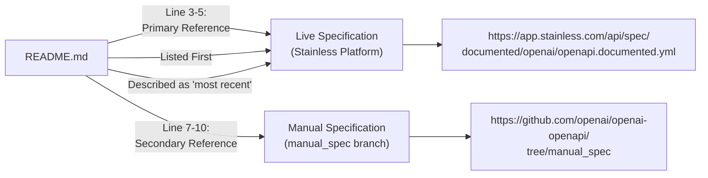

The README positions the live specification as the **primary reference** by listing it first and describing it as "the most recent OpenAPI specification."

**Sources:** [README.md:3-10]()

---

## Operational Considerations

### Availability

- **Uptime:** Dependent on Stainless platform availability
- **No SLA:** No service-level agreement documented
- **Fallback:** Use manual specification if live spec is unavailable

### Caching Recommendations

For production systems consuming the live specification:

1. **Implement local caching** to reduce dependency on external service
2. **Set reasonable TTL** (e.g., 1 hour) for cache invalidation
3. **Monitor for changes** to detect breaking changes early
4. **Maintain fallback** to last-known-good specification

### Rate Limiting

No documented rate limits exist for accessing the Stainless URL, but consumers should:

- Avoid excessive polling (use reasonable intervals)
- Implement exponential backoff on failures
- Cache responses appropriately

**Sources:** [README.md:5]()

---

## Summary

The live OpenAPI specification on the Stainless platform provides:

- **Real-time accuracy:** Automatically reflects current API state
- **Easy access:** Simple HTTPS URL without authentication
- **Tool-friendly:** Designed for automated consumption
- **Continuous integration:** Ideal for CI/CD pipelines

For stable, version-controlled specifications suitable for documentation, use the manual specification documented in [Manual Specification (Git Branch)](#2.2). For reporting issues with the specification, see [Reporting Specification Issues](#3.1).

**Sources:** [README.md:1-17]()

---

# Page: Manual Specification (Git Branch)

# Manual Specification (Git Branch)

<details>
<summary>Relevant source files</summary>

The following files were used as context for generating this wiki page:

- [README.md](README.md)

</details>


## Purpose and Scope

This document describes the manually-curated OpenAPI specification for the OpenAI API, which is maintained on the `manual_spec` Git branch of this repository. This specification represents a human-reviewed, stable baseline version of the API specification, as opposed to the automatically-generated live specification documented in [Live Specification (Stainless Platform)](#2.1).

The manual specification is designed for use cases requiring stability, versioning, and human curation, such as documentation generation, validation tooling, and integration testing where a stable reference is preferred over real-time updates.

## Accessing the Manual Specification

### Branch Location

The manual specification is hosted as a Git branch within the `openai/openai-openapi` repository:

```
https://github.com/openai/openai-openapi/tree/manual_spec
```

**Sources:** [README.md:7-10]()

### Access Methods

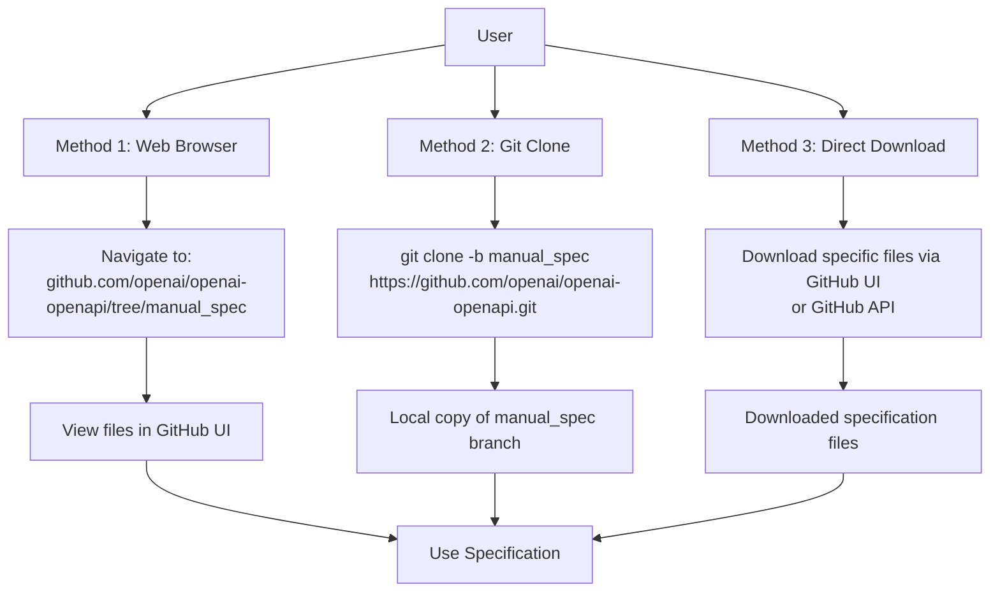

**Sources:** [README.md:7-10]()

| Access Method | Use Case | Advantages |
|--------------|----------|------------|
| **Web Browser** | Quick reference, one-time viewing | No tools required, immediate access |
| **Git Clone** | Development integration, version tracking | Full Git history, easy updates via `git pull` |
| **Direct Download** | Automation, CI/CD pipelines | Scriptable, specific file retrieval |

## Specification Characteristics

### Manual vs Live Specification Comparison

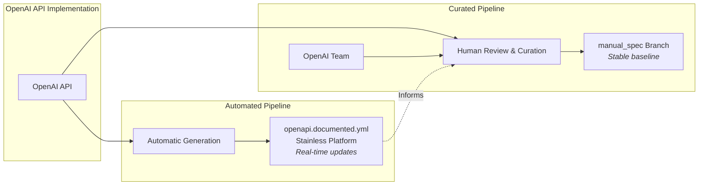

**Sources:** [README.md:3-10]()

| Attribute | Manual Specification | Live Specification |
|-----------|---------------------|-------------------|
| **Update Mechanism** | Manual curation by OpenAI team | Automatic generation from API |
| **Update Frequency** | As needed, human-driven | Real-time, continuous |
| **Stability** | High - changes are deliberate | Lower - reflects immediate API changes |
| **Review Status** | Human-reviewed and curated | Automated, may contain edge cases |
| **Version Control** | Git-tracked on `manual_spec` branch | Hosted on Stainless platform |
| **Primary Use Cases** | Documentation, validation, stable integrations | SDK generation, real-time tooling |
| **Access Location** | `github.com/openai/openai-openapi/tree/manual_spec` | `app.stainless.com/api/spec/...` |

**Sources:** [README.md:3-10]()

### Key Properties

The `manual_spec` branch provides:

1. **Git Version History**: Full commit history showing specification evolution
2. **Stable References**: Immutable commits can be referenced for reproducible builds
3. **Human Curation**: Reviewed for clarity, completeness, and accuracy
4. **Deterministic Access**: Branch content changes only through explicit commits

## When to Use Manual vs Live Specification

### Decision Flow

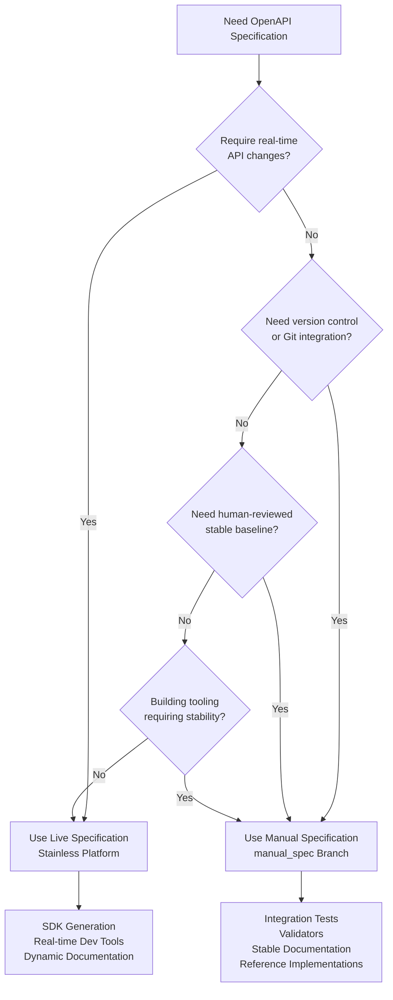

**Sources:** [README.md:3-10]()

### Use Case Recommendations

#### Prefer Manual Specification When:

- **Integration Testing**: Requires a stable, versioned specification that doesn't change unexpectedly
- **Documentation Generation**: Needs a curated, reviewed specification for accuracy
- **API Validation Tools**: Validates API responses against a stable baseline
- **Reference Implementations**: Builds example code that should remain valid over time
- **Regulatory Compliance**: Requires auditable, version-controlled specification
- **Educational Materials**: Creates tutorials or examples requiring stability

#### Prefer Live Specification When:

- **SDK Generation**: Needs latest API features immediately (see [Live Specification](#2.1))
- **Real-time Development**: Working with bleeding-edge API capabilities
- **Automated Tooling**: Tools that benefit from always-current specification
- **Rapid Prototyping**: Quick access to newest API endpoints

**Sources:** [README.md:3-10]()

## Maintenance and Update Process

### Specification Lifecycle

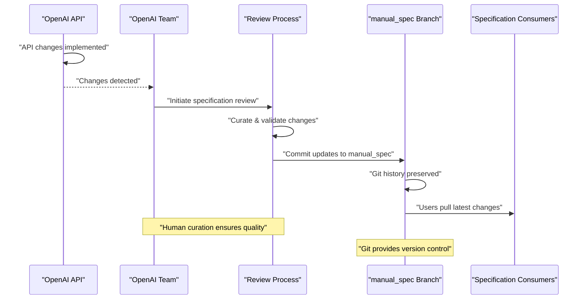

**Sources:** [README.md:7-10]()

### Update Characteristics

| Aspect | Description |
|--------|-------------|
| **Trigger** | Manual decision by OpenAI team |
| **Process** | Human review and curation of API changes |
| **Frequency** | As needed, not on fixed schedule |
| **Versioning** | Implicit through Git commits on `manual_spec` branch |
| **Rollback** | Possible via Git checkout of previous commits |
| **Transparency** | Commit history shows what changed and when |

**Sources:** [README.md:7-10]()

## Branch Structure and Contents

### Repository Structure Reference

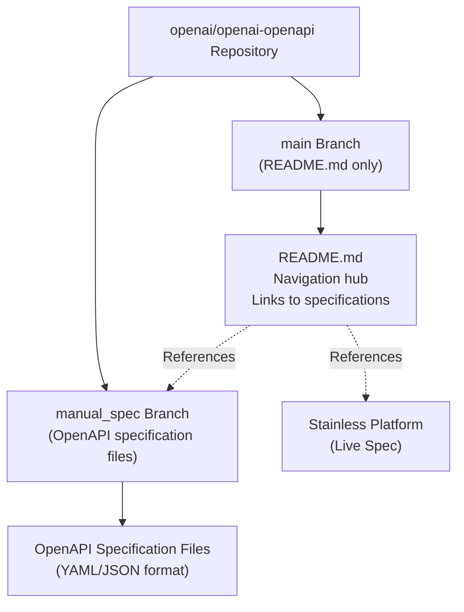

**Sources:** [README.md:1-17]()

The repository uses a branch-based architecture where:

- **`main` branch**: Contains only [README.md:1-17]() as a navigation hub
- **`manual_spec` branch**: Contains the actual OpenAPI specification files

This separation ensures the main branch remains lightweight while the specification content is maintained separately with its own commit history.

## Integration Examples

### CI/CD Pipeline Integration

For automated testing or documentation generation, the manual specification can be integrated into CI/CD workflows:

**Git Clone Approach:**
```bash
# Clone only the manual_spec branch
git clone --single-branch --branch manual_spec \
  https://github.com/openai/openai-openapi.git spec

# Use the specification files
cd spec
# Run validation, documentation generation, etc.
```

**Direct Download Approach:**
```bash
# Download specific spec file via GitHub API
curl -L -o openapi.yaml \
  https://raw.githubusercontent.com/openai/openai-openapi/manual_spec/[spec-file-name]
```

### Version Pinning

For reproducible builds, reference a specific commit:

```bash
# Clone at a specific commit
git clone https://github.com/openai/openai-openapi.git
cd openai-openapi
git checkout manual_spec
git checkout [commit-hash]
```

**Sources:** [README.md:7-10]()

## Relationship to Repository Support Model

Issues with the manual specification should be reported via the GitHub issue tracker as described in [Reporting Specification Issues](#3.1). The OpenAI team performs best-effort triage and resolution of specification problems.

For immediate assistance with API usage (not specification issues), refer to the OpenAI support portal documented in [Contacting OpenAI Support](#3.2).

**Sources:** [README.md:12-16]()

## Summary

The `manual_spec` branch provides a **stable, human-curated, version-controlled** OpenAPI specification suitable for:

- Documentation generation
- API validation and testing
- Reference implementations
- Any use case requiring specification stability

Access it at: `https://github.com/openai/openai-openapi/tree/manual_spec`

For real-time, automatically-updated specifications, use the [Live Specification (Stainless Platform)](#2.1) instead.

**Sources:** [README.md:3-10]()

---

# Page: Support and Issue Reporting

# Support and Issue Reporting

<details>
<summary>Relevant source files</summary>

The following files were used as context for generating this wiki page:

- [README.md](README.md)

</details>


## Purpose and Scope

This document describes the dual-channel support model implemented by the openai-openapi repository. It covers how to get assistance when working with OpenAPI specifications, distinguishing between specification-specific issues (reported via GitHub issues) and general support needs (handled through OpenAI's support portal).

For information about accessing the OpenAPI specifications themselves, see [OpenAPI Specification Access](#2).

Sources: [README.md:1-17]()

## Support Model Overview

The repository implements a **dual-channel support model** that separates concerns between specification-related problems and general API or account support. This separation ensures efficient routing of user needs to the appropriate support mechanism.

### Support Channel Decision Matrix

| Need Type | Channel | Response Model | URL/Location |
|-----------|---------|----------------|--------------|
| Specification errors or inconsistencies | GitHub Issues | Best-effort triage | `github.com/openai/openai-openapi/issues` |
| Schema validation problems | GitHub Issues | Best-effort triage | `github.com/openai/openai-openapi/issues` |
| Missing or incorrect API documentation | GitHub Issues | Best-effort triage | `github.com/openai/openai-openapi/issues` |
| API usage questions | Support Portal | Immediate assistance | `help.openai.com` |
| Account or billing issues | Support Portal | Immediate assistance | `help.openai.com` |
| Service outages or incidents | Support Portal | Immediate assistance | `help.openai.com` |
| SDK integration problems | Support Portal | Immediate assistance | `help.openai.com` |

Sources: [README.md:12-16]()

### Support Channel Selection Flow

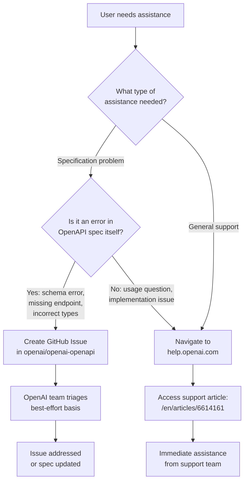

**Support Channel Selection Flow**

This diagram illustrates the decision process users should follow when determining which support channel to use. The key distinction is whether the problem relates specifically to the OpenAPI specification document itself.

Sources: [README.md:12-16]()

## Reporting Specification Issues

### When to Use GitHub Issues

GitHub issues in this repository should be used exclusively for problems with the **OpenAPI specification documents** themselves, not for general API usage or support questions.

Valid issue types include:

- **Schema Errors**: Incorrect type definitions, validation constraints, or property specifications
- **Missing Endpoints**: API endpoints that exist in the OpenAI API but are absent from the specification
- **Incorrect Documentation**: Descriptions or examples that don't match actual API behavior
- **Breaking Schema Changes**: Specification updates that break previously valid tooling
- **Structural Problems**: Malformed OpenAPI YAML/JSON, invalid references, or schema violations

Sources: [README.md:12-14]()

### Issue Reporting Process

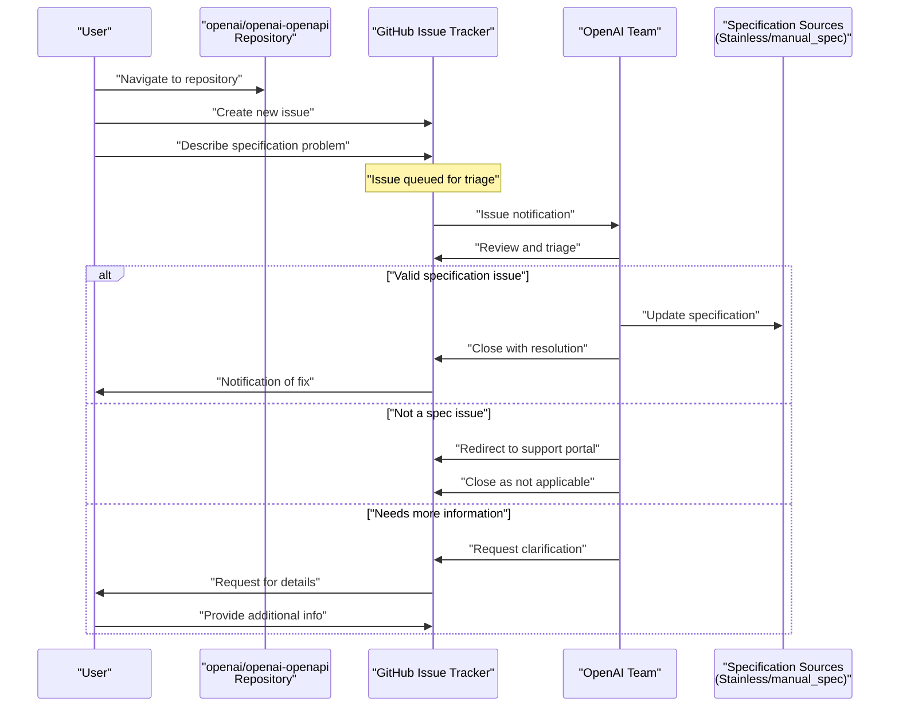

**GitHub Issue Lifecycle**

This sequence diagram shows the complete lifecycle of a specification issue from creation through resolution, including the OpenAI team's triage process.

Sources: [README.md:12-14]()

### Best-Effort Support Model

The repository operates on a **best-effort support model** for GitHub issues. This means:

- **No SLA Guarantees**: Issues are triaged and addressed as team resources permit
- **Prioritization**: Critical specification errors affecting multiple users may receive faster attention
- **Community Visibility**: All issues are public, allowing community members to see known problems
- **No Guaranteed Response Time**: The OpenAI team addresses issues when available

This model differs from the immediate assistance available through the support portal (see [Contacting OpenAI Support](#contacting-openai-support) below).

Sources: [README.md:12-14]()

### Issue Submission Guidelines

When creating a GitHub issue for a specification problem:

1. **Verify the Specification Version**: Check both the live specification ([Live Specification](#2.1)) and manual specification ([Manual Specification](#2.2)) to confirm the problem exists
2. **Provide Specific Details**: Include the exact endpoint, schema path, or specification location
3. **Include Examples**: Show the discrepancy between specification and actual API behavior
4. **Check for Duplicates**: Search existing issues to avoid duplicate reports

Example issue structure:

```markdown
**Specification Version:** [Live/Manual]
**Affected Endpoint:** POST /v1/chat/completions
**Schema Location:** components/schemas/ChatCompletionRequest

**Problem Description:**
The `temperature` parameter is defined as type `number` with range 0-2,
but API returns error when value exceeds 1.0.

**Expected Behavior:**
Schema should restrict range to 0-1 or API should accept values up to 2.

**Actual Behavior:**
API rejects requests with temperature > 1.0 despite schema allowing it.
```

Sources: [README.md:12-14]()

## Contacting OpenAI Support

### When to Use the Support Portal

The OpenAI support portal at `help.openai.com` should be used for all non-specification issues requiring immediate assistance.

```mermaid
graph TB
    subgraph SupportScope["OpenAI Support Portal Scope"]
        API["API Usage Questions"]
        Account["Account Management"]
        Billing["Billing Inquiries"]
        Auth["Authentication Issues"]
        Rate["Rate Limit Questions"]
        Outage["Service Outages"]
        SDK["SDK Problems"]
        Integration["Integration Support"]
    end
    
    subgraph NotSupport["NOT Support Portal Scope<br/>(Use GitHub Issues)"]
        SpecError["Specification Errors"]
        SchemaIssue["Schema Validation Problems"]
        MissingDoc["Missing API Documentation"]
    end
    
    Portal["help.openai.com"] --> Article["Article 6614161:<br/>How to Contact Support"]
    Article --> SupportScope
    
    GitHub["GitHub Issues"] --> NotSupport
```

**Support Channel Scope Boundaries**

This diagram clarifies which issues belong to the support portal versus GitHub issues, preventing misdirected support requests.

Sources: [README.md:14-16]()

### Accessing Support

The primary support access point is documented in the README:

[README.md:14-16]()

```
For immediate assistance, visit:
https://help.openai.com/en/articles/6614161-how-can-i-contact-support
```

This article provides:

- **Direct Contact Methods**: How to reach OpenAI support directly
- **Response Time Expectations**: Information about support response SLAs
- **Escalation Procedures**: How to escalate urgent issues
- **Self-Service Resources**: Links to documentation and troubleshooting guides

Sources: [README.md:14-16]()

### Support vs. Issue Reporting Comparison

```mermaid
graph LR
    subgraph GitHubChannel["GitHub Issue Channel"]
        GH_Input["Specification Problems"]
        GH_Process["Best-Effort Triage"]
        GH_Output["Spec Updates"]
        GH_Time["No SLA"]
        
        GH_Input --> GH_Process
        GH_Process --> GH_Output
        GH_Process -.->|"Response Time"| GH_Time
    end
    
    subgraph SupportChannel["Support Portal Channel"]
        SP_Input["General Support Needs"]
        SP_Process["Immediate Assistance"]
        SP_Output["Direct Resolution"]
        SP_Time["SLA-Based Response"]
        
        SP_Input --> SP_Process
        SP_Process --> SP_Output
        SP_Process -.->|"Response Time"| SP_Time
    end
    
    User["User with Need"] --> Decision{"Issue Type?"}
    Decision -->|"Specification"| GH_Input
    Decision -->|"General Support"| SP_Input
```

**Comparison of Support Channels**

This diagram contrasts the two support channels, highlighting their different input types, processing models, and response time commitments.

Sources: [README.md:12-16]()

## Integration with Repository Architecture

The support model integrates with the repository's navigation hub architecture. The [README.md:1-17]() serves as the central routing point, directing users to appropriate support channels based on their needs.

### Support Routing in README.md

The README implements a clear three-tier information structure:

1. **Specification Access** ([README.md:3-10]()): Links to live and manual specifications
2. **Issue Reporting** ([README.md:12-14]()): GitHub issues for specification problems
3. **General Support** ([README.md:14-16]()): Support portal for immediate assistance

This separation ensures users can quickly identify and access the appropriate support mechanism without confusion.

Sources: [README.md:1-17]()

### Repository as Support Hub

```mermaid
graph TB
    README["README.md<br/>(Support Hub)"]
    
    README -->|"Lines 12-14:<br/>Specification problems"| Issues["GitHub Issue Tracker<br/>github.com/.../issues"]
    README -->|"Lines 14-16:<br/>Immediate assistance"| Portal["Support Portal<br/>help.openai.com"]
    
    Issues --> Team["OpenAI Team<br/>Best-effort triage"]
    Portal --> SupportTeam["Support Team<br/>SLA-based response"]
    
    Team --> SpecUpdate["Update manual_spec<br/>or Stainless spec"]
    SupportTeam --> DirectHelp["Direct user assistance"]
    
    SpecUpdate -.->|"Resolves"| Issues
    DirectHelp -.->|"Resolves"| Portal
```

**README.md Support Routing Architecture**

This diagram shows how README.md acts as a hub that routes users to different support mechanisms, with specific line references showing where each routing instruction appears in the file.

Sources: [README.md:1-17]()

## Summary

The openai-openapi repository implements a dual-channel support model:

- **GitHub Issues**: For specification-specific problems, operated on a best-effort basis without SLA guarantees
- **Support Portal**: For immediate assistance with general API, account, or usage questions

Users should consult [README.md:12-16]() to determine the appropriate channel. Specification problems belong in GitHub issues, while all other support needs should use the `help.openai.com` portal for faster, SLA-based assistance.

Sources: [README.md:1-17]()

---

# Page: Reporting Specification Issues

# Reporting Specification Issues

<details>
<summary>Relevant source files</summary>

The following files were used as context for generating this wiki page:

- [README.md](README.md)

</details>


## Purpose and Scope

This document describes the process for reporting problems with the OpenAI API OpenAPI specification via the GitHub issue tracker. It covers what types of issues should be reported through this channel, how to create an issue, and what to expect from the OpenAI team's triage and resolution process.

For general support needs or immediate assistance with the OpenAI API (not specification-specific), see [Contacting OpenAI Support](#3.2).

**Sources:** [README.md:1-17]()

---

## Overview

The openai-openapi repository provides a GitHub issue tracker as the primary channel for reporting problems with the OpenAPI specification. This includes issues with both the live specification (hosted on Stainless) and the manual specification (on the `manual_spec` branch).

The OpenAI team monitors this issue tracker and makes a **best-effort attempt** to triage and resolve reported issues. This is not an SLA-backed support channel but rather a community feedback mechanism.

**Sources:** [README.md:12-14]()

---

## Issue Reporting Flow

The following diagram illustrates the complete lifecycle of a specification issue from detection through resolution:

### Issue Lifecycle

```mermaid
graph TD
    UserDetect["User Detects<br/>Specification Problem"]
    Navigate["Navigate to<br/>github.com/openai/openai-openapi"]
    CheckType{"Type of<br/>Problem?"}
    
    UserDetect --> Navigate
    Navigate --> CheckType
    
    CheckType -->|"Spec Issue"| CreateIssue["Create GitHub Issue"]
    CheckType -->|"General Support"| Support["Visit help.openai.com"]
    
    CreateIssue --> IssueQueue["Issue Added to<br/>Tracker Queue"]
    IssueQueue --> Triage["OpenAI Team<br/>Triages Issue"]
    
    Triage --> Classification{"Issue<br/>Classification"}
    
    Classification -->|"Valid Spec Bug"| Fix["Team Updates<br/>Specification"]
    Classification -->|"Duplicate"| Close["Close as Duplicate"]
    Classification -->|"Won't Fix"| CloseWontFix["Close with<br/>Explanation"]
    Classification -->|"Needs Clarification"| Request["Request More Info"]
    
    Fix --> UpdateManual["Update manual_spec<br/>Branch"]
    Fix --> UpdateSource["Update API<br/>Implementation"]
    
    UpdateManual --> Resolved["Issue Resolved"]
    UpdateSource -.->|"Auto-generates"| UpdateLive["Stainless Platform<br/>Updates"]
    UpdateLive -.-> Resolved
    
    Request --> UserRespond["User Provides<br/>Details"]
    UserRespond --> Triage
    
    Close --> Resolved
    CloseWontFix --> Resolved
    
    Support --> ImmediateHelp["Get Immediate<br/>Assistance"]
```

**Sources:** [README.md:12-16]()

---

## When to Use GitHub Issues

GitHub issues in this repository should be used specifically for problems with the OpenAPI specification itself. The following table clarifies when to use this channel versus other support options:

| Problem Type | Use GitHub Issues | Use Support Portal |
|--------------|-------------------|-------------------|
| Incorrect schema definition in OpenAPI spec | ✓ | |
| Missing endpoint in specification | ✓ | |
| Wrong parameter types in spec | ✓ | |
| Documentation inconsistency in spec | ✓ | |
| Validation errors when using the spec | ✓ | |
| API authentication problems | | ✓ |
| Billing questions | | ✓ |
| API quota or rate limiting issues | | ✓ |
| General API usage questions | | ✓ |
| Service outages | | ✓ |

**Sources:** [README.md:12-16]()

---

## Creating a Specification Issue

### Access the Issue Tracker

To create an issue, navigate to the repository's issue tracker:

```
https://github.com/openai/openai-openapi/issues
```

This is accessible from the main repository page at `https://github.com/openai/openai-openapi` by clicking the "Issues" tab.

### Issue Creation Process

```mermaid
sequenceDiagram
    participant User
    participant GitHub as "GitHub Issues UI"
    participant Repo as "openai-openapi Repository"
    participant Team as "OpenAI Team"
    
    User->>GitHub: Navigate to Issues tab
    User->>GitHub: Click "New Issue"
    User->>GitHub: Fill issue details
    Note over User,GitHub: Title, description,<br/>reproduction steps,<br/>spec version
    User->>GitHub: Submit issue
    GitHub->>Repo: Create issue in tracker
    Repo->>Team: Notify team members
    Team->>Repo: Triage issue
    Team->>Repo: Add labels/milestones
    Team-->>User: Comment with updates
```

**Sources:** [README.md:12-14]()

---

## Recommended Issue Content

While there is no formal issue template, providing the following information helps the OpenAI team triage and resolve issues more efficiently:

### Essential Information

| Field | Description | Example |
|-------|-------------|---------|
| **Specification Version** | Which spec version shows the problem | Live spec from Stainless, or manual_spec branch |
| **Endpoint/Schema** | Specific API endpoint or schema affected | `/v1/chat/completions` endpoint |
| **Problem Description** | Clear description of the issue | Response schema missing `finish_reason` field |
| **Expected Behavior** | What the spec should contain | Schema should include optional `finish_reason` string |
| **Actual Behavior** | What the spec currently shows | Field is not documented in response schema |

### Optional but Helpful

- **Impact**: How this affects your use case
- **Workaround**: Any temporary solution you've found
- **Related Issues**: Links to similar or related issues
- **Spec Snippet**: Copy of the problematic section from the OpenAPI YAML

**Sources:** [README.md:12-14]()

---

## Triage and Resolution Process

### Best-Effort Support Model

The repository operates under a **best-effort support model**, as documented in [README.md:13-14]():

```
the OpenAI team will make a best-effort attempt to
triage and resolve them
```

This means:
- No guaranteed response time (SLA)
- No guaranteed resolution
- Prioritization based on team capacity and impact
- Community-driven feedback mechanism

### Triage Workflow

```mermaid
graph LR
    subgraph "Issue Queue"
        NewIssue["New Issue<br/>Created"]
    end
    
    subgraph "Team Review"
        TeamMember["OpenAI Team<br/>Member Reviews"]
        Classify["Classify Issue"]
    end
    
    subgraph "Outcomes"
        ValidBug["Valid Bug<br/>Needs Fix"]
        Duplicate["Duplicate<br/>Issue"]
        WontFix["Won't Fix"]
        NeedInfo["Need More<br/>Information"]
    end
    
    subgraph "Actions"
        FixManual["Update<br/>manual_spec"]
        FixSource["Update<br/>API Source"]
        CloseIssue["Close Issue"]
        RequestInfo["Request<br/>Clarification"]
    end
    
    NewIssue --> TeamMember
    TeamMember --> Classify
    
    Classify --> ValidBug
    Classify --> Duplicate
    Classify --> WontFix
    Classify --> NeedInfo
    
    ValidBug --> FixManual
    ValidBug --> FixSource
    Duplicate --> CloseIssue
    WontFix --> CloseIssue
    NeedInfo --> RequestInfo
    
    FixManual --> CloseIssue
    FixSource -.->|"Auto-updates"| Stainless["Stainless<br/>Platform"]
    RequestInfo -.->|"User responds"| TeamMember
```

**Sources:** [README.md:12-14]()

---

## System Integration

The issue tracking system integrates with the broader specification management architecture:

### GitHub Issues in Context

```mermaid
graph TB
    subgraph "User Interface"
        README["README.md"]
        IssueUI["GitHub Issues<br/>Web Interface"]
    end
    
    subgraph "Issue Management"
        Tracker["GitHub Issue<br/>Tracker"]
        Queue["Triage Queue"]
    end
    
    subgraph "Specification Storage"
        ManualSpec["manual_spec<br/>Branch"]
        StainlessPlatform["Stainless Platform<br/>app.stainless.com"]
    end
    
    subgraph "Source of Truth"
        APIImpl["OpenAI API<br/>Implementation"]
    end
    
    subgraph "Team Operations"
        Team["OpenAI Team<br/>Maintenance"]
    end
    
    README -->|"Directs users to"| IssueUI
    IssueUI -->|"Creates entry in"| Tracker
    Tracker --> Queue
    Queue -->|"Triaged by"| Team
    
    Team -->|"Updates"| ManualSpec
    Team -->|"Updates"| APIImpl
    
    APIImpl -.->|"Auto-generates"| StainlessPlatform
    ManualSpec -.->|"References"| README
    StainlessPlatform -.->|"References"| README
```

**Sources:** [README.md:1-17]()

---

## Issue Resolution Paths

### Path 1: Manual Specification Update

When an issue affects the manually-curated specification:

1. OpenAI team member identifies the problem
2. Updates the OpenAPI YAML file(s) in the `manual_spec` branch
3. Commits the fix with reference to the issue number
4. Closes the issue with resolution details

### Path 2: API Implementation Update

When an issue reveals an actual API implementation problem:

1. OpenAI team identifies the root cause in the API implementation
2. Updates the API source code
3. Changes automatically propagate to the Stainless platform
4. Live specification regenerates with the fix
5. Team may also update `manual_spec` branch manually
6. Issue is closed with resolution details

### Path 3: Clarification or Won't Fix

When an issue is not a specification bug:

1. Team member adds a comment explaining the current behavior
2. May mark as "wontfix" or "working as intended"
3. Issue is closed with detailed explanation
4. User can respond if they believe the assessment is incorrect

**Sources:** [README.md:7-10](), [README.md:3-5]()

---

## Escalation Path

For issues requiring immediate attention or not suitable for the issue tracker:

```mermaid
graph TD
    Issue["Specification Issue<br/>Reported"]
    
    Decision{"Severity"}
    
    Issue --> Decision
    
    Decision -->|"Low/Medium<br/>Can wait"| GitHubIssue["Create GitHub Issue<br/>Best-effort resolution"]
    Decision -->|"High/Urgent<br/>Blocking work"| SupportPath["Visit Support Portal"]
    
    SupportPath --> Portal["help.openai.com<br/>Article 6614161"]
    Portal --> ImmediateHelp["Get Immediate<br/>Assistance"]
    
    GitHubIssue --> TeamTriage["OpenAI Team<br/>Triages"]
    TeamTriage --> Resolution["Eventually<br/>Resolved"]
```

The support portal link referenced in [README.md:16]() provides:

```
https://help.openai.com/en/articles/6614161-how-can-i-contact-support
```

This is the appropriate channel for urgent or blocking issues that cannot wait for the best-effort GitHub issue resolution process.

**Sources:** [README.md:14-16]()

---

## Communication Expectations

### Response Times

- **No guaranteed SLA**: Issue tracker operates on best-effort basis
- **Triage timing**: Varies based on team capacity and issue volume
- **Resolution timing**: Depends on issue complexity and priority

### Status Updates

Users can expect:
- Issue acknowledgment when triaged
- Status updates for significant progress
- Resolution explanation when closed
- Requests for additional information if needed

### Community Participation

The issue tracker is public, allowing:
- Other users to comment on similar issues
- Community members to provide workarounds
- Discussion of specification design decisions
- Transparency in the triage process

**Sources:** [README.md:12-14]()

---

## Summary

The GitHub issue tracker at `github.com/openai/openai-openapi/issues` provides a structured channel for reporting OpenAPI specification problems. Key characteristics:

| Aspect | Details |
|--------|---------|
| **Purpose** | Report specification bugs and inconsistencies |
| **Support Model** | Best-effort, no SLA guarantees |
| **Triage** | Performed by OpenAI team |
| **Resolution Paths** | Update `manual_spec` branch, update API implementation, or close with explanation |
| **Escalation** | Use support portal for urgent issues |
| **Documentation** | [README.md:12-16]() |

For general support or immediate assistance, see [Contacting OpenAI Support](#3.2).

**Sources:** [README.md:1-17]()

---

# Page: Contacting OpenAI Support

# Contacting OpenAI Support

<details>
<summary>Relevant source files</summary>

The following files were used as context for generating this wiki page:

- [README.md](README.md)

</details>


## Purpose and Scope

This document explains how to access the OpenAI support portal for immediate assistance with general support needs, questions, or issues that fall outside the scope of OpenAPI specification problems. For reporting problems specifically with the OpenAPI specification itself, see [Reporting Specification Issues](#3.1).

The repository implements a **dual-channel support model** that routes users to different support resources based on their needs. This page covers the external support channel pathway.

**Sources:** [README.md:12-16]()

---

## When to Use OpenAI Support

The OpenAI support portal is the appropriate channel for:

| Use Case | Description | Example |
|----------|-------------|---------|
| **API Usage Questions** | Questions about how to use the OpenAI API | "How do I implement streaming responses?" |
| **Account Issues** | Problems with billing, authentication, rate limits | "My API key isn't working" |
| **Product Features** | Questions about API capabilities and features | "What models support function calling?" |
| **General Assistance** | Any support needs requiring immediate help | "I need urgent help with my integration" |
| **Non-Specification Issues** | Problems not related to the OpenAPI spec itself | "API endpoint returning unexpected data" |

The GitHub issue tracker (covered in [Reporting Specification Issues](#3.1)) should be used **only** for problems with the OpenAPI specification documentation itself, not general API support.

**Sources:** [README.md:12-16]()

---

## Support Portal Access

### URL and Location

The OpenAI support portal is accessed via the following URL, as documented in the repository README:

```
https://help.openai.com/en/articles/6614161-how-can-i-contact-support
```

This link is referenced in [README.md:16]() and serves as the primary entry point for immediate assistance.

### Integration with Repository Navigation

The README.md file serves as the navigation hub that routes users to this external support resource:

```mermaid
graph TD
    User["User arrives at repository"] --> README["README.md"]
    README --> Decision{"User needs"}
    
    Decision -->|"Specification problem"| Issues["GitHub Issues<br/>(Section 3.1)"]
    Decision -->|"Immediate assistance<br/>General support"| Support["help.openai.com<br/>Support Portal"]
    
    Issues --> Triage["OpenAI team<br/>Best-effort triage"]
    Support --> Immediate["Immediate support<br/>response"]
    
    Triage --> Resolution["Issue resolution<br/>(no SLA)"]
    Immediate --> Assistance["Support assistance<br/>(with SLA)"]
```

**Diagram: Support Channel Routing from README.md**

The README acts as a decision router, directing users to the appropriate support channel based on their needs. The support portal provides SLA-backed immediate assistance, while GitHub issues operate on a best-effort basis.

**Sources:** [README.md:12-16]()

---

## Support Flow Architecture

### External vs Internal Support Channels

The repository's architecture separates support concerns into external (immediate) and internal (specification-focused) channels:

```mermaid
graph LR
    subgraph Repository["openai-openapi Repository"]
        README_File["README.md<br/>Lines 12-16"]
        IssueTracker["GitHub Issues<br/>(Specification)"]
    end
    
    subgraph External["External Services"]
        SupportPortal["help.openai.com<br/>Support Portal"]
    end
    
    subgraph Internal["OpenAI Internal"]
        Team["OpenAI Team"]
        SupportSystem["Support Systems"]
    end
    
    README_File -->|"Links to<br/>(Line 16)"| SupportPortal
    README_File -->|"Links to<br/>(Lines 12-13)"| IssueTracker
    
    SupportPortal --> SupportSystem
    IssueTracker --> Team
    
    SupportSystem -->|"Professional support"| User1["User needing<br/>immediate help"]
    Team -->|"Best-effort"| User2["User with<br/>spec problem"]
```

**Diagram: Dual-Channel Support Architecture**

The architecture maintains clear separation between:
- **External support portal**: Professional, SLA-backed support for general needs
- **GitHub issues**: Community-style, best-effort support for specification problems

**Sources:** [README.md:12-16]()

---

## Code References and Navigation Path

### README.md Implementation

The support portal link is embedded in the README at a specific location:

| File | Line Range | Content | Purpose |
|------|------------|---------|---------|
| `README.md` | 12-13 | GitHub issue instructions | Directs to specification issues |
| `README.md` | 14 | "For immediate assistance, visit:" | Transition to support portal |
| `README.md` | 16 | Support portal URL | Direct link to external support |

The implementation uses a clear textual transition ("For immediate assistance") to signal the shift from specification-focused issues to general support needs.

### User Journey from Repository to Support

```mermaid
sequenceDiagram
    participant User
    participant GitHub as "GitHub Repository"
    participant README as "README.md"
    participant Browser
    participant Support as "help.openai.com"
    
    User->>GitHub: Navigate to repository
    GitHub->>README: Display README.md
    README->>User: Show support options
    
    alt Specification Issue
        User->>README: Read lines 12-13
        README-->>User: Create GitHub issue
    else Immediate Assistance
        User->>README: Read lines 14-16
        README->>Browser: Click support link (line 16)
        Browser->>Support: Navigate to help.openai.com
        Support->>User: Provide immediate assistance
    end
```

**Diagram: User Support Journey Sequence**

This sequence shows how users navigate from the repository to the appropriate support channel. The README.md serves as the decision point, with line 16 providing the direct link to external support.

**Sources:** [README.md:12-16]()

---

## Relationship to Other Support Mechanisms

### Comparison with Specification Issue Reporting

The repository provides two distinct support pathways that serve different purposes:

```mermaid
graph TB
    subgraph SupportChannels["Support Channels"]
        direction LR
        
        subgraph GH["GitHub Issues (3.1)"]
            GH_Purpose["Specification problems"]
            GH_Response["Best-effort triage"]
            GH_Type["Community-style"]
        end
        
        subgraph SP["Support Portal (3.2)"]
            SP_Purpose["General assistance"]
            SP_Response["Immediate help"]
            SP_Type["Professional support"]
        end
    end
    
    subgraph Navigation["Navigation Hub"]
        README_Nav["README.md<br/>Lines 12-16"]
    end
    
    README_Nav -->|"Lines 12-13"| GH
    README_Nav -->|"Lines 14-16"| SP
    
    GH --> Outcome1["Manual spec updates<br/>Issue resolution"]
    SP --> Outcome2["Account fixes<br/>API usage help"]
```

**Diagram: Support Channel Comparison**

**Key Differences:**

| Aspect | GitHub Issues (3.1) | Support Portal (3.2) |
|--------|---------------------|----------------------|
| **Scope** | OpenAPI specification problems only | General API and account support |
| **Response Model** | Best-effort, no SLA | Immediate assistance |
| **Outcome** | Specification corrections | Direct problem resolution |
| **Documentation** | README.md:12-13 | README.md:14-16 |
| **Support Type** | Community/triage-based | Professional support team |

**Sources:** [README.md:12-16]()

---

## Design Philosophy

### Separation of Concerns

The repository's support architecture implements a clean separation between specification maintenance and general user support:

```mermaid
graph TD
    subgraph Concerns["Separated Concerns"]
        direction TB
        
        SpecConcern["Specification Quality<br/>(GitHub Issues)"]
        UserConcern["User Success<br/>(Support Portal)"]
    end
    
    subgraph Resources["Resource Allocation"]
        DevTeam["OpenAI Dev Team<br/>Specification maintenance"]
        SupportTeam["Support Team<br/>User assistance"]
    end
    
    subgraph Entry["Entry Point"]
        README_Entry["README.md"]
    end
    
    README_Entry -->|"Lines 12-13"| SpecConcern
    README_Entry -->|"Lines 14-16"| UserConcern
    
    SpecConcern --> DevTeam
    UserConcern --> SupportTeam
    
    DevTeam --> Output1["Improved specifications<br/>Fixed documentation"]
    SupportTeam --> Output2["Resolved user issues<br/>Successful integrations"]
```

**Diagram: Separation of Support Concerns**

This architecture ensures:
- **Specification issues** route to the development team for documentation improvements
- **User support needs** route to dedicated support systems for immediate resolution
- **No overlap** between specification maintenance and user assistance workflows

The README.md file enforces this separation through clear textual guidance at lines 12-16.

**Sources:** [README.md:12-16]()

---

## Summary

The OpenAI support portal provides immediate, professional assistance for general API usage questions, account issues, and support needs outside the scope of OpenAPI specification problems. Access is provided through a direct link in [README.md:16](), which routes users from the repository to the external support system at `help.openai.com`.

**Key Points:**

- Use the support portal for **immediate assistance** with general needs
- Use GitHub issues (see [Reporting Specification Issues](#3.1)) for **specification problems only**
- The repository implements a **dual-channel support model** with clear separation of concerns
- The README.md serves as the **navigation hub** routing users to appropriate support resources

**Sources:** [README.md:12-16]()

---

# Page: Repository Architecture

# Repository Architecture

<details>
<summary>Relevant source files</summary>

The following files were used as context for generating this wiki page:

- [README.md](README.md)

</details>


## Purpose and Scope

This document explains the architectural design and philosophy of the openai-openapi repository. The repository implements a **lightweight navigation hub pattern** rather than functioning as a traditional specification storage repository. It employs a distributed architecture where content is hosted externally and the repository serves as a stable reference point.

For information about accessing the specifications themselves, see [OpenAPI Specification Access](#2). For details on support mechanisms, see [Support and Issue Reporting](#3).

Sources: [README.md:1-17]()

## Core Architectural Principles

The openai-openapi repository is built on three fundamental architectural principles:

### 1. Navigation Hub Pattern

The repository functions as a **pointer and routing mechanism** rather than a content store. The primary asset is [README.md:1-17](), which contains structured links to external resources rather than embedding the OpenAPI specification directly.

**Key characteristics:**
- Single entry point documentation ([README.md:1-17]())
- External resource references ([README.md:5](), [README.md:10](), [README.md:16]())
- Minimal local content storage
- Stable URL structure for external linking

### 2. Distributed Specification Management

The OpenAPI specification is maintained across two distinct locations, each serving different use cases:

| Specification Type | Location | Update Mechanism | Primary Use Case |
|-------------------|----------|------------------|------------------|
| Live Spec | Stainless Platform ([README.md:5]()) | Automated | Real-time tooling, SDK generation |
| Manual Spec | Git branch ([README.md:10]()) | Manual curation | Documentation, stable integrations |

### 3. Separation of Concerns

The architecture clearly separates different user needs into distinct channels:
- **Specification Access**: External hosting platforms
- **Issue Reporting**: GitHub issue tracker
- **General Support**: OpenAI help portal ([README.md:16]())

Sources: [README.md:1-17]()

## Repository Component Architecture

```mermaid
graph TB
    subgraph Repository["openai/openai-openapi Repository"]
        README["README.md"]
        ManualBranch["manual_spec branch"]
        IssueTracker["GitHub Issue Tracker"]
        License["LICENSE file"]
    end
    
    subgraph ExternalContent["External Content Storage"]
        StainlessURL["https://app.stainless.com/api/spec/documented/openai/openapi.documented.yml"]
        SupportURL["https://help.openai.com/en/articles/6614161-how-can-i-contact-support"]
    end
    
    README -->|"Links to (line 5)"| StainlessURL
    README -->|"Links to (line 10)"| ManualBranch
    README -->|"Directs issues (line 12-14)"| IssueTracker
    README -->|"Directs support (line 14-16)"| SupportURL
    
    ManualBranch -.->|"Curated specification"| Repository
```

**Component Breakdown:**

| Component | File Path | Purpose | Content Type |
|-----------|-----------|---------|--------------|
| Navigation Hub | `README.md` | Primary documentation and routing | Link directory |
| Manual Specification | `manual_spec` branch | Stable, curated OpenAPI spec | YAML specification |
| Issue Tracker | GitHub Issues (repository feature) | Problem reporting queue | User-generated issues |
| License | `LICENSE` | Legal terms | MIT license text |

The [README.md:1-17]() serves as the **central routing document**, containing no specification content itself but instead providing structured navigation to:
- Live specification URL at line 5
- Manual specification branch reference at line 10
- Issue reporting instructions at lines 12-14
- Support portal URL at line 16

Sources: [README.md:1-17]()

## Specification Distribution Model

The repository implements a **dual-track specification architecture** where specifications are stored and served from separate systems:

```mermaid
graph LR
    subgraph SourceSystem["OpenAI API Implementation"]
        APIAPI["OpenAI API"]
    end
    
    subgraph RepoHub["Repository Hub<br/>README.md"]
        Nav["Navigation Links"]
    end
    
    subgraph LiveTrack["Live Track"]
        Stainless["Stainless Platform<br/>app.stainless.com"]
        LiveSpec["openapi.documented.yml"]
    end
    
    subgraph ManualTrack["Manual Track"]
        ManualSpecBranch["manual_spec branch"]
        CuratedFiles["Curated Spec Files"]
    end
    
    APIAPI -.->|"Auto-generates"| Stainless
    APIAPI -.->|"Informs"| ManualSpecBranch
    
    Nav -->|"Line 5"| Stainless
    Nav -->|"Line 10"| ManualSpecBranch
    
    Stainless --> LiveSpec
    ManualSpecBranch --> CuratedFiles
```

**Distribution Characteristics:**

The **Live Track** ([README.md:5]()):
- Hosted externally on Stainless platform
- Automatically updated from API implementation
- Accessed via stable URL: `https://app.stainless.com/api/spec/documented/openai/openapi.documented.yml`
- No local storage in main branch

The **Manual Track** ([README.md:10]()):
- Hosted as Git branch: `manual_spec`
- Manually curated and reviewed
- Version-controlled through Git
- Accessible via GitHub branch URL: `https://github.com/openai/openai-openapi/tree/manual_spec`

This separation enables:
1. **Currency**: Live spec reflects latest API state
2. **Stability**: Manual spec provides reviewed baseline
3. **Flexibility**: Users choose appropriate version for their use case

Sources: [README.md:3-10]()

## Information Flow Architecture

The repository's information flow follows a clear pattern where users enter through README.md and are routed to appropriate resources:

```mermaid
graph TD
    UserEntry["User arrives at repository"]
    
    UserEntry --> ReadREADME["Reads README.md"]
    
    ReadREADME --> Decision{"User need type?"}
    
    Decision -->|"Latest spec"| LivePath["README.md line 5"]
    Decision -->|"Stable spec"| ManualPath["README.md line 10"]
    Decision -->|"Report issue"| IssuePath["README.md lines 12-14"]
    Decision -->|"Get support"| SupportPath["README.md line 16"]
    
    LivePath --> StainlessEndpoint["Stainless Platform<br/>openapi.documented.yml"]
    ManualPath --> ManualBranchAccess["manual_spec branch"]
    IssuePath --> GitHubIssues["GitHub Issue Tracker"]
    SupportPath --> HelpPortal["help.openai.com"]
    
    GitHubIssues --> TeamTriage["OpenAI team triage<br/>(best-effort)"]
    
    StainlessEndpoint --> UserSuccess["User obtains specification"]
    ManualBranchAccess --> UserSuccess
    TeamTriage --> UserSuccess
    HelpPortal --> UserSuccess
```

**Flow Characteristics:**

1. **Single Entry Point**: All documentation begins at [README.md:1]()
2. **Decision Routing**: Lines 3-16 provide structured routing based on user needs
3. **External Handoff**: Most paths exit repository to external systems
4. **Best-Effort Support**: Issue path ([README.md:12-14]()) operates on best-effort basis, not SLA-backed

Sources: [README.md:1-17]()

## Navigation Hub Implementation

The [README.md:1-17]() file implements the navigation hub pattern through a structured document with four distinct sections:

```mermaid
graph TB
    subgraph READMEStructure["README.md Structure"]
        Title["Title<br/>Line 1"]
        LiveSection["Live Spec Section<br/>Lines 3-5"]
        ManualSection["Manual Spec Section<br/>Lines 7-10"]
        SupportSection["Support Section<br/>Lines 12-16"]
    end
    
    subgraph ExternalTargets["External Targets"]
        StainlessTarget["app.stainless.com/api/spec/documented/openai/openapi.documented.yml"]
        ManualTarget["github.com/openai/openai-openapi/tree/manual_spec"]
        IssueTarget["Repository Issue Tracker"]
        HelpTarget["help.openai.com/en/articles/6614161-how-can-i-contact-support"]
    end
    
    LiveSection -->|"Direct URL link"| StainlessTarget
    ManualSection -->|"Branch reference"| ManualTarget
    SupportSection -->|"Creates issue in"| IssueTarget
    SupportSection -->|"Redirects to"| HelpTarget
```

**Document Structure Analysis:**

| Lines | Section Purpose | Target Resource | Link Type |
|-------|----------------|-----------------|-----------|
| 1 | Title/Header | N/A | Informational |
| 3-5 | Live specification access | Stainless platform | Direct URL |
| 7-10 | Manual specification access | `manual_spec` branch | GitHub branch URL |
| 12-14 | Issue reporting instructions | GitHub Issues | Repository feature |
| 14-16 | Support portal access | OpenAI help center | External URL |

The navigation hub contains **zero specification content**. The entire file is 17 lines of routing information, making it:
- Fast to load
- Easy to maintain
- Stable reference point
- Single source of truth for resource locations

Sources: [README.md:1-17]()

## Minimal Content Storage Design

The repository deliberately minimizes local content storage to maintain agility and avoid duplication:

**Repository Footprint:**

```mermaid
graph LR
    subgraph MainBranch["Main Branch"]
        READMEFile["README.md<br/>(17 lines)"]
        LICENSEFile["LICENSE<br/>(legal text)"]
        GitFiles[".git metadata"]
    end
    
    subgraph SecondarBranch["manual_spec Branch"]
        SpecFiles["OpenAPI specification files"]
    end
    
    subgraph NotStored["Not Stored in Repository"]
        LiveSpecExternal["Live OpenAPI spec"]
        SupportContent["Support documentation"]
        IssueContent["Issue discussions"]
    end
    
    MainBranch -.->|"References"| SecondarBranch
    MainBranch -.->|"Links to"| NotStored
```

**Design Rationale:**

1. **Avoid Duplication**: Live spec is generated from API implementation; storing locally would create synchronization burden
2. **Reduce Maintenance**: Single README.md file requires minimal updates
3. **External Delegation**: Leverage existing platforms (Stainless, GitHub Features, Help Portal) rather than rebuilding functionality
4. **Version Control Separation**: Manual spec on separate branch prevents main branch pollution

**What the Repository Contains:**
- Navigation document: [README.md:1-17]()
- Legal terms: `LICENSE` file
- Version control metadata: `.git` directory
- Manual specification: `manual_spec` branch (separate from main)

**What the Repository Does Not Contain:**
- Live OpenAPI specification (hosted externally at line 5)
- Support documentation (hosted at line 16)
- SDK generation tools (external consumers)
- Specification validation tools (external consumers)

This minimal design ensures the repository remains a **stable reference point** without becoming a content management burden.

Sources: [README.md:1-17]()

## Multi-Channel Support Architecture

The repository implements a **dual-channel support model** where different types of user needs are routed to appropriate systems:

```mermaid
graph TB
    UserNeed["User Has Need"]
    
    UserNeed --> NeedType{"Need Type?"}
    
    NeedType -->|"Specification issue"| SpecChannel["Specification Channel"]
    NeedType -->|"API support<br/>Account issues<br/>Billing<br/>General help"| GeneralChannel["General Support Channel"]
    
    subgraph SpecChannel["Specification Issue Channel"]
        READMESpec["README.md lines 12-14"]
        CreateIssue["Create GitHub Issue"]
        TeamReview["OpenAI team review"]
        BestEffort["Best-effort resolution"]
    end
    
    subgraph GeneralChannel["General Support Channel"]
        READMESupport["README.md lines 14-16"]
        HelpURL["help.openai.com link"]
        SupportPortal["OpenAI Support Portal"]
        ImmediateHelp["Immediate assistance"]
    end
    
    READMESpec --> CreateIssue
    CreateIssue --> TeamReview
    TeamReview --> BestEffort
    
    READMESupport --> HelpURL
    HelpURL --> SupportPortal
    SupportPortal --> ImmediateHelp
```

**Channel Separation Logic:**

The [README.md:12-16]() establishes clear routing:

**Specification Channel** (lines 12-14):
- Purpose: OpenAPI specification problems
- Mechanism: GitHub issue tracker
- SLA: Best-effort (no guaranteed response time)
- Audience: Developers, integration engineers

**General Support Channel** (lines 14-16):
- Purpose: Immediate assistance, non-specification issues
- Mechanism: External help portal
- SLA: Per OpenAI support policies
- Audience: All users

This separation prevents:
- Issue tracker overflow with non-specification questions
- Delayed responses for urgent support needs
- Confusion about appropriate escalation paths

Sources: [README.md:12-16]()

## Architectural Benefits and Trade-offs

**Benefits of the Navigation Hub Architecture:**

| Benefit | Implementation | Evidence |
|---------|---------------|----------|
| **Maintainability** | Single 17-line README requires minimal updates | [README.md:1-17]() |
| **Scalability** | External hosting handles specification serving load | [README.md:5]() |
| **Flexibility** | Can change specification hosting without repository changes | External URL references |
| **Clarity** | Clear separation between live and manual specs | [README.md:5]() vs [README.md:10]() |
| **Stability** | Repository provides stable reference point | Minimal content changes |

**Trade-offs:**

| Trade-off | Impact | Mitigation |
|-----------|--------|------------|
| **External Dependencies** | Stainless platform availability affects spec access | Manual spec branch provides backup |
| **URL Stability** | Broken external links would impact users | Repository provides stable GitHub URL |
| **No Offline Access** | Live spec requires internet connection | Manual spec branch accessible via Git clone |
| **Support Complexity** | Dual-channel model requires user understanding | Clear routing in README |

The architecture prioritizes **agility and minimal maintenance burden** over self-contained storage, making it suitable for rapidly evolving API specifications where the implementation is the source of truth.

Sources: [README.md:1-17]()

---

# Page: License

# License

<details>
<summary>Relevant source files</summary>

The following files were used as context for generating this wiki page:

- [LICENSE](LICENSE)

</details>


## Purpose and Scope

This document details the MIT License terms under which the openai-openapi repository is distributed. It covers the permissions granted to users, conditions required for use, warranty disclaimers, and liability limitations as defined in the [LICENSE]() file.

## License Overview

The repository is licensed under the MIT License, a permissive open-source license.

### Basic Information

| Attribute | Value |
|-----------|-------|
| License Type | The MIT License |
| Copyright Holder | OpenAI (https://openai.com) |
| License File | [LICENSE:1-21]() |

Sources: [LICENSE:1-3]()

## Permissions Granted

The MIT License grants permission to any person obtaining a copy of the software and associated documentation files to deal in the Software without restriction, including the following rights:

| Permission | Description |
|------------|-------------|
| Use | Use the software for any purpose |
| Copy | Make copies of the software |
| Modify | Modify the software |
| Merge | Merge the software with other works |
| Publish | Publish the software |
| Distribute | Distribute copies of the software |
| Sublicense | Grant sublicenses of the software |
| Sell | Sell copies of the software |

Sources: [LICENSE:5-10]()

## License Conditions

The license imposes one condition for use:

**Copyright Notice Inclusion**: The copyright notice and permission notice must be included in all copies or substantial portions of the Software.

```
The above copyright notice and this permission notice shall be included in
all copies or substantial portions of the Software.
```

Sources: [LICENSE:12-13]()

## Warranty Disclaimer

The Software is provided "AS IS", without warranty of any kind, express or implied, including but not limited to:

- Warranties of merchantability
- Fitness for a particular purpose  
- Non-infringement

```
THE SOFTWARE IS PROVIDED "AS IS", WITHOUT WARRANTY OF ANY KIND, EXPRESS OR
IMPLIED, INCLUDING BUT NOT LIMITED TO THE WARRANTIES OF MERCHANTABILITY,
FITNESS FOR A PARTICULAR PURPOSE AND NONINFRINGEMENT.
```

Sources: [LICENSE:15-18]()

## Liability Limitations

The authors or copyright holders shall not be liable for:

- Any claim, damages, or other liability
- Whether arising in an action of contract, tort, or otherwise
- Arising from, out of, or in connection with the software or the use or other dealings in the software

```
IN NO EVENT SHALL THE AUTHORS OR COPYRIGHT HOLDERS BE LIABLE FOR ANY CLAIM,
DAMAGES OR OTHER LIABILITY, WHETHER IN AN ACTION OF CONTRACT, TORT OR
OTHERWISE, ARISING FROM, OUT OF OR IN CONNECTION WITH THE SOFTWARE OR THE
USE OR OTHER DEALINGS IN THE SOFTWARE.
```

Sources: [LICENSE:17-21]()

## License Application to Repository Components

### Repository File Coverage

The MIT License in [LICENSE]() applies to the repository contents:

```mermaid
graph TD
    LICENSE_file["LICENSE"]
    
    subgraph Repository_Contents["Repository Contents"]
        README_md["README.md"]
        manual_spec_branch["manual_spec branch"]
    end
    
    subgraph External_Resources["External Resources<br>(Not Governed by LICENSE)"]
        Stainless_Platform["Stainless Platform<br>app.stainless.com"]
        Support_Portal["help.openai.com"]
    end
    
    LICENSE_file -->|"governs"| README_md
    LICENSE_file -->|"governs"| manual_spec_branch
    README_md -->|"references"| Stainless_Platform
    README_md -->|"references"| Support_Portal
```

Sources: [LICENSE:1-21]()

### License Scope Diagram

```mermaid
graph LR
    subgraph MIT_Licensed["MIT Licensed<br>(LICENSE file)"]
        repo_files["Repository Files<br>README.md<br>manual_spec branch"]
    end
    
    subgraph Separately_Licensed["Separately Licensed"]
        api_service["OpenAI API Service<br>(OpenAI Terms of Service)"]
        live_spec["Live Specification<br>(Stainless Platform)"]
    end
    
    repo_files -.->|"documents"| api_service
    repo_files -.->|"references"| live_spec
```

Sources: [LICENSE:1-21]()

## Repository Usage Rights

Under the MIT License, users have the following rights:

| Right | Application |
|-------|-------------|
| Use | Use repository contents for any purpose, including commercial applications |
| Copy | Make copies of repository contents |
| Modify | Create derivative works based on repository contents |
| Distribute | Share original or modified versions |
| Sublicense | Grant licenses to others under different terms |
| Sell | Include in commercial products |

**Condition**: All distributions must include the copyright notice and permission notice from [LICENSE:12-13]().

Sources: [LICENSE:5-13]()

## Important Distinctions

It's crucial to understand the difference between:

1. **The OpenAPI specification document** - Licensed under MIT, allowing for free use, modification, and distribution
2. **The OpenAI API service itself** - Usage governed by OpenAI's Terms of Service, not by the MIT License

Using, modifying, or distributing the OpenAPI specification does not grant any additional rights to use the OpenAI API beyond what is provided in OpenAI's Terms of Service.

## Summary

The OpenAI OpenAPI repository is licensed under the MIT License, providing users with broad rights to use, modify, and distribute the specification. However, as a public mirror of an internal specification, the repository does not currently accept external contributions through pull requests. OpenAI has indicated that contribution capabilities may be enabled in the future.

Sources: [README.md:1-7](), [LICENSE:1-21]()