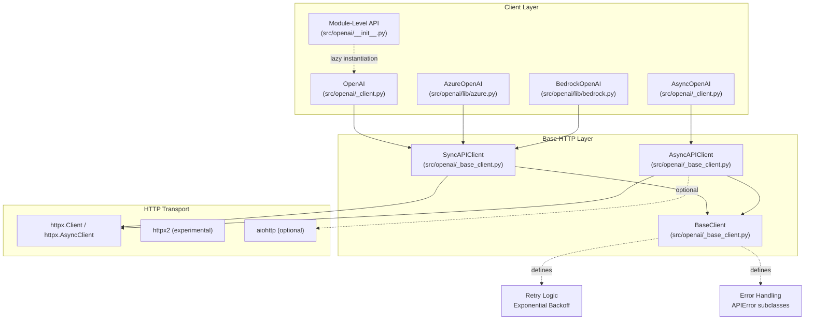
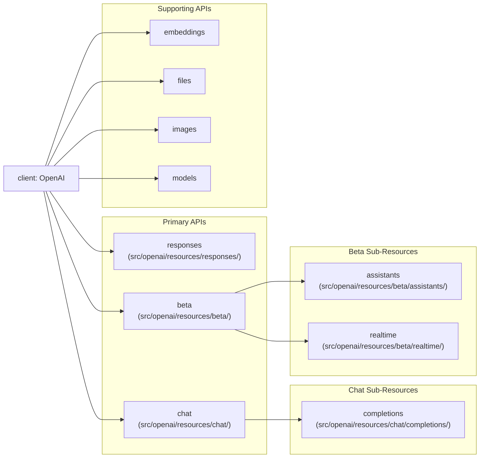

<!-- source: DeepWiki mcp.deepwiki.com · repo openai/openai-python · page 1 Overview · fetched 2026-10-26 -->

# Overview

Relevant source files

The following files were used as context for generating this wiki page:

- [.release-please-manifest.json](.release-please-manifest.json)
- [.stats.yml](.stats.yml)
- [CHANGELOG.md](CHANGELOG.md)
- [README.md](README.md)
- [api.md](api.md)
- [pyproject.toml](pyproject.toml)
- [src/openai/__init__.py](src/openai/__init__.py)
- [src/openai/_base_client.py](src/openai/_base_client.py)
- [src/openai/_client.py](src/openai/_client.py)
- [src/openai/_version.py](src/openai/_version.py)
- [src/openai/lib/azure.py](src/openai/lib/azure.py)
- [src/openai/resources/beta/realtime/realtime.py](src/openai/resources/beta/realtime/realtime.py)
- [src/openai/resources/realtime/realtime.py](src/openai/resources/realtime/realtime.py)
- [src/openai/types/__init__.py](src/openai/types/__init__.py)
- [src/openai/types/shared/__init__.py](src/openai/types/shared/__init__.py)
- [src/openai/types/shared_params/__init__.py](src/openai/types/shared_params/__init__.py)
- [tests/lib/test_azure.py](tests/lib/test_azure.py)
- [tests/test_client.py](tests/test_client.py)
- [tests/test_utils/test_logging.py](tests/test_utils/test_logging.py)

The OpenAI Python SDK is the official Python client library for accessing the OpenAI REST API. It provides type-safe, idiomatic Python interfaces for all OpenAI API endpoints, supporting both synchronous and asynchronous execution models. The library is generated from OpenAI's OpenAPI specification using Stainless and targets Python 3.10 and above.

This page introduces the SDK's architecture, core concepts, and key components. For installation and configuration details, see [Installation and Setup](#2). For API-specific documentation, see [API Resources and Endpoints](#4). For type system details, see [Data Types and Type System](#5).

## Library Purpose and Scope

The SDK serves three primary functions:

1.  **API Client**: Provides `OpenAI`, `AsyncOpenAI`, `AzureOpenAI`, and `BedrockOpenAI` client classes that manage HTTP communication, authentication, retries, and error handling. [src/openai/_client.py:106-258](), [src/openai/lib/azure.py:101-200](), [src/openai/lib/bedrock.py:114-175]()
2.  **Type System**: Offers comprehensive type definitions for all request params and response fields, enabling IDE autocomplete and static type checking. [README.md:6-9](), [src/openai/types/__init__.py]()
3.  **Developer Experience**: Implements convenience features including streaming, auto-pagination, file uploads, and structured output parsing. [src/openai/_streaming.py](), [src/openai/_base_client.py:182-241]()

**Sources:** [pyproject.toml:1-6](), [README.md:1-10](), [src/openai/_client.py:106-258]()

## Client Architecture

The SDK implements a hierarchical client architecture built on top of `httpx`.

**Key Classes:**

*   **`BaseClient`**: Foundation class providing HTTP request infrastructure, retry logic, and response parsing. [src/openai/_base_client.py:643-718]()
*   **`OpenAI` / `AsyncOpenAI`**: Main client classes exposing all API resources (e.g., `chat`, `images`, `audio`) as properties. [src/openai/_client.py:106-258]()
*   **`AzureOpenAI`**: Specialized client for Microsoft Azure OpenAI services, handling deployment-based URL mapping. [src/openai/lib/azure.py:101-200]()
*   **`BedrockOpenAI`**: Specialized client for Amazon Bedrock integration. [src/openai/lib/bedrock.py:114-175]()

The module-level API (e.g., `openai.chat.completions.create()`) provides a convenience layer that lazily instantiates an `OpenAI` client from environment variables on first use via `_ModuleClient`. [src/openai/__init__.py:176-243]()

**Sources:** [pyproject.toml:11-20](), [src/openai/_base_client.py:643-718](), [src/openai/_client.py:106-258](), [src/openai/__init__.py:176-243]()

## API Resource Organization

API resources are organized hierarchically and accessible as properties on the client:

**Resource Hierarchy:**

| Resource Path | Module | Purpose |
| :--- | :--- | :--- |
| `client.responses` | `src/openai/resources/responses/` | Modern interface for model interactions (text, audio, vision). [README.md:27-45]() |
| `client.chat.completions` | `src/openai/resources/chat/completions/` | Standard chat completions API. [README.md:47-66]() |
| `client.beta.assistants` | `src/openai/resources/beta/assistants/` | Stateful AI assistants with thread management. [api.md:195-245]() |
| `client.embeddings` | `src/openai/resources/embeddings.py` | Vector representations of text. [api.md:106-117]() |
| `client.files` | `src/openai/resources/files.py` | Document management and processing. [api.md:118-135]() |

**Sources:** [README.md:27-66](), [api.md:1-173](), [src/openai/_client.py:44-90]()

## Execution Models

The SDK supports three execution patterns:

### Synchronous Execution
Uses `httpx.Client` for blocking I/O. Suitable for scripts and synchronous web frameworks. [src/openai/_client.py:106-156]()

### Asynchronous Execution
Uses `httpx.AsyncClient` or optionally `aiohttp` (via `DefaultAioHttpClient`) for non-blocking I/O. [src/openai/_client.py:225-241](), [src/openai/_base_client.py:40]()

### Module-Level API
Convenience pattern that defers client instantiation. The module stores configuration in module-level variables (e.g., `openai.api_key`) and creates an `OpenAI` client on-demand. [src/openai/__init__.py:129-243]()

**Sources:** [README.md:29-45](), [README.md:218-241](), [src/openai/__init__.py:129-243]()

## Type System Architecture

The SDK uses a dual-layer type system for safety and validation:

1.  **Request Parameter Types**: `TypedDict` definitions (e.g., `ChatCompletionMessageParam`) for static type checking. [api.md:51-90]()
2.  **Response Model Types**: Pydantic models (inheriting from `BaseModel`) for runtime validation and attribute access. [src/openai/_models.py:76](), [src/openai/_response.py:78-80]()
3.  **Shared Types**: Common enums and models (e.g., `ChatModel`, `ReasoningEffort`) used across resources. [api.md:1-24]()

**Sources:** [pyproject.toml:13-14](), [src/openai/_models.py:76](), [src/openai/types/__init__.py]()

## Key Features

### Automatic Retries
Requests failing with connection errors or specific status codes (408, 429, 5xx) are automatically retried with exponential backoff. [src/openai/_base_client.py:83-91](), [src/openai/_base_client.py:862-937]()

### Streaming Support
Server-Sent Events (SSE) are supported for real-time response generation via `Stream` and `AsyncStream`. [src/openai/_streaming.py:92]()

### Workload Identity
Supports secure authentication in cloud environments (Kubernetes, Azure, GCP) using short-lived tokens from identity providers. [README.md:74-168](), [src/openai/_client.py:13-114]()

### Bedrock and Azure Support
Includes specialized clients for Amazon Bedrock and Microsoft Azure OpenAI services, handling provider-specific authentication and endpoint mapping. [src/openai/lib/azure.py](), [src/openai/lib/bedrock.py]()

**Sources:** [src/openai/_base_client.py:862-937](), [README.md:74-168](), [src/openai/lib/bedrock.py:114-175]()

## Project Configuration and Dependencies

The project uses **Rye** for dependency management and **Hatchling** as the build backend. [pyproject.toml:61-119]()

### Core Dependencies
| Package | Version | Purpose |
| :--- | :--- | :--- |
| `httpx` | >=0.23.0, <1 | HTTP client for sync/async requests |
| `pydantic` | >=1.9.0, <3 | Data validation and serialization |
| `anyio` | >=3.5.0, <5 | Async I/O abstraction |
| `jiter` | >=0.10.0, <1 | Fast JSON parsing |

**Sources:** [pyproject.toml:11-20]()

## Version and Compatibility
Current version: **2.49.0** [src/openai/_version.py:4]().
The library requires **Python 3.10+** [pyproject.toml:22]().

For detailed architecture, see [Architecture Overview](#1.1).
For project setup and release details, see [Project Configuration and Dependencies](#1.2).

---

