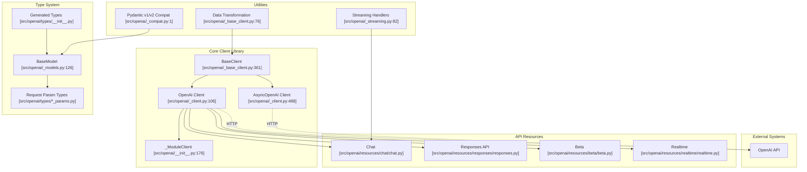
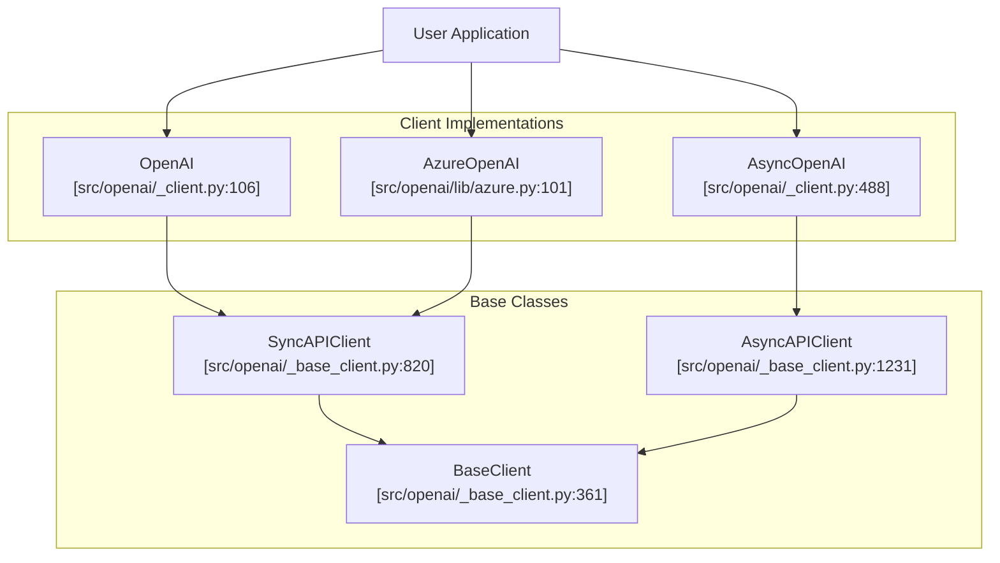
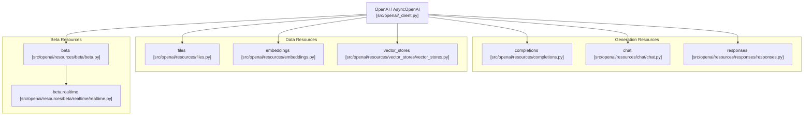
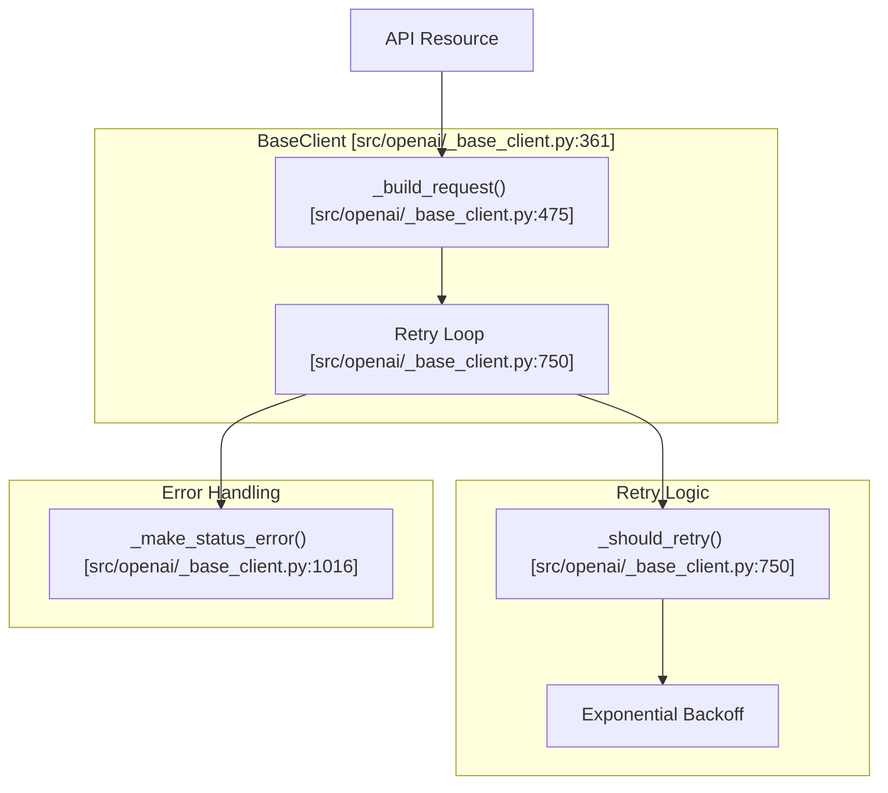
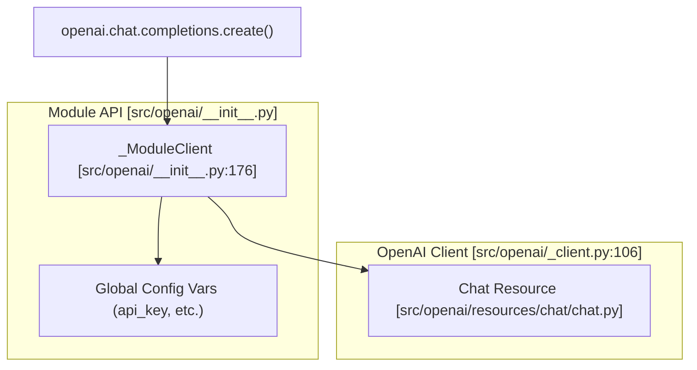

<!-- source: DeepWiki mcp.deepwiki.com · repo openai/openai-python · page 1.1 Architecture Overview · fetched 2026-10-26 -->

# Architecture Overview

<details>
<summary>Relevant source files</summary>

The following files were used as context for generating this wiki page:

- [.stats.yml](.stats.yml)
- [README.md](README.md)
- [api.md](api.md)
- [src/openai/__init__.py](src/openai/__init__.py)
- [src/openai/_base_client.py](src/openai/_base_client.py)
- [src/openai/_client.py](src/openai/_client.py)
- [src/openai/_module_client.py](src/openai/_module_client.py)
- [src/openai/lib/azure.py](src/openai/lib/azure.py)
- [src/openai/resources/__init__.py](src/openai/resources/__init__.py)
- [src/openai/resources/admin/__init__.py](src/openai/resources/admin/__init__.py)
- [src/openai/resources/admin/admin.py](src/openai/resources/admin/admin.py)
- [src/openai/resources/beta/realtime/realtime.py](src/openai/resources/beta/realtime/realtime.py)
- [src/openai/resources/realtime/realtime.py](src/openai/resources/realtime/realtime.py)
- [src/openai/types/__init__.py](src/openai/types/__init__.py)
- [src/openai/types/shared/__init__.py](src/openai/types/shared/__init__.py)
- [src/openai/types/shared_params/__init__.py](src/openai/types/shared_params/__init__.py)
- [tests/lib/test_azure.py](tests/lib/test_azure.py)
- [tests/test_client.py](tests/test_client.py)
- [tests/test_utils/test_logging.py](tests/test_utils/test_logging.py)

</details>


## Purpose and Scope

This document provides a detailed architectural overview of the OpenAI Python library, explaining how the major components interact to provide a typed, reliable interface to the OpenAI API. It covers the layered architecture from client initialization through HTTP communication to response parsing, including both synchronous and asynchronous patterns.

The library is generated from an OpenAPI specification ([.stats.yml:2]()) and supports Python 3.10+ ([README.md:6]()).

## High-Level Architecture

The OpenAI Python SDK is organized into distinct layers that provide a typed, reliable interface to the OpenAI API. The library exposes **278 configured API endpoints** (referenced in [.stats.yml:1]()) across numerous top-level resources.

**Overall System Architecture**



The library follows a layered architecture:

1.  **Core Client Library**: `BaseClient` ([src/openai/_base_client.py:361]()) provides HTTP infrastructure, specialized into `SyncAPIClient` ([src/openai/_base_client.py:820]()) and `AsyncAPIClient` ([src/openai/_base_client.py:1231]()).
2.  **API Resources**: Top-level resources representing OpenAI API endpoints (e.g., `chat`, `files`, `responses`).
3.  **Type System**: Pydantic-based models ([src/openai/_models.py:126]()) with custom extensions for serialization and validation.
4.  **Data Transformation**: Logic for property aliasing, Pydantic compatibility ([src/openai/_compat.py:1]()), and streaming event processing ([src/openai/_streaming.py:92]()).

Sources: [.stats.yml:1-5](), [src/openai/_client.py:106-802](), [src/openai/_base_client.py:361-1498]()

## Client Layer

The client layer provides three primary entry points for users, all inheriting from common base classes:



### Synchronous Client: `OpenAI`

The `OpenAI` class ([src/openai/_client.py:106-485]()) is the primary synchronous client.

| Feature | Implementation | Location |
| :--- | :--- | :--- |
| API Authentication | `api_key` property / `WorkloadIdentity` | [src/openai/_client.py:108, 110]() |
| Resource Access | Cached properties for each API resource | [src/openai/_client.py:375-451]() |
| Workload Identity | Short-lived token provider support | [src/openai/_client.py:131, 174]() |
| Environment Inference | `OPENAI_API_KEY`, `OPENAI_ORG_ID`, etc. | [src/openai/_client.py:160-164]() |

### Asynchronous Client: `AsyncOpenAI`

The `AsyncOpenAI` class ([src/openai/_client.py:488-833]()) provides the same API surface with async support:

-   Inherits from `AsyncAPIClient` ([src/openai/_base_client.py:1231]()).
-   Uses `httpx.AsyncClient` for non-blocking HTTP communication.
-   Uses `AsyncStream` ([src/openai/_streaming.py:92]()) as the default streaming class.

### Azure Integration: `AzureOpenAI`

Azure-specific clients (in `src/openai/lib/azure.py`) extend `OpenAI` or `AsyncOpenAI` to support Azure OpenAI service parameters like `api_version` and `azure_endpoint` ([src/openai/lib/azure.py:101]()). It specifically handles Azure-style deployment URL construction by prepending `/deployments/{model}` to paths like `/chat/completions` ([src/openai/lib/azure.py:75-80]()).

Sources: [src/openai/_client.py:106-833](), [src/openai/_base_client.py:820-1498](), [src/openai/lib/azure.py:64-101]()

## API Resources Layer

The library exposes top-level API resources organized as cached properties on the client.

**Resource Organization Diagram**



Resources are accessed via `@cached_property` decorators ([src/openai/_client.py:375-451]()):

```python
@cached_property
def chat(self) -> Chat:
    from .resources.chat import Chat
    return Chat(self)
```

Each resource method transforms request parameters and delegates to the client's internal request methods ([src/openai/_base_client.py:610-632]()).

Sources: [src/openai/_client.py:375-451](), [src/openai/resources/__init__.py:1-260]()

## HTTP & Retry Layer

The HTTP layer, centered on `BaseClient`, handles communication, retries, and error mapping.



### Retry Strategy

The retry logic ([src/openai/_base_client.py:750-783]()) implements backoff:

-   **Base delay**: 0.5 seconds (`INITIAL_RETRY_DELAY` from [src/openai/_constants.py:87]()).
-   **Exponential backoff**: Doubling delay up to 8 seconds (`MAX_RETRY_DELAY` from [src/openai/_constants.py:85]()).
-   **Jitter**: Randomization to prevent thundering herd ([src/openai/_base_client.py:741]()).
-   **Status Codes**: Retries 408 (Timeout), 409 (Conflict), 429 (Rate Limit), and 5xx (Server Error) ([src/openai/_base_client.py:750-783]()).

### Error Hierarchy

HTTP status codes are mapped to specific exception types in `src/openai/_exceptions.py`:

-   **400**: `BadRequestError` ([src/openai/__init__.py:27]())
-   **401**: `AuthenticationError` ([src/openai/__init__.py:29]())
-   **404**: `NotFoundError` ([src/openai/__init__.py:23]())
-   **429**: `RateLimitError` ([src/openai/__init__.py:25]())
-   **500**: `InternalServerError` ([src/openai/__init__.py:30]())

All inherit from `APIStatusError` ([src/openai/_exceptions.py:95]()), which inherits from `OpenAIError` ([src/openai/_exceptions.py:94]()).

Sources: [src/openai/_base_client.py:726-783](), [src/openai/_constants.py:84-91](), [src/openai/_exceptions.py:93-99]()

## Data & Type System

The SDK uses a comprehensive type system built on Pydantic and TypedDicts.

| Component | Purpose | Location |
| :--- | :--- | :--- |
| `BaseModel` | Extended Pydantic model for response validation | [src/openai/_models.py:126]() |
| `TypedDict` | Parameter types for request methods | `src/openai/types/*_params.py` |
| `NotGiven` | Sentinel to distinguish `None` from an omitted argument | [src/openai/_types.py:133]() |
| `Omit` | Sentinel to explicitly remove a value from a request | [src/openai/_types.py:166]() |

### Data Transformation

The library uses a transformation pipeline to prepare data for the API. Key functions include:

-   `construct_type`: Coerces data into the expected response type ([src/openai/_base_client.py:76]()).
-   `transform`: Recursively applies property aliases and formatters to request bodies ([src/openai/_base_client.py:66]()).

Sources: [src/openai/_models.py:126](), [src/openai/_types.py:133-166](), [src/openai/_base_client.py:66-76]()

## Module-Level API Pattern

For convenience, the library provides a module-level API that uses a global client instance configured via lazy properties on a `_ModuleClient` class.



The module-level variables (e.g., `openai.api_key`) are used to configure the underlying client lazily. This allows usage like `openai.chat.completions.create(...)` without manual client instantiation ([src/openai/__init__.py:137-234]()).

Sources: [src/openai/__init__.py:129-234](), [src/openai/_client.py:106-485]()

## Response Wrappers

Users can access more than just the parsed model using specialized patterns:

-   **`with_raw_response`**: Returns a `LegacyAPIResponse` ([src/openai/_legacy_response.py:101]()) containing the `httpx.Response` and headers.
-   **`with_streaming_response`**: Returns an `APIResponse` ([src/openai/_response.py:78]()) where the body is not yet read, allowing for manual streaming control.

Sources: [src/openai/_base_client.py:77-81](), [src/openai/_response.py:78](), [src/openai/_legacy_response.py:101]()

---

