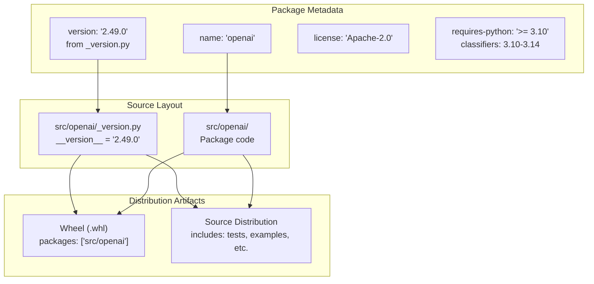
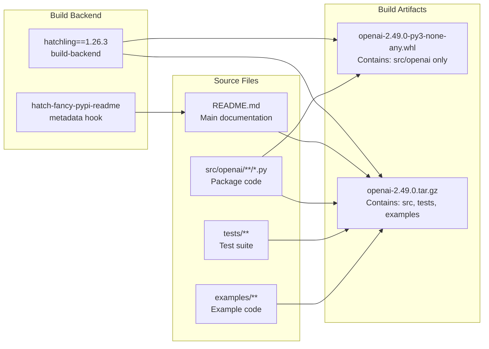
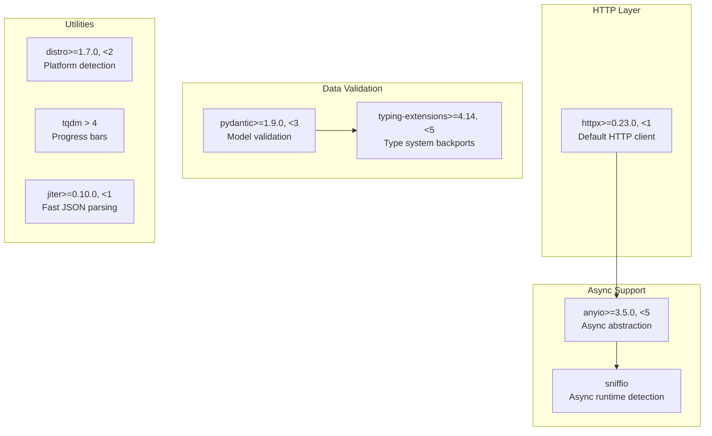
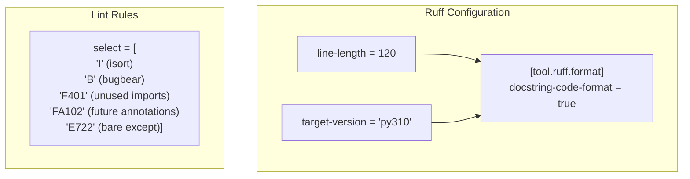
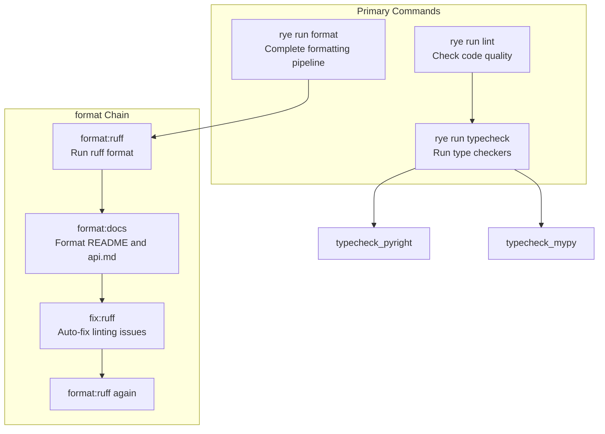

<!-- source: DeepWiki mcp.deepwiki.com · repo openai/openai-python · page 1.2 Project Configuration and Dependencies · fetched 2026-10-26 -->

# Project Configuration and Dependencies

<details>
<summary>Relevant source files</summary>

The following files were used as context for generating this wiki page:

- [.release-please-manifest.json](.release-please-manifest.json)
- [CHANGELOG.md](CHANGELOG.md)
- [pyproject.toml](pyproject.toml)
- [requirements-dev.lock](requirements-dev.lock)
- [requirements.lock](requirements.lock)
- [scripts/utils/validate-bedrock-wheel.py](scripts/utils/validate-bedrock-wheel.py)
- [scripts/utils/validate-httpx2-wheel.py](scripts/utils/validate-httpx2-wheel.py)
- [src/openai/_version.py](src/openai/_version.py)
- [tests/conftest.py](tests/conftest.py)
- [tests/lib/test_bedrock_auth_conformance.py](tests/lib/test_bedrock_auth_conformance.py)
- [uv.lock](uv.lock)

</details>


This document describes the project's configuration system, dependency management, build infrastructure, and development tooling. The `openai-python` library uses `pyproject.toml` as its central configuration file, Rye for dependency management, and Hatchling as its build backend. For information about the CI/CD pipeline and release automation, see [CI/CD Pipeline and Release Process](#8.4). For development environment setup instructions, see [8.1 Development Environment Setup]().

## Project Metadata and Package Structure

The library is configured as a standard Python package with metadata defined in [pyproject.toml:1-40](). Key identifiers:

- **Package name**: `openai` (published to PyPI) [pyproject.toml:2]()
- **Current version**: `2.49.0` ([pyproject.toml:3](), [src/openai/_version.py:4]())
- **License**: Apache-2.0 [pyproject.toml:6]()
- **Python support**: Python 3.10 and above ([pyproject.toml:22](), [CHANGELOG.md:9]())
- **Project homepage**: https://github.com/openai/openai-python [pyproject.toml:41]()

The package source code is located in `src/openai`, and the project includes several optional dependency groups for specialized functionality.

Project Metadata Mapping:


**Sources**: [pyproject.toml:1-43](), [src/openai/_version.py:1-5](), [CHANGELOG.md:3-9]()

## Build System Configuration

The library uses Hatchling as its build backend with `hatch-fancy-pypi-readme` for dynamic README generation [pyproject.toml:118-119]():

Build Process Flow:


The build configuration specifies:

- **Wheel packages**: Only `src/openai` is included ([pyproject.toml:127]())
- **Source distribution includes**: All non-hidden files including tests, examples, lock files, and configuration ([pyproject.toml:129-142]())
- **Dynamic README**: The `README.md` is processed to convert relative links to absolute GitHub links ([pyproject.toml:144-153]())

**Sources**: [pyproject.toml:118-153]()

## Dependency Management with Rye

The project uses Rye for dependency management, which generates lock files to ensure reproducible builds [pyproject.toml:61-62]():

| File | Purpose | Scope |
|------|---------|-------|
| `pyproject.toml` | Declares dependency constraints | All environments |
| `requirements.lock` | Locked runtime + optional dependencies | Production + optional features |
| `requirements-dev.lock` | Locked dev dependencies | Development environment |

Rye manages the project with the `managed = true` flag ([pyproject.toml:62]()). Dependencies are resolved and locked automatically when running `rye lock` or `rye sync`.

**Sources**: [pyproject.toml:61-86](), [requirements.lock:1-126](), [requirements-dev.lock:1-262]()

## Runtime Dependencies

The core runtime dependencies provide HTTP communication, data validation, and async support:

Dependency Stack:


**Key dependency rationale:**

- **httpx**: Provides synchronous and asynchronous HTTP client with HTTP/2 support [pyproject.toml:12]()
- **pydantic**: Powers the type system and response validation; supports both v1 and v2 ([pyproject.toml:13]())
- **anyio**: Enables compatibility with multiple async backends (asyncio, trio) [pyproject.toml:15]()
- **jiter**: Fast JSON parsing library for high-performance response processing [pyproject.toml:19]()
- **distro**: Used for platform detection in user-agent headers [pyproject.toml:16]()
- **tqdm**: Provides progress bars for long-running operations [pyproject.toml:18]()

**Sources**: [pyproject.toml:11-20]()

## Optional Dependencies

The library provides several optional dependency groups for extended functionality:

```mermaid
graph TB
    subgraph "optional-dependencies"
        aiohttp_extra["[aiohttp]<br/>Alternative HTTP backend"]
        httpx2_extra["[httpx2]<br/>Experimental HTTPX2 support"]
        realtime_extra["[realtime]<br/>WebSocket support"]
        datalib_extra["[datalib]<br/>Data processing"]
        voice_extra["[voice_helpers]<br/>Audio utilities"]
        bedrock_extra["[bedrock]<br/>Amazon Bedrock support"]
    end
    
    subgraph "aiohttp Group"
        aiohttp["aiohttp>=3.14.1"]
        httpx_aiohttp["httpx_aiohttp>=0.1.9"]
    end
    
    subgraph "httpx2 Group"
        httpx2["httpx2>=2.7.0"]
        anyio_httpx2["anyio>=4.10.0"]
    end
    
    subgraph "realtime Group"
        websockets["websockets >= 13, < 16"]
    end
    
    subgraph "datalib Group"
        numpy["numpy >= 1"]
        pandas["pandas >= 1.2.3"]
        pandas_stubs["pandas-stubs >= 1.1.0.11"]
    end
    
    subgraph "voice_helpers Group"
        sounddevice["sounddevice>=0.5.1"]
        numpy_voice["numpy>=2.0.2"]
    end

    subgraph "bedrock Group"
        botocore["botocore>=1.40.0"]
    end
    
    aiohttp_extra --> aiohttp
    aiohttp_extra --> httpx_aiohttp
    httpx2_extra --> httpx2
    realtime_extra --> websockets
    datalib_extra --> numpy
    datalib_extra --> pandas
    voice_extra --> sounddevice
    bedrock_extra --> botocore
```



**Installation examples:**

```bash
# Install with aiohttp backend support
pip install openai[aiohttp]

# Install with experimental HTTPX2 support
pip install openai[httpx2]

# Install with Realtime API support
pip install openai[realtime]

# Install with data processing utilities
pip install openai[datalib]

# Install with Amazon Bedrock support
pip install openai[bedrock]
```

**Sources**: [pyproject.toml:44-59](), [CHANGELOG.md:26]()

## Development Dependencies

Development dependencies are managed through Rye and include testing, type checking, and code quality tools:

| Category | Tools | Purpose |
|----------|-------|---------|
| **Type Checking** | `pyright==1.1.399`, `mypy==1.17` | Static type analysis with dual checkers [pyproject.toml:65-66]() |
| **Testing** | `pytest`, `pytest-asyncio`, `pytest-xdist` | Test framework with async and parallel support [pyproject.toml:68-69, 84]() |
| **HTTP Mocking** | `respx` | HTTP request/response mocking for tests [pyproject.toml:67]() |
| **Code Quality** | `ruff` | Fast linter and formatter [pyproject.toml:71]() |
| **Test Utilities** | `time-machine`, `dirty-equals`, `inline-snapshot` | Testing helpers and snapshot testing [pyproject.toml:72, 74, 77]() |
| **Build Automation** | `nox` | Task automation and multi-environment testing [pyproject.toml:73]() |
| **Cloud/Identity** | `azure-identity`, `botocore` | Testing Azure and Bedrock authentication flows [pyproject.toml:78-79]() |

**Sources**: [pyproject.toml:61-86](), [requirements-dev.lock:1-262]()

## Tool Configurations

### Ruff (Linting and Formatting)

Ruff provides fast Python linting and code formatting with opinionated defaults:



**Configuration highlights:**
- Line length: 120 characters ([pyproject.toml:255]())
- Formats code in docstrings ([pyproject.toml:260]())
- Target version: Python 3.10 ([pyproject.toml:257]())

**Sources**: [pyproject.toml:254-275]()

### Pyright (Type Checking)

Pyright runs in strict mode with comprehensive type checking:

```python
# Configuration from pyproject.toml:168-192
[tool.pyright]
typeCheckingMode = "strict"
pythonVersion = "3.10"
reportImplicitOverride = true

# Excluded paths
exclude = [
    "_dev",
    ".venv",
    ".nox",
    ".git",
    "examples/realtime/audio_util.py",
    "examples/realtime/push_to_talk_app.py"
]
```

**Sources**: [pyproject.toml:168-192]()

### mypy (Secondary Type Checker)

mypy provides complementary type checking with different inference rules:

```python
# Configuration from pyproject.toml:193-247
[tool.mypy]
pretty = true
strict_equality = true
check_untyped_defs = true
disallow_untyped_defs = true

# Excluded modules to avoid conflicts or known limitations
exclude = [
  'src/openai/_files.py',
  '_dev/.*.py',
  'tests/.*',
  'src/openai/_utils/_logs.py',
]
```

**Sources**: [pyproject.toml:193-247]()

### pytest (Testing Framework)

pytest is configured for async testing with parallel execution:

```python
# Configuration from pyproject.toml:155-163
[tool.pytest.ini_options]
testpaths = ["tests"]
addopts = "--tb=short -n auto"
asyncio_mode = "auto"
asyncio_default_fixture_loop_scope = "session"
filterwarnings = ["error"]
```

**Sources**: [pyproject.toml:155-163]()

## Rye Scripts and Commands

Rye provides custom script commands for common development tasks:

Script Workflow:


**Command details:**

| Command | Description | Implementation |
|---------|-------------|----------------|
| `rye run format` | Format code and docs, fix issues | Chains `format:ruff`, `format:docs`, `fix:ruff` ([pyproject.toml:89-95]()) |
| `rye run lint` | Check linting and types | Chains `check:ruff`, `typecheck`, `check:importable` ([pyproject.toml:99-103]()) |
| `rye run typecheck` | Run both type checkers | Chains `typecheck:pyright` and `typecheck:mypy` ([pyproject.toml:109-112]()) |

**Sources**: [pyproject.toml:88-116]()

## Version Management and Release Integration

Version information is maintained in multiple synchronized locations:

- `pyproject.toml`: `version = "2.49.0"` [pyproject.toml:3]()
- `src/openai/_version.py`: `__version__ = "2.49.0"` [src/openai/_version.py:4]()
- `.release-please-manifest.json`: `".": "2.49.0"` [.release-please-manifest.json:2]()

The version string in `_version.py` includes a special comment for automation:

```python
# From src/openai/_version.py:4
__version__ = "2.49.0"  # x-release-please-version
```

This marker allows the `release-please` automation to update version numbers. The library maintains a comprehensive `CHANGELOG.md` which tracks features (like Amazon Bedrock support and HTTPX2 support), bug fixes, and required environment updates like the move to Python 3.10 ([CHANGELOG.md:1-130]()).

**Sources**: [src/openai/_version.py:1-5](), [pyproject.toml:3](), [.release-please-manifest.json:1-3](), [CHANGELOG.md:1-130]()

---

