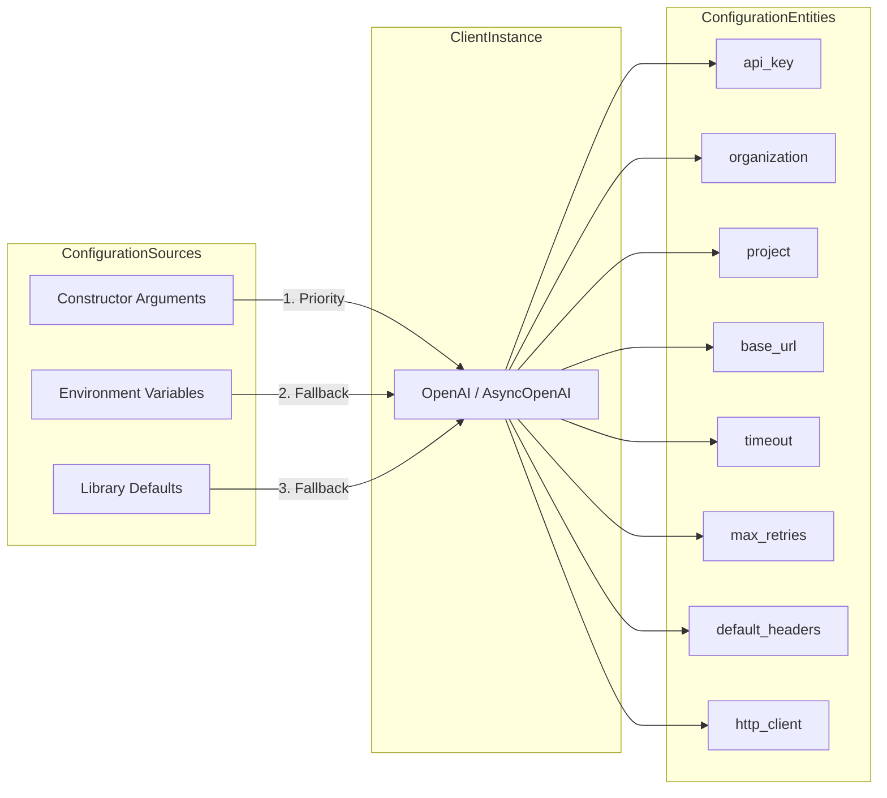
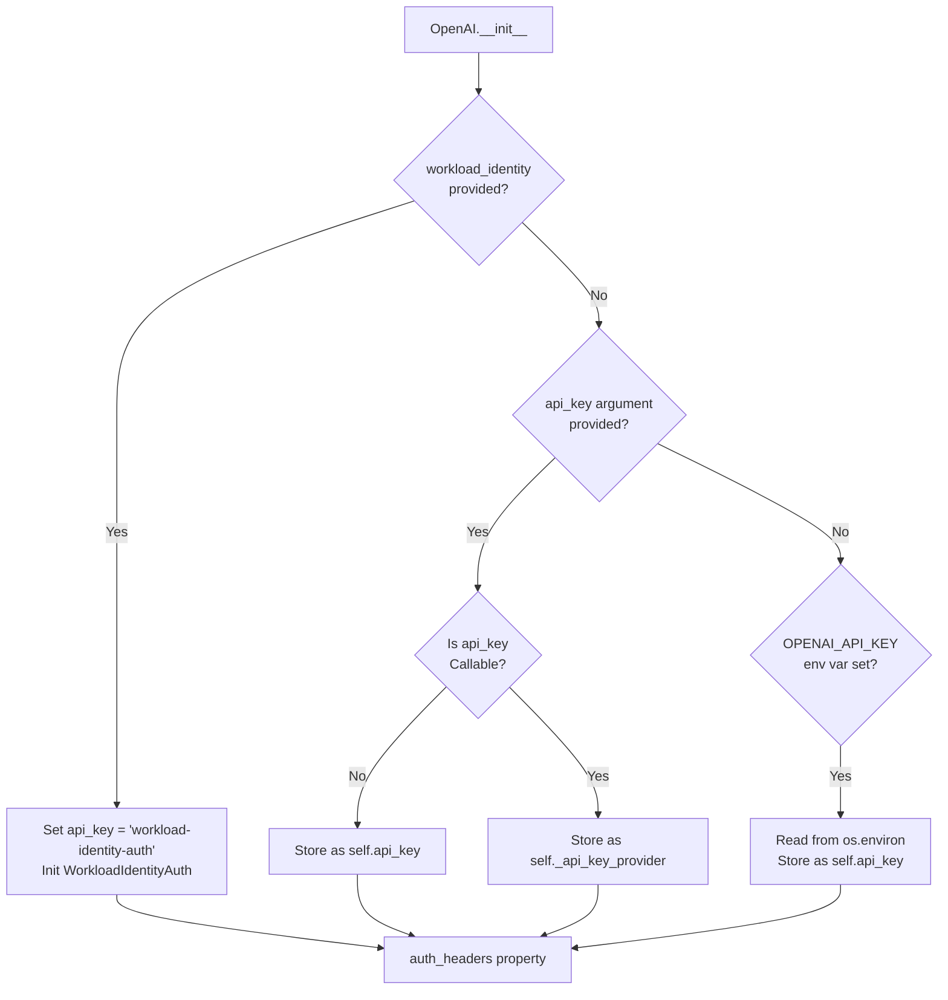

<!-- source: DeepWiki mcp.deepwiki.com · repo openai/openai-python · page 2.1 Client Configuration · fetched 2026-10-26 -->

# Client Configuration

<details>
<summary>Relevant source files</summary>

The following files were used as context for generating this wiki page:

- [README.md](README.md)
- [src/openai/__init__.py](src/openai/__init__.py)
- [src/openai/_base_client.py](src/openai/_base_client.py)
- [src/openai/_client.py](src/openai/_client.py)
- [src/openai/_constants.py](src/openai/_constants.py)
- [src/openai/lib/azure.py](src/openai/lib/azure.py)
- [src/openai/resources/beta/realtime/realtime.py](src/openai/resources/beta/realtime/realtime.py)
- [src/openai/resources/realtime/realtime.py](src/openai/resources/realtime/realtime.py)
- [tests/lib/test_azure.py](tests/lib/test_azure.py)
- [tests/test_client.py](tests/test_client.py)
- [tests/test_utils/test_logging.py](tests/test_utils/test_logging.py)

</details>


## Purpose and Scope

This page explains how to configure the `OpenAI` and `AsyncOpenAI` client classes with authentication credentials, network settings, retry behavior, timeouts, and custom HTTP clients. This covers the core configuration options available when instantiating these clients.

For Azure-specific configuration, see [Azure OpenAI Configuration](#2.2). For information about the module-level API pattern (e.g., `openai.chat.completions`), see [Module-Level API Usage](#2.3). For detailed documentation of the client classes themselves and their resource access patterns, see [OpenAI and AsyncOpenAI Clients](#3.1).

## Configuration Overview

The client accepts configuration through three primary mechanisms:

1.  **Constructor arguments** - Explicit parameters passed during instantiation [src/openai/_client.py:126-156]().
2.  **Environment variables** - Automatic fallback when arguments are not provided [src/openai/_client.py:159-165]().
3.  **Runtime modification** - Using `copy()` or `with_options()` to create modified client instances [src/openai/_client.py:341-398]().

**Diagram: Configuration Resolution**

Title: Configuration Data Flow

Sources: [src/openai/_client.py:106-167](), [README.md:30-36]()

## Basic Client Instantiation

### Synchronous Client

The `OpenAI` class provides synchronous HTTP operations [src/openai/_client.py:106]().

```python
from openai import OpenAI

client = OpenAI(
    api_key="sk-...",  # Optional - defaults to OPENAI_API_KEY env var
    organization="org-...",  # Optional - defaults to OPENAI_ORG_ID env var
    project="proj_...",  # Optional - defaults to OPENAI_PROJECT_ID env var
)
```

### Asynchronous Client

The `AsyncOpenAI` class provides asynchronous HTTP operations [src/openai/_client.py:451]().

```python
from openai import AsyncOpenAI

client = AsyncOpenAI(
    api_key="sk-...",
    organization="org-...",
    project="proj_...",
)
```

Both clients share identical configuration interfaces. The synchronous client inherits from `SyncAPIClient` while the asynchronous variant inherits from `AsyncAPIClient` [src/openai/_client.py:106](), [src/openai/_client.py:451]().

Sources: [src/openai/_client.py:106-167](), [src/openai/_client.py:451-526](), [README.md:30-45](), [README.md:223-241]()

## Authentication Configuration

### API Key and Workload Identity

The SDK supports standard API keys and Workload Identity for automated environments [README.md:74-76](). API keys can be passed as strings or as a `Callable[[], str]` for dynamic retrieval [src/openai/_client.py:129]().

| Method | Source | Code Entity |
| :--- | :--- | :--- |
| **Standard API Key** | `OPENAI_API_KEY` | `self.api_key` [src/openai/_client.py:108]() |
| **Admin API Key** | `OPENAI_ADMIN_KEY` | `self.admin_api_key` [src/openai/_client.py:109]() |
| **Workload Identity** | `workload_identity` arg | `self.workload_identity` [src/openai/_client.py:110]() |

**Diagram: Authentication Logic Flow**

Title: Authentication Entity Mapping


**Workload Identity** allows using short-lived tokens from cloud providers like Kubernetes, Azure, or GCP [README.md:74-130](). It uses a `WorkloadIdentityAuth` internal handler [src/openai/_client.py:114]().

Sources: [src/openai/_client.py:106-182](), [README.md:74-152](), [src/openai/auth/__init__.py]()

### Organization and Project IDs

Organization and project IDs are sent as headers (`OpenAI-Organization` and `OpenAI-Project`) with each request [src/openai/_client.py:332-339]().

Sources: [src/openai/_client.py:111-112](), [src/openai/_client.py:332-339]()

## Network Configuration

### Base URL and WebSocket URL

The `base_url` determines the REST API endpoint, while `websocket_base_url` targets Realtime API connections [src/openai/_client.py:118-124]().

*   **Default REST Base:** The library typically defaults to the OpenAI production API [src/openai/_client.py:136]().
*   **WebSocket Logic:** If `websocket_base_url` is missing, the SDK replaces `http` with `wss` in the standard `base_url` [src/openai/_client.py:121-124]().

Sources: [src/openai/_client.py:118-137](), [src/openai/_base_client.py:560-562]()

### Timeout Configuration

Timeouts are managed via `httpx.Timeout` [src/openai/_types.py:50](). The library default is **10 minutes** for the total timeout and **5 seconds** for connection [src/openai/_constants.py:9]().

```python
from openai import OpenAI
import httpx

client = OpenAI(
    timeout=httpx.Timeout(
        timeout=600.0,
        connect=5.0
    )
)
```

Sources: [src/openai/_constants.py:9](), [src/openai/_base_client.py:122-128]()

## Request Behavior Configuration

### Retry Configuration

The SDK implements automatic retries for specific status codes (408, 409, 429, 5xx) and connection errors [src/openai/_base_client.py:93-99]().

*   **Default Max Retries:** 2 [src/openai/_constants.py:10]().
*   **Initial Delay:** 0.5s [src/openai/_constants.py:13]().
*   **Max Delay:** 8.0s [src/openai/_constants.py:14]().

Sources: [src/openai/_constants.py:10-14](), [src/openai/_base_client.py:85-87]()

### Custom Headers and Query Parameters

Global headers and query parameters can be provided during initialization and are merged into every request [src/openai/_client.py:140-141]().

Sources: [src/openai/_client.py:140-141](), [src/openai/_base_client.py:456-465]()

## Custom HTTP Client Configuration

Advanced networking scenarios like proxies require passing an `http_client` [src/openai/_client.py:145]().

```python
import httpx
from openai import OpenAI, DefaultHttpxClient

client = OpenAI(
    http_client=DefaultHttpxClient(
        proxies="http://my-proxy:8080",
        limits=httpx.Limits(max_connections=500)
    )
)
```

The `DefaultHttpxClient` and `DefaultAsyncHttpxClient` classes provide the SDK's recommended defaults (timeouts and connection limits) while allowing overrides [src/openai/_base_client.py:558-615]().

Sources: [src/openai/_client.py:145](), [src/openai/_base_client.py:558-615](), [src/openai/_constants.py:11]()

## Per-Request Configuration Overrides

The `with_options()` method (which uses `copy()`) allows temporary configuration changes without mutating the main client [src/openai/_client.py:341]().

```python
# Create a temporary client with a short timeout for one specific call
short_timeout_client = client.with_options(timeout=1.0)
response = short_timeout_client.chat.completions.create(...)
```

Sources: [src/openai/_client.py:341-398](), [tests/test_client.py:148-175]()

## Configuration Summary Table

| Argument | Type | Env Var | Code Entity |
| :--- | :--- | :--- | :--- |
| `api_key` | `str \| Callable` | `OPENAI_API_KEY` | `OpenAI.api_key` |
| `admin_api_key` | `str` | `OPENAI_ADMIN_KEY` | `OpenAI.admin_api_key` |
| `organization` | `str` | `OPENAI_ORG_ID` | `OpenAI.organization` |
| `project` | `str` | `OPENAI_PROJECT_ID` | `OpenAI.project` |
| `base_url` | `str \| URL` | - | `BaseClient.base_url` |
| `timeout` | `float \| Timeout` | - | `BaseClient.timeout` |
| `max_retries` | `int` | - | `BaseClient.max_retries` |
| `http_client` | `httpx.Client` | - | `BaseClient._client` |

Sources: [src/openai/_client.py:127-156](), [src/openai/_base_client.py:440-490]()

---

