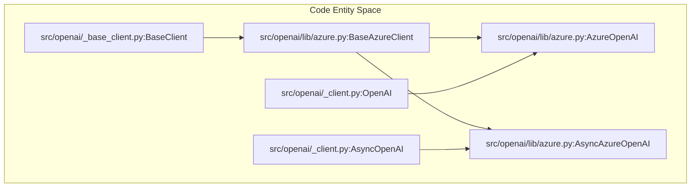
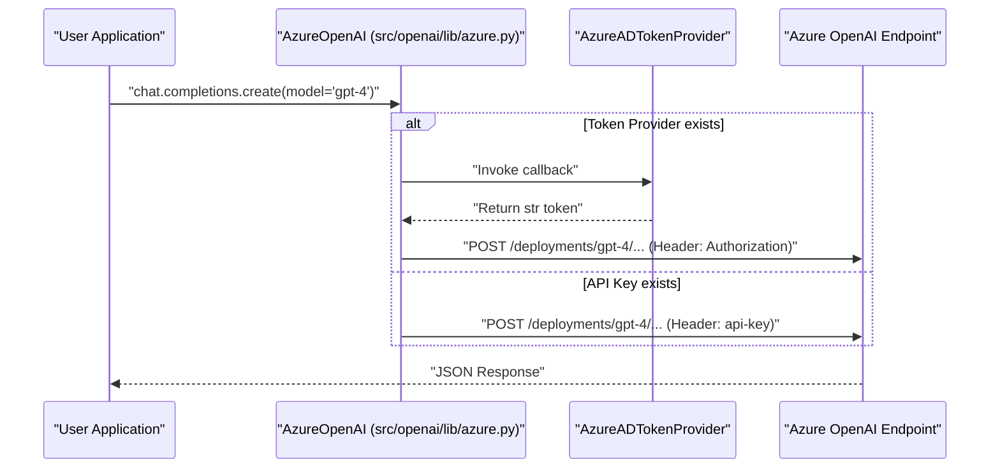
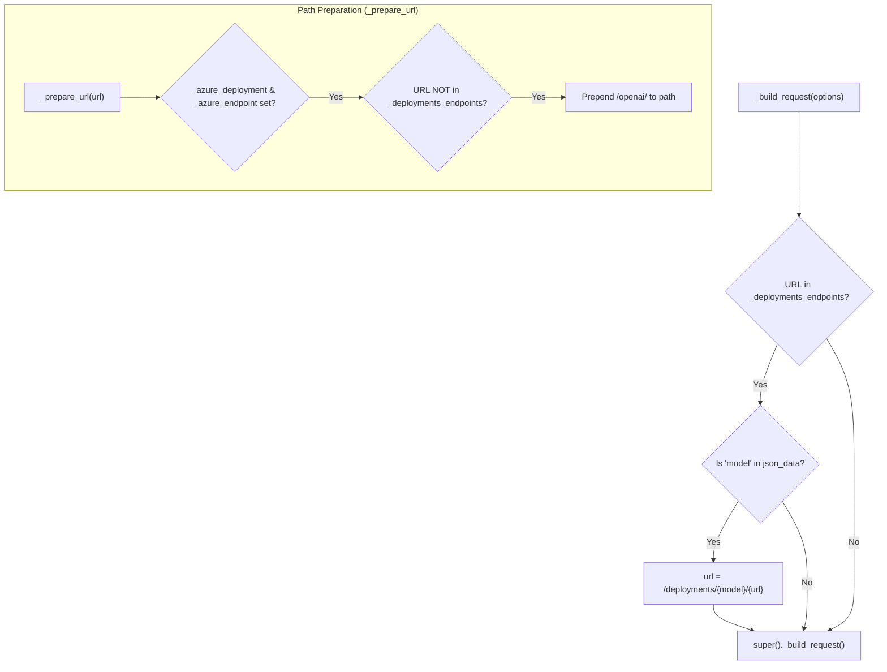

<!-- source: DeepWiki mcp.deepwiki.com · repo openai/openai-python · page 2.2 Azure OpenAI Configuration · fetched 2026-10-26 -->

# Azure OpenAI Configuration

<details>
<summary>Relevant source files</summary>

The following files were used as context for generating this wiki page:

- [README.md](README.md)
- [examples/async_demo.py](examples/async_demo.py)
- [examples/azure.py](examples/azure.py)
- [examples/azure_ad.py](examples/azure_ad.py)
- [examples/demo.py](examples/demo.py)
- [examples/streaming.py](examples/streaming.py)
- [src/openai/__init__.py](src/openai/__init__.py)
- [src/openai/_base_client.py](src/openai/_base_client.py)
- [src/openai/_client.py](src/openai/_client.py)
- [src/openai/lib/_validators.py](src/openai/lib/_validators.py)
- [src/openai/lib/azure.py](src/openai/lib/azure.py)
- [src/openai/resources/beta/realtime/realtime.py](src/openai/resources/beta/realtime/realtime.py)
- [src/openai/resources/realtime/realtime.py](src/openai/resources/realtime/realtime.py)
- [tests/lib/test_azure.py](tests/lib/test_azure.py)
- [tests/test_client.py](tests/test_client.py)
- [tests/test_required_args.py](tests/test_required_args.py)
- [tests/test_utils/test_logging.py](tests/test_utils/test_logging.py)

</details>


This document covers the `AzureOpenAI` and `AsyncAzureOpenAI` client classes, which provide access to OpenAI models deployed on Microsoft Azure's infrastructure. It explains the Azure-specific configuration parameters, authentication methods, and how the Azure client differs from the standard OpenAI client.

---

## Overview

The Azure OpenAI service uses a different API shape and authentication mechanism compared to the standard OpenAI API. The SDK provides dedicated `AzureOpenAI` and `AsyncAzureOpenAI` classes to handle these differences.

**Key Differences from Standard Client:**
- Uses Azure-specific endpoints with resource names and deployment IDs.
- Supports both API key and Azure Active Directory (Microsoft Entra ID) authentication.
- Requires explicit API version specification via `api_version`.
- Model names are often replaced with deployment names in the request URL path.

**Sources:** [src/openai/lib/azure.py:22-33](), [src/openai/lib/azure.py:68-80](), [src/openai/lib/azure.py:101-101]()

---

## AzureOpenAI Client Class

### Basic Usage

```python
from openai import AzureOpenAI

client = AzureOpenAI(
    api_version="2023-07-01-preview",
    azure_endpoint="https://example-endpoint.openai.azure.com",
)

completion = client.chat.completions.create(
    model="deployment-name",  # Your Azure deployment name
    messages=[{"role": "user", "content": "Hello!"}],
)
```

### Client Hierarchy



**Diagram: Azure Client Inheritance**

The `BaseAzureClient` class overrides `_prepare_url` and `_build_request` to inject `/deployments/{model}` into the path for supported endpoints.

**Sources:** [src/openai/lib/azure.py:64-66](), [src/openai/lib/azure.py:101-101](), [src/openai/lib/azure.py:216-216]()

---

## Configuration Parameters

The `AzureOpenAI` client constructors accept specific parameters for the Azure environment:

### Azure-Specific Parameters

| Parameter | Type | Description |
|-----------|------|-------------|
| `azure_endpoint` | `str` | The base URL for your Azure OpenAI resource (e.g., `https://<resource-name>.openai.azure.com`). |
| `api_version` | `str` | The Azure API version to use (e.g., `2023-07-01-preview`). |
| `azure_deployment` | `str` | A default deployment name to use if the `model` parameter is omitted in requests. |
| `azure_ad_token` | `str` | A static Azure AD token for authentication. |
| `azure_ad_token_provider` | `AzureADTokenProvider` | A callable that returns an Azure AD token, enabling dynamic token refresh. |

**Sources:** [src/openai/lib/azure.py:103-122](), [src/openai/lib/azure.py:36-37]()

---

## Authentication Methods

Azure OpenAI supports three primary authentication schemes, which are mutually exclusive. Passing more than one results in a `MutuallyExclusiveAuthError`.

### 1. API Key Authentication
Uses the `api-key` HTTP header. The key can be passed via the `api_key` parameter or the `AZURE_OPENAI_API_KEY` environment variable.

### 2. Azure AD Token
Uses the `Authorization: Bearer <token>` header. A static token is provided via `azure_ad_token`.

### 3. Azure AD Token Provider
A callable function that the client invokes to retrieve a token for each request. This is the recommended way to use Managed Identities or rotating credentials.

```python
from azure.identity import DefaultAzureCredential, get_bearer_token_provider
from openai import AzureOpenAI

token_provider = get_bearer_token_provider(
    DefaultAzureCredential(), "https://cognitiveservices.azure.com/.default"
)

client = AzureOpenAI(
    azure_endpoint="https://my-resource.openai.azure.com",
    azure_ad_token_provider=token_provider,
    api_version="2023-07-01-preview",
)
```

### Authentication Logic Flow



**Diagram: Azure Authentication and Request Flow**

**Sources:** [src/openai/lib/azure.py:53-61](), [src/openai/lib/azure.py:36-37](), [examples/azure_ad.py:17-26]()

---

## URL Construction and Deployment Routing

Azure OpenAI requests typically route through a deployment-specific path. The `BaseAzureClient` automatically transforms standard OpenAI paths into Azure deployment paths.

### Deployment Path Injection
If the client is configured with an `azure_endpoint` and the request `url` matches a deployment-based feature (like `/chat/completions`), the client modifies the URL:

1. It checks if the URL is in `_deployments_endpoints`.
2. It extracts the `model` from the request data (`options.json_data`).
3. It rewrites the URL to `/deployments/{model}/{original_path}`.

**Supported Deployment Endpoints:**
- `/completions`
- `/chat/completions`
- `/embeddings`
- `/audio/transcriptions`, `/audio/translations`, `/audio/speech`
- `/images/generations`, `/images/edits`

**Sources:** [src/openai/lib/azure.py:22-33](), [src/openai/lib/azure.py:69-80]()

### URL Preparation Logic



**Diagram: Azure URL Transformation Logic**

**Sources:** [src/openai/lib/azure.py:69-98](), [tests/lib/test_azure.py:39-50]()

---

## Asynchronous Azure Client

The `AsyncAzureOpenAI` class provides the same configuration interface as the synchronous version but utilizes `httpx.AsyncClient`. It supports `AsyncAzureADTokenProvider`, which can return an `Awaitable[str]`.

```python
from openai import AsyncAzureOpenAI

client = AsyncAzureOpenAI(
    azure_endpoint="https://example.openai.azure.com",
    api_version="2023-07-01-preview"
)

async def ask():
    res = await client.chat.completions.create(
        model="my-deployment",
        messages=[{"role": "user", "content": "Hi"}]
    )
```

**Sources:** [src/openai/lib/azure.py:216-216](), [src/openai/lib/azure.py:37-37]()

---

## Advanced Configuration

### Credentials Enforcement
By default, the client ensures credentials (key or token) are present during initialization. This can be disabled using `_enforce_credentials=False` for scenarios where authentication is handled by a custom `http_client` or manual headers.

**Sources:** [src/openai/lib/azure.py:122](), [tests/lib/test_azure.py:82-91]()

### Copying and Overriding
The `copy()` and `with_options()` methods allow creating a new client instance with modified Azure settings (like `api_version`) while retaining the base configuration.

```python
new_client = client.copy(api_version="2024-02-01")
```

**Sources:** [src/openai/lib/azure.py:330-335](), [tests/lib/test_azure.py:75-79]()

---

