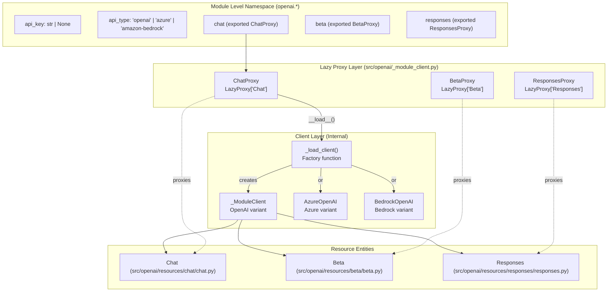
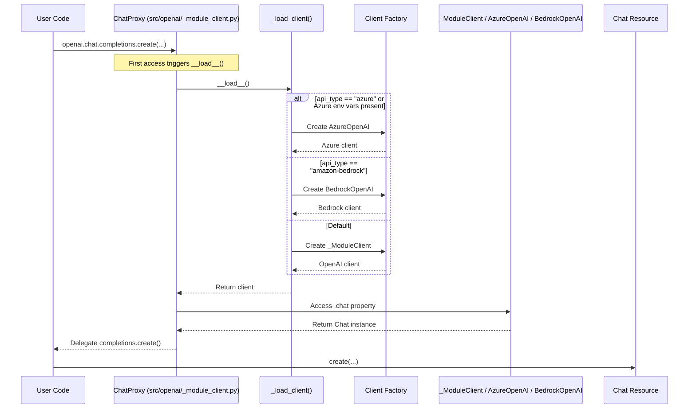

<!-- source: DeepWiki mcp.deepwiki.com · repo openai/openai-python · page 2.3 Module-Level API Usage · fetched 2026-10-26 -->

# Module-Level API Usage

<details>
<summary>Relevant source files</summary>

The following files were used as context for generating this wiki page:

- [examples/bedrock.py](examples/bedrock.py)
- [src/openai/_module_client.py](src/openai/_module_client.py)
- [src/openai/lib/bedrock.py](src/openai/lib/bedrock.py)
- [src/openai/providers/bedrock.py](src/openai/providers/bedrock.py)
- [src/openai/resources/__init__.py](src/openai/resources/__init__.py)
- [src/openai/resources/admin/__init__.py](src/openai/resources/admin/__init__.py)
- [src/openai/resources/admin/admin.py](src/openai/resources/admin/admin.py)
- [tests/lib/test_bedrock.py](tests/lib/test_bedrock.py)
- [tests/test_module_client.py](tests/test_module_client.py)

</details>


This document explains the module-level client pattern in the `openai-python` library, which allows users to configure and use the API through module-level variables rather than explicit client instantiation. This pattern supports lazy initialization and automatic API type detection (OpenAI, Azure, or Amazon Bedrock).

For information about explicit client instantiation, see [Client Configuration](2.1). For Azure-specific configuration, see [Azure OpenAI Configuration](2.2).

## Overview

The module-level API pattern provides a simplified interface where users can set configuration at the module level and access API resources directly without creating a client instance:

```python
import openai

openai.api_key = "sk-..."
response = openai.chat.completions.create(...)
```

This is an alternative to the explicit client instantiation pattern:

```python
from openai import OpenAI

client = OpenAI(api_key="sk-...")
response = client.chat.completions.create(...)
```

The module-level pattern uses lazy initialization and proxy objects to provide the same functionality while maintaining backwards compatibility with earlier library versions.

**Sources:** [src/openai/_module_client.py:1-189](), [tests/test_module_client.py:11-100]()

## Configuration Variables

The library exposes the following module-level configuration variables that users can set before making API calls. These variables are synchronized with the internal `_ModuleClient` properties.

| Variable | Type | Environment Variable | Description |
|----------|------|---------------------|-------------|
| `api_key` | `str \| None` | `OPENAI_API_KEY` | OpenAI API authentication key |
| `organization` | `str \| None` | `OPENAI_ORG_ID` | OpenAI organization ID |
| `project` | `str \| None` | `OPENAI_PROJECT_ID` | OpenAI project ID |
| `webhook_secret` | `str \| None` | `OPENAI_WEBHOOK_SECRET` | Secret for webhook verification |
| `base_url` | `str \| httpx.URL \| None` | `OPENAI_BASE_URL` | Base URL for API requests |
| `timeout` | `float \| Timeout \| None` | N/A | Request timeout configuration |
| `max_retries` | `int` | N/A | Maximum number of retry attempts |
| `default_headers` | `Mapping[str, str] \| None` | N/A | Custom headers for all requests |
| `default_query` | `Mapping[str, object] \| None` | N/A | Custom query parameters |
| `http_client` | `httpx.Client \| None` | N/A | Custom HTTP client instance |
| `api_type` | `Literal["openai", "azure", "amazon-bedrock"] \| None` | `OPENAI_API_TYPE` | API type selector |
| `api_version` | `str \| None` | `OPENAI_API_VERSION` | API version (Azure only) |
| `azure_endpoint` | `str \| None` | `AZURE_OPENAI_ENDPOINT` | Azure endpoint URL (Azure only) |
| `azure_ad_token` | `str \| None` | `AZURE_OPENAI_AD_TOKEN` | Azure AD token (Azure only) |
| `azure_ad_token_provider` | `AzureADTokenProvider \| None` | N/A | Azure AD token provider (Azure only) |
| `bedrock_token_provider` | `BedrockTokenProvider \| None` | N/A | Amazon Bedrock token provider |

**Sources:** [tests/test_module_client.py:15-35](), [tests/test_module_client.py:42-99]()

## Architecture

### Module-Level Client Pattern

The architecture bridges the gap between the static `openai` module namespace and the dynamic resource instances (like `Chat` or `Completions`).

Title: Module Level Resource Proxy Architecture


**Sources:** [src/openai/_module_client.py:32-189](), [src/openai/resources/__init__.py:11-26](), [src/openai/resources/__init__.py:115-122]()

### Lazy Initialization Flow

Accessing a module-level resource like `openai.chat` triggers a lazy-loading sequence that detects the appropriate API environment.

Title: Module Resource Resolution Sequence


**Sources:** [src/openai/_module_client.py:36-40](), [tests/test_module_client.py:122-128](), [tests/test_module_client.py:167-178](), [tests/test_module_client.py:192-202]()

## The Lazy Proxy Pattern

Resources are not instantiated when the `openai` module is imported. Instead, the module exports instances of `LazyProxy` subclasses that wrap the resource attributes of a singleton client.

### Implementation of Proxies

Each major resource has a corresponding proxy class in `src/openai/_module_client.py`. These proxies implement the `__load__` method, which calls `_load_client()` to obtain the actual client and then selects the specific resource.

| Proxy Class | Resource Loaded | Code Citation |
|-------------|-----------------|---------------|
| `ChatProxy` | `client.chat` | [src/openai/_module_client.py:36-40]() |
| `BetaProxy` | `client.beta` | [src/openai/_module_client.py:42-46]() |
| `FilesProxy` | `client.files` | [src/openai/_module_client.py:48-52]() |
| `AudioProxy` | `client.audio` | [src/openai/_module_client.py:54-58]() |
| `AdminProxy` | `client.admin` | [src/openai/_module_client.py:60-64]() |
| `ImagesProxy` | `client.images` | [src/openai/_module_client.py:72-76]() |
| `ResponsesProxy` | `client.responses` | [src/openai/_module_client.py:120-124]() |
| `FineTuningProxy` | `client.fine_tuning` | [src/openai/_module_client.py:150-154]() |

The instances are exported as module-level attributes:
```python
chat: Chat = ChatProxy().__as_proxied__()
responses: Responses = ResponsesProxy().__as_proxied__()
# ...
```
**Sources:** [src/openai/_module_client.py:168-189]()

## API Type Detection

The library determines whether to behave as a standard OpenAI client, an Azure OpenAI client, or an Amazon Bedrock client based on the provided configuration or environment variables.

### Detection Scenarios

1.  **OpenAI Default**: If only `api_key` or `OPENAI_API_KEY` is provided, the client defaults to `_ModuleClient` ([tests/test_module_client.py:122-128]()).
2.  **Azure via Environment**: If `AZURE_OPENAI_API_KEY`, `OPENAI_API_VERSION`, and `AZURE_OPENAI_ENDPOINT` are set, the module-level client automatically switches to Azure mode ([tests/test_module_client.py:155-166]()).
3.  **Amazon Bedrock**: If `api_type` is set to `"amazon-bedrock"` or `AWS_BEARER_TOKEN_BEDROCK` is present with `AWS_REGION`, it instantiates a `BedrockOpenAI` client internally ([tests/test_module_client.py:192-202](), [tests/test_module_client.py:203-214]()).

### Ambiguity and Errors
If configuration is missing for Azure (e.g., key provided but no version), the client will raise a `ValueError` upon the first resource access ([tests/test_module_client.py:130-140]()). For Bedrock, SigV4 authentication requires a replayable request body; if the body cannot be read, an `OpenAIError` is raised ([src/openai/providers/bedrock.py:51-59]()).

## Usage Examples

### Runtime Configuration Updates
The module-level pattern allows changing configuration after the module is imported. These changes are reflected in the underlying client because the `_ModuleClient` uses properties that proxy back to the module-level globals.

```python
import openai
from httpx import URL

# Initial state
openai.base_url = "http://foo.com"
assert openai.completions._client.base_url == URL("http://foo.com")

# Update state
openai.timeout = 3
assert openai.completions._client.timeout == 3
```
**Sources:** [tests/test_module_client.py:42-60]()

### Resetting State
To clear the internal singleton client and force a reconfiguration (useful in testing or multi-tenant environments), the library uses `_reset_client()`.

```python
def reset_state() -> None:
    openai._reset_client()
    openai.api_key = None
    openai.base_url = None
    # ... resets all other module vars
```
**Sources:** [tests/test_module_client.py:15-35]()

## Resource Hierarchy

The module-level API provides access to the full depth of the SDK resource tree. For example, accessing the Admin Organization:

```python
import openai

# openai.admin (AdminProxy) -> organization (Organization)
org = openai.admin.organization.retrieve("org_123")
```

| Component | Class | File |
|-----------|-------|------|
| `openai.admin` | `Admin` | [src/openai/resources/admin/admin.py:19]() |
| `.organization` | `Organization` | [src/openai/resources/admin/admin.py:21-22]() |

**Sources:** [src/openai/resources/admin/admin.py:19-22](), [src/openai/resources/admin/__init__.py:1-33]()

---

