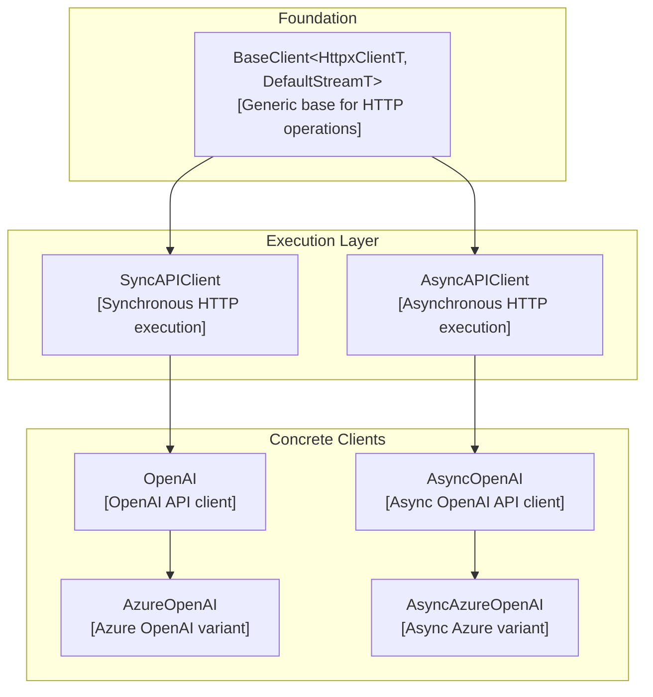
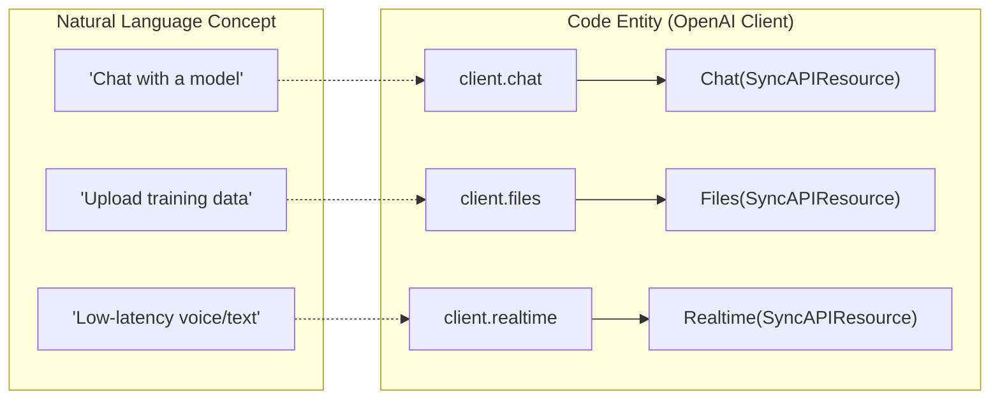

<!-- source: DeepWiki mcp.deepwiki.com · repo openai/openai-python · page 3 Core Client Classes · fetched 2026-10-26 -->

# Core Client Classes

Relevant source files

The following files were used as context for generating this wiki page:

- [README.md](README.md)
- [src/openai/__init__.py](src/openai/__init__.py)
- [src/openai/_base_client.py](src/openai/_base_client.py)
- [src/openai/_client.py](src/openai/_client.py)
- [src/openai/_legacy_response.py](src/openai/_legacy_response.py)
- [src/openai/_response.py](src/openai/_response.py)
- [src/openai/_streaming.py](src/openai/_streaming.py)
- [src/openai/lib/azure.py](src/openai/lib/azure.py)
- [src/openai/resources/beta/realtime/realtime.py](src/openai/resources/beta/realtime/realtime.py)
- [src/openai/resources/realtime/realtime.py](src/openai/resources/realtime/realtime.py)
- [tests/lib/test_azure.py](tests/lib/test_azure.py)
- [tests/test_client.py](tests/test_client.py)
- [tests/test_legacy_response.py](tests/test_legacy_response.py)
- [tests/test_response.py](tests/test_response.py)
- [tests/test_streaming.py](tests/test_streaming.py)
- [tests/test_utils/test_logging.py](tests/test_utils/test_logging.py)

This page documents the foundational client classes that handle HTTP communication, request building, and response processing in the OpenAI Python SDK. These classes provide the infrastructure for making API requests, managing connections, and exposing API resources.

For information about configuring clients with API keys and other options, see [Client Configuration](#2.1). For details about the request lifecycle and data transformation, see [Request and Response Processing](#3.3). For information about API resources exposed by clients, see [API Resources and Endpoints](#4).

---

## Client Class Hierarchy

The SDK implements a multi-tier client class hierarchy that separates HTTP infrastructure, synchronous/asynchronous execution models, and OpenAI-specific configuration.

### Client Inheritance Structure

**Sources:** [src/openai/_base_client.py:363-790](), [src/openai/_base_client.py:822-1138](), [src/openai/_client.py:106-433](), [src/openai/lib/azure.py:64-244]()

### BaseClient
`BaseClient` is the primary internal generic class providing the machinery for HTTP communication. It abstracts the complexities of `httpx` and provides the framework for request preparation and response handling [src/openai/_base_client.py:363-363]().

Key responsibilities include:
- **Request Construction**: Using `_build_request` to assemble `httpx.Request` objects with correct headers, credentials, and URL normalization [src/openai/_base_client.py:465-530]().
- **Retry Mechanism**: Implementing automatic retries with exponential backoff via `_should_retry` and `_calculate_retry_timeout` [src/openai/_base_client.py:532-582]().
- **Platform Detection**: Gathering system telemetry (OS, Python version, architecture) for the `X-Stainless-OS` and `X-Stainless-Runtime` headers via `get_platform` [src/openai/_base_client.py:385-420]().

**Sources:** [src/openai/_base_client.py:363-790]()

### SyncAPIClient and AsyncAPIClient
These classes specialize the base infrastructure for specific concurrency models.

| Class | HTTP Backend | Streaming Class | Execution Model |
|-------|--------------|-----------------|-----------------|
| `SyncAPIClient` | `httpx.Client` | `Stream` | Blocking I/O |
| `AsyncAPIClient` | `httpx.AsyncClient` | `AsyncStream` | `asyncio` / Non-blocking |

For details on the differences between these variants, see [OpenAI and AsyncOpenAI Clients](#3.1).

**Sources:** [src/openai/_base_client.py:822-1138](), [src/openai/_base_client.py:1141-1433]()

---

## Resource Exposure Pattern

Clients expose OpenAI API features (like Chat, Embeddings, or Realtime) through a resource-based organization. These resources are organized as cached properties to ensure they are only instantiated when needed.

### Natural Language to Code Entity Mapping

**Sources:** [src/openai/_client.py:44-90](), [src/openai/resources/realtime/realtime.py:69-136]()

---

## Core Infrastructure Components

The client relies on several specialized classes to handle specific parts of the request lifecycle:

### Request Options
The SDK uses `FinalRequestOptions` to store the processed state of a request before it is converted into an HTTP call. This includes the method, URL, processed JSON data, and custom headers [src/openai/_models.py:76-76]().

### Response Parsing
Responses are managed by `APIResponse` (sync) and `AsyncAPIResponse` (async). These classes handle:
- **Lazy Parsing**: The response is not parsed into a Pydantic model until `.parse()` is called [src/openai/_response.py:129-184]().
- **Raw Access**: Providing access to the underlying `httpx.Response` via the `http_response` property [src/openai/_response.py:57-57]().

For more details, see [Request and Response Processing](#3.3) and [Response Wrappers](#3.6).

**Sources:** [src/openai/_response.py:49-232](), [src/openai/_legacy_response.py:46-245]()

### Authentication & Workload Identity
The client handles standard API key authentication as well as advanced **Workload Identity** for cloud environments (GCP, Azure, K8s).
- **Bearer Auth**: Standard `Authorization: Bearer <key>` header processing [src/openai/_client.py:127-167]().
- **Workload Identity**: Uses `WorkloadIdentityAuth` to exchange environment tokens for short-lived OpenAI tokens [src/openai/_client.py:13-13]().

For details, see [Authentication and Workload Identity](#3.7).

---

## Client Lifecycle and Modification

### Modification via `copy()`
Clients are immutable in their configuration. To change settings (like a timeout or a header) for a specific set of calls, use the `.copy()` or `.with_options()` methods, which return a new client instance sharing the same underlying connection pool [src/openai/_client.py:106-106]().

### Connection Management
Clients act as context managers. Using `with client:` or `async with client:` ensures that the underlying `httpx` transports and connection pools are closed correctly when the block exits [src/openai/_base_client.py:883-892](), [src/openai/_base_client.py:1218-1230]().

**Sources:** [src/openai/_client.py:106-433](), [tests/test_client.py:148-182]()

---

## Child Pages

For deep dives into specific areas of the client architecture, refer to the following:

*   [OpenAI and AsyncOpenAI Clients](#3.1) — Detailed parameters and sync vs async usage.
*   [HTTP Client Foundation](#3.2) — The `BaseClient` and `httpx` abstraction.
*   [Request and Response Processing](#3.3) — The lifecycle from Python dict to HTTP and back.
*   [Error Handling and Retry Logic](#3.4) — How the SDK handles failures and backoff.
*   [Pagination](#3.5) — Iterating through list endpoints.
*   [Response Wrappers](#3.6) — Accessing headers and raw bytes.
*   [Authentication and Workload Identity](#3.7) — Cloud-native identity and token management.

**Sources:** [src/openai/_base_client.py:1-1433](), [src/openai/_client.py:1-780]()

---

