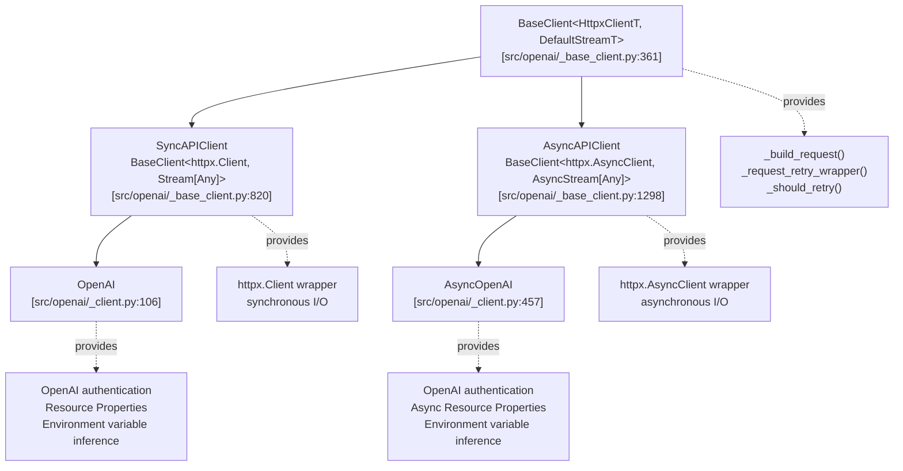
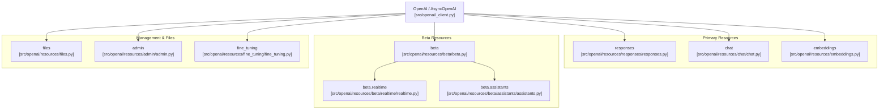

<!-- source: DeepWiki mcp.deepwiki.com · repo openai/openai-python · page 3.1 OpenAI and AsyncOpenAI Clients · fetched 2026-10-26 -->

# OpenAI and AsyncOpenAI Clients

<details>
<summary>Relevant source files</summary>

The following files were used as context for generating this wiki page:

- [README.md](README.md)
- [src/openai/__init__.py](src/openai/__init__.py)
- [src/openai/_base_client.py](src/openai/_base_client.py)
- [src/openai/_client.py](src/openai/_client.py)
- [src/openai/_module_client.py](src/openai/_module_client.py)
- [src/openai/lib/azure.py](src/openai/lib/azure.py)
- [src/openai/resources/__init__.py](src/openai/resources/__init__.py)
- [src/openai/resources/admin/__init__.py](src/openai/resources/admin/__init__.py)
- [src/openai/resources/admin/admin.py](src/openai/resources/admin/admin.py)
- [src/openai/resources/beta/realtime/realtime.py](src/openai/resources/beta/realtime/realtime.py)
- [src/openai/resources/realtime/realtime.py](src/openai/resources/realtime/realtime.py)
- [tests/lib/test_azure.py](tests/lib/test_azure.py)
- [tests/test_client.py](tests/test_client.py)
- [tests/test_utils/test_logging.py](tests/test_utils/test_logging.py)

</details>


This document details the main client classes `OpenAI` and `AsyncOpenAI` that serve as the primary entry points for interacting with the OpenAI API. These clients handle authentication, HTTP communication, resource management, and expose all API endpoints through resource properties.

For information about the underlying HTTP client infrastructure and request/response processing, see [HTTP Client Foundation](#3.2). For details on the module-level API pattern, see [Module-Level API Usage](#2.3). For Azure-specific client variants, see [Azure OpenAI Configuration](#2.2).

## Client Class Hierarchy

The `OpenAI` and `AsyncOpenAI` clients inherit from base client classes that provide HTTP communication infrastructure. The architecture separates the abstract request handling logic from the specific sync/async I/O implementations.

### Entity Relationship Diagram

Title: Client Inheritance and Composition

**Sources:** [src/openai/_client.py:106-126](), [src/openai/_client.py:457-477](), [src/openai/_base_client.py:361-390](), [src/openai/_base_client.py:820-869](), [src/openai/_base_client.py:1298-1348]()

## Initialization Parameters

Both `OpenAI` and `AsyncOpenAI` accept the same initialization parameters, with one key difference in the `api_key` parameter type for refreshable credentials.

| Parameter | Type | Default | Description |
|-----------|------|---------|-------------|
| `api_key` | `str \| Callable[[], str] \| None` (sync)<br/>`str \| Callable[[], Awaitable[str]] \| None` (async) | `None` | API key or provider function. Auto-inferred from `OPENAI_API_KEY` [src/openai/_client.py:160]() |
| `admin_api_key` | `str \| None` | `None` | Admin API key for organization management. Auto-inferred from `OPENAI_ADMIN_KEY` [src/openai/_client.py:161]() |
| `workload_identity` | `WorkloadIdentity \| None` | `None` | Configuration for OIDC token exchange (K8s, Azure, GCP) [src/openai/_client.py:110]() |
| `organization` | `str \| None` | `None` | Organization ID. Auto-inferred from `OPENAI_ORG_ID` [src/openai/_client.py:162]() |
| `project` | `str \| None` | `None` | Project ID. Auto-inferred from `OPENAI_PROJECT_ID` [src/openai/_client.py:163]() |
| `webhook_secret` | `str \| None` | `None` | Webhook secret for signature verification. Auto-inferred from `OPENAI_WEBHOOK_SECRET` [src/openai/_client.py:164]() |
| `base_url` | `str \| httpx.URL \| None` | `None` | Base URL for API requests. Defaults to `"https://api.openai.com/v1"` [src/openai/_client.py:239]() |
| `websocket_base_url` | `str \| httpx.URL \| None` | `None` | Base URL for WebSocket connections (Realtime API) [src/openai/_client.py:118]() |
| `timeout` | `float \| Timeout \| None \| NotGiven` | `not_given` | Request timeout. Defaults to 10 minutes (600s) [src/openai/_constants.py:84]() |
| `max_retries` | `int` | `2` | Maximum number of retry attempts [src/openai/_constants.py:86]() |
| `http_client` | `httpx.Client \| None` (sync)<br/>`httpx.AsyncClient \| None` (async) | `None` | Custom HTTP client instance [src/openai/_client.py:145]() |

**Sources:** [src/openai/_client.py:126-156](), [src/openai/_client.py:477-507](), [src/openai/_constants.py:83-91]()

## Workload Identity Authentication

For secure, automated environments, the SDK supports Workload Identity (OIDC token exchange). When `workload_identity` is provided, the client uses `WorkloadIdentityAuth` to exchange external subject tokens for short-lived OpenAI access tokens.

```python
from openai import OpenAI
from openai.auth import k8s_service_account_token_provider

client = OpenAI(
    workload_identity={
        "identity_provider_id": "idp-123",
        "service_account_id": "sa-456",
        "provider": k8s_service_account_token_provider("/var/run/secrets/token")
    }
)
```

If `workload_identity` is used, the client uses a placeholder `WORKLOAD_IDENTITY_API_KEY_PLACEHOLDER` ("workload-identity-auth") internally while `WorkloadIdentityAuth` handles the actual token injection in `auth_headers`.

**Sources:** [src/openai/_client.py:93](), [src/openai/_client.py:208-225](), [README.md:74-95]()

## Resource Access

Both client classes expose API resources as cached properties. This lazy instantiation pattern ensures that resource classes are only imported and initialized when needed.

Title: Client Resource Property Mapping


**Sources:** [src/openai/_client.py:180-298](), [src/openai/_client.py:531-649](), [src/openai/resources/beta/realtime/realtime.py:66-121]()

## Client Methods

### copy() and with_options()
The `copy()` method creates a new client instance with the same configuration, allowing for overrides. `with_options()` is a functional alias for `copy()`.

**Header and Query Merging Behavior:**
*   `default_headers`: Merges with existing headers (new values override existing keys) [src/openai/_client.py:383-387]().
*   `set_default_headers`: Completely replaces the existing `default_headers` dictionary [src/openai/_client.py:388-389]().
*   `default_query`: Merges with existing query parameters [src/openai/_client.py:392-396]().
*   `set_default_query`: Completely replaces the existing `default_query` dictionary [src/openai/_client.py:397-398]().

**Sources:** [src/openai/_client.py:342-399](), [src/openai/_client.py:693-750](), [tests/test_client.py:148-175]()

### Authentication Headers
The `auth_headers` property constructs the dictionary of headers required for authentication. It prioritizes `WorkloadIdentityAuth` if configured; otherwise, it uses the `api_key`. It also handles `organization` and `project` headers if provided.

**Sources:** [src/openai/_client.py:322-340](), [src/openai/_client.py:673-691]()

## Synchronous vs Asynchronous Clients

While the API surfaces are identical, the underlying implementations differ in their I/O handling and return types for streaming.

| Aspect | OpenAI (Sync) | AsyncOpenAI (Async) |
|--------|---------------|---------------------|
| **Base Class** | `SyncAPIClient` | `AsyncAPIClient` |
| **HTTP Backend** | `httpx.Client` | `httpx.AsyncClient` |
| **Streaming** | `Stream[Any]` | `AsyncStream[Any]` |
| **API Key Provider** | `Callable[[], str]` | `Callable[[], Awaitable[str]]` |
| **Method Calls** | Blocking | Requires `await` |
| **Context Manager** | `with client:` | `async with client:` |

**Sources:** [src/openai/_client.py:106-126](), [src/openai/_client.py:457-477](), [README.md:218-244]()

## HTTP Client Lifecycle

Both clients support context manager usage for proper resource cleanup. The `BaseClient` manages the lifecycle of the underlying `httpx` client, ensuring connections are closed correctly.

```python
# Sync cleanup
with OpenAI() as client:
    client.chat.completions.create(...)

# Async cleanup
async with AsyncOpenAI() as client:
    await client.chat.completions.create(...)
```

**Sources:** [src/openai/_base_client.py:883-892](), [src/openai/_base_client.py:1361-1372](), [tests/test_client.py:118-125]()

## Error Handling

The clients map HTTP status codes to specific exception types defined in `_exceptions.py`. `APIStatusError` serves as the base class for all non-2xx responses.

| Status Code | Exception Class |
|-------------|-----------------|
| 400 | `BadRequestError` |
| 401 | `AuthenticationError` / `OAuthError` |
| 403 | `PermissionDeniedError` |
| 404 | `NotFoundError` |
| 409 | `ConflictError` |
| 422 | `UnprocessableEntityError` |
| 429 | `RateLimitError` |
| 5xx | `InternalServerError` |

**Sources:** [src/openai/_exceptions.py:117-163](), [src/openai/_client.py:401-433]()

## Response Wrappers

The clients expose `.with_raw_response` and `.with_streaming_response` properties on every resource. These return a version of the resource where methods return an `APIResponse` (parsed metadata + raw body) or `LegacyAPIResponse` instead of just the parsed Pydantic model.

**Sources:** [src/openai/_client.py:301-306](), [src/openai/_client.py:652-657](), [src/openai/resources/beta/realtime/realtime.py:76-92]()

---

