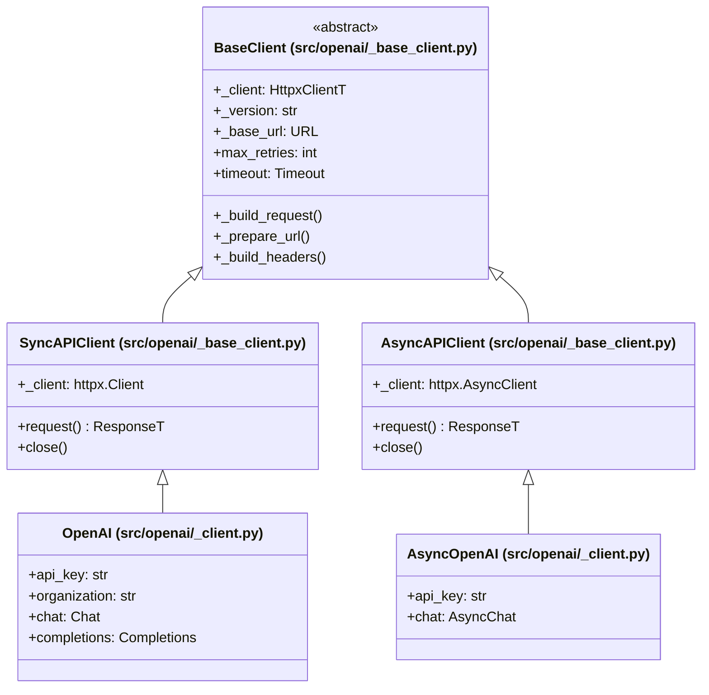
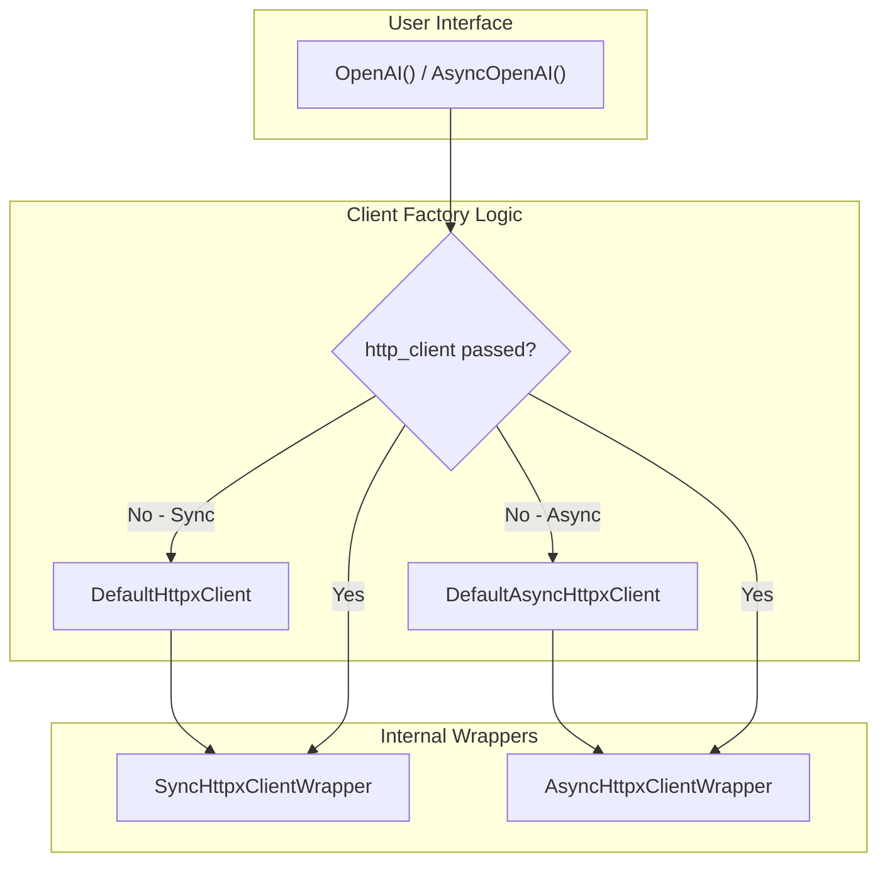
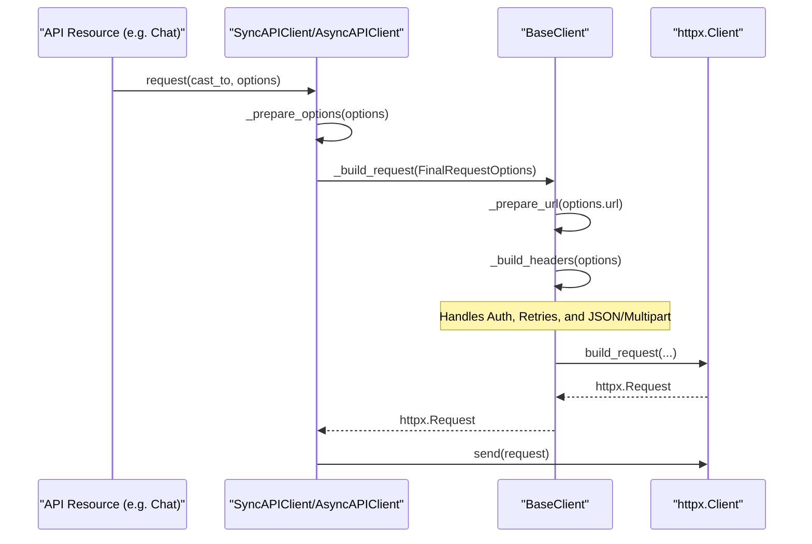

<!-- source: DeepWiki mcp.deepwiki.com · repo openai/openai-python · page 3.2 HTTP Client Foundation · fetched 2026-10-26 -->

# HTTP Client Foundation

Relevant source files

The following files were used as context for generating this wiki page:

- [README.md](README.md)
- [requirements-dev.lock](requirements-dev.lock)
- [requirements.lock](requirements.lock)
- [scripts/utils/validate-bedrock-wheel.py](scripts/utils/validate-bedrock-wheel.py)
- [scripts/utils/validate-httpx2-wheel.py](scripts/utils/validate-httpx2-wheel.py)
- [src/openai/__init__.py](src/openai/__init__.py)
- [src/openai/_base_client.py](src/openai/_base_client.py)
- [src/openai/_client.py](src/openai/_client.py)
- [src/openai/lib/azure.py](src/openai/lib/azure.py)
- [src/openai/resources/beta/realtime/realtime.py](src/openai/resources/beta/realtime/realtime.py)
- [src/openai/resources/realtime/realtime.py](src/openai/resources/realtime/realtime.py)
- [tests/conftest.py](tests/conftest.py)
- [tests/lib/test_azure.py](tests/lib/test_azure.py)
- [tests/lib/test_bedrock_auth_conformance.py](tests/lib/test_bedrock_auth_conformance.py)
- [tests/test_client.py](tests/test_client.py)
- [tests/test_utils/test_logging.py](tests/test_utils/test_logging.py)
- [uv.lock](uv.lock)

## Purpose and Scope

This document describes the foundational HTTP client architecture that powers all communication with the OpenAI API. It covers the `BaseClient` class hierarchy, `httpx` integration, and the mechanics of building and sending HTTP requests. For information about error handling and retry logic, see **3.4 Error Handling and Retry Logic**. For details on request parameter transformation and response parsing, see **3.3 Request and Response Processing**.

**Sources:** [src/openai/_base_client.py:1-100]()

---

## Client Class Hierarchy

The SDK uses a three-tier class hierarchy to separate HTTP infrastructure from API-specific logic. The `BaseClient` provides the abstract mechanics, while `SyncAPIClient` and `AsyncAPIClient` implement the specific execution models using `httpx`.

### Diagram: Client Entity Mapping

This diagram maps the logical client concepts to the specific classes and files where they are defined.

**Sources:** [src/openai/_base_client.py:361-389](), [src/openai/_base_client.py:820-869](), [src/openai/_base_client.py:1182-1231](), [src/openai/_client.py:105-175](), [src/openai/_client.py:435-526]()

### BaseClient (Abstract Layer)

`BaseClient[_HttpxClientT, _DefaultStreamT]` is the generic foundation. It handles the state required for any OpenAI API request, including versioning and base URL management.

| Property | Type | Purpose |
|----------|------|---------|
| `_client` | `httpx.Client | httpx.AsyncClient` | The underlying httpx client instance. |
| `_base_url` | `URL` | Base URL for all requests, always enforced with a trailing slash in `__init__`. |
| `max_retries` | `int` | Maximum number of retry attempts (default: 2). |
| `timeout` | `float | Timeout | None` | Request timeout configuration. |
| `_strict_response_validation` | `bool` | Enable strict Pydantic validation of responses. |

**Sources:** [src/openai/_base_client.py:361-390](), [src/openai/_constants.py:9-11]()

### SyncAPIClient (Synchronous Layer)

`SyncAPIClient` implements synchronous HTTP operations. It manages a `httpx.Client` and provides the `request()` method which orchestrates building the request, sending it, and parsing the response.

Key characteristics:
- Uses `httpx.Client` for blocking I/O [src/openai/_base_client.py:820-825]().
- Implements context manager protocol (`__enter__`, `__exit__`) for resource cleanup [src/openai/_base_client.py:883-892]().
- Wrapped with `SyncHttpxClientWrapper` to ensure `close()` is called on object deletion [src/openai/_base_client.py:809-818]().

**Sources:** [src/openai/_base_client.py:820-893]()

### AsyncAPIClient (Asynchronous Layer)

`AsyncAPIClient` implements non-blocking HTTP operations. It mirrors the sync client but uses `httpx.AsyncClient`.

Key characteristics:
- Uses `httpx.AsyncClient` for non-blocking I/O [src/openai/_base_client.py:1182-1187]().
- Implements async context manager protocol (`__aenter__`, `__aexit__`) [src/openai/_base_client.py:1245-1254]().
- Wrapped with `AsyncHttpxClientWrapper` for automatic cleanup [src/openai/_base_client.py:1149-1160]().

**Sources:** [src/openai/_base_client.py:1182-1255]()

---

## HTTP Client Integration

The SDK integrates `httpx` through wrapper classes that enforce defaults and handle resource cleanup.

### Diagram: HTTP Client Initialization Flow

This diagram bridges the user's high-level instantiation of a client to the internal creation of `httpx` entities.

**Sources:** [src/openai/_base_client.py:789-806](), [src/openai/_base_client.py:1149-1160](), [src/openai/_client.py:126-155]()

### Default HTTP Client Configuration

When no custom `http_client` is provided, the SDK uses `DefaultHttpxClient` (sync) or `DefaultAsyncHttpxClient` (async) with the following defaults:

| Configuration | Value | Purpose |
|---------------|-------|---------|
| `timeout` | `DEFAULT_TIMEOUT` | 600s total, 5s connect [src/openai/_constants.py:9](). |
| `limits` | `DEFAULT_CONNECTION_LIMITS` | 1000 max connections, 100 keep-alive [src/openai/_constants.py:11](). |
| `follow_redirects` | `True` | Standard HTTP behavior for redirects. |

**Sources:** [src/openai/_base_client.py:789-806](), [src/openai/_constants.py:9-11]()

---

## Request Building Foundation

HTTP requests are constructed through a pipeline that transforms high-level `RequestOptions` into `httpx.Request` objects.

### Request Building Sequence

**Sources:** [src/openai/_base_client.py:941-1071](), [src/openai/_base_client.py:475-558]()

### Header Construction

The `_build_headers` method merges multiple sources in a priority order:

1.  **Fixed Headers**: `Accept: application/json` and `Content-Type: application/json` (default) [src/openai/_base_client.py:657-660]().
2.  **Authentication**: Provided by the `auth_headers` property (e.g., `Bearer` token) [src/openai/_client.py:321-344]().
3.  **Client Defaults**: `default_headers` provided during client instantiation [src/openai/_base_client.py:433]().
4.  **Request Specific**: Headers passed in the specific method call via `options.headers` [src/openai/_base_client.py:433]().
5.  **Telemetry**: Platform-specific headers (OS, Arch, Runtime) and `User-Agent` [src/openai/_base_client.py:686-700]().

**Sources:** [src/openai/_base_client.py:433-457](), [src/openai/_base_client.py:647-700]()

### URL Preparation

The `_prepare_url` method merges the relative endpoint path with the `_base_url`. If an absolute URL is provided in the options, it is used directly [src/openai/_base_client.py:459-470](). For Azure-specific logic, `BaseAzureClient` overrides this to handle deployment-based pathing [src/openai/lib/azure.py:82-97]().

**Sources:** [src/openai/_base_client.py:459-470](), [src/openai/lib/azure.py:82-97]()

### Multipart Form Data Handling

If a request includes files, the `_build_request` logic shifts from JSON to `multipart/form-data`.

1.  **JSON to Form**: If `json_data` is present alongside files, it is serialized into form fields [src/openai/_base_client.py:511-516]().
2.  **Header Modification**: The `Content-Type` header is removed to allow `httpx` to generate the correct boundary string [src/openai/_base_client.py:503-505]().
3.  **File Conversion**: Files are converted to `httpx`-compatible formats using `to_httpx_files` or `async_to_httpx_files` [src/openai/_base_client.py:501]().

**Sources:** [src/openai/_base_client.py:500-541]()

---

## Connection Management

The SDK manages HTTP connections through `httpx` connection pooling.

### Resource Cleanup Mechanisms

1.  **Context Managers**: Using `with OpenAI() as client:` ensures `client.close()` is called immediately on exit [src/openai/_base_client.py:883-892]().
2.  **Explicit Close**: The `close()` method terminates the underlying `httpx` client [src/openai/_base_client.py:873-881]().
3.  **Garbage Collection**: The `HttpxClientWrapper` classes implement `__del__` to close the client if it hasn't been closed manually [src/openai/_base_client.py:809-818]().

**Sources:** [src/openai/_base_client.py:809-818](), [src/openai/_base_client.py:873-892](), [src/openai/_base_client.py:1149-1160]()

### Connection Pooling

By default, the SDK uses a pool size of 1000 total connections and 100 keep-alive connections, as defined in `DEFAULT_CONNECTION_LIMITS`.

**Sources:** [src/openai/_constants.py:11]()

---

