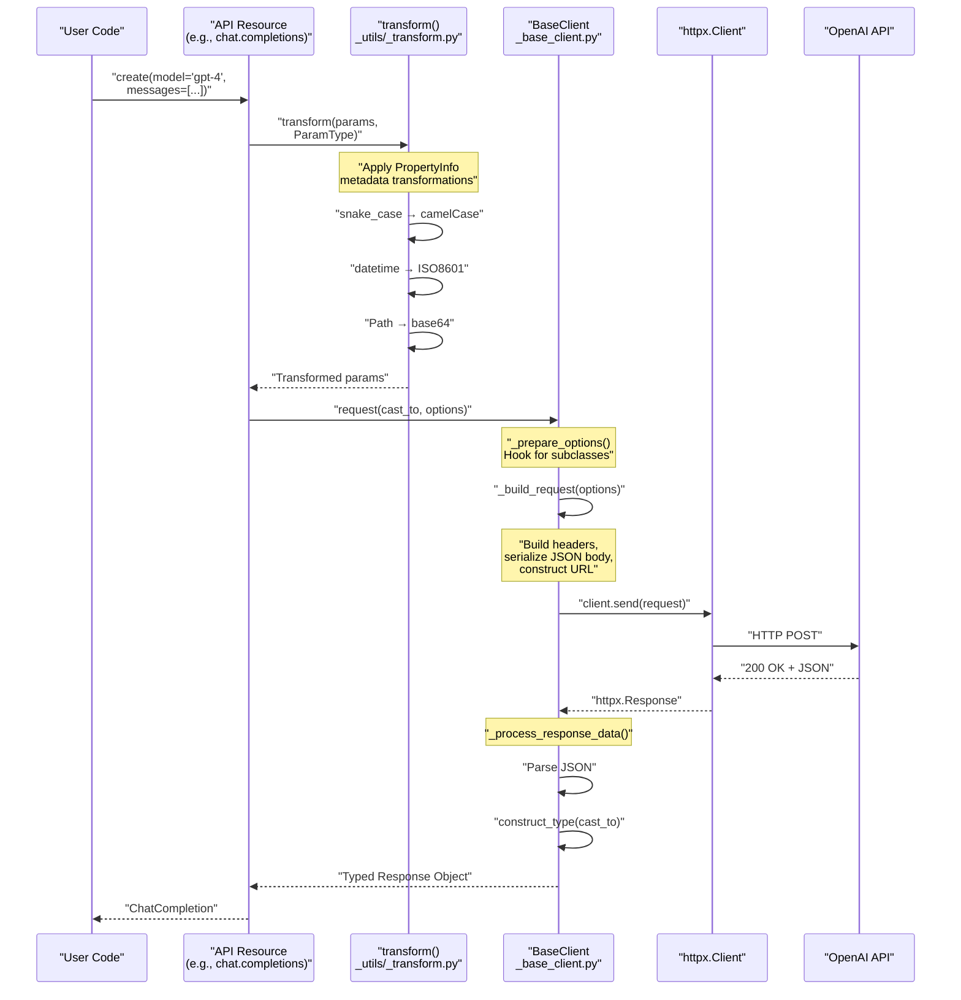
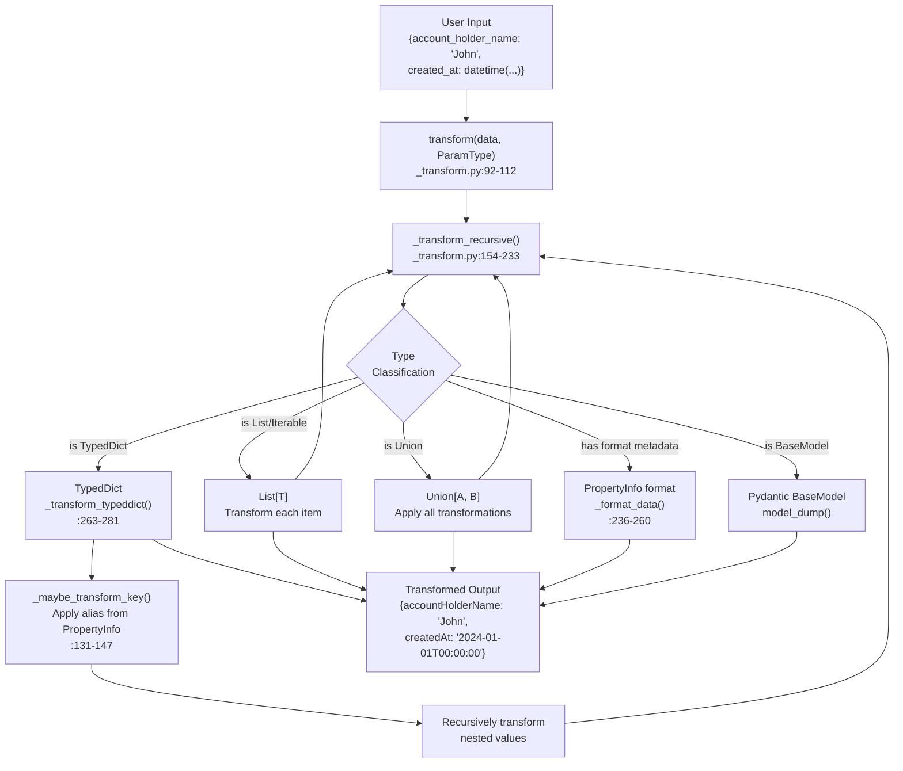

<!-- source: DeepWiki mcp.deepwiki.com · repo openai/openai-python · page 3.3 Request and Response Processing · fetched 2026-10-26 -->

# Request and Response Processing

Relevant source files

The following files were used as context for generating this wiki page:

- [Brewfile](Brewfile)
- [examples/httpx2_client.py](examples/httpx2_client.py)
- [scripts/bootstrap](scripts/bootstrap)
- [scripts/format](scripts/format)
- [scripts/lint](scripts/lint)
- [scripts/mock](scripts/mock)
- [scripts/test](scripts/test)
- [src/openai/_compat.py](src/openai/_compat.py)
- [src/openai/_httpx2.py](src/openai/_httpx2.py)
- [src/openai/_models.py](src/openai/_models.py)
- [src/openai/_qs.py](src/openai/_qs.py)
- [src/openai/_types.py](src/openai/_types.py)
- [src/openai/_utils/__init__.py](src/openai/_utils/__init__.py)
- [src/openai/_utils/_json.py](src/openai/_utils/_json.py)
- [src/openai/_utils/_reflection.py](src/openai/_utils/_reflection.py)
- [src/openai/_utils/_sync.py](src/openai/_utils/_sync.py)
- [src/openai/_utils/_transform.py](src/openai/_utils/_transform.py)
- [src/openai/_utils/_typing.py](src/openai/_utils/_typing.py)
- [src/openai/_utils/_utils.py](src/openai/_utils/_utils.py)
- [tests/test_extract_files.py](tests/test_extract_files.py)
- [tests/test_files.py](tests/test_files.py)
- [tests/test_models.py](tests/test_models.py)
- [tests/test_transform.py](tests/test_transform.py)
- [tests/test_utils/test_json.py](tests/test_utils/test_json.py)
- [tests/test_utils/test_typing.py](tests/test_utils/test_typing.py)
- [tests/utils.py](tests/utils.py)

## Purpose and Scope

This page documents the request and response processing pipeline in the OpenAI Python SDK, covering how user-provided data is transformed, sent to the API, and how responses are parsed and validated. This includes the data transformation system, HTTP request building, and response deserialization.

For information about error handling and retry logic, see [Error Handling and Retry Logic](#3.4). For details about the underlying HTTP client architecture, see [HTTP Client Foundation](#3.2). For streaming response processing, see [Streaming and Event Handling](#7.2).

---

## Request Lifecycle Overview

The following diagram illustrates the path from a high-level resource call to the final parsed response, bridging the gap between natural language concepts and the internal code entities.

**Sources:** [src/openai/_utils/_transform.py:92-112](), [src/openai/_models.py:149-185]()

---

## Request Transformation Pipeline

The SDK transforms user-provided parameters through a metadata-driven pipeline before sending them to the API. This ensures that Python conventions (snake_case, native types) are automatically converted to API requirements (camelCase, ISO 8601 strings).

### Data Transformation Flow

The following diagram maps the logical transformation steps to specific functions and classes in the codebase.

**Sources:** [src/openai/_utils/_transform.py:154-233](), [src/openai/_utils/_transform.py:263-281]()

### PropertyInfo Metadata System

The `PropertyInfo` class provides declarative transformation metadata attached to type annotations using `Annotated`.

| Field | Type | Description |
|-------|------|-------------|
| `alias` | `str \| None` | The API-side field name (e.g., `camelCase`). |
| `format` | `PropertyFormat \| None` | Specific formatting: `iso8601`, `base64`, or `custom`. |
| `format_template` | `str \| None` | Template used for `custom` formatting. |
| `discriminator` | `str \| None` | Used for resolving discriminated unions. |

**Sources:** [src/openai/_utils/_transform.py:44-76]()

### Data Type Transformations

#### String Alias Transformations
The `_maybe_transform_key()` function extracts alias metadata and transforms dictionary keys. If a `PropertyInfo` with an `alias` is found in the `Annotated` metadata, the key is replaced by that alias.

**Sources:** [src/openai/_utils/_transform.py:131-147](), [tests/test_transform.py:40-48]()

#### Format Transformations
The `_format_data()` function applies format conversions based on `PropertyInfo.format`:
*   **ISO 8601:** Converts `datetime` and `date` objects to standard strings using `parse_datetime` or `parse_date` logic [src/openai/_utils/_transform.py:236-248]().
*   **Base64:** Encodes file-like objects or `Path` objects into base64 strings [src/openai/_utils/_transform.py:250-256]().

**Sources:** [src/openai/_utils/_transform.py:236-260](), [tests/test_transform.py:190-206]()

#### Pydantic Model Serialization
When a `BaseModel` is encountered, it is serialized using `model_dump()`. The SDK handles compatibility between Pydantic v1 and v2 through the `_compat` layer, ensuring `by_alias=True` is used to match API naming conventions.

**Sources:** [src/openai/_utils/_transform.py:172-173](), [src/openai/_compat.py:138-166](), [src/openai/_models.py:149-185]()

---

## Response Processing and Parsing

Once an HTTP response is received, it is processed through the response parsing logic located primarily in the core response wrappers.

### Response Data Handling

The SDK provides a `BaseModel` that extends Pydantic's base class to add utility methods like `to_dict()` and `to_json()`. These methods default to using API names (aliases) and excluding unset fields.

| Method | Role |
|--------|------|
| `to_dict()` | Recursively generates a dictionary. Defaults to `use_api_names=True`. [src/openai/_models.py:149-185]() |
| `to_json()` | Generates a JSON string. Defaults to `use_api_names=True`. [src/openai/_models.py:187-213]() |
| `construct()` | A class method for creating models from dictionaries without full Pydantic validation, used for performance in response parsing. [src/openai/_models.py:228-251]() |

**Sources:** [src/openai/_models.py:111-251]()

### Request ID Propagation
For responses parsed into `BaseModel`, the SDK extracts the `x-request-id` header and attaches it to the model instance. The `BaseModel` class defines `_request_id` as a public property for this purpose.

**Sources:** [src/openai/_models.py:132-147]()

### Loose Type Coercion
The `construct_type` function is a critical utility for response parsing. It attempts to coerce JSON data into the expected Python type, handling:
*   Nested `BaseModel` instances.
*   Unions and Discriminated Unions.
*   Lists and Dictionaries.
*   Optional types.

**Sources:** [src/openai/_models.py:3395-3450](), [tests/test_models.py:223-237]()

---

## Request Building Utilities

### File Extraction and Multipart Requests
If the request includes files, the SDK uses `extract_files` from `_utils/_utils.py` to pull file objects out of the parameter dictionary. This function is recursive and supports various array formats.

| Array Format | Field Name Result |
|--------------|-------------------|
| `brackets` | `foo[]` |
| `indices` | `foo[0]`, `foo[1]` |
| `repeat` | `foo` |

**Sources:** [src/openai/_utils/_utils.py:41-76](), [src/openai/_utils/_utils.py:79-157]()

### Sentinel Values
To distinguish between a parameter being explicitly set to `None` versus not being provided at all, the SDK uses the `NotGiven` sentinel.
*   `NotGiven`: Indicates the user did not provide a value.
*   `Omit`: Used to explicitly remove a key (like a header) from a request.

**Sources:** [src/openai/_types.py:133-164](), [src/openai/_types.py:166-189](), [src/openai/_utils/_utils.py:160-161]()

---

