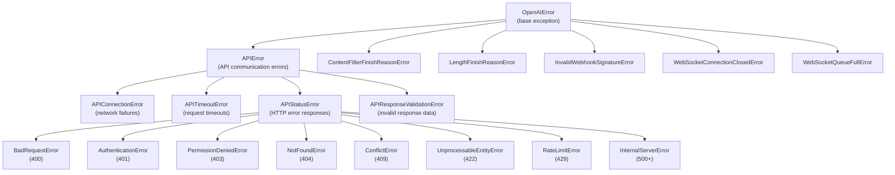
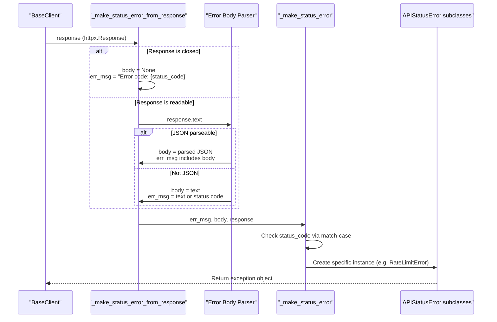
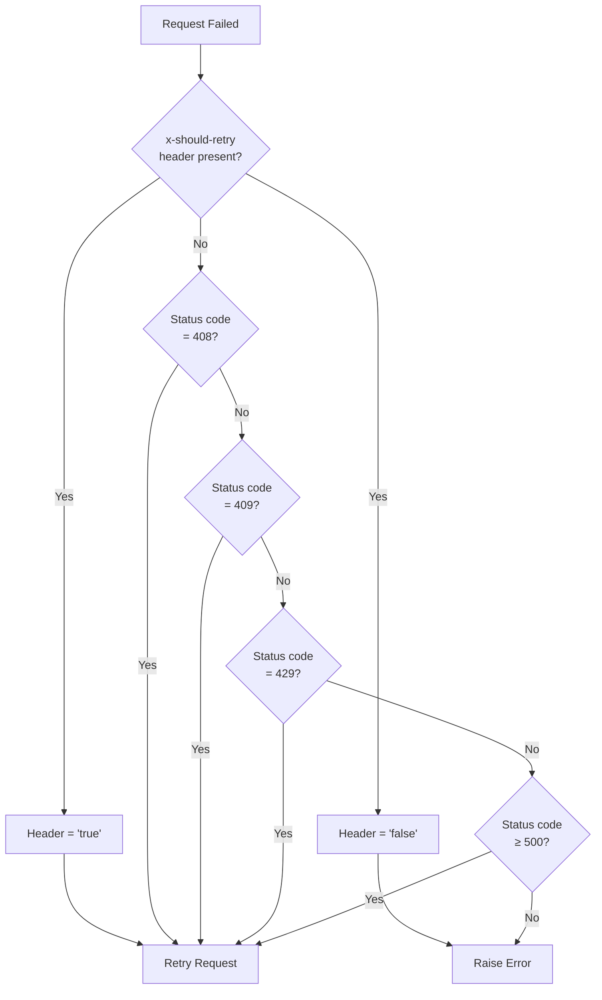
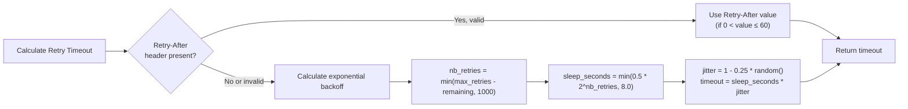
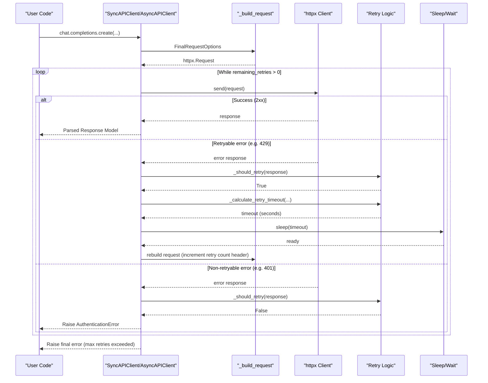

<!-- source: DeepWiki mcp.deepwiki.com · repo openai/openai-python · page 3.4 Error Handling and Retry Logic · fetched 2026-10-26 -->

# Error Handling and Retry Logic

<details>
<summary>Relevant source files</summary>

The following files were used as context for generating this wiki page:

- [README.md](README.md)
- [src/openai/__init__.py](src/openai/__init__.py)
- [src/openai/_base_client.py](src/openai/_base_client.py)
- [src/openai/_client.py](src/openai/_client.py)
- [src/openai/_exceptions.py](src/openai/_exceptions.py)
- [src/openai/lib/_parsing/_completions.py](src/openai/lib/_parsing/_completions.py)
- [src/openai/lib/_pydantic.py](src/openai/lib/_pydantic.py)
- [src/openai/lib/azure.py](src/openai/lib/azure.py)
- [src/openai/lib/streaming/chat/__init__.py](src/openai/lib/streaming/chat/__init__.py)
- [src/openai/lib/streaming/chat/_completions.py](src/openai/lib/streaming/chat/_completions.py)
- [src/openai/resources/beta/realtime/realtime.py](src/openai/resources/beta/realtime/realtime.py)
- [src/openai/resources/realtime/realtime.py](src/openai/resources/realtime/realtime.py)
- [tests/lib/schema_types/query.py](tests/lib/schema_types/query.py)
- [tests/lib/test_azure.py](tests/lib/test_azure.py)
- [tests/lib/test_pydantic.py](tests/lib/test_pydantic.py)
- [tests/test_client.py](tests/test_client.py)
- [tests/test_utils/test_logging.py](tests/test_utils/test_logging.py)

</details>


## Purpose and Scope

This document describes the error handling and automatic retry mechanisms in the `openai-python` library. It covers the exception hierarchy, retry strategies, exponential backoff implementation, and configuration options for controlling retry behavior. For information about response processing and validation, see [Request and Response Processing](3.3). For timeout configuration, see [Client Configuration](2.1).

---

## Exception Hierarchy

The library defines a structured exception hierarchy with `OpenAIError` as the base exception for all library-specific errors. All exceptions are exported at the top level of the package.



Sources: [src/openai/_exceptions.py:36-208](), [src/openai/_base_client.py:93-99](), [src/openai/__init__.py:18-39]()

---

## Error Types and Status Code Mapping

The library maps HTTP status codes to specific exception types. `APIStatusError` is the base class for all non-2xx responses.

| Status Code | Exception Type | Description |
|------------|----------------|-------------|
| 400 | `BadRequestError` | Invalid request parameters |
| 401 | `AuthenticationError` | Missing or invalid API key |
| 403 | `PermissionDeniedError` | Insufficient permissions |
| 404 | `NotFoundError` | Resource not found |
| 409 | `ConflictError` | Resource conflict (retryable) |
| 422 | `UnprocessableEntityError` | Validation error |
| 429 | `RateLimitError` | Rate limit exceeded (retryable) |
| ≥500 | `InternalServerError` | Server error (retryable) |
| N/A | `APIConnectionError` | Network connection failure (retryable) |
| N/A | `APITimeoutError` | Request timeout (retryable) |

Sources: [src/openai/_exceptions.py:117-163]()

---

## Status Error Construction Flow

When a response returns a non-success status code, the `BaseClient` uses `_make_status_error` to instantiate the appropriate exception, attempting to parse the error body for extra context like error codes and parameters.



Sources: [src/openai/_base_client.py:1012-1042](), [src/openai/_exceptions.py:67-105]()

---

## Retry Logic

### Retryable Conditions

The `_should_retry()` method determines whether a failed request should be retried based on status codes or specific headers.



**Retryable status codes:**
- **408** Request Timeout
- **409** Conflict (lock timeouts)
- **429** Rate Limit
- **≥500** Internal Server Errors

Sources: [src/openai/_base_client.py:1175-1208]()

### Exponential Backoff Strategy

The retry delay calculation implements exponential backoff with jitter to avoid thundering herd problems.



**Backoff parameters:**
- `INITIAL_RETRY_DELAY = 0.5` seconds [src/openai/_constants.py:87]()
- `MAX_RETRY_DELAY = 8.0` seconds [src/openai/_constants.py:85]()
- Formula: `min(0.5 * 2^n, 8.0) * jitter` [src/openai/_base_client.py:1165-1168]()
- Jitter range: 75-100% of calculated delay [src/openai/_base_client.py:1170]()

Sources: [src/openai/_base_client.py:1151-1173](), [src/openai/_constants.py:83-91]()

### Retry-After Header Parsing

The library respects the `Retry-After` HTTP header and the non-standard `retry-after-ms`.

| Format | Example | Parsing Method |
|--------|---------|----------------|
| Milliseconds | `retry-after-ms: 1500` | Parse as float, divide by 1000 [src/openai/_base_client.py:1124-1127]() |
| Seconds | `retry-after: 5` | Parse as float [src/openai/_base_client.py:1130-1133]() |
| HTTP date | `retry-after: Wed, 21 Oct 2015 07:28:00 GMT` | Parse date via `email.utils.parsedate_to_datetime` [src/openai/_base_client.py:1138-1143]() |

Sources: [src/openai/_base_client.py:1117-1149]()

---

## Request Retry Loop Implementation

The retry loop is implemented in `_request` for the synchronous client and `_as_request` for the asynchronous client.



Sources: [src/openai/_base_client.py:915-1071]() (Sync), [src/openai/_base_client.py:1300-1443]() (Async)

---

## Configuration Options

### Client-Level Configuration

Retry behavior is configured during client instantiation via the `max_retries` parameter.

```python
from openai import OpenAI

# Disable retries
client = OpenAI(max_retries=0)

# Custom retry count
client = OpenAI(max_retries=5)
```

**Default:** `DEFAULT_MAX_RETRIES = 2` [src/openai/_constants.py:86]()

Sources: [src/openai/_client.py:139](), [src/openai/_base_client.py:648-650]()

### Per-Request Configuration

Override retry settings for individual requests using `.with_options()`.

```python
client = OpenAI()

# Override for specific request
response = client.with_options(max_retries=5).chat.completions.create(
    model="gpt-4o",
    messages=[{"role": "user", "content": "Hello"}]
)
```

Sources: [src/openai/_base_client.py:779-795]()

---

## Error Context and Request IDs

`APIStatusError` exceptions include a `request_id` property extracted from the `x-request-id` header, which is essential for debugging and support.

```python
import openai

try:
    client.chat.completions.create(...)
except openai.APIStatusError as exc:
    print(f"Request ID: {exc.request_id}")
    print(f"Status code: {exc.status_code}")
```

Sources: [src/openai/_exceptions.py:93-105]()

---

## Header Tracking for Retries

The client adds specific headers to track and debug retries during request building:

| Header | Value | Purpose |
|--------|-------|---------|
| `x-stainless-retry-count` | `"0"`, `"1"`, ... | Number of retries attempted [src/openai/_base_client.py:441]() |
| `x-stainless-read-timeout` | Timeout in seconds | Effective read timeout for the attempt [src/openai/_base_client.py:443]() |

Sources: [src/openai/_base_client.py:433-456]()

---

## Specialized Parsing Errors

The SDK includes specific errors for failures during structured output parsing or streaming:

- **`LengthFinishReasonError`**: Raised when a response cannot be parsed because the model reached its `max_tokens` or token limit [src/openai/_exceptions.py:166-181]().
- **`ContentFilterFinishReasonError`**: Raised when parsing fails because the content was filtered by safety systems [src/openai/_exceptions.py:183-188]().
- **`APIResponseValidationError`**: Raised when the SDK is configured with `_strict_response_validation=True` and the API returns data that does not match the Pydantic schema [src/openai/_exceptions.py:83-91]().

Sources: [src/openai/_exceptions.py:166-191](), [src/openai/lib/_parsing/_completions.py:99-103]()

---

