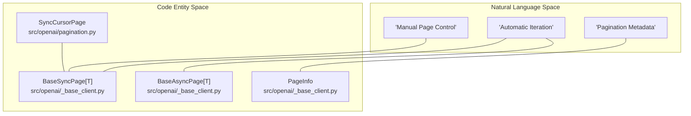
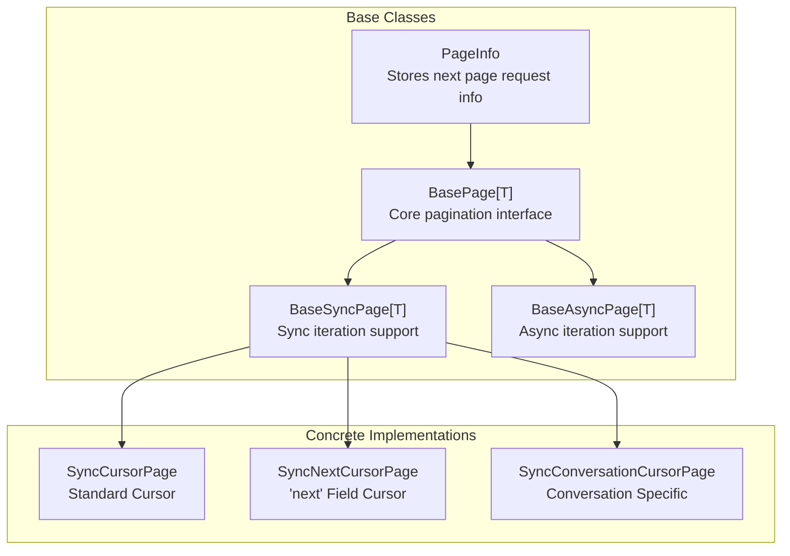
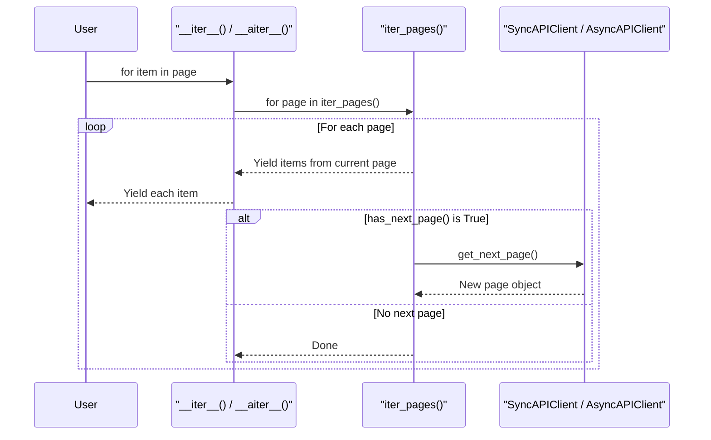

<!-- source: DeepWiki mcp.deepwiki.com · repo openai/openai-python · page 3.5 Pagination · fetched 2026-10-26 -->

# Pagination

<details>
<summary>Relevant source files</summary>

The following files were used as context for generating this wiki page:

- [README.md](README.md)
- [src/openai/__init__.py](src/openai/__init__.py)
- [src/openai/_base_client.py](src/openai/_base_client.py)
- [src/openai/_client.py](src/openai/_client.py)
- [src/openai/lib/azure.py](src/openai/lib/azure.py)
- [src/openai/pagination.py](src/openai/pagination.py)
- [src/openai/resources/admin/organization/certificates.py](src/openai/resources/admin/organization/certificates.py)
- [src/openai/resources/admin/organization/projects/certificates.py](src/openai/resources/admin/organization/projects/certificates.py)
- [src/openai/resources/beta/realtime/realtime.py](src/openai/resources/beta/realtime/realtime.py)
- [src/openai/resources/realtime/realtime.py](src/openai/resources/realtime/realtime.py)
- [tests/lib/test_azure.py](tests/lib/test_azure.py)
- [tests/test_client.py](tests/test_client.py)
- [tests/test_utils/test_logging.py](tests/test_utils/test_logging.py)

</details>


## Purpose and Scope

This document covers the pagination system in the OpenAI Python SDK, which handles API responses that return large datasets across multiple pages. The system provides both automatic iteration across all pages and manual page-by-page control. For information about streaming responses (Server-Sent Events), see [7.2](). For general request/response processing, see [3.3]().

## Overview

The OpenAI API paginates list endpoints (such as `fine_tuning.jobs.list()`, `files.list()`, etc.) to manage large result sets. The library provides a cursor-based pagination system that automatically fetches subsequent pages or allows manual control over page retrieval. Pagination is implemented through a hierarchy of base classes that API-specific page types inherit from.

The system supports both synchronous and asynchronous usage patterns with identical APIs, ensuring consistency across the library.

**Sources:** [src/openai/_base_client.py:107-108](), [src/openai/pagination.py:1-17]()

## Pagination Architecture

The pagination system bridges the gap between raw HTTP list responses and high-level Python iterators.

### Entity Mapping Diagram

This diagram associates high-level concepts with specific code entities responsible for their implementation.

Title: Pagination Entity Mapping


**Sources:** [src/openai/_base_client.py:131-182](), [src/openai/pagination.py:71-102]()

### Class Hierarchy

Title: Pagination Class Hierarchy


**Sources:** [src/openai/_base_client.py:131-243](), [src/openai/pagination.py:6-17]()

## Core Components

### PageInfo

The `PageInfo` class stores the necessary information to build the request for the next page. It can store pagination information in one of three ways:

| Field | Type | Description |
|-------|------|-------------|
| `url` | `URL \| NotGiven` | Complete URL for next page request [src/openai/_base_client.py:137-137]() |
| `params` | `Query \| NotGiven` | Query parameters to merge with existing request [src/openai/_base_client.py:138-138]() |
| `json` | `Body \| NotGiven` | JSON body data to merge with existing request [src/openai/_base_client.py:139-139]() |

Only one of these fields should be set per `PageInfo` instance. The choice depends on how the API endpoint communicates pagination information.

**Sources:** [src/openai/_base_client.py:131-180]()

### BasePage

`BasePage[_T]` is the generic base class defining the core interface for pagination. It is parameterized by `_T`, which represents the pydantic model that represents an item in the response.

**Key Methods:**

- `has_next_page() -> bool`: Checks if there is another page available by examining if items exist and if `next_page_info()` returns data. [src/openai/_base_client.py:197-201]()
- `next_page_info() -> Optional[PageInfo]`: Abstract method to get the necessary information for the next request. [src/openai/_base_client.py:203-203]()
- `_get_page_items() -> Iterable[_T]`: Internal method to extract items from the current page response. [src/openai/_base_client.py:205-206]()

**Private Attributes:**

- `_options: FinalRequestOptions`: Stores the original request options used to fetch the current page. [src/openai/_base_client.py:194-194]()
- `_model: Type[_T]`: The model type for individual items on the page. [src/openai/_base_client.py:195-195]()

**Sources:** [src/openai/_base_client.py:182-241]()

### BaseSyncPage

`BaseSyncPage[_T]` extends `BasePage[_T]` to provide synchronous iteration support and page retrieval.

**Key Methods:**

- `__iter__() -> Iterator[_T]`: Yields individual items across all pages by calling `iter_pages()` and iterating through each page's items. [src/openai/_base_client.py:261-265]()
- `iter_pages() -> Iterator[SyncPageT]`: Yields the current page, then recursively yields subsequent pages. [src/openai/_base_client.py:267-273]()
- `get_next_page() -> SyncPageT`: Uses `next_page_info()` and `_info_to_options()` to fetch the next page via the client. [src/openai/_base_client.py:275-283]()

**Sources:** [src/openai/_base_client.py:243-284]()

### BaseAsyncPage

`BaseAsyncPage[_T]` provides the asynchronous equivalent of `BaseSyncPage[_T]`.

**Key Methods:**

- `__aiter__() -> AsyncIterator[_T]`: Asynchronously yields individual items across all pages. [src/openai/_base_client.py:341-345]()
- `iter_pages() -> AsyncIterator[AsyncPageT]`: Asynchronously yields page objects. [src/openai/_base_client.py:347-353]()
- `get_next_page() -> AsyncPageT`: Asynchronously fetches the next page. [src/openai/_base_client.py:355-363]()

**Sources:** [src/openai/_base_client.py:323-364]()

## Concrete Page Implementations

The SDK defines several standard page types in `src/openai/pagination.py` to handle different API pagination styles:

| Class | Description | Next Page Logic |
|-------|-------------|-----------------|
| `SyncPage` / `AsyncPage` | For endpoints that return a single list without true pagination. | Always returns `None` for next page. [src/openai/pagination.py:27-68]() |
| `SyncCursorPage` / `AsyncCursorPage` | Standard cursor-based pagination using `after`. | Uses the `id` of the last item in `data`. [src/openai/pagination.py:71-135]() |
| `SyncConversationCursorPage` / `AsyncConversationCursorPage` | Specialized cursor page for conversations. | Uses a top-level `last_id` field. [src/openai/pagination.py:137-193]() |
| `SyncNextCursorPage` / `AsyncNextCursorPage` | Cursor page using a `next` field. | Uses a top-level `next` field. [src/openai/pagination.py:195-251]() |

**Sources:** [src/openai/pagination.py:22-251]()

## Usage Patterns

### Auto-Pagination (Automatic Iteration)

The simplest usage pattern iterates directly over a page object to automatically fetch and process all items across all pages.

Title: Auto-Pagination Sequence


**Sources:** [src/openai/_base_client.py:261-273](), [src/openai/_base_client.py:341-353]()

### Manual Page Control

For granular control, users can manually manage page retrieval using `has_next_page()` and `get_next_page()`.

**Sources:** [src/openai/_base_client.py:197-201](), [src/openai/_base_client.py:275-283]()

## Implementation Details

### Building Next Page Requests

When `get_next_page()` is called, the system converts the `PageInfo` into a `FinalRequestOptions` object using `_info_to_options()`:

1. **Stripping Headers:** It calls `options._strip_raw_response_header()` to ensure that `with_raw_response` headers are not propagated to subsequent automated page fetches [src/openai/_base_client.py:214-214]().
2. **Merging Params:** If `PageInfo.params` is set, it merges them into the existing query parameters [src/openai/_base_client.py:216-218]().
3. **Handling URLs:** If `PageInfo.url` is set, it extracts parameters and updates the request URL [src/openai/_base_client.py:220-225]().
4. **Merging JSON:** If `PageInfo.json` is set, it merges the data into the JSON body (only supported for mappings) [src/openai/_base_client.py:227-238]().

**Sources:** [src/openai/_base_client.py:212-241](), [src/openai/_base_client.py:275-283]()

### Client Integration

API resources utilize the client's internal list helpers to initiate paginated requests. For example, in the Admin Certificates resource:

```python
# Example logic similar to src/openai/resources/admin/organization/certificates.py
# Uses SyncPage for non-paginated lists or SyncConversationCursorPage for cursors
return self._get_api_list(
    "/organization/certificates",
    page=SyncPage[Certificate],
    options=make_request_options(
        # ...
        security={"admin_api_key_auth": True},
    ),
    model=Certificate,
)
```

**Sources:** [src/openai/resources/admin/organization/certificates.py:16-17](), [src/openai/pagination.py:27-47]()

---

