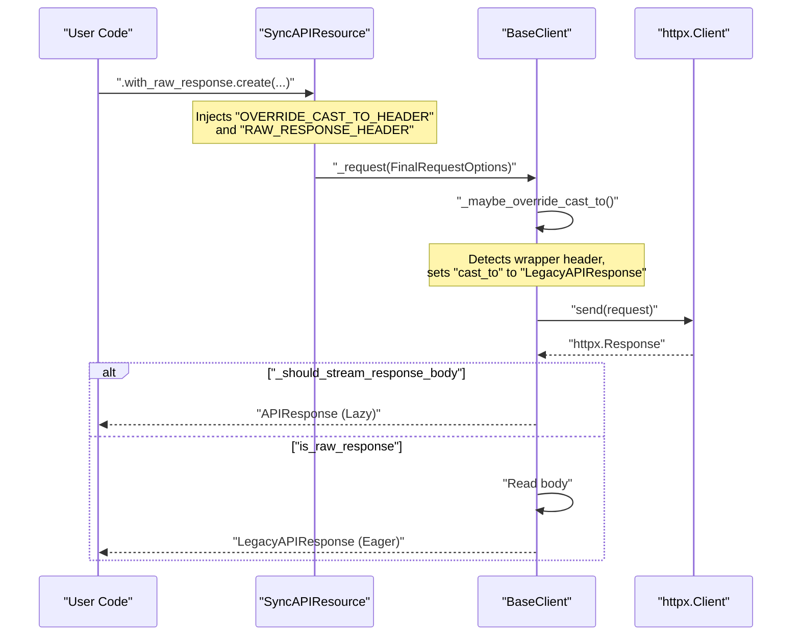
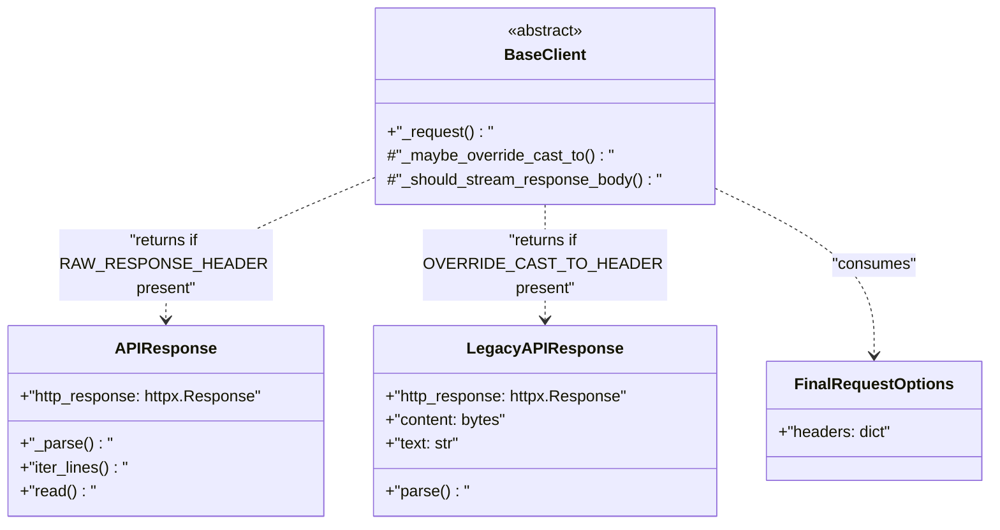

<!-- source: DeepWiki mcp.deepwiki.com · repo openai/openai-python · page 3.6 Response Wrappers · fetched 2026-10-26 -->

# Response Wrappers

<details>
<summary>Relevant source files</summary>

The following files were used as context for generating this wiki page:

- [README.md](README.md)
- [src/openai/__init__.py](src/openai/__init__.py)
- [src/openai/_base_client.py](src/openai/_base_client.py)
- [src/openai/_client.py](src/openai/_client.py)
- [src/openai/_legacy_response.py](src/openai/_legacy_response.py)
- [src/openai/_response.py](src/openai/_response.py)
- [src/openai/_streaming.py](src/openai/_streaming.py)
- [src/openai/lib/azure.py](src/openai/lib/azure.py)
- [src/openai/resources/beta/realtime/realtime.py](src/openai/resources/beta/realtime/realtime.py)
- [src/openai/resources/realtime/realtime.py](src/openai/resources/realtime/realtime.py)
- [tests/lib/test_azure.py](tests/lib/test_azure.py)
- [tests/test_client.py](tests/test_client.py)
- [tests/test_legacy_response.py](tests/test_legacy_response.py)
- [tests/test_response.py](tests/test_response.py)
- [tests/test_streaming.py](tests/test_streaming.py)
- [tests/test_utils/test_logging.py](tests/test_utils/test_logging.py)

</details>


## Purpose and Scope

Response wrappers provide alternative return patterns for API calls, allowing access to raw HTTP response data, headers, and streaming contexts. This page documents the `.with_raw_response` and `.with_streaming_response` patterns available on all resource methods in the OpenAI Python SDK. These patterns are essential for use cases requiring metadata inspection or fine-grained control over response body consumption.

## Overview

The SDK provides two primary response wrapper patterns that modify the return behavior of API calls:

| Pattern | Return Type | Use Case |
|---------|-------------|----------|
| `.with_raw_response` | `LegacyAPIResponse` | Access response headers and raw HTTP data while eagerly reading the response body. |
| `.with_streaming_response` | `APIResponse` / `AsyncAPIResponse` | Access response headers and stream the response body incrementally using a context manager. |

Both patterns are implemented as properties on the client and all resource objects. They work by intercepting the request lifecycle to modify how the response is parsed and returned to the user.

**Sources:** [src/openai/_client.py:81-91](), [src/openai/_base_client.py:67-91]()

## Access Pattern

Response wrappers are accessed by chaining the wrapper property before the resource method call. This pattern is generated for every resource method in the SDK.

```python
# Standard call: returns parsed Pydantic model
completion = client.chat.completions.create(...)

# With raw response wrapper: returns LegacyAPIResponse
response = client.chat.completions.with_raw_response.create(...)

# With streaming response wrapper: returns APIResponse (requires context manager)
with client.chat.completions.with_streaming_response.create(...) as response:
    ...
```

The wrapper pattern is available on:
- **The top-level client:** `client.with_raw_response`, `client.with_streaming_response` [src/openai/_client.py:81-91]()
- **All resource objects:** `client.chat.with_raw_response`, `client.responses.with_streaming_response`, etc. [src/openai/resources/beta/realtime/realtime.py:76-92]()
- **Nested resources:** `client.beta.realtime.with_raw_response`, etc. [src/openai/resources/beta/realtime/realtime.py:132-148]()

**Sources:** [src/openai/resources/beta/realtime/realtime.py:75-93](), [src/openai/_client.py:81-97]()

## with_raw_response Pattern

### Basic Usage

The `.with_raw_response` pattern eagerly reads the entire response body into memory and returns a `LegacyAPIResponse` object. This object provides access to the raw `httpx.Response` while still allowing you to parse the body into the expected typed model.

```python
from openai import OpenAI

client = OpenAI()
response = client.chat.completions.with_raw_response.create(
    messages=[{"role": "user", "content": "Say this is a test"}],
    model="gpt-4o",
)

# Access raw HTTP data
print(response.headers.get('x-request-id'))
print(response.status_code)
print(response.http_response)  # Underlying httpx.Response

# Parse to get the typed model (cached after first call)
completion = response.parse()
print(completion.choices[0].message.content)
```

### LegacyAPIResponse Interface

The `LegacyAPIResponse` class is a wrapper around the raw HTTP response. It is marked as legacy because it will be replaced by `APIResponse` in a future major release. [src/openai/_legacy_response.py:47-57]()

| Property/Method | Type | Description |
|-----------------|------|-------------|
| `headers` | `httpx.Headers` | Access all response headers. [src/openai/_legacy_response.py:149-150]() |
| `status_code` | `int` | The HTTP status code (e.g., 200, 400). [src/openai/_legacy_response.py:157-158]() |
| `http_response` | `httpx.Response` | The underlying response object from the `httpx` library. [src/openai/_legacy_response.py:66-66]() |
| `parse()` | `ModelT` | Parses the response body into the SDK's Pydantic models. [src/openai/_legacy_response.py:101-147]() |
| `text` | `str` | Property returning the decoded response body. [src/openai/_legacy_response.py:178-183]() |
| `content` | `bytes` | Property returning the raw binary response body. [src/openai/_legacy_response.py:169-176]() |
| `request_id` | `str \| None` | Convenience property for the `x-request-id` header. [src/openai/_legacy_response.py:92-93]() |

**Sources:** [src/openai/_legacy_response.py:46-208]()

## with_streaming_response Pattern

### Basic Usage

The `.with_streaming_response` pattern returns an `APIResponse` (sync) or `AsyncAPIResponse` (async) object. Unlike the raw response pattern, it does **not** read the body immediately. This allows you to inspect headers and then stream the body content.

```python
from openai import OpenAI

client = OpenAI()

with client.chat.completions.with_streaming_response.create(
    messages=[{"role": "user", "content": "Say this is a test"}],
    model="gpt-4o",
) as response:
    # Access headers immediately without reading the body
    print(response.headers.get("Content-Type"))
    
    # Stream the response body line by line
    for line in response.iter_lines():
        print(line)
```

### Context Manager Requirement

A context manager (`with` or `async with`) is **mandatory**. Because the body is streamed, the connection remains open until the context block exits. The `APIResponse` classes implement `__enter__` and `__exit__` to ensure the underlying `httpx.Response` is closed correctly.

**Sources:** [src/openai/_response.py:246-261](), [src/openai/_response.py:421-435]()

### APIResponse Interface

The `APIResponse` and `AsyncAPIResponse` objects provide methods for controlled body consumption.

| Method | Sync/Async | Description |
|--------|------------|-------------|
| `read()` | Both | Reads the entire response body as bytes. [src/openai/_response.py:263-264]() |
| `text()` | Both | Reads the entire response body as a string. [src/openai/_response.py:267-268]() |
| `json()` | Both | Parses the response body as JSON. [src/openai/_response.py:271-272]() |
| `parse()` | Both | Parses the body into the typed Pydantic model. [src/openai/_response.py:129-183]() |
| `iter_bytes()` | Both | Iterates over the response body in binary chunks. [src/openai/_response.py:281-282]() |
| `iter_lines()` | Both | Iterates over the response body line by line. [src/openai/_response.py:291-292]() |

**Sources:** [src/openai/_response.py:49-311]()

## Implementation Architecture

The wrapper pattern is implemented by injecting specific internal headers into the request options before they reach the `BaseClient`.

### Wrapper Flow Diagram

The following diagram shows how a request is transformed when using a wrapper.

**Response Wrapper Request Lifecycle**



**Sources:** [src/openai/_base_client.py:590-608](), [src/openai/_constants.py:88-89](), [src/openai/_response.py:49-71]()

### System Entity Mapping

This diagram bridges the natural language concepts to the specific code entities responsible for response wrapping.

**Code Entity Space: Response Wrappers**



**Sources:** [src/openai/_base_client.py:590-608](), [src/openai/_response.py:49-71](), [src/openai/_legacy_response.py:46-89](), [src/openai/_constants.py:88-89]()

## Internal Mechanics

### Internal Headers
The SDK uses two sentinel headers defined in `_constants.py` to trigger wrapper behavior internally. These headers are stripped before the request is sent to OpenAI's servers.

- `X-Stainless-Raw-Response`: Triggers the return of a raw response wrapper instead of a parsed model. [src/openai/_constants.py:88-88]()
- `____stainless_override_cast_to`: Informs the `BaseClient` to ignore the default resource return type and instead use the wrapper type. [src/openai/_constants.py:89-89]()

### Conditional Parsing Logic
In `BaseClient._request`, the SDK checks `_should_stream_response_body()`. If true (which occurs when the user calls `.with_streaming_response`), it skips the automatic body reading and returns an `APIResponse` object that holds the open connection. [src/openai/_base_client.py:607-608]()

## Async Client Usage

The `AsyncOpenAI` client uses `AsyncAPIResponse`. Because this wrapper performs I/O on demand, almost all methods for consuming the body are coroutines.

```python
async with client.chat.completions.with_streaming_response.create(
    messages=[{"role": "user", "content": "Hello"}],
    model="gpt-4",
) as response:
    # Headers are available immediately
    print(response.headers.get("x-request-id"))
    
    # Body consumption must be awaited
    content = await response.read() 
    
    # Or streamed asynchronously
    async for line in response.iter_lines():
        print(line)
```

**Sources:** [src/openai/_response.py:341-360](), [tests/test_client.py:128-147]()

## Comparison Summary

| Feature | `with_raw_response` | `with_streaming_response` |
|---------|-------------------|---------------------------|
| **Return Class** | `LegacyAPIResponse` | `APIResponse` |
| **I/O Timing** | Eager (reads body during request) | Lazy (reads body on method call) |
| **Memory** | Higher (stores full body) | Lower (can process in chunks) |
| **Cleanup** | Automatic | Requires Context Manager |
| **Best For** | Header inspection, Debugging | File downloads, Large data processing |

**Sources:** [src/openai/_response.py:49-127](), [src/openai/_legacy_response.py:46-89](), [tests/test_client.py:128-147]()

---

