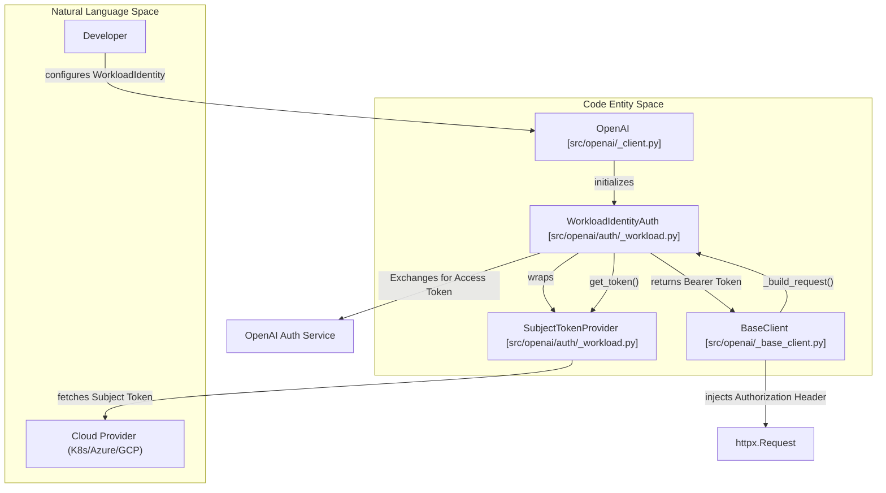
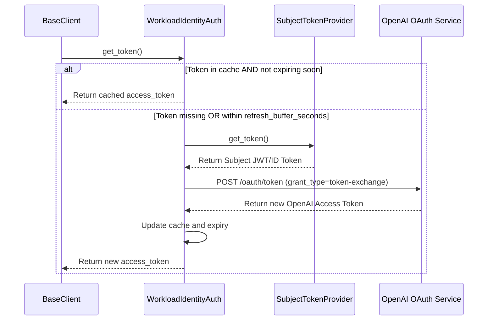

<!-- source: DeepWiki mcp.deepwiki.com · repo openai/openai-python · page 3.7 Authentication and Workload Identity · fetched 2026-10-26 -->

# Authentication and Workload Identity

Relevant source files

The following files were used as context for generating this wiki page:

- [README.md](README.md)
- [src/openai/__init__.py](src/openai/__init__.py)
- [src/openai/_base_client.py](src/openai/_base_client.py)
- [src/openai/_client.py](src/openai/_client.py)
- [src/openai/auth/_workload.py](src/openai/auth/_workload.py)
- [src/openai/lib/azure.py](src/openai/lib/azure.py)
- [src/openai/resources/beta/realtime/realtime.py](src/openai/resources/beta/realtime/realtime.py)
- [src/openai/resources/realtime/realtime.py](src/openai/resources/realtime/realtime.py)
- [tests/lib/test_azure.py](tests/lib/test_azure.py)
- [tests/test_auth.py](tests/test_auth.py)
- [tests/test_client.py](tests/test_client.py)
- [tests/test_utils/test_logging.py](tests/test_utils/test_logging.py)

The OpenAI Python SDK supports several authentication mechanisms to accommodate different security requirements and environments. While traditional API Key authentication is the most common for development, the SDK provides robust support for Admin API Keys and Workload Identity for secure, automated cloud deployments using short-lived tokens.

## Authentication Schemes

The SDK primarily uses Bearer token authentication in the HTTP `Authorization` header. Depending on the client configuration, this token is either a long-lived API key or a short-lived token generated via Workload Identity.

### API Key Authentication
This is the default scheme. The SDK looks for the `OPENAI_API_KEY` environment variable or an explicit `api_key` parameter during client initialization [src/openai/_client.py:160-160](). The key is stored as a string or a callable that returns a string [src/openai/_client.py:129-129]().

### Admin API Key Authentication
For organization management tasks, the SDK supports an `admin_api_key` (environment variable `OPENAI_ADMIN_KEY`) [src/openai/_client.py:161-161](). This key is used for administrative resources such as managing organization-level settings or keys via the `client.admin` resource [src/openai/_client.py:109-109]().

### Workload Identity
Workload Identity allows applications running in cloud environments (Kubernetes, Azure, GCP) to authenticate without long-lived secrets. It uses short-lived tokens from the cloud provider's identity service to exchange for an OpenAI access token [README.md:74-77]().

## Workload Identity Implementation

Workload Identity is implemented via the `WorkloadIdentityAuth` class [src/openai/auth/_workload.py:174-174](), which manages the lifecycle of short-lived tokens, including proactive refreshing before expiration.

### Core Entities and Data Flow

The following diagram illustrates how the `WorkloadIdentityAuth` component integrates into the `OpenAI` client's request lifecycle to provide automated token exchange.

**Diagram: Workload Identity Request Flow**

Sources: [src/openai/_client.py:126-156](), [src/openai/auth/_workload.py:174-210](), [src/openai/_base_client.py:641-650]().

### Key Components

| Class/Type | Description |
| :--- | :--- |
| `WorkloadIdentity` | A `TypedDict` defining the configuration: `identity_provider_id`, `service_account_id`, and the `provider` [src/openai/auth/_workload.py:30-43](). |
| `SubjectTokenProvider` | A `TypedDict` defining how to retrieve a subject token (`get_token`) and its type (`jwt` or `id`) [src/openai/auth/_workload.py:25-28](). |
| `WorkloadIdentityAuth` | Internal class that handles the logic of calling the provider, exchanging tokens via OAuth2 token exchange, and caching the token [src/openai/auth/_workload.py:174-180](). |

## Supported Providers

The SDK includes built-in providers for common cloud environments. These functions return a `SubjectTokenProvider` structure used by the auth manager.

### Kubernetes
Uses service account tokens typically mounted by the K8s API server.
*   **Function**: `k8s_service_account_token_provider(token_file_path)` [src/openai/auth/_workload.py:45-47]().
*   **Default Path**: `/var/run/secrets/kubernetes.io/serviceaccount/token` [src/openai/auth/_workload.py:46-46]().

### Azure Managed Identity
Fetches tokens from the Azure Instance Metadata Service (IMDS) endpoint `169.254.169.254`.
*   **Function**: `azure_managed_identity_token_provider(resource, ...)` [src/openai/auth/_workload.py:70-79]().
*   **Default Resource**: `https://management.azure.com/` [src/openai/auth/_workload.py:71-71]().

### Google Cloud Platform (GCP)
Uses the GCP Compute Engine metadata server to fetch identity tokens.
*   **Function**: `gcp_id_token_provider(audience, ...)` [src/openai/auth/_workload.py:130-135]().
*   **Default Audience**: `https://api.openai.com/v1` [src/openai/auth/_workload.py:131-131]().

## Token Lifecycle Management

When `workload_identity` is configured, the SDK internally sets the API key to a placeholder string `workload-identity-auth` [src/openai/_client.py:93-93](). The `WorkloadIdentityAuth` class manages a refresh buffer (default 1200 seconds) to ensure tokens are rotated before they expire [src/openai/auth/_workload.py:17-17]().

**Diagram: Token Refresh and Exchange Logic**

Sources: [src/openai/auth/_workload.py:15-17](), [src/openai/auth/_workload.py:220-250](), [README.md:154-168]().

## Azure OpenAI Authentication

The `AzureOpenAI` client variant supports a different set of authentication mechanisms tailored for Microsoft Azure. Notably, the generic `workload_identity` parameter is not functional in the Azure client [src/openai/lib/azure.py:177-178]().

Instead, Azure authentication uses:
1.  **API Key**: Standard Azure OpenAI service key [src/openai/lib/azure.py:109-109]().
2.  **Azure AD Token**: A static Entra ID (formerly Azure AD) access token [src/openai/lib/azure.py:111-111]().
3.  **Azure AD Token Provider**: A callable (sync or async) that returns a dynamic token [src/openai/lib/azure.py:112-112]().

If Entra ID authentication is used, the SDK employs a sentinel value `API_KEY_SENTINEL` ("`<missing API key>`") for the internal `api_key` field to satisfy base client requirements [src/openai/lib/azure.py:45-45]().

Sources: [src/openai/lib/azure.py:36-62](), [src/openai/lib/azure.py:170-186]().

---

