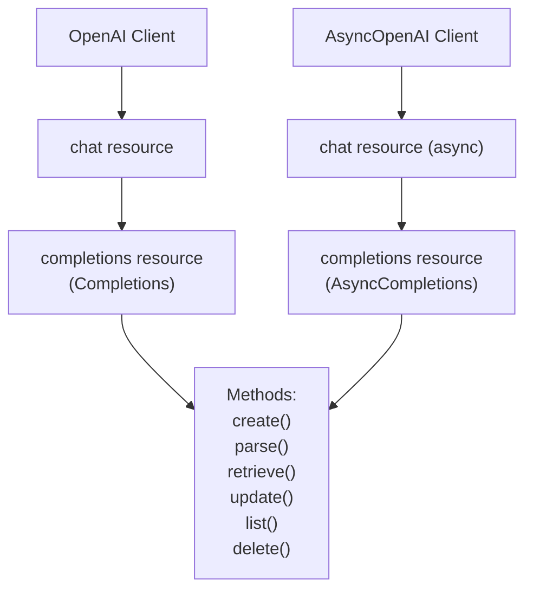
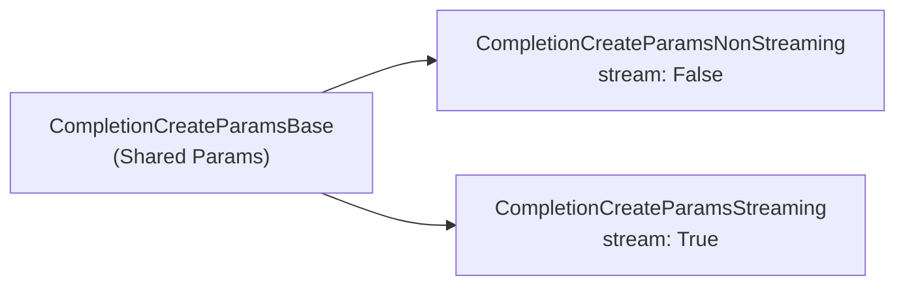
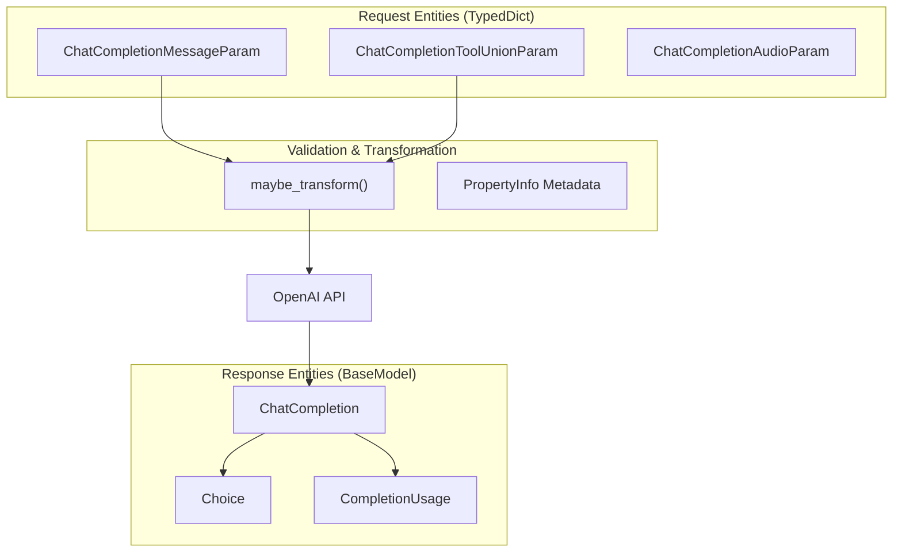

<!-- source: DeepWiki mcp.deepwiki.com · repo openai/openai-python · page 4.1 Chat Completions API · fetched 2026-10-26 -->

# Chat Completions API

<details>
<summary>Relevant source files</summary>

The following files were used as context for generating this wiki page:

- [src/openai/resources/chat/completions/completions.py](src/openai/resources/chat/completions/completions.py)
- [src/openai/resources/responses/responses.py](src/openai/resources/responses/responses.py)
- [src/openai/types/chat/__init__.py](src/openai/types/chat/__init__.py)
- [src/openai/types/chat/chat_completion.py](src/openai/types/chat/chat_completion.py)
- [src/openai/types/chat/chat_completion_assistant_message_param.py](src/openai/types/chat/chat_completion_assistant_message_param.py)
- [src/openai/types/chat/chat_completion_chunk.py](src/openai/types/chat/chat_completion_chunk.py)
- [src/openai/types/chat/chat_completion_message.py](src/openai/types/chat/chat_completion_message.py)
- [src/openai/types/chat/chat_completion_message_tool_call.py](src/openai/types/chat/chat_completion_message_tool_call.py)
- [src/openai/types/chat/chat_completion_message_tool_call_param.py](src/openai/types/chat/chat_completion_message_tool_call_param.py)
- [src/openai/types/chat/chat_completion_message_tool_call_union_param.py](src/openai/types/chat/chat_completion_message_tool_call_union_param.py)
- [src/openai/types/chat/chat_completion_tool_param.py](src/openai/types/chat/chat_completion_tool_param.py)
- [src/openai/types/chat/completion_create_params.py](src/openai/types/chat/completion_create_params.py)
- [src/openai/types/responses/response.py](src/openai/types/responses/response.py)
- [src/openai/types/responses/response_compact_params.py](src/openai/types/responses/response_compact_params.py)
- [src/openai/types/responses/response_create_params.py](src/openai/types/responses/response_create_params.py)
- [src/openai/types/responses/responses_client_event.py](src/openai/types/responses/responses_client_event.py)
- [src/openai/types/responses/responses_client_event_param.py](src/openai/types/responses/responses_client_event_param.py)
- [tests/api_resources/chat/test_completions.py](tests/api_resources/chat/test_completions.py)
- [tests/api_resources/test_responses.py](tests/api_resources/test_responses.py)
- [tests/compat/test_tool_param.py](tests/compat/test_tool_param.py)

</details>


## Purpose and Scope

The Chat Completions API is a conversational interface for generating text, audio, and tool calls with OpenAI models. While it is supported indefinitely, the [Responses API](#4.2) is now the recommended modern interface for stateful and multi-modal model interactions. This page documents the Chat Completions API resource structure, available methods, and basic usage patterns.

For detailed parameter documentation, see [Parameters and Configuration](#4.1.1). For streaming usage, see [Streaming Chat Completions](#4.1.2). For structured output parsing, see [Parsed Responses and Structured Outputs](#4.1.3).

Sources: [src/openai/resources/chat/completions/completions.py:61-63](), [src/openai/types/chat/completion_create_params.py:37-55]()

---

## Overview

The Chat Completions API enables conversational interactions with OpenAI models through a message-based interface. It is accessed via the `chat.completions` resource on both synchronous and asynchronous clients. The API supports multiple operations: creating completions, retrieving historical completions, updating metadata, listing completions with pagination, and deleting completions.

The resource implements a RESTful pattern with methods that return structured response objects (`ChatCompletion`) or paginated lists (`SyncCursorPage[ChatCompletion]` / `AsyncCursorPage[ChatCompletion]`).

Sources: [src/openai/resources/chat/completions/completions.py:60-90](), [tests/api_resources/chat/test_completions.py:22-120]()

---

## Resource Hierarchy

The Chat Completions API is organized as a nested resource within the SDK's client hierarchy:



**Access Patterns:**
- Synchronous: `client.chat.completions.create(...)` [src/openai/resources/chat/completions/completions.py:206-250]()
- Asynchronous: `await async_client.chat.completions.create(...)` [src/openai/resources/chat/completions/completions.py:848-892]()
- Parsed: `client.chat.completions.parse(..., response_format=MyModel)` [src/openai/resources/chat/completions/completions.py:91-136]()

Sources: [src/openai/resources/chat/completions/completions.py:60-134](), [tests/api_resources/chat/test_completions.py:27-35]()

---

## Available Methods

The `Completions` resource provides several primary methods for managing the lifecycle of chat interactions:

| Method | Purpose | Return Type | Pagination |
|--------|---------|-------------|------------|
| `create()` | Generate a new chat completion | `ChatCompletion` or `Stream[ChatCompletionChunk]` | No |
| `parse()` | Create with automatic Pydantic parsing | `ParsedChatCompletion[T]` | No |
| `retrieve()` | Fetch a previously created completion | `ChatCompletion` | No |
| `update()` | Update completion metadata | `ChatCompletion` | No |
| `list()` | List historical completions | `SyncCursorPage[ChatCompletion]` | Yes |
| `delete()` | Delete a completion record | `ChatCompletionDeleted` | No |

All methods support response wrapper patterns (`.with_raw_response.method()` and `.with_streaming_response.method()`) for accessing raw HTTP headers and timing.

Sources: [src/openai/resources/chat/completions/completions.py:73-89](), [src/openai/resources/chat/completions/completions.py:91-136](), [tests/api_resources/chat/test_completions.py:123-204]()

---

## Method Signatures and Parameters

### create()

The `create()` method is overloaded to support both standard and streaming responses.

**Non-streaming signature:**
```python
def create(
    messages: Iterable[ChatCompletionMessageParam],
    model: Union[str, ChatModel],
    stream: Optional[Literal[False]] = None,
    **kwargs
) -> ChatCompletion
```

**Streaming signature:**
```python
def create(
    messages: Iterable[ChatCompletionMessageParam],
    model: Union[str, ChatModel],
    stream: Literal[True],
    **kwargs
) -> Stream[ChatCompletionChunk]
```

Required parameters:
- `messages`: A list of `ChatCompletionMessageParam` objects (developer, system, user, assistant, or tool roles). [src/openai/types/chat/completion_create_params.py:43-51]()
- `model`: The model ID (e.g., `gpt-4o`, `o3`). [src/openai/types/chat/completion_create_params.py:53-60]()

Sources: [src/openai/types/chat/completion_create_params.py:37-55](), [src/openai/resources/chat/completions/completions.py:206-250]()

### parse()

A high-level wrapper that automatically handles JSON schema generation and Pydantic deserialization into a `ParsedChatCompletion`. It uses `_type_to_response_format` to convert Pydantic models to API parameters. For details, see [Parsed Responses and Structured Outputs](#4.1.3).

Sources: [src/openai/resources/chat/completions/completions.py:91-136](), [src/openai/resources/chat/completions/completions.py:40-41]()

---

## Request and Response Types

### Request Parameters

The `CompletionCreateParams` type hierarchy defines the structure of the request body:



**Key Parameters in `CompletionCreateParamsBase`:**
- `messages`: Conversation history including text, images, or audio. [src/openai/types/chat/completion_create_params.py:43-51]()
- `tools`: List of functions the model may call. [src/openai/types/chat/completion_create_params.py:214-218]()
- `reasoning_effort`: Controls computation for reasoning models like `o1`. [src/openai/types/chat/completion_create_params.py:188-193]()
- `web_search_options`: Configures integrated web search capabilities. [src/openai/types/chat/completion_create_params.py:231-235]()

Sources: [src/openai/types/chat/completion_create_params.py:42-235]()

### Response Types

- **ChatCompletion**: The standard response object containing `choices`, `usage`, and `created` timestamp. [src/openai/types/chat/chat_completion.py:191-225]()
- **ChatCompletionChunk**: An incremental update object used during streaming. [src/openai/types/chat/chat_completion_chunk.py:117-182]()
- **ChatCompletionMessage**: The specific content returned within a choice, including `content`, `tool_calls`, and `audio`. [src/openai/types/chat/chat_completion_message.py:12-45]()

Sources: [src/openai/types/chat/chat_completion.py:191-225](), [src/openai/types/chat/chat_completion_chunk.py:117-182]()

---

## Parameter Type System

The SDK uses `TypedDict` for request parameters and `Pydantic` models for responses to ensure type safety.



Sources: [src/openai/types/chat/completion_create_params.py:12-22](), [src/openai/types/chat/chat_completion.py:7-11](), [src/openai/types/chat/chat_completion_message_tool_call.py:12-18]()

---

## Basic Usage Examples

### Synchronous Non-Streaming
```python
from openai import OpenAI

client = OpenAI()
completion = client.chat.completions.create(
    model="gpt-4o",
    messages=[{"role": "user", "content": "Hello!"}]
)
print(completion.choices[0].message.content)
```
Sources: [tests/api_resources/chat/test_completions.py:27-35]()

### Asynchronous Streaming
```python
from openai import AsyncOpenAI

client = AsyncOpenAI()
stream = await client.chat.completions.create(
    model="gpt-4o",
    messages=[{"role": "user", "content": "Tell a story"}],
    stream=True
)
async for chunk in stream:
    if chunk.choices[0].delta.content:
        print(chunk.choices[0].delta.content, end="")
```
Sources: [tests/api_resources/chat/test_completions.py:596-607]()

---

## Error Handling

The Chat Completions API follows the standard SDK error hierarchy. Common exceptions include:
- `BadRequestError`: Invalid parameters (e.g., unsupported model or invalid message structure).
- `RateLimitError`: API quota exceeded.
- `APIConnectionError`: Network issues between the client and OpenAI.

Sources: [src/openai/resources/responses/responses.py:57-57]() (referencing `OpenAIError` and `WebSocketConnectionClosedError`).

---

