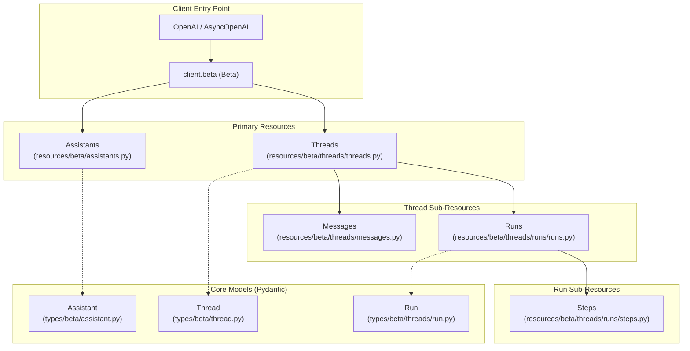
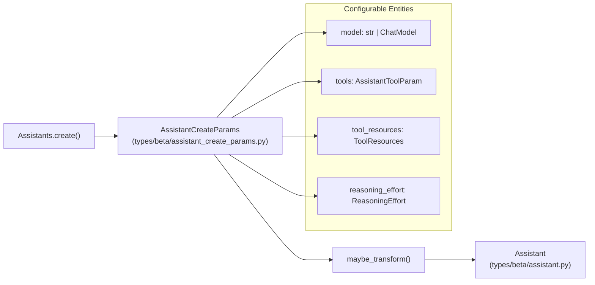
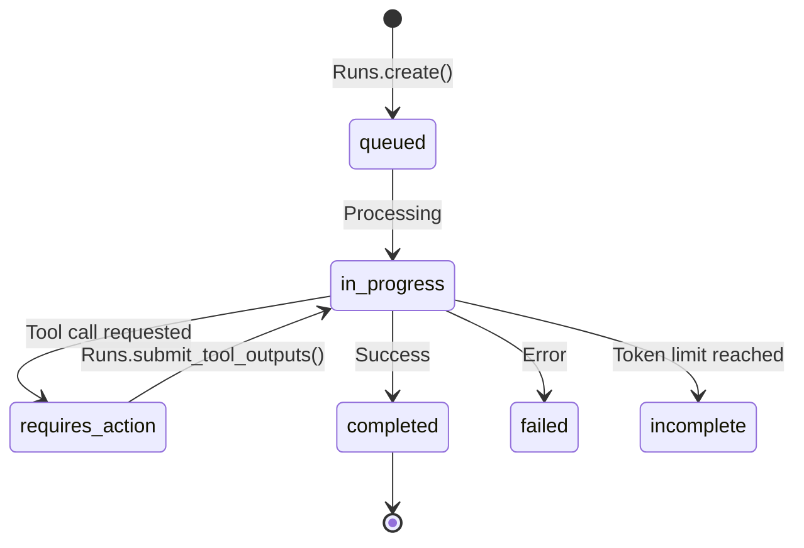

<!-- source: DeepWiki mcp.deepwiki.com · repo openai/openai-python · page 4.3 Assistants API (Beta) · fetched 2026-10-26 -->

# Assistants API (Beta)

<details>
<summary>Relevant source files</summary>

The following files were used as context for generating this wiki page:

- [src/openai/resources/audio/audio.py](src/openai/resources/audio/audio.py)
- [src/openai/resources/beta/assistants.py](src/openai/resources/beta/assistants.py)
- [src/openai/resources/beta/beta.py](src/openai/resources/beta/beta.py)
- [src/openai/resources/beta/threads/runs/runs.py](src/openai/resources/beta/threads/runs/runs.py)
- [src/openai/resources/beta/threads/threads.py](src/openai/resources/beta/threads/threads.py)
- [src/openai/resources/fine_tuning/fine_tuning.py](src/openai/resources/fine_tuning/fine_tuning.py)
- [src/openai/types/beta/assistant.py](src/openai/types/beta/assistant.py)
- [src/openai/types/beta/assistant_create_params.py](src/openai/types/beta/assistant_create_params.py)
- [src/openai/types/beta/assistant_update_params.py](src/openai/types/beta/assistant_update_params.py)
- [src/openai/types/beta/thread_create_and_run_params.py](src/openai/types/beta/thread_create_and_run_params.py)
- [src/openai/types/beta/threads/run.py](src/openai/types/beta/threads/run.py)
- [src/openai/types/beta/threads/run_create_params.py](src/openai/types/beta/threads/run_create_params.py)
- [src/openai/types/chat_model.py](src/openai/types/chat_model.py)

</details>


**Deprecation Notice**: The Assistants API is deprecated in favor of the Responses API. All methods in this API are marked with deprecation warnings [src/openai/resources/beta/threads/runs/runs.py:90-90](). For new applications, see [Responses API](#4.2).

## Purpose and Scope

The Assistants API provides a framework for building stateful AI agents with persistent conversation threads, tool integration (code execution, file search, function calling), and multi-turn execution. This document covers:

- Creating and managing assistants with instructions, tools, and tool resources.
- Thread-based conversation management with messages.
- Run lifecycle for executing assistants on threads.
- Tool integration including `code_interpreter`, `file_search`, and custom functions.
- Streaming run events and handling required actions.

For detailed information on specific components, see the following child pages:
- [Assistants and Configuration](#4.3.1) — Creating and managing assistants, instructions, and tools.
- [Threads and Messages](#4.3.2) — Managing conversation state and adding messages.
- [Runs and Execution](#4.3.3) — The run lifecycle, state machine, and required actions.
- [Streaming Assistant Events](#4.3.4) — Processing real-time events and incremental responses.

---

## System Architecture

The Assistants API consists of primary resources organized hierarchically under the `beta` namespace [src/openai/resources/beta/beta.py:6-30](). The SDK uses a resource-based pattern where sub-resources are accessed via cached properties on their parents.

### Resource Hierarchy



**Sources**: [src/openai/resources/beta/beta.py:48-73](), [src/openai/resources/beta/assistants.py:35-38](), [src/openai/resources/beta/threads/threads.py:62-73](), [src/openai/resources/beta/threads/runs/runs.py:62-68]()

---

## Assistants

Assistants are stateful AI agents configured with a model, instructions, and tools. They serve as the blueprint for conversation execution.

### Assistant Configuration

Assistants are created via `client.beta.assistants.create()` [src/openai/resources/beta/assistants.py:58](). Key parameters include `model`, `instructions`, and `tools` (e.g., `code_interpreter`, `file_search`, or `function`) [src/openai/types/beta/assistant_create_params.py:28-112]().



For details, see [Assistants and Configuration](#4.3.1).

**Sources**: [src/openai/resources/beta/assistants.py:58-78](), [src/openai/types/beta/assistant_create_params.py:28-125](), [src/openai/types/beta/assistant_update_params.py:17-161]()

---

## Threads and Messages

Threads represent a session between a user and an assistant. They store `Messages`, which contain text, images, or attachments used by tools.

| Component | SDK Access | Description |
|-----------|------------|-------------|
| **Thread** | `client.beta.threads` | Persistent conversation container [src/openai/resources/beta/threads/threads.py:62-63]() |
| **Message** | `client.beta.threads.messages` | Individual turns in a thread [src/openai/resources/beta/threads/threads.py:71-73]() |
| **Tool Resources** | `tool_resources` | File IDs for code interpreter or vector stores for file search [src/openai/types/beta/thread_create_and_run_params.py:147-153]() |

For details, see [Threads and Messages](#4.3.2).

**Sources**: [src/openai/resources/beta/threads/threads.py:95-154](), [src/openai/types/beta/thread_create_and_run_params.py:129-159]()

---

## Runs and Execution

A `Run` is an invocation of an assistant on a thread. The SDK manages the run lifecycle, which includes handling tool calls through "Required Actions" [src/openai/types/beta/threads/run.py:56-68]().

### Run Lifecycle State Machine

Runs progress through several statuses defined in `RunStatus` [src/openai/types/beta/threads/run.py:7]().



For details, see [Runs and Execution](#4.3.3).

**Sources**: [src/openai/resources/beta/threads/runs/runs.py:89-119](), [src/openai/types/beta/threads/run.py:107-197](), [src/openai/types/beta/threads/run.py:25-36]()

---

## Streaming

The SDK provides specialized handlers for streaming assistant events, allowing for real-time UI updates as the model generates content or calls tools. This is implemented via the `AssistantEventHandler` and `AssistantStreamManager` [src/openai/resources/beta/threads/runs/runs.py:35-42]().

```python
# Example logic based on resource methods
with client.beta.threads.runs.create(
    thread_id="thread_id",
    assistant_id="assistant_id",
    stream=True
) as stream:
    for event in stream:
        print(event)
```

For details, see [Streaming Assistant Events](#4.3.4).

**Sources**: [src/openai/resources/beta/threads/runs/runs.py:35-42](), [src/openai/resources/beta/threads/runs/runs.py:81-87]()

---

## Key Entities and Types

| Entity | Pydantic Model | Parameter Type (TypedDict) |
|--------|----------------|----------------------------|
| **Assistant** | `Assistant` [src/openai/types/beta/assistant.py:44]() | `AssistantCreateParams` [src/openai/types/beta/assistant_create_params.py:28]() |
| **Thread** | `Thread` [src/openai/types/beta/thread.py:49]() | `thread_create_params.ThreadCreateParams` [src/openai/resources/beta/threads/threads.py:36]() |
| **Run** | `Run` [src/openai/types/beta/threads/run.py:107]() | `RunCreateParamsBase` [src/openai/types/beta/threads/run_create_params.py:30]() |
| **Tool Resources** | `ToolResources` [src/openai/types/beta/assistant.py:33]() | `ToolResources` [src/openai/types/beta/assistant_create_params.py:103]() |

**Sources**: [src/openai/types/beta/assistant.py:44](), [src/openai/types/beta/thread.py:49](), [src/openai/types/beta/threads/run.py:107](), [src/openai/types/beta/assistant_create_params.py:28-103]()

---

