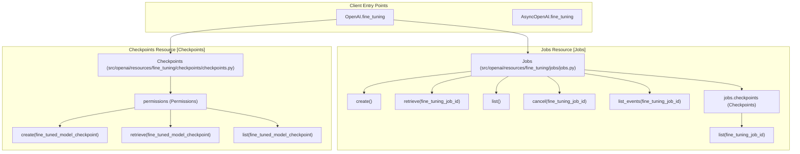
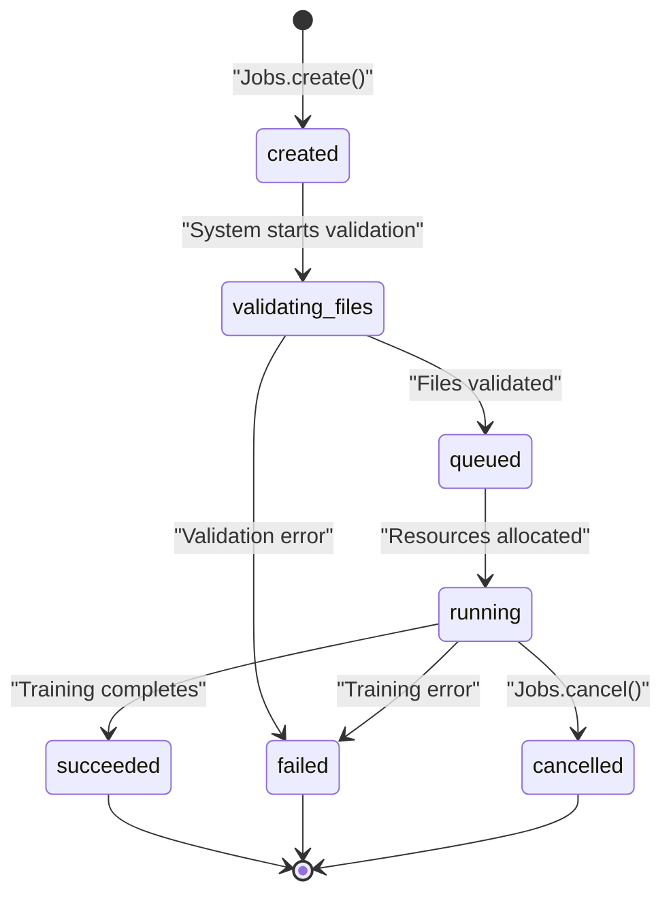
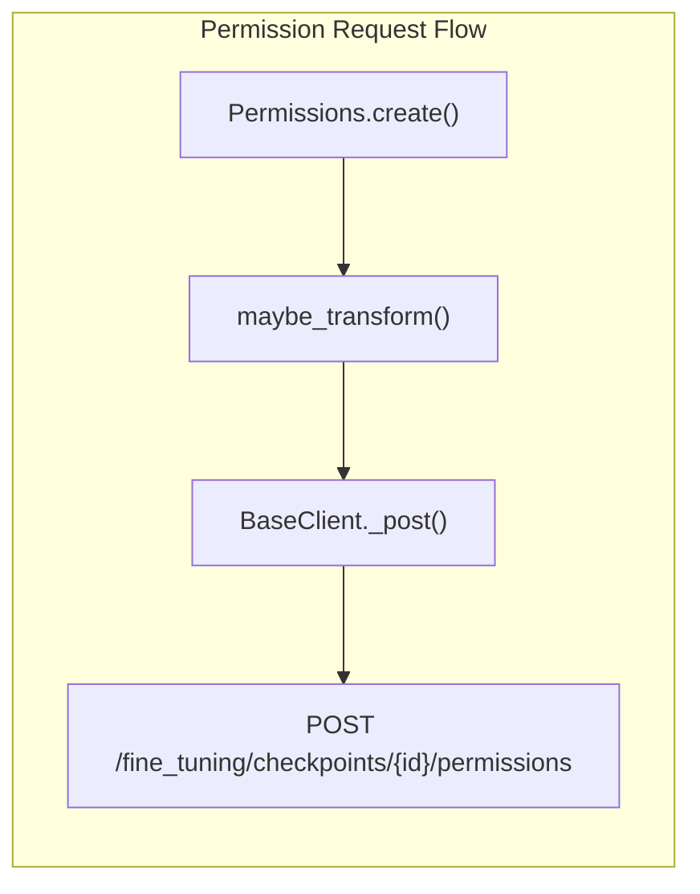
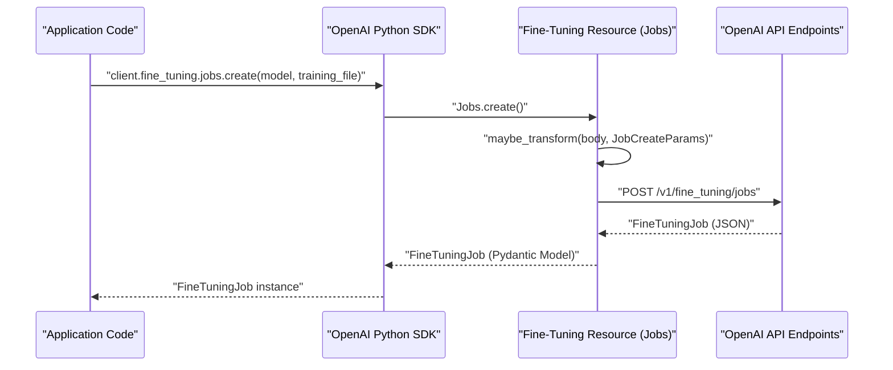

<!-- source: DeepWiki mcp.deepwiki.com · repo openai/openai-python · page 4.4 Fine-Tuning API · fetched 2026-10-26 -->

# Fine-Tuning API

<details>
<summary>Relevant source files</summary>

The following files were used as context for generating this wiki page:

- [src/openai/resources/beta/threads/messages.py](src/openai/resources/beta/threads/messages.py)
- [src/openai/resources/beta/threads/runs/steps.py](src/openai/resources/beta/threads/runs/steps.py)
- [src/openai/resources/evals/evals.py](src/openai/resources/evals/evals.py)
- [src/openai/resources/evals/runs/runs.py](src/openai/resources/evals/runs/runs.py)
- [src/openai/resources/fine_tuning/checkpoints/permissions.py](src/openai/resources/fine_tuning/checkpoints/permissions.py)
- [src/openai/resources/fine_tuning/jobs/jobs.py](src/openai/resources/fine_tuning/jobs/jobs.py)
- [src/openai/resources/models.py](src/openai/resources/models.py)
- [src/openai/resources/vector_stores/vector_stores.py](src/openai/resources/vector_stores/vector_stores.py)
- [src/openai/types/fine_tuning/checkpoints/permission_retrieve_response.py](src/openai/types/fine_tuning/checkpoints/permission_retrieve_response.py)
- [src/openai/types/fine_tuning/fine_tuning_job.py](src/openai/types/fine_tuning/fine_tuning_job.py)
- [src/openai/types/fine_tuning/job_create_params.py](src/openai/types/fine_tuning/job_create_params.py)
- [src/openai/types/fine_tuning/job_list_params.py](src/openai/types/fine_tuning/job_list_params.py)
- [tests/api_resources/fine_tuning/checkpoints/test_permissions.py](tests/api_resources/fine_tuning/checkpoints/test_permissions.py)

</details>


The Fine-Tuning API provides functionality for training custom models on domain-specific data using supervised learning, Direct Preference Optimization (DPO), or reinforcement learning methods. This API enables creating fine-tuning jobs, monitoring training progress through events, managing checkpoints, and controlling access permissions for fine-tuned models.

For information about file uploads for training data, see [File Management and Uploads](#4.6). For details about the base client infrastructure used by this API, see [Core Client Classes](#3).

## Resource Hierarchy and Structure

The Fine-Tuning API is organized into a nested resource hierarchy accessible from the main client. The structure reflects distinct functional areas: job management, checkpoint access, and permission control.

Title: Fine-Tuning Resource Hierarchy


**Resource Paths and Endpoints**

| Resource Path | HTTP Endpoint | Purpose |
|--------------|---------------|---------|
| `client.fine_tuning.jobs` | `/fine_tuning/jobs` | Create and manage fine-tuning jobs [src/openai/resources/fine_tuning/jobs/jobs.py:37-38]() |
| `client.fine_tuning.jobs.checkpoints` | `/fine_tuning/jobs/{job_id}/checkpoints` | List checkpoints for a specific job [src/openai/resources/fine_tuning/jobs/jobs.py:41-43]() |
| `client.fine_tuning.checkpoints.permissions` | `/fine_tuning/checkpoints/{checkpoint}/permissions` | Manage access permissions for model checkpoints [src/openai/resources/fine_tuning/checkpoints/permissions.py:31-32]() |

Sources: [src/openai/resources/fine_tuning/jobs/jobs.py:1-43](), [src/openai/resources/fine_tuning/checkpoints/permissions.py:1-32]()

## Fine-Tuning Jobs

Fine-tuning jobs represent training operations that customize a base model using provided training data. Jobs support multiple training methods and can be monitored or cancelled during execution.

### Job Lifecycle States

The `FineTuningJob` object represents the state of a training operation [src/openai/types/fine_tuning/fine_tuning_job.py:76-79]().

Title: Fine-Tuning Job State Machine


**Job State Descriptions**

| State | Description |
|-------|-------------|
| `validating_files` | Training and validation files are being validated [src/openai/types/fine_tuning/fine_tuning_job.py:133-134]() |
| `queued` | Job is waiting for compute resources [src/openai/types/fine_tuning/fine_tuning_job.py:130-131]() |
| `running` | Model training is in progress [src/openai/types/fine_tuning/fine_tuning_job.py:130-131]() |
| `succeeded` | Training completed successfully, fine-tuned model is available [src/openai/types/fine_tuning/fine_tuning_job.py:130-131]() |
| `failed` | Job failed; check `error` field for details [src/openai/types/fine_tuning/fine_tuning_job.py:87-91]() |
| `cancelled` | Job was manually cancelled [src/openai/types/fine_tuning/fine_tuning_job.py:130-131]() |

Sources: [src/openai/types/fine_tuning/fine_tuning_job.py:76-134]()

### Creating Fine-Tuning Jobs

Jobs are created through `client.fine_tuning.jobs.create()` [src/openai/resources/fine_tuning/jobs/jobs.py:64-82]().

```python
# Example supervised fine-tuning job creation
job = client.fine_tuning.jobs.create(
    model="gpt-4o-mini",
    training_file="file-123",
    method={
        "type": "supervised",
        "supervised": {
            "hyperparameters": {
                "n_epochs": 3
            }
        }
    }
)
```

**Core Parameters**

| Parameter | Type | Required | Description |
|-----------|------|----------|-------------|
| `model` | `str` | Yes | Base model to fine-tune (e.g., `gpt-4o-mini`) [src/openai/resources/fine_tuning/jobs/jobs.py:67]() |
| `training_file` | `str` | Yes | File ID containing training examples [src/openai/resources/fine_tuning/jobs/jobs.py:68]() |
| `validation_file` | `str` | No | File ID for validation data [src/openai/resources/fine_tuning/jobs/jobs.py:75]() |
| `method` | `Method` | No | Training method configuration [src/openai/resources/fine_tuning/jobs/jobs.py:72]() |
| `suffix` | `str` | No | String suffix for the fine-tuned model name [src/openai/resources/fine_tuning/jobs/jobs.py:74]() |
| `seed` | `int` | No | Seed for reproducibility [src/openai/resources/fine_tuning/jobs/jobs.py:73]() |
| `integrations` | `Iterable[Integration]` | No | List of integrations (e.g., Weights & Biases) [src/openai/resources/fine_tuning/jobs/jobs.py:70]() |

Sources: [src/openai/resources/fine_tuning/jobs/jobs.py:64-160](), [src/openai/types/fine_tuning/fine_tuning_job.py:60-75](), [src/openai/types/fine_tuning/job_create_params.py:128-176]()

### Job Management Operations

| Method | Returns | Description |
|--------|---------|-------------|
| `create()` | `FineTuningJob` | Create a new fine-tuning job [src/openai/resources/fine_tuning/jobs/jobs.py:64-160]() |
| `retrieve(job_id)` | `FineTuningJob` | Get details of a specific job [src/openai/resources/fine_tuning/jobs/jobs.py:192-212]() |
| `list()` | `SyncCursorPage[FineTuningJob]` | List all fine-tuning jobs [src/openai/resources/fine_tuning/jobs/jobs.py:236-264]() |
| `cancel(job_id)` | `FineTuningJob` | Cancel a running job [src/openai/resources/fine_tuning/jobs/jobs.py:288-308]() |
| `list_events(job_id)` | `SyncCursorPage[FineTuningJobEvent]` | List events for a specific job [src/openai/resources/fine_tuning/jobs/jobs.py:332-365]() |

Sources: [src/openai/resources/fine_tuning/jobs/jobs.py:64-365]()

## Training Methods and Hyperparameters

The SDK supports multiple training methods defined in `openai.types.fine_tuning.fine_tuning_job.Method` [src/openai/types/fine_tuning/fine_tuning_job.py:60-75]().

### Supervised Fine-Tuning

Supervised fine-tuning is the standard method for customizing models on input-output pairs.

**Hyperparameters** [src/openai/types/fine_tuning/fine_tuning_job.py:34-58]()

| Parameter | Type | Description |
|-----------|------|-------------|
| `batch_size` | `int \| "auto"` | Number of examples in each batch [src/openai/types/fine_tuning/fine_tuning_job.py:40-45]() |
| `learning_rate_multiplier` | `float \| "auto"` | Scaling factor for the learning rate [src/openai/types/fine_tuning/fine_tuning_job.py:47-51]() |
| `n_epochs` | `int \| "auto"` | Number of cycles through the training dataset [src/openai/types/fine_tuning/fine_tuning_job.py:53-57]() |

### Advanced Methods (DPO and Reinforcement)

In addition to `supervised`, the API supports `dpo` (Direct Preference Optimization) and `reinforcement` learning methods [src/openai/types/fine_tuning/fine_tuning_job.py:63-75](). These are configured via the `method` parameter in `Jobs.create()` [src/openai/resources/fine_tuning/jobs/jobs.py:72]().

Sources: [src/openai/types/fine_tuning/fine_tuning_job.py:34-75](), [src/openai/types/fine_tuning/job_create_params.py:177-191]()

## Checkpoints and Permissions

Checkpoints are intermediate model states saved during training. Access to these checkpoints can be shared across projects within an organization.

### Listing Checkpoints

Checkpoints are retrieved for a specific job via `client.fine_tuning.jobs.checkpoints.list(job_id)` [src/openai/resources/fine_tuning/jobs/jobs.py:41-43]().

### Checkpoint Permissions

Permissions allow organization owners to share fine-tuned model checkpoints with other projects. **Note:** Calling these endpoints requires an Admin API Key [src/openai/resources/fine_tuning/checkpoints/permissions.py:66-67]().

Title: Permission Creation Request Data Flow


**Permission Operations** [src/openai/resources/fine_tuning/checkpoints/permissions.py:31-240]()

| Method | Parameters | Returns | Description |
|--------|-----------|---------|-------------|
| `create()` | `checkpoint_id`, `project_ids` | `SyncPage[PermissionCreateResponse]` | Grant access to specific projects [src/openai/resources/fine_tuning/checkpoints/permissions.py:53-102]() |
| `list()` | `checkpoint_id` | `SyncConversationCursorPage[PermissionListResponse]` | List all permissions for a checkpoint [src/openai/resources/fine_tuning/checkpoints/permissions.py:192-240]() |
| `retrieve()` | `checkpoint_id` | `PermissionRetrieveResponse` | **Deprecated:** Use `list()` instead [src/openai/resources/fine_tuning/checkpoints/permissions.py:104-105]() |

Sources: [src/openai/resources/fine_tuning/checkpoints/permissions.py:31-240](), [tests/api_resources/fine_tuning/checkpoints/test_permissions.py:25-46](), [src/openai/types/fine_tuning/checkpoints/permission_retrieve_response.py:29-39]()

## Summary of Data Flow

The following diagram illustrates the data flow from client request to the fine-tuning training infrastructure.

Title: Fine-Tuning Job Creation Sequence


Sources: [src/openai/resources/fine_tuning/jobs/jobs.py:64-160](), [src/openai/types/fine_tuning/fine_tuning_job.py:76-177]()

---

