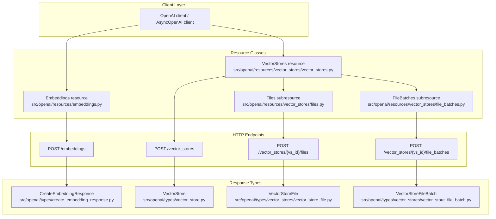
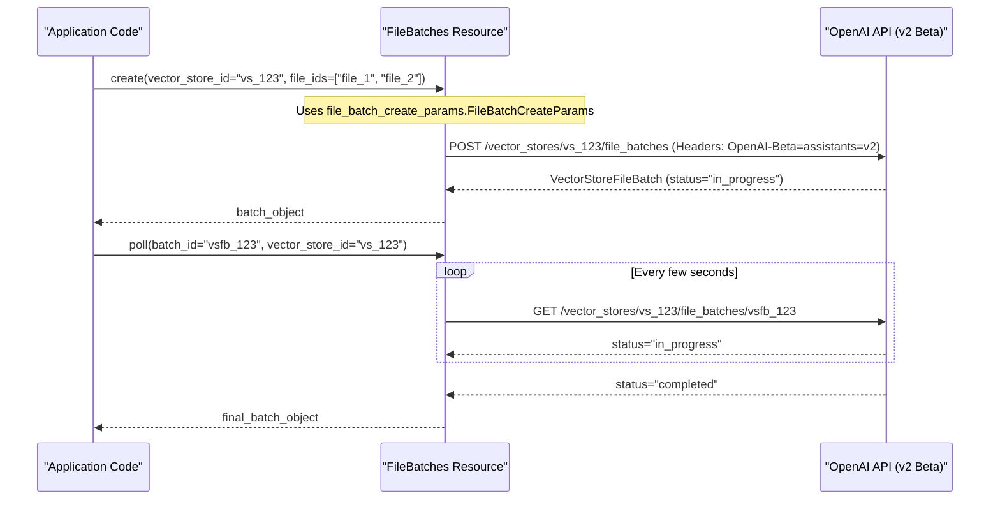

<!-- source: DeepWiki mcp.deepwiki.com · repo openai/openai-python · page 4.5 Embeddings and Vector Stores · fetched 2026-10-26 -->

# Embeddings and Vector Stores

Relevant source files

The following files were used as context for generating this wiki page:

- [src/openai/resources/embeddings.py](src/openai/resources/embeddings.py)
- [src/openai/resources/vector_stores/file_batches.py](src/openai/resources/vector_stores/file_batches.py)
- [src/openai/resources/vector_stores/files.py](src/openai/resources/vector_stores/files.py)
- [src/openai/types/embedding_create_params.py](src/openai/types/embedding_create_params.py)
- [src/openai/types/responses/file_search_tool.py](src/openai/types/responses/file_search_tool.py)
- [src/openai/types/responses/file_search_tool_param.py](src/openai/types/responses/file_search_tool_param.py)
- [src/openai/types/vector_stores/file_batch_create_params.py](src/openai/types/vector_stores/file_batch_create_params.py)
- [src/openai/types/vector_stores/file_create_params.py](src/openai/types/vector_stores/file_create_params.py)
- [tests/api_resources/vector_stores/test_file_batches.py](tests/api_resources/vector_stores/test_file_batches.py)
- [tests/api_resources/vector_stores/test_files.py](tests/api_resources/vector_stores/test_files.py)

**Purpose**: This page documents the embeddings API for generating vector representations of text and the vector stores API for managing searchable collections of embedded content. These APIs enable semantic search and retrieval-augmented generation (RAG) workflows.

For information about using vector stores with the Assistants API, see [Assistants API (Beta)](#4.3). For file upload mechanics, see [File Management and Uploads](#4.6).

---

## System Overview

The embeddings and vector stores subsystem provides two complementary capabilities:

1. **Embeddings API**: Converts text into high-dimensional vector representations that capture semantic meaning.
2. **Vector Stores API**: Manages collections of embedded content with built-in semantic search, file chunking, and batch operations.

### Resource Hierarchy

**Sources**: [src/openai/resources/embeddings.py:27-151](), [src/openai/resources/vector_stores/files.py:28-48](), [src/openai/resources/vector_stores/file_batches.py:31-51]()

---

## Embeddings API

The `Embeddings` resource generates vector representations from text inputs. These vectors encode semantic meaning in a high-dimensional space where similar content has nearby vectors.

### Implementation Detail: Base64 Optimization
The SDK includes a performance optimization for embeddings. By default, if a user does not specify an `encoding_format`, the SDK requests `base64` from the API to reduce payload size [src/openai/resources/embeddings.py:111-112](). It then uses a `post_parser` to decode this back into a list of floats [src/openai/resources/embeddings.py:114-134](). If `numpy` is available, it uses `np.frombuffer` for high-speed conversion; otherwise, it falls back to the standard library `array.array` [src/openai/resources/embeddings.py:126-132]().

**Sources**: [src/openai/resources/embeddings.py:111-134]()

### Request Parameters

The `create` method accepts `EmbeddingCreateParams`:

| Parameter | Type | Required | Description |
|-----------|------|----------|-------------|
| `input` | `str | SequenceNotStr[str] | Iterable[int] | Iterable[Iterable[int]]` | Yes | Input text to embed, encoded as a string or array of tokens. [src/openai/types/embedding_create_params.py:15-26]() |
| `model` | `str | EmbeddingModel` | Yes | ID of the model to use (e.g., `text-embedding-3-small`). [src/openai/types/embedding_create_params.py:28-36]() |
| `dimensions` | `int` | No | Number of dimensions for the output vector (supported in v3 models). [src/openai/types/embedding_create_params.py:38-42]() |
| `encoding_format` | `"float" | "base64"` | No | Format for the returned embeddings. [src/openai/types/embedding_create_params.py:44-48]() |

**Sources**: [src/openai/resources/embeddings.py:51-65](), [src/openai/types/embedding_create_params.py:14-56]()

---

## Vector Store Management

Vector stores provide persistent storage for embedded content with automatic indexing. The `client.vector_stores` resource manages these collections, while sub-resources handle file ingestion.

### File Management (`vector_stores.files`)

The `Files` sub-resource allows attaching individual files to a vector store. It supports standard CRUD operations and convenience polling methods.

**Key Methods**:
- `create`: Attaches an existing `File` ID to a vector store. [src/openai/resources/vector_stores/files.py:48-112]()
- `list`: Lists files attached to a store, returning a `SyncCursorPage[VectorStoreFile]`. [src/openai/resources/vector_stores/files.py:180-213]()
- `poll`: A helper that waits until a file's processing status is terminal (`completed` or `failed`).

**Sources**: [src/openai/resources/vector_stores/files.py:28-213](), [tests/api_resources/vector_stores/test_files.py:27-185]()

### Batch Ingestion (`vector_stores.file_batches`)

For multi-file ingestion, `FileBatches` is recommended to reduce write request pressure. It supports up to 2000 files per batch [src/openai/types/vector_stores/file_batch_create_params.py:38-39]().

**Sources**: [src/openai/resources/vector_stores/file_batches.py:51-123](), [src/openai/types/vector_stores/file_batch_create_params.py:31-49]()

---

## File Chunking Strategies

When files are added to a vector store, they are partitioned into chunks for indexing. The SDK supports configuring these strategies via `FileChunkingStrategyParam`.

| Strategy | Type | Description |
|----------|------|-------------|
| **Auto** | `auto` | Default strategy. The system automatically determines chunk boundaries. [src/openai/types/vector_stores/file_create_params.py:33-37]() |
| **Static** | `static` | Allows manual control over chunking parameters. [src/openai/types/vector_stores/file_create_params.py:33-37]() |

**Sources**: [src/openai/types/vector_stores/file_create_params.py:32-37](), [src/openai/types/vector_stores/file_batch_create_params.py:24-29]()

---

## Semantic Search Configuration

While vector stores are often used implicitly by Assistants, they can be configured for specific search behaviors via the `FileSearchToolParam`.

### Ranking and Hybrid Search
The `RankingOptions` allow fine-tuning how results are retrieved, including support for hybrid search (balancing semantic matches vs. keyword matches).

- `ranker`: Can be `auto` or a specific version like `default-2024-11-15`. [src/openai/types/responses/file_search_tool_param.py:38-39]()
- `score_threshold`: A value between 0 and 1 to filter out irrelevant results. [src/openai/types/responses/file_search_tool_param.py:41-47]()
- `hybrid_search`: Configures `embedding_weight` and `text_weight` for reciprocal rank fusion. [src/openai/types/responses/file_search_tool_param.py:17-27]()

**Sources**: [src/openai/types/responses/file_search_tool_param.py:12-72](), [src/openai/types/responses/file_search_tool.py:15-69]()

---

