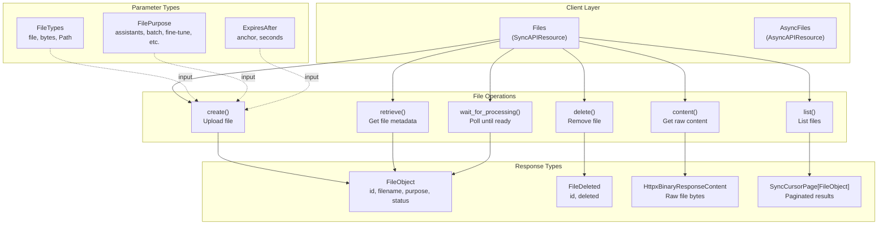
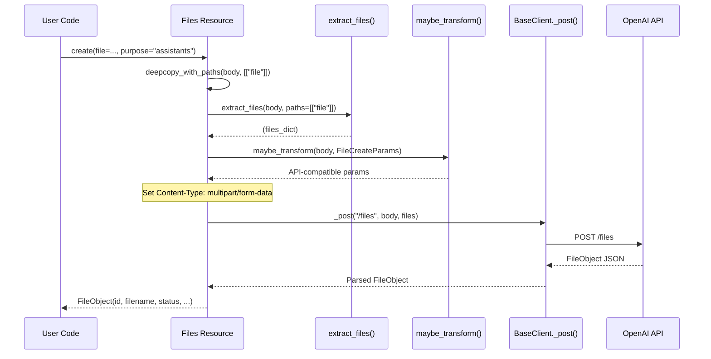
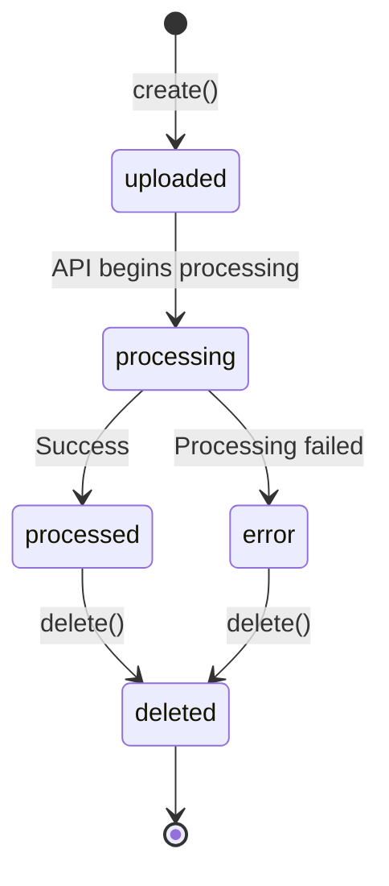
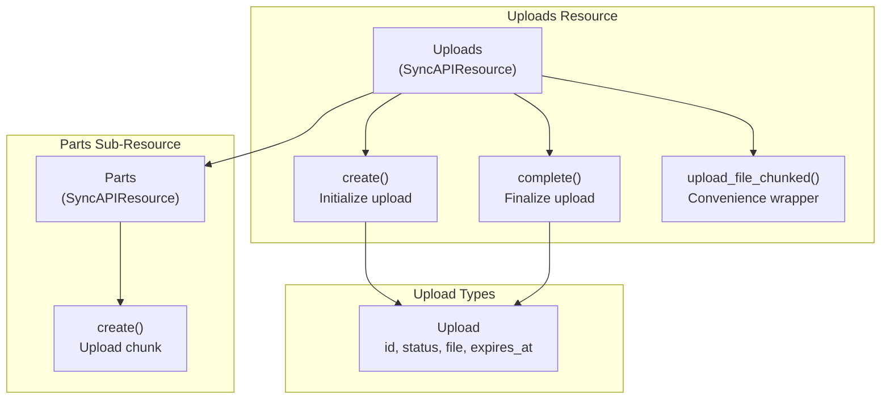
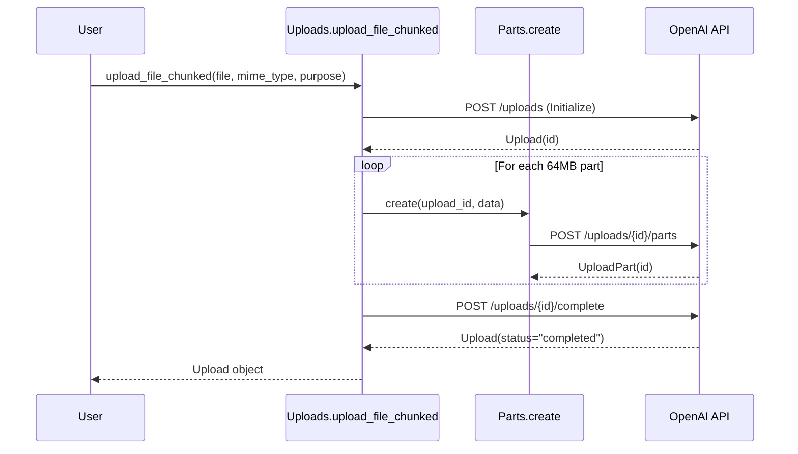

<!-- source: DeepWiki mcp.deepwiki.com · repo openai/openai-python · page 4.6 File Management and Uploads · fetched 2026-10-26 -->

# File Management and Uploads

<details>
<summary>Relevant source files</summary>

The following files were used as context for generating this wiki page:

- [src/openai/_files.py](src/openai/_files.py)
- [src/openai/resources/audio/speech.py](src/openai/resources/audio/speech.py)
- [src/openai/resources/audio/transcriptions.py](src/openai/resources/audio/transcriptions.py)
- [src/openai/resources/audio/translations.py](src/openai/resources/audio/translations.py)
- [src/openai/resources/completions.py](src/openai/resources/completions.py)
- [src/openai/resources/files.py](src/openai/resources/files.py)
- [src/openai/resources/moderations.py](src/openai/resources/moderations.py)
- [src/openai/resources/uploads/uploads.py](src/openai/resources/uploads/uploads.py)
- [src/openai/types/audio/speech_create_params.py](src/openai/types/audio/speech_create_params.py)
- [src/openai/types/beta/threads/run_submit_tool_outputs_params.py](src/openai/types/beta/threads/run_submit_tool_outputs_params.py)
- [src/openai/types/completion_create_params.py](src/openai/types/completion_create_params.py)
- [src/openai/types/file_create_params.py](src/openai/types/file_create_params.py)
- [src/openai/types/file_object.py](src/openai/types/file_object.py)
- [src/openai/types/file_purpose.py](src/openai/types/file_purpose.py)
- [src/openai/types/realtime/conversation_item_create_event.py](src/openai/types/realtime/conversation_item_create_event.py)
- [src/openai/types/realtime/conversation_item_create_event_param.py](src/openai/types/realtime/conversation_item_create_event_param.py)
- [src/openai/types/upload_create_params.py](src/openai/types/upload_create_params.py)

</details>


## Purpose and Scope

This document covers the file management capabilities of the OpenAI Python library, including file upload, retrieval, deletion, content access, and multipart uploads for large files. Files in the OpenAI API serve as inputs to various endpoints including Assistants, Fine-tuning, Batch processing, and Vector Stores.

For information about vector store-specific file operations and chunking strategies, see [Embeddings and Vector Stores](#4.5). For technical details about file extraction and transformation mechanisms, see [File Extraction and Processing](#6.5).

---

## File Resource Architecture

The Files resource is implemented in the `Files` class and `AsyncFiles` class, providing both synchronous and asynchronous interfaces for file operations. All file operations return `FileObject` instances containing metadata about uploaded files.

### Core File Operations

Detailed Mapping of Code Entities:
- **Client Classes**: `Files` [src/openai/resources/files.py:36](), `AsyncFiles` [src/openai/resources/files.py:383]().
- **Response Models**: `FileObject` [src/openai/types/file_object.py:11](), `FileDeleted` [src/openai/types/file_deleted.py:11]().
- **Parameter Types**: `FileCreateParams` [src/openai/types/file_create_params.py:13](), `FilePurpose` [src/openai/types/file_purpose.py:8]().



**Sources:** [src/openai/resources/files.py:36-349](), [src/openai/types/file_object.py:11-61](), [src/openai/types/file_create_params.py:13-52]()

---

## Basic File Operations

### Creating Files

Files are uploaded using the `create()` method with a required `purpose` parameter that determines how the file can be used across different endpoints. The SDK uses `extract_files` [src/openai/_utils.py:16]() to pull file data from the request body and `deepcopy_with_paths` [src/openai/_files.py:128]() to prevent mutation of the original input.



**Implementation:** [src/openai/resources/files.py:60-152]()

**Parameters:**
- `file: FileTypes` - The file object to upload (can be a file handle, bytes, or `pathlib.Path`) [src/openai/types/file_create_params.py:14-15]()
- `purpose: FilePurpose` - Required purpose identifier [src/openai/types/file_create_params.py:17-26]()
- `expires_after: ExpiresAfter | Omit` - Optional expiration policy [src/openai/types/file_create_params.py:28-33]()

**File Purposes:**

| Purpose | Use Case | Size Limit | Format Requirements |
|---------|----------|------------|---------------------|
| `assistants` | Assistants API tools | 512 MB per file | Up to 2M tokens, specific types |
| `batch` | Batch API requests | 200 MB | `.jsonl` with specific format |
| `fine-tune` | Fine-tuning models | 512 MB | `.jsonl` with chat/completions format |
| `vision` | Vision fine-tuning | 512 MB | Images |
| `user_data` | General purpose | 512 MB | Any format |
| `evals` | Evaluation datasets | 512 MB | Eval data sets |

**Sources:** [src/openai/resources/files.py:73-126](), [src/openai/types/file_create_params.py:17-26](), [src/openai/_files.py:128-173]()

### Retrieving File Metadata

The `retrieve()` method returns metadata about a specific file without downloading its content.

```python
# Synchronous
file = client.files.retrieve(file_id="file-abc123")
# Returns: FileObject(id="file-abc123", filename="data.jsonl", status="processed", ...)
```

**Sources:** [src/openai/resources/files.py:154-186]()

### Listing Files

The `list()` method returns a paginated collection of files with optional filtering by purpose. It uses the `SyncCursorPage` [src/openai/pagination.py:144]() for synchronous iteration.

```python
# List all files
page = client.files.list()

# Filter by purpose and control pagination
page = client.files.list(
    purpose="assistants",
    limit=20,
    order="desc"
)

# Iterate through all pages
for file in page.auto_paging_iter():
    print(f"{file.filename}: {file.status}")
```

**Sources:** [src/openai/resources/files.py:188-249]()

### Deleting Files

The `delete()` method removes a file from the account.

```python
deletion_status = client.files.delete(file_id="file-abc123")
# Returns: FileDeleted(id="file-abc123", deleted=True)
```

**Sources:** [src/openai/resources/files.py:251-282]()

---

## File Content Access

### Retrieving File Content

The `content()` method is used for accessing raw file contents.

1. **`content()`** - Returns raw binary content as `HttpxBinaryResponseContent`.
2. **`retrieve_content()`** - Deprecated method that returns content as string.

```python
# Preferred method - returns binary content
binary_content = client.files.content(file_id="file-abc123")
# Can write to file: binary_content.write_to_file("output.jsonl")
```

**Implementation Details:**
The `content()` method sets the `Accept: application/binary` header and returns the response without parsing, allowing efficient handling of large files. [src/openai/resources/files.py:313]()

**Sources:** [src/openai/resources/files.py:284-317](), [src/openai/resources/files.py:319-352]()

---

## File Processing and Status Tracking

### File Status Lifecycle

Files transition through several states after upload. Terminal states are `processed`, `error`, and `uploaded` (initial). These are defined in the `FileObject` model [src/openai/types/file_object.py:45-50]().



**Sources:** [src/openai/types/file_object.py:45-50]()

### wait_for_processing() Helper

The `wait_for_processing()` helper method polls the file status until it reaches a terminal state. It implements a basic polling loop using `time.sleep` [src/openai/resources/files.py:373]().

```python
file = client.files.create(
    file=open("dataset.jsonl", "rb"),
    purpose="fine-tune"
)

# Wait until processing completes (default 30 min timeout)
processed_file = client.files.wait_for_processing(
    id=file.id,
    poll_interval=5.0
)
```

**Sources:** [src/openai/resources/files.py:354-375]()

---

## Multipart Uploads for Large Files

For files larger than 512 MB, the Uploads API provides multipart capabilities. Currently, an Upload can accept at most 8 GB in total and expires after an hour [src/openai/resources/uploads/uploads.py:188-189]().

### Multipart Upload Architecture

The `Uploads` resource manages the session, while the `Parts` sub-resource handles individual chunk uploads.



**Sources:** [src/openai/resources/uploads/uploads.py:43-166](), [src/openai/resources/uploads/parts.py:33-113]()

### Multipart Upload Workflow

The `upload_file_chunked()` method [src/openai/resources/uploads/uploads.py:97]() provides a high-level wrapper that manages the lifecycle of a multipart upload, splitting the file into parts (defaulting to 64MB via `DEFAULT_PART_SIZE`) [src/openai/resources/uploads/uploads.py:38]().



**Sources:** [src/openai/resources/uploads/uploads.py:108-166]()

---

## Audio and Transcription Files

The Audio API handles files for transcription, translation, and speech generation. These methods utilize the same `extract_files` logic to handle multipart form data.

| Resource | Method | Input/Output | Notes |
|----------|--------|--------------|-------|
| `audio.transcriptions` | `create()` | `FileTypes` -> `Transcription` | Supports flac, mp3, mp4, wav, etc. [src/openai/resources/audio/transcriptions.py:97]() |
| `audio.translations` | `create()` | `FileTypes` -> `Translation` | Translates audio into English [src/openai/resources/audio/translations.py:119]() |
| `audio.speech` | `create()` | `input: str` -> `BinaryContent` | Generates audio from text [src/openai/resources/audio/speech.py:68]() |

**Sources:** [src/openai/resources/audio/transcriptions.py:68-152](), [src/openai/resources/audio/translations.py:103-164](), [src/openai/resources/audio/speech.py:50-129]()

---

## Integration and Expiration

### Expiration Configuration

Files can be configured with an `ExpiresAfter` policy during creation. This policy defines an `anchor` (currently only `created_at`) and `seconds` (between 3600 and 2592000) [src/openai/types/file_create_params.py:36-52]().

```python
from openai.types.file_create_params import ExpiresAfter

file = client.files.create(
    file=open("temp.jsonl", "rb"),
    purpose="user_data",
    expires_after=ExpiresAfter(
        anchor="created_at",
        seconds=3600  # 1 hour
    )
)
```

**Sources:** [src/openai/types/file_create_params.py:36-52]()

### Multi-Modal Moderation

The Moderations API also supports multi-modal inputs, allowing for image-based moderation by providing a list of `ModerationMultiModalInputParam` [src/openai/resources/moderations.py:51]().

```python
client.moderations.create(
    input=[
        {
            "type": "image_url",
            "image_url": {"url": "data:image/jpeg;base64,..."}
        }
    ]
)
```

**Sources:** [src/openai/resources/moderations.py:48-99]()

---

