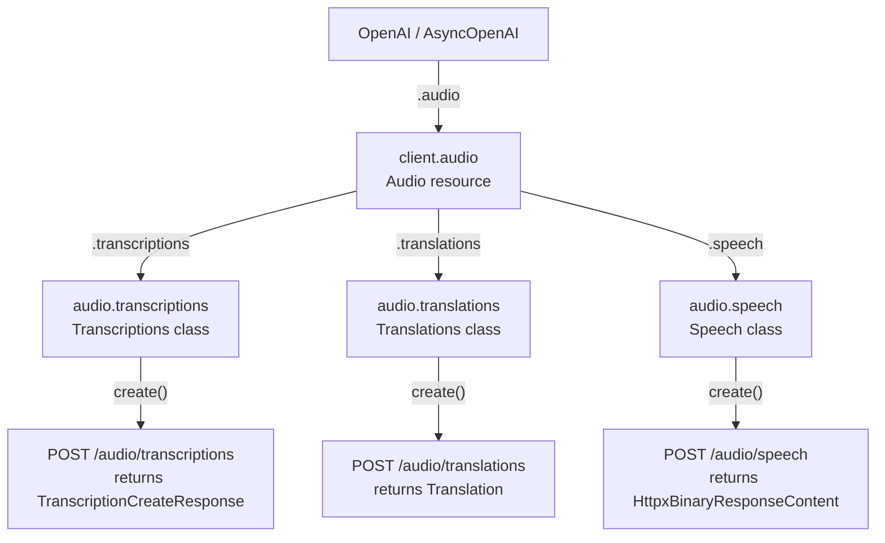
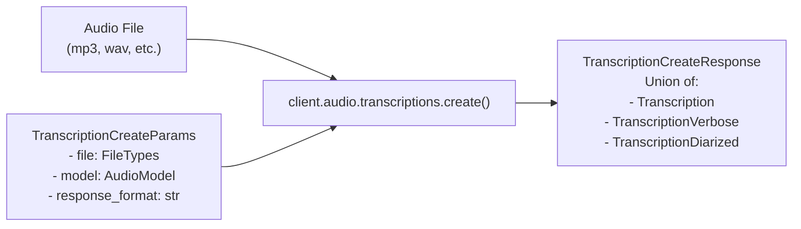
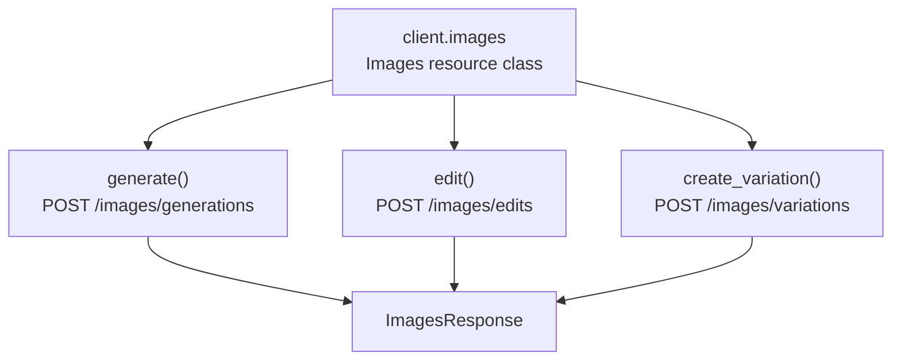
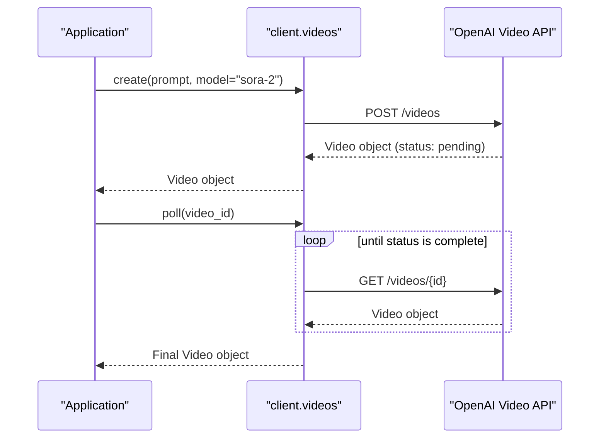
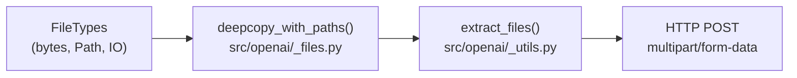

<!-- source: DeepWiki mcp.deepwiki.com · repo openai/openai-python · page 4.7 Audio, Images, and Video APIs · fetched 2026-10-26 -->

# Audio, Images, and Video APIs

Relevant source files

The following files were used as context for generating this wiki page:

- [examples/image_stream.py](examples/image_stream.py)
- [src/openai/lib/streaming/responses/_events.py](src/openai/lib/streaming/responses/_events.py)
- [src/openai/resources/audio/speech.py](src/openai/resources/audio/speech.py)
- [src/openai/resources/audio/transcriptions.py](src/openai/resources/audio/transcriptions.py)
- [src/openai/resources/audio/translations.py](src/openai/resources/audio/translations.py)
- [src/openai/resources/completions.py](src/openai/resources/completions.py)
- [src/openai/resources/containers/files/files.py](src/openai/resources/containers/files/files.py)
- [src/openai/resources/files.py](src/openai/resources/files.py)
- [src/openai/resources/images.py](src/openai/resources/images.py)
- [src/openai/resources/moderations.py](src/openai/resources/moderations.py)
- [src/openai/resources/skills/skills.py](src/openai/resources/skills/skills.py)
- [src/openai/resources/skills/versions/versions.py](src/openai/resources/skills/versions/versions.py)
- [src/openai/resources/uploads/parts.py](src/openai/resources/uploads/parts.py)
- [src/openai/resources/videos.py](src/openai/resources/videos.py)
- [src/openai/types/audio/speech_create_params.py](src/openai/types/audio/speech_create_params.py)
- [src/openai/types/audio/transcription_create_params.py](src/openai/types/audio/transcription_create_params.py)
- [src/openai/types/audio/translation_create_params.py](src/openai/types/audio/translation_create_params.py)
- [src/openai/types/beta/threads/run_submit_tool_outputs_params.py](src/openai/types/beta/threads/run_submit_tool_outputs_params.py)
- [src/openai/types/completion_create_params.py](src/openai/types/completion_create_params.py)
- [src/openai/types/image_edit_params.py](src/openai/types/image_edit_params.py)
- [src/openai/types/image_edit_partial_image_event.py](src/openai/types/image_edit_partial_image_event.py)
- [src/openai/types/image_edit_stream_event.py](src/openai/types/image_edit_stream_event.py)
- [src/openai/types/image_generate_params.py](src/openai/types/image_generate_params.py)
- [src/openai/types/responses/response_function_shell_tool_call_output.py](src/openai/types/responses/response_function_shell_tool_call_output.py)
- [src/openai/types/responses/tool.py](src/openai/types/responses/tool.py)
- [src/openai/types/responses/tool_param.py](src/openai/types/responses/tool_param.py)
- [src/openai/types/video_create_params.py](src/openai/types/video_create_params.py)
- [tests/api_resources/test_images.py](tests/api_resources/test_images.py)
- [tests/api_resources/test_videos.py](tests/api_resources/test_videos.py)

This page documents the OpenAI client library's support for non-text modalities: audio processing (transcriptions, translations, and speech synthesis), image generation and editing, and video generation. These APIs enable applications to work with multimedia content beyond text-based interactions.

For multi-modal inputs within conversational contexts (e.g., images in chat messages), see the Responses API documentation ([Responses API](#4.2)) and Chat Completions API documentation ([Chat Completions API](#4.1)). For file management infrastructure used by these APIs, see [File Management and Uploads](#4.6).

---

## Overview of Media API Resources

The client exposes three primary resource namespaces for media operations:

| Resource | Client Property | Purpose |
|----------|----------------|---------|
| Audio | `client.audio` | Transcribe/translate audio to text, synthesize speech from text |
| Images | `client.images` | Generate, edit, and create variations of images |
| Video | `client.videos` | Generate, edit, and remix video content |

Sources: [src/openai/resources/audio/transcriptions.py:45-46](), [src/openai/resources/images.py:28-29](), [src/openai/resources/videos.py:49-50]()

---

## Audio APIs

The `audio` resource provides sub-resources for audio processing. All audio APIs accept file inputs or text inputs and return structured responses or binary content.

### Audio Resource Structure

**Implementation:** [src/openai/resources/audio/transcriptions.py:45](), [src/openai/resources/audio/translations.py:30](), [src/openai/resources/audio/speech.py:28]()

### Audio Transcriptions

The transcriptions API converts audio files to text using Whisper or GPT-4o models. It supports multiple response formats and optional features like speaker diarization and word-level timestamps.

#### Basic Transcription

**Stream Event Types:**
The API supports streaming transcriptions via Server-Sent Events (SSE). [src/openai/resources/audio/transcriptions.py:129-136]()

| Event Type | Description |
|------------|-------------|
| `TranscriptionTextSegmentEvent` | Complete segment with timing |
| `TranscriptionTextDeltaEvent` | Incremental text updates |
| `TranscriptionTextDoneEvent` | Final completion event |

**Response Formats:**
The `response_format` parameter controls the returned structure:
- **`"json"`**: Returns `Transcription` with text. [src/openai/resources/audio/transcriptions.py:87]()
- **`"verbose_json"`**: Returns `TranscriptionVerbose` with segment timing. [src/openai/resources/audio/transcriptions.py:144]()
- **`"text"`, `"srt"`, `"vtt"`**: Returns raw strings. [src/openai/resources/audio/transcriptions.py:125]()

Sources: [src/openai/resources/audio/transcriptions.py:68-152](), [src/openai/types/audio/transcription_stream_event.py]()

### Audio Translations

The translations API converts audio in any supported language to English text. It uses the `whisper-1` model. [src/openai/resources/audio/translations.py:125]()

**Key Types:**
- `Translation`: Basic translated text. [src/openai/types/audio/translation.py]()
- `TranslationVerbose`: Detailed response with segment metadata. [src/openai/types/audio/translation_verbose.py]()

Sources: [src/openai/resources/audio/translations.py:103-165]()

### Audio Speech Synthesis (TTS)

The speech API converts text to spoken audio. It returns binary audio content.

**Key Parameters:**
- `model`: One of `tts-1`, `tts-1-hd`, `gpt-4o-mini-tts`. [src/openai/resources/audio/speech.py:77]()
- `voice`: Supported voices like `alloy`, `echo`, `nova`, `shimmer`. [src/openai/resources/audio/speech.py:79-81]()
- `response_format`: `mp3`, `opus`, `aac`, `flac`, `wav`, `pcm`. [src/openai/resources/audio/speech.py:89]()

**Return Type:** Returns `_legacy_response.HttpxBinaryResponseContent`, providing raw bytes. [src/openai/resources/audio/speech.py:128]()

Sources: [src/openai/resources/audio/speech.py:50-129]()

---

## Images API

The `images` resource provides operations for image generation, editing, and variations.

### Images Resource Operations

**Implementation:** [src/openai/resources/images.py:28]()

### Image Generation and Streaming

The `generate()` method creates images from text prompts. It supports standard generation and streaming for GPT image models. [src/openai/resources/images.py:209]()

**Streaming Support:**
GPT image models (`gpt-image-1.5`, etc.) support streaming partial image data. [src/openai/types/image_generate_params.py:145]()

| Event Type | Contains |
|------------|----------|
| `ImageGenPartialImageEvent` | Incremental base64 image data |
| `ImageGenCompletedEvent` | Final image with metadata |

Sources: [src/openai/resources/images.py:209-260](), [src/openai/types/image_generate_params.py:13-160](), [src/openai/types/image_gen_stream_event.py]()

### Image Editing and Variations

- **`edit()`**: Modifies an image based on a prompt. Requires a square PNG for `dall-e-2` or up to 16 images for GPT models. [src/openai/types/image_edit_params.py:15-24]()
- **`create_variation()`**: Creates a variation of a given image. Only supports `dall-e-2`. [src/openai/resources/images.py:68]()

Sources: [src/openai/resources/images.py:50-126](), [src/openai/types/image_edit_params.py:11-160]()

---

## Video APIs

The `videos` resource manages video generation jobs, supporting creation, editing, and remixing using models like `sora-2`.

### Video Operations Lifecycle

**Key Methods:**
- **`create()`**: Starts a generation job. [src/openai/resources/videos.py:69]()
- **`create_and_poll()`**: Convenience method to create and wait for completion. [src/openai/resources/videos.py:137]()
- **`edit()`**: Edits an existing video. [src/openai/resources/videos.py:237]()
- **`remix()`**: Creates a remix of a video. [src/openai/resources/videos.py:408]()
- **`extend()`**: Extends a video's duration. [src/openai/resources/videos.py:494]()

**Key Parameters:**
- `seconds`: Clip duration (4, 8, 12). [src/openai/resources/videos.py:95]()
- `size`: Resolution (e.g., `1280x720`, `1792x1024`). [src/openai/resources/videos.py:97]()

Sources: [src/openai/resources/videos.py:49-550](), [src/openai/types/video_create_params.py]()

---

## File Handling Patterns

Media APIs use `extract_files` and `deepcopy_with_paths` to handle binary uploads (multipart/form-data).

**Implementation Details:**
- **Multipart Headers**: The SDK explicitly sets `Content-Type: multipart/form-data` for file-bearing requests. [src/openai/resources/files.py:139](), [src/openai/resources/videos.py:122]()
- **File Extraction**: The `extract_files` utility separates binary content from JSON metadata for the HTTP client. [src/openai/_utils.py:135]()

Sources: [src/openai/resources/files.py:127-143](), [src/openai/resources/videos.py:108-123](), [src/openai/_utils.py:16]()

---

## Tool Integration (Multi-Modal)

The SDK's type system allows media generation to be integrated as tools in conversational contexts via the `ToolParam` and `Tool` definitions.

| Tool Type | Code Entity | Purpose |
|-----------|-------------|---------|
| Image Generation | `ImageGeneration` | Allows models to generate images as a tool call. |
| Computer Use | `ComputerTool` | Visual interaction with computer interfaces. |

Sources: [src/openai/types/responses/tool_param.py:39](), [src/openai/types/responses/tool.py:10-40]()

---

## Error Handling and Validation

Media APIs validate inputs before transmission using `maybe_transform`.

- **Audio Validation**: Checks for supported formats (flac, mp3, etc.). [src/openai/resources/audio/transcriptions.py:96-97]()
- **Image Validation**: Checks size limits (4MB for `dall-e-2`) and PNG requirements. [src/openai/types/image_edit_params.py:23-25]()
- **Video Validation**: Validates `VideoSize` and `VideoSeconds` against allowed literal values. [src/openai/resources/videos.py:92-98]()

Sources: [src/openai/resources/audio/transcriptions.py:142](), [src/openai/types/image_edit_params.py:14-138](), [src/openai/resources/videos.py:124]()

---

